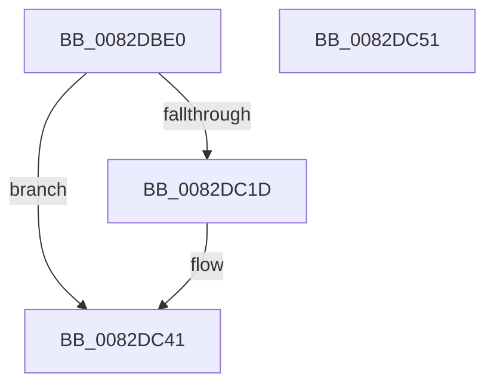

# CmRaiseDeleteEvent

- RVA: `0x0082DBE0`–`0x0082DC52` (길이 `114` bytes)
- VA: `0x000000014082DBE0`
- 실행 섹션: `PAGE`
- PDB 이름 있음: `예`; PDB Function 태그: `아니요`
- unwind 정보 RVA: `0x00086C28`
- 디코드: `30`개 명령, `114/114` bytes 표시
- 미해석 바이트: `0` (있으면 어셈블리에 `.byte`로 보존)

> 이 문서는 커널 이미지의 기계어와 PDB 기호를 분석해 생성했습니다. 4번과 5번은 함수 원형과 자료형을 바이너리 사용 방식에서 추정한 C 해석이며 원본 소스 복구 결과는 아닙니다.

## 1. Dependencies

- 직접 호출 지점: **3**; 고유 호출 대상: **3**
- 직접 호출자로 확인된 함수: **6**
- RIP 상대 이미지 참조: **0**

### Outgoing calls
- `0x0082DC01` → [_CmMapCmObjectTypeToPnpObjectType](../8F/_CmMapCmObjectTypeToPnpObjectType_function_008FF060.md) (function, `0x008FF060`)
- `0x0082DC0C` → [PnpObjectRaiseDeleteEvent](PnpObjectRaiseDeleteEvent_function_0082DCFC.md) (function, `0x0082DCFC`)
- `0x0082DC3C` → [guard_dispatch_icall](../../text/6B/guard_dispatch_icall_function_006BAAD0.md) (function, `0x006BAAD0`)

### Direct callers
- [CmDeleteDeviceInterfaceWorker](CmDeleteDeviceInterfaceWorker_function_0082A0B8.md) at `0x0082A2F3`
- [CmDeleteInstallerClassWorker](CmDeleteInstallerClassWorker_function_0082A490.md) at `0x0082A6A1`
- [CmDeleteInterfaceClassWorker](CmDeleteInterfaceClassWorker_function_0082A838.md) at `0x0082AA4F`
- [CmDeleteDeviceContainerWorker](CmDeleteDeviceContainerWorker_function_0082B37C.md) at `0x0082B507`
- [CmDeleteDevicePanelWorker](CmDeleteDevicePanelWorker_function_0082E7EC.md) at `0x0082E977`
- [_CmDeleteDeviceWorker](../A0/_CmDeleteDeviceWorker_function_00A08F48.md) at `0x00A0930E`

### Static image references
- 디코드된 RIP-relative 메모리 참조가 없습니다.

## 2. Other-region calls and transfers

- 다른 실행 섹션으로 향하는 call: **1**
  - `0x0082DC3C` → [guard_dispatch_icall](../../text/6B/guard_dispatch_icall_function_006BAAD0.md) (`PAGE` → `.text`)
- 별도 외부 분기/꼬리 이동을 확인하지 못했습니다.

## 3. Assembly (complete function range)

```asm
0082DBE0  48 89 5C 24 08                  mov qword ptr [rsp + 8], rbx
0082DBE5  48 89 74 24 10                  mov qword ptr [rsp + 0x10], rsi
0082DBEA  57                              push rdi
0082DBEB  48 83 EC 40                     sub rsp, 0x40
0082DBEF  48 83 64 24 38 00               and qword ptr [rsp + 0x38], 0
0082DBF5  48 8B D9                        mov rbx, rcx
0082DBF8  41 8B C8                        mov ecx, r8d
0082DBFB  41 8B F8                        mov edi, r8d
0082DBFE  48 8B F2                        mov rsi, rdx
0082DC01  E8 5A 14 0D 00                  call 0x1408ff060
0082DC06  44 8B C0                        mov r8d, eax
0082DC09  48 8B CB                        mov rcx, rbx
0082DC0C  E8 EB 00 00 00                  call 0x14082dcfc
0082DC11  48 8B 83 00 02 00 00            mov rax, qword ptr [rbx + 0x200]
0082DC18  48 85 C0                        test rax, rax
0082DC1B  74 24                           je 0x14082dc41
0082DC1D  48 83 64 24 30 00               and qword ptr [rsp + 0x30], 0
0082DC23  48 8D 4C 24 30                  lea rcx, [rsp + 0x30]
0082DC28  48 89 4C 24 20                  mov qword ptr [rsp + 0x20], rcx
0082DC2D  41 B9 03 00 00 00               mov r9d, 3
0082DC33  48 8B CB                        mov rcx, rbx
0082DC36  44 8B C7                        mov r8d, edi
0082DC39  48 8B D6                        mov rdx, rsi
0082DC3C  E8 8F CE E8 FF                  call 0x1406baad0
0082DC41  48 8B 5C 24 50                  mov rbx, qword ptr [rsp + 0x50]
0082DC46  48 8B 74 24 58                  mov rsi, qword ptr [rsp + 0x58]
0082DC4B  48 83 C4 40                     add rsp, 0x40
0082DC4F  5F                              pop rdi
0082DC50  C3                              ret
0082DC51  CC                              int3
```

## 4. C-style interpretation (structured pseudocode)

```c
__int64 __fastcall CmRaiseDeleteEvent(__int64 a1, __int64 a2, int a3)
{
    __int64 result;
    __int64 v_rsp;
    unsigned __int64 v_stack_m10;
    unsigned __int64 v_stack_m18;
    unsigned __int64 v_stack_m28;
    unsigned __int64 v_stack_p10;
    unsigned __int64 v_stack_p8;

    v_stack_p8 = v_rbx;
    v_stack_p10 = v_rsi;
    v_rsp = (v_rsp) - (64);
    result = _CmMapCmObjectTypeToPnpObjectType((unsigned int)(a3), a2, a3, a4);
    result = PnpObjectRaiseDeleteEvent(a1, a2, (unsigned int)((unsigned int)(result)), a4);
    result = *(unsigned __int64 *)(a1 + 512);
    if (*(unsigned __int64 *)(a1 + 512) != 0) {
        a1 = v_stack_m18;
        v_stack_m28 = a1;
        a4 = 3;
        a1 = a1;
        a3 = (unsigned int)((unsigned int)(a3));
        a2 = a2;
        result = guard_dispatch_icall(a1, a2, a3, a4);
    }
    v_rsp = (v_rsp) + (64);
    return result;
}
```

## 5. (Beta) C Style

```c
int64_t CmRaiseDeleteEvent(void *Arg1, int64_t Arg2, int32_t Arg3)
{
    uint8_t *arg1 = (uint8_t *)Arg1;

    int64_t result;
    int64_t local_rsp;
    uint64_t v_stack_m10;
    uint64_t v_stack_m18;
    uint64_t v_stack_m28;
    uint64_t v_stack_p10;
    uint64_t v_stack_p8;

    v_stack_p8 = local_rbx;
    v_stack_p10 = local_rsi;
    local_rsp = (local_rsp) - (64);
    result = _CmMapCmObjectTypeToPnpObjectType((uint32_t)(Arg3), Arg2, Arg3, a4);
    result = PnpObjectRaiseDeleteEvent(Arg1, Arg2, (uint32_t)((uint32_t)(result)), a4);
    result = *(uint64_t *)(arg1 + 0x200);
    if (*(uint64_t *)(arg1 + 0x200) != 0) {
        Arg1 = v_stack_m18;
        v_stack_m28 = Arg1;
        a4 = 3;
        Arg1 = Arg1;
        Arg3 = (uint32_t)((uint32_t)(Arg3));
        Arg2 = Arg2;
        result = guard_dispatch_icall(Arg1, Arg2, Arg3, a4);
    }
    local_rsp = (local_rsp) + (64);
    return result;
}
```

### 관측된 메모리 오프셋

구조체 형식이 확인되지 않은 접근은 인자 기준의 오프셋으로만 기록했습니다.

| 기준 인자 | 오프셋 표현 | 폭 (bit) | 접근 |
|---|---:|---:|---|
| `Arg1` | `+ 0x200` | `64` | `R` |

## 6. Execution-region graph

[열기: 2D/3D 그래프와 함수 탐색 컨트롤 패널](../../../control-panel.html?section=page&rva=0x0082DBE0&view=graph)

- 2D 그래프는 위에서 아래로 흐르고, 3D 그래프는 빈 공간을 드래그해 회전합니다. Shift+드래그는 이동, 휠은 확대·축소, 함수 노드 선택은 대상 보고서 이동입니다.

### Static fallback


