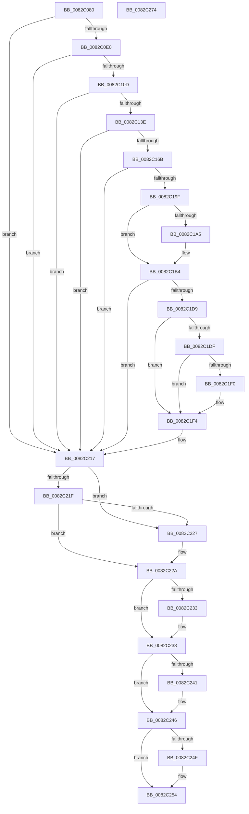

# CmRemoveDeviceFromContainerWorker

- RVA: `0x0082C080`–`0x0082C275` (길이 `501` bytes)
- VA: `0x000000014082C080`
- 실행 섹션: `PAGE`
- PDB 이름 있음: `예`; PDB Function 태그: `아니요`
- unwind 정보 RVA: `0x000AD928`
- 디코드: `138`개 명령, `501/501` bytes 표시
- 미해석 바이트: `0` (있으면 어셈블리에 `.byte`로 보존)

> 이 문서는 커널 이미지의 기계어와 PDB 기호를 분석해 생성했습니다. 4번과 5번은 함수 원형과 자료형을 바이너리 사용 방식에서 추정한 C 해석이며 원본 소스 복구 결과는 아닙니다.

## 1. Dependencies

- 직접 호출 지점: **13**; 고유 호출 대상: **8**
- 직접 호출자로 확인된 함수: **1**
- RIP 상대 이미지 참조: **2**

### Outgoing calls
- `0x0082C0D1` → [_PnpCtxGetCachedContextBaseKey](../8E/_PnpCtxGetCachedContextBaseKey_function_008EFB2C.md) (function, `0x008EFB2C`)
- `0x0082C0FE` → [PnpCtxRegOpenKey](../8E/PnpCtxRegOpenKey_function_008EF7B8.md) (function, `0x008EF7B8`)
- `0x0082C12F` → [PnpCtxRegOpenKey](../8E/PnpCtxRegOpenKey_function_008EF7B8.md) (function, `0x008EF7B8`)
- `0x0082C15C` → [PnpCtxRegOpenKey](../8E/PnpCtxRegOpenKey_function_008EF7B8.md) (function, `0x008EF7B8`)
- `0x0082C172` → [PnpCtxRegDeleteValue](../8F/PnpCtxRegDeleteValue_function_008FE5E0.md) (function, `0x008FE5E0`)
- `0x0082C194` → [PnpCtxRegQueryInfoKey](../99/PnpCtxRegQueryInfoKey_function_009945FC.md) (function, `0x009945FC`)
- `0x0082C1AF` → [PnpCtxRegDeleteTree](../96/PnpCtxRegDeleteTree_function_00965CC8.md) (function, `0x00965CC8`)
- `0x0082C1CE` → [PnpCtxRegQueryInfoKey](../99/PnpCtxRegQueryInfoKey_function_009945FC.md) (function, `0x009945FC`)
- `0x0082C1E5` → [CmDeleteDeviceContainer](CmDeleteDeviceContainer_function_0082AEF4.md) (function, `0x0082AEF4`)
- `0x0082C212` → [PnpObjectRaisePropertyChangeEvent](../8F/PnpObjectRaisePropertyChangeEvent_function_008F7E94.md) (function, `0x008F7E94`)
- `0x0082C233` → [ZwClose](../../text/6A/ZwClose_function_006AD2B0.md) (function, `0x006AD2B0`)
- `0x0082C241` → [ZwClose](../../text/6A/ZwClose_function_006AD2B0.md) (function, `0x006AD2B0`)
- `0x0082C24F` → [ZwClose](../../text/6A/ZwClose_function_006AD2B0.md) (function, `0x006AD2B0`)

### Direct callers
- [CmRemoveDeviceFromContainer](CmRemoveDeviceFromContainer_function_0082BF40.md) at `0x0082BFE4`

### Static image references
- `0x0082C11A` → RVA `0x00B0D7D0` (` ?? ::NNGAKEGL::`string'`; read)
- `0x0082C1F7` → RVA `0x00011568` (`.rdata`; read)

## 2. Other-region calls and transfers

- 다른 실행 섹션으로 향하는 call: **3**
  - `0x0082C233` → [ZwClose](../../text/6A/ZwClose_function_006AD2B0.md) (`PAGE` → `.text`)
  - `0x0082C241` → [ZwClose](../../text/6A/ZwClose_function_006AD2B0.md) (`PAGE` → `.text`)
  - `0x0082C24F` → [ZwClose](../../text/6A/ZwClose_function_006AD2B0.md) (`PAGE` → `.text`)
- 별도 외부 분기/꼬리 이동을 확인하지 못했습니다.

## 3. Assembly (complete function range)

```asm
0082C080  48 89 5C 24 08                  mov qword ptr [rsp + 8], rbx
0082C085  48 89 74 24 10                  mov qword ptr [rsp + 0x10], rsi
0082C08A  48 89 7C 24 18                  mov qword ptr [rsp + 0x18], rdi
0082C08F  55                              push rbp
0082C090  41 54                           push r12
0082C092  41 55                           push r13
0082C094  41 56                           push r14
0082C096  41 57                           push r15
0082C098  48 8B EC                        mov rbp, rsp
0082C09B  48 83 EC 70                     sub rsp, 0x70
0082C09F  4C 8B 75 50                     mov r14, qword ptr [rbp + 0x50]
0082C0A3  45 33 ED                        xor r13d, r13d
0082C0A6  4D 8B E0                        mov r12, r8
0082C0A9  4C 89 6D F0                     mov qword ptr [rbp - 0x10], r13
0082C0AD  48 8B F2                        mov rsi, rdx
0082C0B0  4C 89 6D E8                     mov qword ptr [rbp - 0x18], r13
0082C0B4  4C 8D 45 F0                     lea r8, [rbp - 0x10]
0082C0B8  4C 89 6D E0                     mov qword ptr [rbp - 0x20], r13
0082C0BC  41 8D 55 0A                     lea edx, [r13 + 0xa]
0082C0C0  4C 89 6D D8                     mov qword ptr [rbp - 0x28], r13
0082C0C4  4D 8B F9                        mov r15, r9
0082C0C7  44 89 6D D0                     mov dword ptr [rbp - 0x30], r13d
0082C0CB  48 8B F9                        mov rdi, rcx
0082C0CE  45 88 2E                        mov byte ptr [r14], r13b
0082C0D1  E8 56 3A 0C 00                  call 0x1408efb2c
0082C0D6  8B D8                           mov ebx, eax
0082C0D8  85 C0                           test eax, eax
0082C0DA  0F 88 37 01 00 00               js 0x14082c217
0082C0E0  48 8B 55 F0                     mov rdx, qword ptr [rbp - 0x10]
0082C0E4  48 8D 45 E8                     lea rax, [rbp - 0x18]
0082C0E8  48 89 44 24 28                  mov qword ptr [rsp + 0x28], rax
0082C0ED  45 33 C9                        xor r9d, r9d
0082C0F0  4C 8B C6                        mov r8, rsi
0082C0F3  C7 44 24 20 01 00 00 00         mov dword ptr [rsp + 0x20], 1
0082C0FB  48 8B CF                        mov rcx, rdi
0082C0FE  E8 B5 36 0C 00                  call 0x1408ef7b8
0082C103  8B D8                           mov ebx, eax
0082C105  85 C0                           test eax, eax
0082C107  0F 88 0A 01 00 00               js 0x14082c217
0082C10D  48 8B 55 E8                     mov rdx, qword ptr [rbp - 0x18]
0082C111  48 8D 45 E0                     lea rax, [rbp - 0x20]
0082C115  48 89 44 24 28                  mov qword ptr [rsp + 0x28], rax
0082C11A  4C 8D 05 AF 16 2E 00            lea r8, [rip + 0x2e16af]
0082C121  45 33 C9                        xor r9d, r9d
0082C124  C7 44 24 20 01 00 00 00         mov dword ptr [rsp + 0x20], 1
0082C12C  48 8B CF                        mov rcx, rdi
0082C12F  E8 84 36 0C 00                  call 0x1408ef7b8
0082C134  8B D8                           mov ebx, eax
0082C136  85 C0                           test eax, eax
0082C138  0F 88 D9 00 00 00               js 0x14082c217
0082C13E  48 8B 55 E0                     mov rdx, qword ptr [rbp - 0x20]
0082C142  48 8D 45 D8                     lea rax, [rbp - 0x28]
0082C146  48 89 44 24 28                  mov qword ptr [rsp + 0x28], rax
0082C14B  45 33 C9                        xor r9d, r9d
0082C14E  4D 8B C4                        mov r8, r12
0082C151  C7 44 24 20 03 00 00 00         mov dword ptr [rsp + 0x20], 3
0082C159  48 8B CF                        mov rcx, rdi
0082C15C  E8 57 36 0C 00                  call 0x1408ef7b8
0082C161  8B D8                           mov ebx, eax
0082C163  85 C0                           test eax, eax
0082C165  0F 88 AC 00 00 00               js 0x14082c217
0082C16B  48 8B 55 D8                     mov rdx, qword ptr [rbp - 0x28]
0082C16F  4D 8B C7                        mov r8, r15
0082C172  E8 69 24 0D 00                  call 0x1408fe5e0
0082C177  48 8B 55 D8                     mov rdx, qword ptr [rbp - 0x28]
0082C17B  48 8D 45 D0                     lea rax, [rbp - 0x30]
0082C17F  4C 89 6C 24 30                  mov qword ptr [rsp + 0x30], r13
0082C184  45 33 C9                        xor r9d, r9d
0082C187  4C 89 6C 24 28                  mov qword ptr [rsp + 0x28], r13
0082C18C  45 33 C0                        xor r8d, r8d
0082C18F  48 89 44 24 20                  mov qword ptr [rsp + 0x20], rax
0082C194  E8 63 84 16 00                  call 0x1409945fc
0082C199  8B D8                           mov ebx, eax
0082C19B  85 C0                           test eax, eax
0082C19D  78 78                           js 0x14082c217
0082C19F  44 39 6D D0                     cmp dword ptr [rbp - 0x30], r13d
0082C1A3  75 0F                           jne 0x14082c1b4
0082C1A5  48 8B 55 D8                     mov rdx, qword ptr [rbp - 0x28]
0082C1A9  45 33 C0                        xor r8d, r8d
0082C1AC  48 8B CF                        mov rcx, rdi
0082C1AF  E8 14 9B 13 00                  call 0x140965cc8
0082C1B4  48 8B 55 E0                     mov rdx, qword ptr [rbp - 0x20]
0082C1B8  4C 8D 45 D0                     lea r8, [rbp - 0x30]
0082C1BC  4C 89 6C 24 30                  mov qword ptr [rsp + 0x30], r13
0082C1C1  45 33 C9                        xor r9d, r9d
0082C1C4  4C 89 6C 24 28                  mov qword ptr [rsp + 0x28], r13
0082C1C9  4C 89 6C 24 20                  mov qword ptr [rsp + 0x20], r13
0082C1CE  E8 29 84 16 00                  call 0x1409945fc
0082C1D3  8B D8                           mov ebx, eax
0082C1D5  85 C0                           test eax, eax
0082C1D7  78 3E                           js 0x14082c217
0082C1D9  44 39 6D D0                     cmp dword ptr [rbp - 0x30], r13d
0082C1DD  75 15                           jne 0x14082c1f4
0082C1DF  48 8B D6                        mov rdx, rsi
0082C1E2  48 8B CF                        mov rcx, rdi
0082C1E5  E8 0A ED FF FF                  call 0x14082aef4
0082C1EA  8B D8                           mov ebx, eax
0082C1EC  85 C0                           test eax, eax
0082C1EE  78 04                           js 0x14082c1f4
0082C1F0  41 C6 06 01                     mov byte ptr [r14], 1
0082C1F4  45 33 C9                        xor r9d, r9d
0082C1F7  48 8D 05 6A 53 7E FF            lea rax, [rip - 0x81ac96]
0082C1FE  48 89 44 24 28                  mov qword ptr [rsp + 0x28], rax
0082C203  49 8B D7                        mov rdx, r15
0082C206  48 8B CF                        mov rcx, rdi
0082C209  4C 89 6C 24 20                  mov qword ptr [rsp + 0x20], r13
0082C20E  45 8D 41 01                     lea r8d, [r9 + 1]
0082C212  E8 7D BC 0C 00                  call 0x1408f7e94
0082C217  81 FB 34 00 00 C0               cmp ebx, 0xc0000034
0082C21D  74 08                           je 0x14082c227
0082C21F  81 FB 7C 01 00 C0               cmp ebx, 0xc000017c
0082C225  75 03                           jne 0x14082c22a
0082C227  41 8B DD                        mov ebx, r13d
0082C22A  48 8B 4D D8                     mov rcx, qword ptr [rbp - 0x28]
0082C22E  48 85 C9                        test rcx, rcx
0082C231  74 05                           je 0x14082c238
0082C233  E8 78 10 E8 FF                  call 0x1406ad2b0
0082C238  48 8B 4D E0                     mov rcx, qword ptr [rbp - 0x20]
0082C23C  48 85 C9                        test rcx, rcx
0082C23F  74 05                           je 0x14082c246
0082C241  E8 6A 10 E8 FF                  call 0x1406ad2b0
0082C246  48 8B 4D E8                     mov rcx, qword ptr [rbp - 0x18]
0082C24A  48 85 C9                        test rcx, rcx
0082C24D  74 05                           je 0x14082c254
0082C24F  E8 5C 10 E8 FF                  call 0x1406ad2b0
0082C254  4C 8D 5C 24 70                  lea r11, [rsp + 0x70]
0082C259  8B C3                           mov eax, ebx
0082C25B  49 8B 5B 30                     mov rbx, qword ptr [r11 + 0x30]
0082C25F  49 8B 73 38                     mov rsi, qword ptr [r11 + 0x38]
0082C263  49 8B 7B 40                     mov rdi, qword ptr [r11 + 0x40]
0082C267  49 8B E3                        mov rsp, r11
0082C26A  41 5F                           pop r15
0082C26C  41 5E                           pop r14
0082C26E  41 5D                           pop r13
0082C270  41 5C                           pop r12
0082C272  5D                              pop rbp
0082C273  C3                              ret
0082C274  CC                              int3
```

## 4. C-style interpretation (structured pseudocode)

```c
__int64 __fastcall CmRemoveDeviceFromContainerWorker(__int64 a1, __int64 a2, __int64 a3, __int64 a4, __int64 a5)
{
    __int64 result;
    __int64 v_r13;
    __int64 v_rbx;
    __int64 v_rsp;
    unsigned __int64 v_stack_m28;
    unsigned __int64 v_stack_m38;
    unsigned __int64 v_stack_m40;
    unsigned __int64 v_stack_m48;
    unsigned __int64 v_stack_m50;
    unsigned int v_stack_m58;
    unsigned __int64 v_stack_m68;
    unsigned __int64 v_stack_m70;
    unsigned int v_stack_m78;
    unsigned __int64 v_stack_p10;
    unsigned __int64 v_stack_p18;
    unsigned __int64 v_stack_p8;

    v_stack_p8 = v_rbx;
    v_stack_p10 = v_rsi;
    v_stack_p18 = v_rdi;
    v_rsp = (v_rsp) - (112);
    v_r13 = 0;
    v_stack_m38 = 0;
    v_stack_m40 = 0;
    v_stack_m48 = 0;
    v_stack_m50 = 0;
    v_stack_m58 = 0;
    *(unsigned __int8 *)(a5) = 0;
    result = _PnpCtxGetCachedContextBaseKey(a1, v_r13 + 10, v_stack_m38, a4);
    if (sign_flag) goto loc_0082C217;
    v_stack_m70 = v_stack_m40;
    a4 = 0;
    v_stack_m78 = 1;
    result = PnpCtxRegOpenKey(a1, v_stack_m38, a2, a4);
    if (sign_flag) goto loc_0082C217;
    v_stack_m70 = v_stack_m48;
    a4 = 0;
    v_stack_m78 = 1;
    result = PnpCtxRegOpenKey(a1, v_stack_m40, v_rip + 3020463, a4);
    if (sign_flag) goto loc_0082C217;
    v_stack_m70 = v_stack_m50;
    a4 = 0;
    v_stack_m78 = 3;
    result = PnpCtxRegOpenKey(a1, v_stack_m48, a3, a4);
    if (sign_flag) goto loc_0082C217;
    result = PnpCtxRegDeleteValue(a1, v_stack_m50, 0, a4);
    v_stack_m68 = 0;
    a4 = 0;
    v_stack_m70 = 0;
    a3 = 0;
    v_stack_m78 = v_stack_m58;
    result = PnpCtxRegQueryInfoKey(a1, v_stack_m50, a3, a4);
    if (sign_flag) goto loc_0082C217;
    if (v_stack_m58 == 0) {
        a2 = v_stack_m50;
        a3 = 0;
        a1 = a1;
        result = PnpCtxRegDeleteTree(a1, a2, a3, a4);
    }
    v_stack_m68 = 0;
    a4 = 0;
    v_stack_m70 = 0;
    v_stack_m78 = 0;
    result = PnpCtxRegQueryInfoKey(a1, v_stack_m48, v_stack_m58, a4);
    if (sign_flag) goto loc_0082C217;
    if (v_stack_m58 != 0) goto loc_0082C1F4;
    result = CmDeleteDeviceContainer(a1, a2, v_stack_m58, a4);
    if (!(sign_flag)) {
        *(unsigned __int8 *)(a5) = 1;
    }
    a4 = 0;
    v_stack_m70 = v_rip - 8498326;
    v_stack_m78 = 0;
    result = PnpObjectRaisePropertyChangeEvent(a1, 0, a4 + 1, a4);
loc_0082C217:
    if (((unsigned int)((unsigned int)((unsigned int)(result)))) == 0xC0000034ULL) goto loc_0082C227;
    v_rbx = (unsigned int)((unsigned int)(result));
    if (((unsigned int)((unsigned int)((unsigned int)(result)))) == 0xC000017CULL) {
        v_rbx = 0;
    }
    if (v_stack_m50 != 0) {
        result = ZwClose(v_stack_m50, 0, a4 + 1, a4);
    }
    if (v_stack_m48 != 0) {
        result = ZwClose(v_stack_m48, 0, a4 + 1, a4);
    }
    if (v_stack_m40 != 0) {
        result = ZwClose(v_stack_m40, 0, a4 + 1, a4);
    }
    return (unsigned int)((unsigned int)(v_rbx));
}
```

## 5. (Beta) C Style

```c
int64_t CmRemoveDeviceFromContainerWorker(int64_t Arg1, int64_t Arg2, int64_t Arg3, int64_t Arg4, void *Arg5)
{
    uint8_t *arg5 = (uint8_t *)Arg5;

    int64_t result;
    int64_t local_r13;
    int64_t local_rbx;
    int64_t local_rsp;
    uint64_t v_stack_m28;
    uint64_t v_stack_m38;
    uint64_t v_stack_m40;
    uint64_t v_stack_m48;
    uint64_t v_stack_m50;
    uint32_t v_stack_m58;
    uint64_t v_stack_m68;
    uint64_t v_stack_m70;
    uint32_t v_stack_m78;
    uint64_t v_stack_p10;
    uint64_t v_stack_p18;
    uint64_t v_stack_p8;

    v_stack_p8 = local_rbx;
    v_stack_p10 = local_rsi;
    v_stack_p18 = local_rdi;
    local_rsp = (local_rsp) - (112);
    local_r13 = 0;
    v_stack_m38 = 0;
    v_stack_m40 = 0;
    v_stack_m48 = 0;
    v_stack_m50 = 0;
    v_stack_m58 = 0;
    *(uint8_t *)(arg5) = 0;
    result = _PnpCtxGetCachedContextBaseKey(Arg1, local_r13 + 10, v_stack_m38, Arg4);
    if (sign_flag) goto loc_0082C217;
    v_stack_m70 = v_stack_m40;
    Arg4 = 0;
    v_stack_m78 = 1;
    result = PnpCtxRegOpenKey(Arg1, v_stack_m38, Arg2, Arg4);
    if (sign_flag) goto loc_0082C217;
    v_stack_m70 = v_stack_m48;
    Arg4 = 0;
    v_stack_m78 = 1;
    result = PnpCtxRegOpenKey(Arg1, v_stack_m40, v_rip + 3020463, Arg4);
    if (sign_flag) goto loc_0082C217;
    v_stack_m70 = v_stack_m50;
    Arg4 = 0;
    v_stack_m78 = 3;
    result = PnpCtxRegOpenKey(Arg1, v_stack_m48, Arg3, Arg4);
    if (sign_flag) goto loc_0082C217;
    result = PnpCtxRegDeleteValue(Arg1, v_stack_m50, 0, Arg4);
    v_stack_m68 = 0;
    Arg4 = 0;
    v_stack_m70 = 0;
    Arg3 = 0;
    v_stack_m78 = v_stack_m58;
    result = PnpCtxRegQueryInfoKey(Arg1, v_stack_m50, Arg3, Arg4);
    if (sign_flag) goto loc_0082C217;
    if (v_stack_m58 == 0) {
        Arg2 = v_stack_m50;
        Arg3 = 0;
        Arg1 = Arg1;
        result = PnpCtxRegDeleteTree(Arg1, Arg2, Arg3, Arg4);
    }
    v_stack_m68 = 0;
    Arg4 = 0;
    v_stack_m70 = 0;
    v_stack_m78 = 0;
    result = PnpCtxRegQueryInfoKey(Arg1, v_stack_m48, v_stack_m58, Arg4);
    if (sign_flag) goto loc_0082C217;
    if (v_stack_m58 != 0) goto loc_0082C1F4;
    result = CmDeleteDeviceContainer(Arg1, Arg2, v_stack_m58, Arg4);
    if (!(sign_flag)) {
        *(uint8_t *)(arg5) = 1;
    }
    Arg4 = 0;
    v_stack_m70 = v_rip - 8498326;
    v_stack_m78 = 0;
    result = PnpObjectRaisePropertyChangeEvent(Arg1, 0, Arg4 + 1, Arg4);
loc_0082C217:
    if (((uint32_t)((uint32_t)((uint32_t)(result)))) == 0xC0000034ULL) goto loc_0082C227;
    local_rbx = (uint32_t)((uint32_t)(result));
    if (((uint32_t)((uint32_t)((uint32_t)(result)))) == 0xC000017CULL) {
        local_rbx = 0;
    }
    if (v_stack_m50 != 0) {
        result = ZwClose(v_stack_m50, 0, Arg4 + 1, Arg4);
    }
    if (v_stack_m48 != 0) {
        result = ZwClose(v_stack_m48, 0, Arg4 + 1, Arg4);
    }
    if (v_stack_m40 != 0) {
        result = ZwClose(v_stack_m40, 0, Arg4 + 1, Arg4);
    }
    return (uint32_t)((uint32_t)(local_rbx));
}
```

### 관측된 메모리 오프셋

구조체 형식이 확인되지 않은 접근은 인자 기준의 오프셋으로만 기록했습니다.

| 기준 인자 | 오프셋 표현 | 폭 (bit) | 접근 |
|---|---:|---:|---|
| `Arg5` | `+ 0x0` | `8` | `W` |

## 6. Execution-region graph

[열기: 2D/3D 그래프와 함수 탐색 컨트롤 패널](../../../control-panel.html?section=page&rva=0x0082C080&view=graph)

- 2D 그래프는 위에서 아래로 흐르고, 3D 그래프는 빈 공간을 드래그해 회전합니다. Shift+드래그는 이동, 휠은 확대·축소, 함수 노드 선택은 대상 보고서 이동입니다.

### Static fallback


