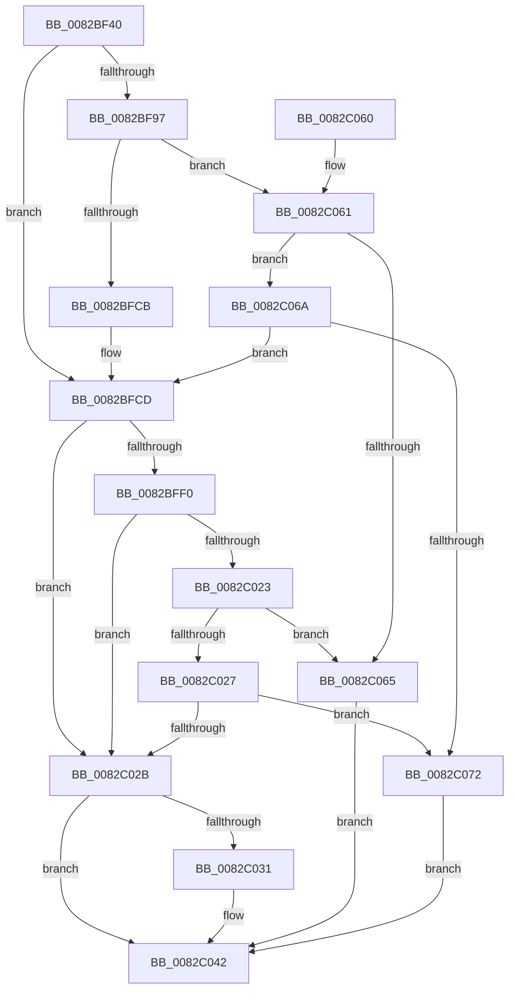

# CmRemoveDeviceFromContainer

- RVA: `0x0082BF40`–`0x0082C079` (길이 `313` bytes)
- VA: `0x000000014082BF40`
- 실행 섹션: `PAGE`
- PDB 이름 있음: `예`; PDB Function 태그: `아니요`
- unwind 정보 RVA: `0x000DA924`
- 디코드: `90`개 명령, `313/313` bytes 표시
- 미해석 바이트: `0` (있으면 어셈블리에 `.byte`로 보존)

> 이 문서는 커널 이미지의 기계어와 PDB 기호를 분석해 생성했습니다. 4번과 5번은 함수 원형과 자료형을 바이너리 사용 방식에서 추정한 C 해석이며 원본 소스 복구 결과는 아닙니다.

## 1. Dependencies

- 직접 호출 지점: **6**; 고유 호출 대상: **5**
- 직접 호출자로 확인된 함수: **4**
- RIP 상대 이미지 참조: **1**

### Outgoing calls
- `0x0082BF79` → [memset](../../text/6C/memset_function_006C6C40.md) (function, `0x006C6C40`)
- `0x0082BFBB` → [guard_dispatch_icall](../../text/6B/guard_dispatch_icall_function_006BAAD0.md) (function, `0x006BAAD0`)
- `0x0082BFE4` → [CmRemoveDeviceFromContainerWorker](CmRemoveDeviceFromContainerWorker_function_0082C080.md) (function, `0x0082C080`)
- `0x0082C017` → [guard_dispatch_icall](../../text/6B/guard_dispatch_icall_function_006BAAD0.md) (function, `0x006BAAD0`)
- `0x0082C03D` → [PnpObjectRaiseDevicesChangeEvent](../AC/PnpObjectRaiseDevicesChangeEvent_function_00AC9888.md) (function, `0x00AC9888`)
- `0x0082C04B` → [_security_check_cookie](../../text/6A/_security_check_cookie_function_006AC640.md) (function, `0x006AC640`)

### Direct callers
- [PiDcResetChildDeviceContainers](../73/PiDcResetChildDeviceContainers_function_00731030.md) at `0x00731132`
- [CmMoveBaseContainer](CmMoveBaseContainer_function_0082BE5C.md) at `0x0082BEC5`
- [PiDcUpdateDeviceContainerMembership](../8F/PiDcUpdateDeviceContainerMembership_function_008FD0A8.md) at `0x008FD282`
- [_CmDeleteDeviceWorker](../A0/_CmDeleteDeviceWorker_function_00A08F48.md) at `0x00A0934A`

### Static image references
- `0x0082BF55` → RVA `0x00E0A740` (`.data`; read)

## 2. Other-region calls and transfers

- 다른 실행 섹션으로 향하는 call: **4**
  - `0x0082BF79` → [memset](../../text/6C/memset_function_006C6C40.md) (`PAGE` → `.text`)
  - `0x0082BFBB` → [guard_dispatch_icall](../../text/6B/guard_dispatch_icall_function_006BAAD0.md) (`PAGE` → `.text`)
  - `0x0082C017` → [guard_dispatch_icall](../../text/6B/guard_dispatch_icall_function_006BAAD0.md) (`PAGE` → `.text`)
  - `0x0082C04B` → [_security_check_cookie](../../text/6A/_security_check_cookie_function_006AC640.md) (`PAGE` → `.text`)
- 별도 외부 분기/꼬리 이동을 확인하지 못했습니다.

## 3. Assembly (complete function range)

```asm
0082BF40  40 55                           push rbp
0082BF42  53                              push rbx
0082BF43  56                              push rsi
0082BF44  57                              push rdi
0082BF45  41 56                           push r14
0082BF47  41 57                           push r15
0082BF49  48 8D 6C 24 D9                  lea rbp, [rsp - 0x27]
0082BF4E  48 81 EC B8 00 00 00            sub rsp, 0xb8
0082BF55  48 8B 05 E4 E7 5D 00            mov rax, qword ptr [rip + 0x5de7e4]
0082BF5C  48 33 C4                        xor rax, rsp
0082BF5F  48 89 45 0F                     mov qword ptr [rbp + 0xf], rax
0082BF63  4C 8B FA                        mov r15, rdx
0082BF66  49 8B D8                        mov rbx, r8
0082BF69  33 D2                           xor edx, edx
0082BF6B  4C 8B F1                        mov r14, rcx
0082BF6E  48 8D 4D AF                     lea rcx, [rbp - 0x51]
0082BF72  49 8B F9                        mov rdi, r9
0082BF75  44 8D 42 58                     lea r8d, [rdx + 0x58]
0082BF79  E8 C2 AC E9 FF                  call 0x1406c6c40
0082BF7E  49 8B B6 F8 01 00 00            mov rsi, qword ptr [r14 + 0x1f8]
0082BF85  48 89 7D C7                     mov qword ptr [rbp - 0x39], rdi
0082BF89  BF 20 01 00 C0                  mov edi, 0xc0000120
0082BF8E  48 89 5D BF                     mov qword ptr [rbp - 0x41], rbx
0082BF92  48 85 F6                        test rsi, rsi
0082BF95  74 36                           je 0x14082bfcd
0082BF97  41 B9 0E 00 00 00               mov r9d, 0xe
0082BF9D  48 8D 45 AF                     lea rax, [rbp - 0x51]
0082BFA1  48 89 44 24 28                  mov qword ptr [rsp + 0x28], rax
0082BFA6  49 8B D7                        mov rdx, r15
0082BFA9  49 8B CE                        mov rcx, r14
0082BFAC  C7 44 24 20 01 00 00 00         mov dword ptr [rsp + 0x20], 1
0082BFB4  48 8B C6                        mov rax, rsi
0082BFB7  45 8D 41 F7                     lea r8d, [r9 - 9]
0082BFBB  E8 10 EB E8 FF                  call 0x1406baad0
0082BFC0  3D 02 00 00 C0                  cmp eax, 0xc0000002
0082BFC5  0F 85 96 00 00 00               jne 0x14082c061
0082BFCB  33 F6                           xor esi, esi
0082BFCD  4C 8B 4D C7                     mov r9, qword ptr [rbp - 0x39]
0082BFD1  48 8D 45 CF                     lea rax, [rbp - 0x31]
0082BFD5  4C 8B 45 BF                     mov r8, qword ptr [rbp - 0x41]
0082BFD9  49 8B D7                        mov rdx, r15
0082BFDC  49 8B CE                        mov rcx, r14
0082BFDF  48 89 44 24 20                  mov qword ptr [rsp + 0x20], rax
0082BFE4  E8 97 00 00 00                  call 0x14082c080
0082BFE9  8B D8                           mov ebx, eax
0082BFEB  48 85 F6                        test rsi, rsi
0082BFEE  74 3B                           je 0x14082c02b
0082BFF0  89 45 AF                        mov dword ptr [rbp - 0x51], eax
0082BFF3  41 B9 0E 00 00 00               mov r9d, 0xe
0082BFF9  48 8D 45 AF                     lea rax, [rbp - 0x51]
0082BFFD  49 8B D7                        mov rdx, r15
0082C000  48 89 44 24 28                  mov qword ptr [rsp + 0x28], rax
0082C005  49 8B CE                        mov rcx, r14
0082C008  48 8B C6                        mov rax, rsi
0082C00B  C7 44 24 20 02 00 00 00         mov dword ptr [rsp + 0x20], 2
0082C013  45 8D 41 F7                     lea r8d, [r9 - 9]
0082C017  E8 B4 EA E8 FF                  call 0x1406baad0
0082C01C  3D 02 00 00 C0                  cmp eax, 0xc0000002
0082C021  74 08                           je 0x14082c02b
0082C023  3B C7                           cmp eax, edi
0082C025  74 3E                           je 0x14082c065
0082C027  85 C0                           test eax, eax
0082C029  75 47                           jne 0x14082c072
0082C02B  80 7D CF 00                     cmp byte ptr [rbp - 0x31], 0
0082C02F  75 11                           jne 0x14082c042
0082C031  41 B8 05 00 00 00               mov r8d, 5
0082C037  49 8B D7                        mov rdx, r15
0082C03A  49 8B CE                        mov rcx, r14
0082C03D  E8 46 D8 29 00                  call 0x140ac9888
0082C042  8B C3                           mov eax, ebx
0082C044  48 8B 4D 0F                     mov rcx, qword ptr [rbp + 0xf]
0082C048  48 33 CC                        xor rcx, rsp
0082C04B  E8 F0 05 E8 FF                  call 0x1406ac640
0082C050  48 81 C4 B8 00 00 00            add rsp, 0xb8
0082C057  41 5F                           pop r15
0082C059  41 5E                           pop r14
0082C05B  5F                              pop rdi
0082C05C  5E                              pop rsi
0082C05D  5B                              pop rbx
0082C05E  5D                              pop rbp
0082C05F  C3                              ret
0082C060  CC                              int3
0082C061  3B C7                           cmp eax, edi
0082C063  75 05                           jne 0x14082c06a
0082C065  8B 5D AF                        mov ebx, dword ptr [rbp - 0x51]
0082C068  EB D8                           jmp 0x14082c042
0082C06A  85 C0                           test eax, eax
0082C06C  0F 84 5B FF FF FF               je 0x14082bfcd
0082C072  BB E5 00 00 C0                  mov ebx, 0xc00000e5
0082C077  EB C9                           jmp 0x14082c042
```

## 4. C-style interpretation (structured pseudocode)

```c
__int64 __fastcall CmRemoveDeviceFromContainer(__int64 a1, __int64 a2, __int64 a3, __int64 a4)
{
    __int64 result;
    __int64 v_rsi;
    __int64 v_rsp;
    unsigned __int64 v_stack_m48;
    unsigned __int64 v_stack_m57;
    unsigned __int64 v_stack_m88;
    unsigned __int64 v_stack_m90;
    unsigned __int64 v_stack_m98;
    unsigned __int64 v_stack_mA8;
    unsigned __int64 v_stack_mC0;
    unsigned int v_stack_mC8;

    v_rsp = (v_rsp) - (184);
    result = (*(unsigned __int64 *)(v_rip + 6154212)) ^ (v_rsp);
    v_stack_m48 = result;
    a2 = 0;
    result = memset(v_stack_mA8, a2, a2 + 88, a4);
    v_stack_m90 = a4;
    v_stack_m98 = a3;
    if (*(unsigned __int64 *)(a1 + 504) == 0) goto loc_0082BFCD;
    v_stack_mC0 = v_stack_mA8;
    v_stack_mC8 = 1;
    result = guard_dispatch_icall(a1, 0, 14 - 9, 14);
    if (((unsigned int)(result)) != 0xC0000002ULL) goto loc_0082C061;
    v_rsi = 0;
loc_0082BFCD:
    v_stack_mC8 = v_stack_m88;
    result = CmRemoveDeviceFromContainerWorker(a1, 0, v_stack_m98, v_stack_m90);
    if (0 == 0) goto loc_0082C02B;
    v_stack_mA8 = (unsigned int)(result);
    v_stack_mC0 = v_stack_mA8;
    v_stack_mC8 = 2;
    result = guard_dispatch_icall(a1, 0, 14 - 9, 14);
    if (((unsigned int)(result)) == 0xC0000002ULL) goto loc_0082C02B;
    if (((unsigned int)(result)) == ((unsigned int)((unsigned int)(0xC0000120ULL)))) goto loc_0082C065;
    if ((unsigned int)(result) != 0) goto loc_0082C072;
loc_0082C02B:
    if (v_stack_m88 == 0) {
        a3 = 5;
        a2 = 0;
        a1 = a1;
        result = PnpObjectRaiseDevicesChangeEvent(a1, a2, a3, 14);
    }
    a1 = (v_stack_m48) ^ (v_rsp);
    result = _security_check_cookie(a1, a2, a3, 14);
    v_rsp = (v_rsp) + (184);
    return result;
loc_0082C061:
    if (((unsigned int)(result)) != ((unsigned int)((unsigned int)(0xC0000120ULL)))) goto loc_0082C06A;
loc_0082C065:
    goto loc_0082C042;
loc_0082C06A:
    if ((unsigned int)(result) == 0) goto loc_0082BFCD;
loc_0082C072:
    goto loc_0082C042;
}
```

## 5. (Beta) C Style

```c
int64_t CmRemoveDeviceFromContainer(void *Arg1, int64_t Arg2, int64_t Arg3, int64_t Arg4)
{
    uint8_t *arg1 = (uint8_t *)Arg1;

    int64_t result;
    int64_t local_rsi;
    int64_t local_rsp;
    uint64_t v_stack_m48;
    uint64_t v_stack_m57;
    uint64_t v_stack_m88;
    uint64_t v_stack_m90;
    uint64_t v_stack_m98;
    uint64_t v_stack_mA8;
    uint64_t v_stack_mC0;
    uint32_t v_stack_mC8;

    local_rsp = (local_rsp) - (184);
    result = (*(uint64_t *)(v_rip + 0x5DE7E4)) ^ (local_rsp);
    v_stack_m48 = result;
    Arg2 = 0;
    result = memset(v_stack_mA8, Arg2, Arg2 + 88, Arg4);
    v_stack_m90 = Arg4;
    v_stack_m98 = Arg3;
    if (*(uint64_t *)(arg1 + 0x1F8) == 0) goto loc_0082BFCD;
    v_stack_mC0 = v_stack_mA8;
    v_stack_mC8 = 1;
    result = guard_dispatch_icall(Arg1, 0, 14 - 9, 14);
    if (((uint32_t)(result)) != 0xC0000002ULL) goto loc_0082C061;
    local_rsi = 0;
loc_0082BFCD:
    v_stack_mC8 = v_stack_m88;
    result = CmRemoveDeviceFromContainerWorker(Arg1, 0, v_stack_m98, v_stack_m90);
    if (0 == 0) goto loc_0082C02B;
    v_stack_mA8 = (uint32_t)(result);
    v_stack_mC0 = v_stack_mA8;
    v_stack_mC8 = 2;
    result = guard_dispatch_icall(Arg1, 0, 14 - 9, 14);
    if (((uint32_t)(result)) == 0xC0000002ULL) goto loc_0082C02B;
    if (((uint32_t)(result)) == ((uint32_t)((uint32_t)(0xC0000120ULL)))) goto loc_0082C065;
    if ((uint32_t)(result) != 0) goto loc_0082C072;
loc_0082C02B:
    if (v_stack_m88 == 0) {
        Arg3 = 5;
        Arg2 = 0;
        Arg1 = Arg1;
        result = PnpObjectRaiseDevicesChangeEvent(Arg1, Arg2, Arg3, 14);
    }
    Arg1 = (v_stack_m48) ^ (local_rsp);
    result = _security_check_cookie(Arg1, Arg2, Arg3, 14);
    local_rsp = (local_rsp) + (184);
    return result;
loc_0082C061:
    if (((uint32_t)(result)) != ((uint32_t)((uint32_t)(0xC0000120ULL)))) goto loc_0082C06A;
loc_0082C065:
    goto loc_0082C042;
loc_0082C06A:
    if ((uint32_t)(result) == 0) goto loc_0082BFCD;
loc_0082C072:
    goto loc_0082C042;
}
```

### 관측된 메모리 오프셋

구조체 형식이 확인되지 않은 접근은 인자 기준의 오프셋으로만 기록했습니다.

| 기준 인자 | 오프셋 표현 | 폭 (bit) | 접근 |
|---|---:|---:|---|
| `Arg1` | `+ 0x1F8` | `64` | `R` |

## 6. Execution-region graph

[열기: 2D/3D 그래프와 함수 탐색 컨트롤 패널](../../../control-panel.html?section=page&rva=0x0082BF40&view=graph)

- 2D 그래프는 위에서 아래로 흐르고, 3D 그래프는 빈 공간을 드래그해 회전합니다. Shift+드래그는 이동, 휠은 확대·축소, 함수 노드 선택은 대상 보고서 이동입니다.

### Static fallback


