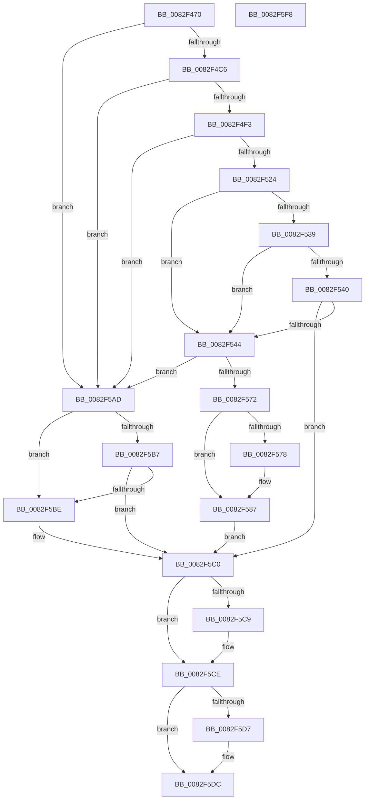

# CmRemovePanelDeviceWorker

- RVA: `0x0082F470`–`0x0082F5F9` (길이 `393` bytes)
- VA: `0x000000014082F470`
- 실행 섹션: `PAGE`
- PDB 이름 있음: `예`; PDB Function 태그: `아니요`
- unwind 정보 RVA: `0x000991EC`
- 디코드: `107`개 명령, `393/393` bytes 표시
- 미해석 바이트: `0` (있으면 어셈블리에 `.byte`로 보존)

> 이 문서는 커널 이미지의 기계어와 PDB 기호를 분석해 생성했습니다. 4번과 5번은 함수 원형과 자료형을 바이너리 사용 방식에서 추정한 C 해석이며 원본 소스 복구 결과는 아닙니다.

## 1. Dependencies

- 직접 호출 지점: **9**; 고유 호출 대상: **7**
- 직접 호출자로 확인된 함수: **1**
- RIP 상대 이미지 참조: **2**

### Outgoing calls
- `0x0082F4B7` → [_PnpCtxGetCachedContextBaseKey](../8E/_PnpCtxGetCachedContextBaseKey_function_008EFB2C.md) (function, `0x008EFB2C`)
- `0x0082F4E4` → [PnpCtxRegOpenKey](../8E/PnpCtxRegOpenKey_function_008EF7B8.md) (function, `0x008EF7B8`)
- `0x0082F515` → [PnpCtxRegOpenKey](../8E/PnpCtxRegOpenKey_function_008EF7B8.md) (function, `0x008EF7B8`)
- `0x0082F52B` → [PnpCtxRegDeleteValue](../8F/PnpCtxRegDeleteValue_function_008FE5E0.md) (function, `0x008FE5E0`)
- `0x0082F567` → [PnpCtxRegQueryInfoKey](../99/PnpCtxRegQueryInfoKey_function_009945FC.md) (function, `0x009945FC`)
- `0x0082F582` → [PnpCtxRegDeleteTree](../96/PnpCtxRegDeleteTree_function_00965CC8.md) (function, `0x00965CC8`)
- `0x0082F5A6` → [PnpObjectRaisePropertyChangeEvent](../8F/PnpObjectRaisePropertyChangeEvent_function_008F7E94.md) (function, `0x008F7E94`)
- `0x0082F5C9` → [ZwClose](../../text/6A/ZwClose_function_006AD2B0.md) (function, `0x006AD2B0`)
- `0x0082F5D7` → [ZwClose](../../text/6A/ZwClose_function_006AD2B0.md) (function, `0x006AD2B0`)

### Direct callers
- [CmRemovePanelDevice](CmRemovePanelDevice_function_0082F32C.md) at `0x0082F3C3`

### Static image references
- `0x0082F500` → RVA `0x00AFD740` (` ?? ::NNGAKEGL::`string'`; read)
- `0x0082F58A` → RVA `0x000115A0` (`.rdata`; read)

## 2. Other-region calls and transfers

- 다른 실행 섹션으로 향하는 call: **2**
  - `0x0082F5C9` → [ZwClose](../../text/6A/ZwClose_function_006AD2B0.md) (`PAGE` → `.text`)
  - `0x0082F5D7` → [ZwClose](../../text/6A/ZwClose_function_006AD2B0.md) (`PAGE` → `.text`)
- 별도 외부 분기/꼬리 이동을 확인하지 못했습니다.

## 3. Assembly (complete function range)

```asm
0082F470  48 89 5C 24 08                  mov qword ptr [rsp + 8], rbx
0082F475  48 89 74 24 10                  mov qword ptr [rsp + 0x10], rsi
0082F47A  48 89 7C 24 18                  mov qword ptr [rsp + 0x18], rdi
0082F47F  55                              push rbp
0082F480  41 56                           push r14
0082F482  41 57                           push r15
0082F484  48 8B EC                        mov rbp, rsp
0082F487  48 83 EC 60                     sub rsp, 0x60
0082F48B  48 83 65 F0 00                  and qword ptr [rbp - 0x10], 0
0082F490  49 8B F0                        mov rsi, r8
0082F493  48 83 65 E8 00                  and qword ptr [rbp - 0x18], 0
0082F498  4C 8D 45 F0                     lea r8, [rbp - 0x10]
0082F49C  48 83 65 E0 00                  and qword ptr [rbp - 0x20], 0
0082F4A1  4C 8B F2                        mov r14, rdx
0082F4A4  83 65 38 00                     and dword ptr [rbp + 0x38], 0
0082F4A8  BA 0B 00 00 00                  mov edx, 0xb
0082F4AD  4D 8B F9                        mov r15, r9
0082F4B0  41 C6 01 00                     mov byte ptr [r9], 0
0082F4B4  48 8B F9                        mov rdi, rcx
0082F4B7  E8 70 06 0C 00                  call 0x1408efb2c
0082F4BC  8B D8                           mov ebx, eax
0082F4BE  85 C0                           test eax, eax
0082F4C0  0F 88 E7 00 00 00               js 0x14082f5ad
0082F4C6  48 8B 55 F0                     mov rdx, qword ptr [rbp - 0x10]
0082F4CA  48 8D 45 E8                     lea rax, [rbp - 0x18]
0082F4CE  48 89 44 24 28                  mov qword ptr [rsp + 0x28], rax
0082F4D3  45 33 C9                        xor r9d, r9d
0082F4D6  4D 8B C6                        mov r8, r14
0082F4D9  C7 44 24 20 01 00 00 00         mov dword ptr [rsp + 0x20], 1
0082F4E1  48 8B CF                        mov rcx, rdi
0082F4E4  E8 CF 02 0C 00                  call 0x1408ef7b8
0082F4E9  8B D8                           mov ebx, eax
0082F4EB  85 C0                           test eax, eax
0082F4ED  0F 88 BA 00 00 00               js 0x14082f5ad
0082F4F3  48 8B 55 E8                     mov rdx, qword ptr [rbp - 0x18]
0082F4F7  48 8D 45 E0                     lea rax, [rbp - 0x20]
0082F4FB  48 89 44 24 28                  mov qword ptr [rsp + 0x28], rax
0082F500  4C 8D 05 39 E2 2C 00            lea r8, [rip + 0x2ce239]
0082F507  45 33 C9                        xor r9d, r9d
0082F50A  C7 44 24 20 03 00 00 00         mov dword ptr [rsp + 0x20], 3
0082F512  48 8B CF                        mov rcx, rdi
0082F515  E8 9E 02 0C 00                  call 0x1408ef7b8
0082F51A  8B D8                           mov ebx, eax
0082F51C  85 C0                           test eax, eax
0082F51E  0F 88 89 00 00 00               js 0x14082f5ad
0082F524  48 8B 55 E0                     mov rdx, qword ptr [rbp - 0x20]
0082F528  4C 8B C6                        mov r8, rsi
0082F52B  E8 B0 F0 0C 00                  call 0x1408fe5e0
0082F530  8B D8                           mov ebx, eax
0082F532  3D 34 00 00 C0                  cmp eax, 0xc0000034
0082F537  74 0B                           je 0x14082f544
0082F539  3D 7C 01 00 C0                  cmp eax, 0xc000017c
0082F53E  74 04                           je 0x14082f544
0082F540  85 C0                           test eax, eax
0082F542  78 7C                           js 0x14082f5c0
0082F544  48 83 64 24 30 00               and qword ptr [rsp + 0x30], 0
0082F54A  48 8D 45 38                     lea rax, [rbp + 0x38]
0082F54E  48 83 64 24 28 00               and qword ptr [rsp + 0x28], 0
0082F554  45 33 C9                        xor r9d, r9d
0082F557  48 8B 55 E0                     mov rdx, qword ptr [rbp - 0x20]
0082F55B  45 33 C0                        xor r8d, r8d
0082F55E  48 89 44 24 20                  mov qword ptr [rsp + 0x20], rax
0082F563  41 C6 07 01                     mov byte ptr [r15], 1
0082F567  E8 90 50 16 00                  call 0x1409945fc
0082F56C  8B D8                           mov ebx, eax
0082F56E  85 C0                           test eax, eax
0082F570  78 3B                           js 0x14082f5ad
0082F572  83 7D 38 00                     cmp dword ptr [rbp + 0x38], 0
0082F576  75 0F                           jne 0x14082f587
0082F578  48 8B 55 E0                     mov rdx, qword ptr [rbp - 0x20]
0082F57C  45 33 C0                        xor r8d, r8d
0082F57F  48 8B CF                        mov rcx, rdi
0082F582  E8 41 67 13 00                  call 0x140965cc8
0082F587  45 33 C9                        xor r9d, r9d
0082F58A  48 8D 05 0F 20 7E FF            lea rax, [rip - 0x81dff1]
0082F591  48 89 44 24 28                  mov qword ptr [rsp + 0x28], rax
0082F596  48 8B D6                        mov rdx, rsi
0082F599  48 83 64 24 20 00               and qword ptr [rsp + 0x20], 0
0082F59F  48 8B CF                        mov rcx, rdi
0082F5A2  45 8D 41 01                     lea r8d, [r9 + 1]
0082F5A6  E8 E9 88 0C 00                  call 0x1408f7e94
0082F5AB  EB 13                           jmp 0x14082f5c0
0082F5AD  8B C3                           mov eax, ebx
0082F5AF  81 FB 34 00 00 C0               cmp ebx, 0xc0000034
0082F5B5  74 07                           je 0x14082f5be
0082F5B7  3D 7C 01 00 C0                  cmp eax, 0xc000017c
0082F5BC  75 02                           jne 0x14082f5c0
0082F5BE  33 DB                           xor ebx, ebx
0082F5C0  48 8B 4D E0                     mov rcx, qword ptr [rbp - 0x20]
0082F5C4  48 85 C9                        test rcx, rcx
0082F5C7  74 05                           je 0x14082f5ce
0082F5C9  E8 E2 DC E7 FF                  call 0x1406ad2b0
0082F5CE  48 8B 4D E8                     mov rcx, qword ptr [rbp - 0x18]
0082F5D2  48 85 C9                        test rcx, rcx
0082F5D5  74 05                           je 0x14082f5dc
0082F5D7  E8 D4 DC E7 FF                  call 0x1406ad2b0
0082F5DC  4C 8D 5C 24 60                  lea r11, [rsp + 0x60]
0082F5E1  8B C3                           mov eax, ebx
0082F5E3  49 8B 5B 20                     mov rbx, qword ptr [r11 + 0x20]
0082F5E7  49 8B 73 28                     mov rsi, qword ptr [r11 + 0x28]
0082F5EB  49 8B 7B 30                     mov rdi, qword ptr [r11 + 0x30]
0082F5EF  49 8B E3                        mov rsp, r11
0082F5F2  41 5F                           pop r15
0082F5F4  41 5E                           pop r14
0082F5F6  5D                              pop rbp
0082F5F7  C3                              ret
0082F5F8  CC                              int3
```

## 4. C-style interpretation (structured pseudocode)

```c
__int64 __fastcall CmRemovePanelDeviceWorker(__int64 a1, __int64 a2, __int64 a3, __int64 a4)
{
    __int64 result;
    __int64 v_rbx;
    __int64 v_rsp;
    unsigned __int64 v_stack_m18;
    unsigned __int64 v_stack_m28;
    unsigned __int64 v_stack_m30;
    unsigned __int64 v_stack_m38;
    unsigned __int64 v_stack_m48;
    unsigned __int64 v_stack_m50;
    unsigned int v_stack_m58;
    unsigned __int64 v_stack_p10;
    unsigned __int64 v_stack_p18;
    unsigned int v_stack_p20;
    unsigned __int64 v_stack_p8;

    v_stack_p8 = v_rbx;
    v_stack_p10 = v_rsi;
    v_stack_p18 = v_rdi;
    v_rsp = (v_rsp) - (96);
    *(unsigned __int8 *)(a4) = 0;
    result = _PnpCtxGetCachedContextBaseKey(a1, 11, v_stack_m28, a4);
    if (sign_flag) goto loc_0082F5AD;
    v_stack_m50 = v_stack_m30;
    a4 = 0;
    v_stack_m58 = 1;
    result = PnpCtxRegOpenKey(a1, v_stack_m28, a2, a4);
    if (sign_flag) goto loc_0082F5AD;
    v_stack_m50 = v_stack_m38;
    a4 = 0;
    v_stack_m58 = 3;
    result = PnpCtxRegOpenKey(a1, v_stack_m30, v_rip + 2941497, a4);
    if (sign_flag) goto loc_0082F5AD;
    result = PnpCtxRegDeleteValue(a1, v_stack_m38, a3, a4);
    if (((unsigned int)(result)) == 0xC0000034ULL) goto loc_0082F544;
    if (((unsigned int)(result)) == 0xC000017CULL) goto loc_0082F544;
    if (sign_flag) goto loc_0082F5C0;
loc_0082F544:
    a4 = 0;
    a3 = 0;
    v_stack_m58 = v_stack_p20;
    *(unsigned __int8 *)(a4) = 1;
    result = PnpCtxRegQueryInfoKey(a1, v_stack_m38, a3, a4);
    if (sign_flag) goto loc_0082F5AD;
    if (v_stack_p20 == 0) {
        a2 = v_stack_m38;
        a3 = 0;
        a1 = a1;
        result = PnpCtxRegDeleteTree(a1, a2, a3, a4);
    }
    a4 = 0;
    v_stack_m50 = v_rip - 8511473;
    result = PnpObjectRaisePropertyChangeEvent(a1, 0, a4 + 1, a4);
    goto loc_0082F5C0;
loc_0082F5AD:
    if (((unsigned int)((unsigned int)((unsigned int)(result)))) == 0xC0000034ULL) goto loc_0082F5BE;
    v_rbx = (unsigned int)((unsigned int)(result));
    if (((unsigned int)((unsigned int)((unsigned int)((unsigned int)((unsigned int)(result)))))) == 0xC000017CULL) {
        v_rbx = 0;
    }
    result = (unsigned int)((unsigned int)((unsigned int)((unsigned int)(result))));
    if (v_stack_m38 != 0) {
        result = ZwClose(v_stack_m38, 0, a4 + 1, a4);
    }
    if (v_stack_m30 != 0) {
        result = ZwClose(v_stack_m30, 0, a4 + 1, a4);
    }
    return 0;
}
```

## 5. (Beta) C Style

```c
int64_t CmRemovePanelDeviceWorker(int64_t Arg1, int64_t Arg2, int64_t Arg3, void *Arg4)
{
    uint8_t *arg4 = (uint8_t *)Arg4;

    int64_t result;
    int64_t local_rbx;
    int64_t local_rsp;
    uint64_t v_stack_m18;
    uint64_t v_stack_m28;
    uint64_t v_stack_m30;
    uint64_t v_stack_m38;
    uint64_t v_stack_m48;
    uint64_t v_stack_m50;
    uint32_t v_stack_m58;
    uint64_t v_stack_p10;
    uint64_t v_stack_p18;
    uint32_t v_stack_p20;
    uint64_t v_stack_p8;

    v_stack_p8 = local_rbx;
    v_stack_p10 = local_rsi;
    v_stack_p18 = local_rdi;
    local_rsp = (local_rsp) - (96);
    *(uint8_t *)(arg4) = 0;
    result = _PnpCtxGetCachedContextBaseKey(Arg1, 11, v_stack_m28, Arg4);
    if (sign_flag) goto loc_0082F5AD;
    v_stack_m50 = v_stack_m30;
    Arg4 = 0;
    v_stack_m58 = 1;
    result = PnpCtxRegOpenKey(Arg1, v_stack_m28, Arg2, Arg4);
    if (sign_flag) goto loc_0082F5AD;
    v_stack_m50 = v_stack_m38;
    Arg4 = 0;
    v_stack_m58 = 3;
    result = PnpCtxRegOpenKey(Arg1, v_stack_m30, v_rip + 2941497, Arg4);
    if (sign_flag) goto loc_0082F5AD;
    result = PnpCtxRegDeleteValue(Arg1, v_stack_m38, Arg3, Arg4);
    if (((uint32_t)(result)) == 0xC0000034ULL) goto loc_0082F544;
    if (((uint32_t)(result)) == 0xC000017CULL) goto loc_0082F544;
    if (sign_flag) goto loc_0082F5C0;
loc_0082F544:
    Arg4 = 0;
    Arg3 = 0;
    v_stack_m58 = v_stack_p20;
    *(uint8_t *)(arg4) = 1;
    result = PnpCtxRegQueryInfoKey(Arg1, v_stack_m38, Arg3, Arg4);
    if (sign_flag) goto loc_0082F5AD;
    if (v_stack_p20 == 0) {
        Arg2 = v_stack_m38;
        Arg3 = 0;
        Arg1 = Arg1;
        result = PnpCtxRegDeleteTree(Arg1, Arg2, Arg3, Arg4);
    }
    Arg4 = 0;
    v_stack_m50 = v_rip - 8511473;
    result = PnpObjectRaisePropertyChangeEvent(Arg1, 0, Arg4 + 1, Arg4);
    goto loc_0082F5C0;
loc_0082F5AD:
    if (((uint32_t)((uint32_t)((uint32_t)(result)))) == 0xC0000034ULL) goto loc_0082F5BE;
    local_rbx = (uint32_t)((uint32_t)(result));
    if (((uint32_t)((uint32_t)((uint32_t)((uint32_t)((uint32_t)(result)))))) == 0xC000017CULL) {
        local_rbx = 0;
    }
    result = (uint32_t)((uint32_t)((uint32_t)((uint32_t)(result))));
    if (v_stack_m38 != 0) {
        result = ZwClose(v_stack_m38, 0, Arg4 + 1, Arg4);
    }
    if (v_stack_m30 != 0) {
        result = ZwClose(v_stack_m30, 0, Arg4 + 1, Arg4);
    }
    return 0;
}
```

### 관측된 메모리 오프셋

구조체 형식이 확인되지 않은 접근은 인자 기준의 오프셋으로만 기록했습니다.

| 기준 인자 | 오프셋 표현 | 폭 (bit) | 접근 |
|---|---:|---:|---|
| `Arg4` | `+ 0x0` | `8` | `W` |

## 6. Execution-region graph

[열기: 2D/3D 그래프와 함수 탐색 컨트롤 패널](../../../control-panel.html?section=page&rva=0x0082F470&view=graph)

- 2D 그래프는 위에서 아래로 흐르고, 3D 그래프는 빈 공간을 드래그해 회전합니다. Shift+드래그는 이동, 휠은 확대·축소, 함수 노드 선택은 대상 보고서 이동입니다.

### Static fallback


