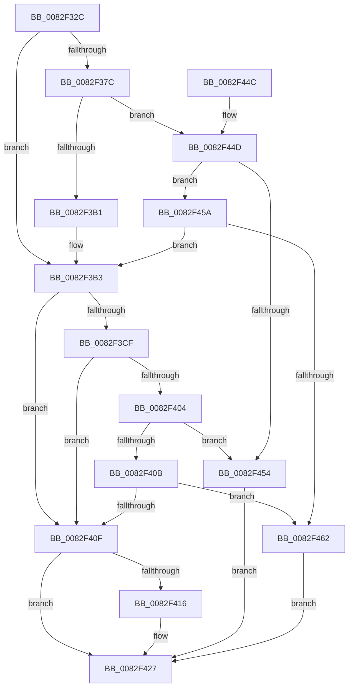

# CmRemovePanelDevice

- RVA: `0x0082F32C`–`0x0082F469` (길이 `317` bytes)
- VA: `0x000000014082F32C`
- 실행 섹션: `PAGE`
- PDB 이름 있음: `예`; PDB Function 태그: `아니요`
- unwind 정보 RVA: `0x000A88C0`
- 디코드: `81`개 명령, `317/317` bytes 표시
- 미해석 바이트: `0` (있으면 어셈블리에 `.byte`로 보존)

> 이 문서는 커널 이미지의 기계어와 PDB 기호를 분석해 생성했습니다. 4번과 5번은 함수 원형과 자료형을 바이너리 사용 방식에서 추정한 C 해석이며 원본 소스 복구 결과는 아닙니다.

## 1. Dependencies

- 직접 호출 지점: **6**; 고유 호출 대상: **5**
- 직접 호출자로 확인된 함수: **2**
- RIP 상대 이미지 참조: **1**

### Outgoing calls
- `0x0082F361` → [memset](../../text/6C/memset_function_006C6C40.md) (function, `0x006C6C40`)
- `0x0082F3A1` → [guard_dispatch_icall](../../text/6B/guard_dispatch_icall_function_006BAAD0.md) (function, `0x006BAAD0`)
- `0x0082F3C3` → [CmRemovePanelDeviceWorker](CmRemovePanelDeviceWorker_function_0082F470.md) (function, `0x0082F470`)
- `0x0082F3F8` → [guard_dispatch_icall](../../text/6B/guard_dispatch_icall_function_006BAAD0.md) (function, `0x006BAAD0`)
- `0x0082F422` → [PnpObjectRaiseDevicesChangeEvent](../AC/PnpObjectRaiseDevicesChangeEvent_function_00AC9888.md) (function, `0x00AC9888`)
- `0x0082F434` → [_security_check_cookie](../../text/6A/_security_check_cookie_function_006AC640.md) (function, `0x006AC640`)

### Direct callers
- [_CmDeleteDeviceWorker](../A0/_CmDeleteDeviceWorker_function_00A08F48.md) at `0x00A093A9`
- [sub_00B34E9C](../B3/Unknown_function_00B34E9C.md) at `0x00B34F49`

### Static image references
- `0x0082F33B` → RVA `0x00E0A740` (`.data`; read)

## 2. Other-region calls and transfers

- 다른 실행 섹션으로 향하는 call: **4**
  - `0x0082F361` → [memset](../../text/6C/memset_function_006C6C40.md) (`PAGE` → `.text`)
  - `0x0082F3A1` → [guard_dispatch_icall](../../text/6B/guard_dispatch_icall_function_006BAAD0.md) (`PAGE` → `.text`)
  - `0x0082F3F8` → [guard_dispatch_icall](../../text/6B/guard_dispatch_icall_function_006BAAD0.md) (`PAGE` → `.text`)
  - `0x0082F434` → [_security_check_cookie](../../text/6A/_security_check_cookie_function_006AC640.md) (`PAGE` → `.text`)
- 별도 외부 분기/꼬리 이동을 확인하지 못했습니다.

## 3. Assembly (complete function range)

```asm
0082F32C  48 89 5C 24 20                  mov qword ptr [rsp + 0x20], rbx
0082F331  55                              push rbp
0082F332  56                              push rsi
0082F333  57                              push rdi
0082F334  48 81 EC B0 00 00 00            sub rsp, 0xb0
0082F33B  48 8B 05 FE B3 5D 00            mov rax, qword ptr [rip + 0x5db3fe]
0082F342  48 33 C4                        xor rax, rsp
0082F345  48 89 84 24 A0 00 00 00         mov qword ptr [rsp + 0xa0], rax
0082F34D  48 8B EA                        mov rbp, rdx
0082F350  49 8B D8                        mov rbx, r8
0082F353  33 D2                           xor edx, edx
0082F355  48 8B F1                        mov rsi, rcx
0082F358  48 8D 4C 24 40                  lea rcx, [rsp + 0x40]
0082F35D  44 8D 42 58                     lea r8d, [rdx + 0x58]
0082F361  E8 DA 78 E9 FF                  call 0x1406c6c40
0082F366  48 8B BE F8 01 00 00            mov rdi, qword ptr [rsi + 0x1f8]
0082F36D  48 89 6C 24 50                  mov qword ptr [rsp + 0x50], rbp
0082F372  48 89 5C 24 58                  mov qword ptr [rsp + 0x58], rbx
0082F377  48 85 FF                        test rdi, rdi
0082F37A  74 37                           je 0x14082f3b3
0082F37C  41 B9 0E 00 00 00               mov r9d, 0xe
0082F382  48 8D 44 24 40                  lea rax, [rsp + 0x40]
0082F387  48 89 44 24 28                  mov qword ptr [rsp + 0x28], rax
0082F38C  48 8B D5                        mov rdx, rbp
0082F38F  48 8B CE                        mov rcx, rsi
0082F392  C7 44 24 20 01 00 00 00         mov dword ptr [rsp + 0x20], 1
0082F39A  48 8B C7                        mov rax, rdi
0082F39D  45 8D 41 F8                     lea r8d, [r9 - 8]
0082F3A1  E8 2A B7 E8 FF                  call 0x1406baad0
0082F3A6  3D 02 00 00 C0                  cmp eax, 0xc0000002
0082F3AB  0F 85 9C 00 00 00               jne 0x14082f44d
0082F3B1  33 FF                           xor edi, edi
0082F3B3  4C 8B 44 24 58                  mov r8, qword ptr [rsp + 0x58]
0082F3B8  4C 8D 4C 24 60                  lea r9, [rsp + 0x60]
0082F3BD  48 8B D5                        mov rdx, rbp
0082F3C0  48 8B CE                        mov rcx, rsi
0082F3C3  E8 A8 00 00 00                  call 0x14082f470
0082F3C8  8B D8                           mov ebx, eax
0082F3CA  48 85 FF                        test rdi, rdi
0082F3CD  74 40                           je 0x14082f40f
0082F3CF  89 44 24 40                     mov dword ptr [rsp + 0x40], eax
0082F3D3  41 B9 0E 00 00 00               mov r9d, 0xe
0082F3D9  48 8D 44 24 40                  lea rax, [rsp + 0x40]
0082F3DE  48 8B D5                        mov rdx, rbp
0082F3E1  48 89 44 24 28                  mov qword ptr [rsp + 0x28], rax
0082F3E6  48 8B CE                        mov rcx, rsi
0082F3E9  48 8B C7                        mov rax, rdi
0082F3EC  C7 44 24 20 02 00 00 00         mov dword ptr [rsp + 0x20], 2
0082F3F4  45 8D 41 F8                     lea r8d, [r9 - 8]
0082F3F8  E8 D3 B6 E8 FF                  call 0x1406baad0
0082F3FD  3D 02 00 00 C0                  cmp eax, 0xc0000002
0082F402  74 0B                           je 0x14082f40f
0082F404  3D 20 01 00 C0                  cmp eax, 0xc0000120
0082F409  74 49                           je 0x14082f454
0082F40B  85 C0                           test eax, eax
0082F40D  75 53                           jne 0x14082f462
0082F40F  80 7C 24 60 00                  cmp byte ptr [rsp + 0x60], 0
0082F414  75 11                           jne 0x14082f427
0082F416  41 B8 06 00 00 00               mov r8d, 6
0082F41C  48 8B D5                        mov rdx, rbp
0082F41F  48 8B CE                        mov rcx, rsi
0082F422  E8 61 A4 29 00                  call 0x140ac9888
0082F427  8B C3                           mov eax, ebx
0082F429  48 8B 8C 24 A0 00 00 00         mov rcx, qword ptr [rsp + 0xa0]
0082F431  48 33 CC                        xor rcx, rsp
0082F434  E8 07 D2 E7 FF                  call 0x1406ac640
0082F439  48 8B 9C 24 E8 00 00 00         mov rbx, qword ptr [rsp + 0xe8]
0082F441  48 81 C4 B0 00 00 00            add rsp, 0xb0
0082F448  5F                              pop rdi
0082F449  5E                              pop rsi
0082F44A  5D                              pop rbp
0082F44B  C3                              ret
0082F44C  CC                              int3
0082F44D  3D 20 01 00 C0                  cmp eax, 0xc0000120
0082F452  75 06                           jne 0x14082f45a
0082F454  8B 5C 24 40                     mov ebx, dword ptr [rsp + 0x40]
0082F458  EB CD                           jmp 0x14082f427
0082F45A  85 C0                           test eax, eax
0082F45C  0F 84 51 FF FF FF               je 0x14082f3b3
0082F462  BB E5 00 00 C0                  mov ebx, 0xc00000e5
0082F467  EB BE                           jmp 0x14082f427
```

## 4. C-style interpretation (structured pseudocode)

```c
__int64 __fastcall CmRemovePanelDevice(__int64 a1, __int64 a2, __int64 a3)
{
    __int64 result;
    __int64 v_rdi;
    __int64 v_rsp;
    unsigned __int64 v_stack_m28;
    unsigned __int64 v_stack_m68;
    unsigned __int64 v_stack_m70;
    unsigned __int64 v_stack_m78;
    unsigned __int64 v_stack_m88;
    unsigned __int64 v_stack_mA0;
    unsigned int v_stack_mA8;
    unsigned __int64 v_stack_p20;
    unsigned int v_stack_p40;

    v_stack_p20 = v_rbx;
    v_rsp = (v_rsp) - (176);
    result = (*(unsigned __int64 *)(v_rip + 6140926)) ^ (v_rsp);
    v_stack_m28 = result;
    a2 = 0;
    result = memset(v_stack_m88, a2, a2 + 88, a4);
    v_stack_m78 = 0;
    v_stack_m70 = a3;
    if (*(unsigned __int64 *)(a1 + 504) == 0) goto loc_0082F3B3;
    v_stack_mA0 = v_stack_m88;
    v_stack_mA8 = 1;
    result = guard_dispatch_icall(a1, 0, 14 - 8, 14);
    if (((unsigned int)(result)) != 0xC0000002ULL) goto loc_0082F44D;
    v_rdi = 0;
loc_0082F3B3:
    result = CmRemovePanelDeviceWorker(a1, 0, v_stack_m70, v_stack_m68);
    if (0 == 0) goto loc_0082F40F;
    v_stack_m88 = (unsigned int)(result);
    v_stack_mA0 = v_stack_m88;
    v_stack_mA8 = 2;
    result = guard_dispatch_icall(a1, 0, 14 - 8, 14);
    if (((unsigned int)(result)) == 0xC0000002ULL) goto loc_0082F40F;
    if (((unsigned int)(result)) == 0xC0000120ULL) goto loc_0082F454;
    if ((unsigned int)(result) != 0) goto loc_0082F462;
loc_0082F40F:
    if (v_stack_m68 == 0) {
        a3 = 6;
        a2 = 0;
        a1 = a1;
        result = PnpObjectRaiseDevicesChangeEvent(a1, a2, a3, 14);
    }
    a1 = (v_stack_m28) ^ (v_rsp);
    result = _security_check_cookie(a1, a2, a3, 14);
    v_rsp = (v_rsp) + (176);
    return result;
loc_0082F44D:
    if (((unsigned int)(result)) != 0xC0000120ULL) goto loc_0082F45A;
loc_0082F454:
    goto loc_0082F427;
loc_0082F45A:
    if ((unsigned int)(result) == 0) goto loc_0082F3B3;
loc_0082F462:
    goto loc_0082F427;
}
```

## 5. (Beta) C Style

```c
int64_t CmRemovePanelDevice(void *Arg1, int64_t Arg2, int64_t Arg3)
{
    uint8_t *arg1 = (uint8_t *)Arg1;

    int64_t result;
    int64_t local_rdi;
    int64_t local_rsp;
    uint64_t v_stack_m28;
    uint64_t v_stack_m68;
    uint64_t v_stack_m70;
    uint64_t v_stack_m78;
    uint64_t v_stack_m88;
    uint64_t v_stack_mA0;
    uint32_t v_stack_mA8;
    uint64_t v_stack_p20;
    uint32_t v_stack_p40;

    v_stack_p20 = local_rbx;
    local_rsp = (local_rsp) - (176);
    result = (*(uint64_t *)(v_rip + 0x5DB3FE)) ^ (local_rsp);
    v_stack_m28 = result;
    Arg2 = 0;
    result = memset(v_stack_m88, Arg2, Arg2 + 88, a4);
    v_stack_m78 = 0;
    v_stack_m70 = Arg3;
    if (*(uint64_t *)(arg1 + 0x1F8) == 0) goto loc_0082F3B3;
    v_stack_mA0 = v_stack_m88;
    v_stack_mA8 = 1;
    result = guard_dispatch_icall(Arg1, 0, 14 - 8, 14);
    if (((uint32_t)(result)) != 0xC0000002ULL) goto loc_0082F44D;
    local_rdi = 0;
loc_0082F3B3:
    result = CmRemovePanelDeviceWorker(Arg1, 0, v_stack_m70, v_stack_m68);
    if (0 == 0) goto loc_0082F40F;
    v_stack_m88 = (uint32_t)(result);
    v_stack_mA0 = v_stack_m88;
    v_stack_mA8 = 2;
    result = guard_dispatch_icall(Arg1, 0, 14 - 8, 14);
    if (((uint32_t)(result)) == 0xC0000002ULL) goto loc_0082F40F;
    if (((uint32_t)(result)) == 0xC0000120ULL) goto loc_0082F454;
    if ((uint32_t)(result) != 0) goto loc_0082F462;
loc_0082F40F:
    if (v_stack_m68 == 0) {
        Arg3 = 6;
        Arg2 = 0;
        Arg1 = Arg1;
        result = PnpObjectRaiseDevicesChangeEvent(Arg1, Arg2, Arg3, 14);
    }
    Arg1 = (v_stack_m28) ^ (local_rsp);
    result = _security_check_cookie(Arg1, Arg2, Arg3, 14);
    local_rsp = (local_rsp) + (176);
    return result;
loc_0082F44D:
    if (((uint32_t)(result)) != 0xC0000120ULL) goto loc_0082F45A;
loc_0082F454:
    goto loc_0082F427;
loc_0082F45A:
    if ((uint32_t)(result) == 0) goto loc_0082F3B3;
loc_0082F462:
    goto loc_0082F427;
}
```

### 관측된 메모리 오프셋

구조체 형식이 확인되지 않은 접근은 인자 기준의 오프셋으로만 기록했습니다.

| 기준 인자 | 오프셋 표현 | 폭 (bit) | 접근 |
|---|---:|---:|---|
| `Arg1` | `+ 0x1F8` | `64` | `R` |

## 6. Execution-region graph

[열기: 2D/3D 그래프와 함수 탐색 컨트롤 패널](../../../control-panel.html?section=page&rva=0x0082F32C&view=graph)

- 2D 그래프는 위에서 아래로 흐르고, 3D 그래프는 빈 공간을 드래그해 회전합니다. Shift+드래그는 이동, 휠은 확대·축소, 함수 노드 선택은 대상 보고서 이동입니다.

### Static fallback


