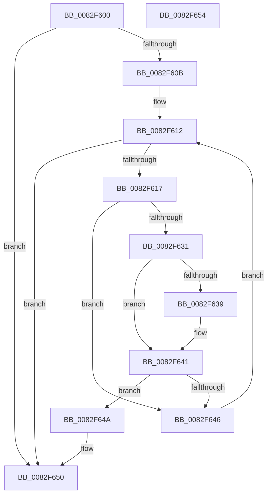

# CmSetDevicePanelMappedProperty

- RVA: `0x0082F600`–`0x0082F655` (길이 `85` bytes)
- VA: `0x000000014082F600`
- 실행 섹션: `PAGE`
- PDB 이름 있음: `예`; PDB Function 태그: `아니요`
- unwind 정보 RVA: `0x000DB714`
- 디코드: `27`개 명령, `85/85` bytes 표시
- 미해석 바이트: `0` (있으면 어셈블리에 `.byte`로 보존)

> 이 문서는 커널 이미지의 기계어와 PDB 기호를 분석해 생성했습니다. 4번과 5번은 함수 원형과 자료형을 바이너리 사용 방식에서 추정한 C 해석이며 원본 소스 복구 결과는 아닙니다.

## 1. Dependencies

- 직접 호출 지점: **0**; 고유 호출 대상: **0**
- 직접 호출자로 확인된 함수: **2**
- RIP 상대 이미지 참조: **1**

### Outgoing calls
- 직접 디코드된 call 명령이 없습니다.

### Direct callers
- [CmDeleteDevicePanelWorker](CmDeleteDevicePanelWorker_function_0082E7EC.md) at `0x0082E91B`
- [PnpDispatchDevicePanel](../83/PnpDispatchDevicePanel_function_00831830.md) at `0x008318BF`

### Static image references
- `0x0082F619` → RVA `0x0000C578` (`.rdata`; read)

## 2. Other-region calls and transfers

- 다른 실행 섹션으로 향하는 call: **0**
- 별도 외부 분기/꼬리 이동을 확인하지 못했습니다.

## 3. Assembly (complete function range)

```asm
0082F600  41 B8 16 00 00 C0               mov r8d, 0xc0000016
0082F606  4D 85 C9                        test r9, r9
0082F609  75 45                           jne 0x14082f650
0082F60B  4C 8B 4C 24 28                  mov r9, qword ptr [rsp + 0x28]
0082F610  33 C9                           xor ecx, ecx
0082F612  83 F9 03                        cmp ecx, 3
0082F615  73 39                           jae 0x14082f650
0082F617  8B C1                           mov eax, ecx
0082F619  4C 8D 15 58 CF 7D FF            lea r10, [rip - 0x8230a8]
0082F620  48 03 C0                        add rax, rax
0082F623  4D 8B 14 C2                     mov r10, qword ptr [r10 + rax*8]
0082F627  41 8B 42 10                     mov eax, dword ptr [r10 + 0x10]
0082F62B  41 39 41 10                     cmp dword ptr [r9 + 0x10], eax
0082F62F  75 15                           jne 0x14082f646
0082F631  49 8B 11                        mov rdx, qword ptr [r9]
0082F634  49 2B 12                        sub rdx, qword ptr [r10]
0082F637  75 08                           jne 0x14082f641
0082F639  49 8B 51 08                     mov rdx, qword ptr [r9 + 8]
0082F63D  49 2B 52 08                     sub rdx, qword ptr [r10 + 8]
0082F641  48 85 D2                        test rdx, rdx
0082F644  74 04                           je 0x14082f64a
0082F646  FF C1                           inc ecx
0082F648  EB C8                           jmp 0x14082f612
0082F64A  41 B8 22 00 00 C0               mov r8d, 0xc0000022
0082F650  41 8B C0                        mov eax, r8d
0082F653  C3                              ret
0082F654  CC                              int3
```

## 4. C-style interpretation (structured pseudocode)

```c
__int64 __fastcall CmSetDevicePanelMappedProperty(int a1, __int64 a2, __int64 a3, __int64 a4, __int64 a5)
{
    __int64 result;

    if (a4 != 0) goto loc_0082F650;
    a1 = 0;
loc_0082F612:
    if (0 >= 3) goto loc_0082F650;
    result = (0) + (0);
    if ((*(unsigned int *)(a5 + 16)) != ((unsigned int)((unsigned int)(*(unsigned int *)(*(unsigned __int64 *)(v_rip - 8532136 + result * 8) + 16))))) goto loc_0082F646;
    a2 = (*(unsigned __int64 *)(a5)) - (*(unsigned __int64 *)(*(unsigned __int64 *)(v_rip - 8532136 + result * 8)));
    if (!(condition_is_not_equal)) {
        a2 = *(unsigned __int64 *)(a5 + 8);
        a2 = (a2) - (*(unsigned __int64 *)(*(unsigned __int64 *)(v_rip - 8532136 + result * 8) + 8));
    }
    if (a2 == 0) goto loc_0082F64A;
loc_0082F646:
    a1 = (unsigned int)((a1) + 1);
    goto loc_0082F612;
loc_0082F64A:
loc_0082F650:
    return (unsigned int)((unsigned int)((unsigned int)(0xC0000022ULL)));
}
```

## 5. (Beta) C Style

```c
int64_t CmSetDevicePanelMappedProperty(int32_t Arg1, int64_t Arg2, int64_t Arg3, int64_t Arg4, void *Arg5)
{
    uint8_t *arg5 = (uint8_t *)Arg5;

    int64_t result;

    if (Arg4 != 0) goto loc_0082F650;
    Arg1 = 0;
loc_0082F612:
    if (0 >= 3) goto loc_0082F650;
    result = (0) + (0);
    if ((*(uint32_t *)(arg5 + 0x10)) != ((uint32_t)((uint32_t)(*(uint32_t *)(*(uint64_t *)(v_rip - 0x8230A8 + result * 8) + 0x10))))) goto loc_0082F646;
    Arg2 = (*(uint64_t *)(arg5)) - (*(uint64_t *)(*(uint64_t *)(v_rip - 0x8230A8 + result * 8)));
    if (!(condition_is_not_equal)) {
        Arg2 = *(uint64_t *)(arg5 + 0x8);
        Arg2 = (Arg2) - (*(uint64_t *)(*(uint64_t *)(v_rip - 0x8230A8 + result * 8) + 0x8));
    }
    if (Arg2 == 0) goto loc_0082F64A;
loc_0082F646:
    Arg1 = (uint32_t)((Arg1) + 1);
    goto loc_0082F612;
loc_0082F64A:
loc_0082F650:
    return (uint32_t)((uint32_t)((uint32_t)(0xC0000022ULL)));
}
```

### 관측된 메모리 오프셋

구조체 형식이 확인되지 않은 접근은 인자 기준의 오프셋으로만 기록했습니다.

| 기준 인자 | 오프셋 표현 | 폭 (bit) | 접근 |
|---|---:|---:|---|
| `Arg5` | `+ 0x0` | `64` | `R` |
| `Arg5` | `+ 0x8` | `64` | `R` |
| `Arg5` | `+ 0x10` | `32` | `R` |

## 6. Execution-region graph

[열기: 2D/3D 그래프와 함수 탐색 컨트롤 패널](../../../control-panel.html?section=page&rva=0x0082F600&view=graph)

- 2D 그래프는 위에서 아래로 흐르고, 3D 그래프는 빈 공간을 드래그해 회전합니다. Shift+드래그는 이동, 휠은 확대·축소, 함수 노드 선택은 대상 보고서 이동입니다.

### Static fallback


