# CmSetInstallerClassRegPropWorker

- RVA: `0x0082ABF4`–`0x0082AE7F` (길이 `651` bytes)
- VA: `0x000000014082ABF4`
- 실행 섹션: `PAGE`
- PDB 이름 있음: `예`; PDB Function 태그: `아니요`
- unwind 정보 RVA: `0x0007FF48`
- 디코드: `189`개 명령, `651/651` bytes 표시
- 미해석 바이트: `0` (있으면 어셈블리에 `.byte`로 보존)

> 이 문서는 커널 이미지의 기계어와 PDB 기호를 분석해 생성했습니다. 4번과 5번은 함수 원형과 자료형을 바이너리 사용 방식에서 추정한 C 해석이며 원본 소스 복구 결과는 아닙니다.

## 1. Dependencies

- 직접 호출 지점: **12**; 고유 호출 대상: **11**
- 직접 호출자로 확인된 함수: **1**
- RIP 상대 이미지 참조: **0**

### Outgoing calls
- `0x0082AC68` → [_CmClassPropertyRead](../../text/46/_CmClassPropertyRead_function_0046286C.md) (function, `0x0046286C`)
- `0x0082AC77` → [CmClassPropertyWrite](../../text/6A/CmClassPropertyWrite_function_006A2D58.md) (function, `0x006A2D58`)
- `0x0082ACFB` → [RtlValidRelativeSecurityDescriptor](../8B/RtlValidRelativeSecurityDescriptor_function_008BDC70.md) (function, `0x008BDC70`)
- `0x0082AD07` → [RtlLengthSecurityDescriptor](../8B/RtlLengthSecurityDescriptor_function_008BC870.md) (function, `0x008BC870`)
- `0x0082AD49` → [CmOpenInstallerClassRegKey](../9D/CmOpenInstallerClassRegKey_function_009D4474.md) (function, `0x009D4474`)
- `0x0082AD95` → [_PnpOpenPropertiesKey](../99/_PnpOpenPropertiesKey_function_009938A0.md) (function, `0x009938A0`)
- `0x0082ADB9` → [MapCmClassPropertyToRegValue](../../text/47/MapCmClassPropertyToRegValue_function_00473B84.md) (function, `0x00473B84`)
- `0x0082ADCD` → [PnpCtxRegDeleteValue](../8F/PnpCtxRegDeleteValue_function_008FE5E0.md) (function, `0x008FE5E0`)
- `0x0082AE07` → [CmRaisePropertyChangeEvent](../8F/CmRaisePropertyChangeEvent_function_008FE93C.md) (function, `0x008FE93C`)
- `0x0082AE1F` → [PnpCtxRegSetValue](../99/PnpCtxRegSetValue_function_00991B8C.md) (function, `0x00991B8C`)
- `0x0082AE49` → [ZwClose](../../text/6A/ZwClose_function_006AD2B0.md) (function, `0x006AD2B0`)
- `0x0082AE58` → [ZwClose](../../text/6A/ZwClose_function_006AD2B0.md) (function, `0x006AD2B0`)

### Direct callers
- [CmSetInstallerClassRegProp](CmSetInstallerClassRegProp_function_0082AA90.md) at `0x0082AB65`

### Static image references
- 디코드된 RIP-relative 메모리 참조가 없습니다.

## 2. Other-region calls and transfers

- 다른 실행 섹션으로 향하는 call: **5**
  - `0x0082AC68` → [_CmClassPropertyRead](../../text/46/_CmClassPropertyRead_function_0046286C.md) (`PAGE` → `.text`)
  - `0x0082AC77` → [CmClassPropertyWrite](../../text/6A/CmClassPropertyWrite_function_006A2D58.md) (`PAGE` → `.text`)
  - `0x0082ADB9` → [MapCmClassPropertyToRegValue](../../text/47/MapCmClassPropertyToRegValue_function_00473B84.md) (`PAGE` → `.text`)
  - `0x0082AE49` → [ZwClose](../../text/6A/ZwClose_function_006AD2B0.md) (`PAGE` → `.text`)
  - `0x0082AE58` → [ZwClose](../../text/6A/ZwClose_function_006AD2B0.md) (`PAGE` → `.text`)
- 별도 외부 분기/꼬리 이동을 확인하지 못했습니다.

## 3. Assembly (complete function range)

```asm
0082ABF4  48 8B C4                        mov rax, rsp
0082ABF7  48 89 58 08                     mov qword ptr [rax + 8], rbx
0082ABFB  48 89 68 10                     mov qword ptr [rax + 0x10], rbp
0082ABFF  48 89 70 18                     mov qword ptr [rax + 0x18], rsi
0082AC03  48 89 78 20                     mov qword ptr [rax + 0x20], rdi
0082AC07  41 54                           push r12
0082AC09  41 56                           push r14
0082AC0B  41 57                           push r15
0082AC0D  48 83 EC 50                     sub rsp, 0x50
0082AC11  33 DB                           xor ebx, ebx
0082AC13  41 8B F9                        mov edi, r9d
0082AC16  48 21 58 D8                     and qword ptr [rax - 0x28], rbx
0082AC1A  4D 8B F0                        mov r14, r8
0082AC1D  48 21 58 E0                     and qword ptr [rax - 0x20], rbx
0082AC21  4C 8B E2                        mov r12, rdx
0082AC24  0F B7 84 24 A8 00 00 00         movzx eax, word ptr [rsp + 0xa8]
0082AC2C  4C 8B F9                        mov r15, rcx
0082AC2F  85 C0                           test eax, eax
0082AC31  74 0A                           je 0x14082ac3d
0082AC33  BB 0D 00 00 C0                  mov ebx, 0xc000000d
0082AC38  E9 20 02 00 00                  jmp 0x14082ae5d
0082AC3D  8B B4 24 A0 00 00 00            mov esi, dword ptr [rsp + 0xa0]
0082AC44  85 F6                           test esi, esi
0082AC46  75 04                           jne 0x14082ac4c
0082AC48  33 ED                           xor ebp, ebp
0082AC4A  EB 0D                           jmp 0x14082ac59
0082AC4C  48 8B AC 24 98 00 00 00         mov rbp, qword ptr [rsp + 0x98]
0082AC54  48 85 ED                        test rbp, rbp
0082AC57  74 DA                           je 0x14082ac33
0082AC59  41 8D 41 FF                     lea eax, [r9 - 1]
0082AC5D  83 F8 24                        cmp eax, 0x24
0082AC60  0F 87 D4 01 00 00               ja 0x14082ae3a
0082AC66  8B CF                           mov ecx, edi
0082AC68  E8 FF 7B C3 FF                  call 0x14046286c
0082AC6D  84 C0                           test al, al
0082AC6F  0F 84 C5 01 00 00               je 0x14082ae3a
0082AC75  8B CF                           mov ecx, edi
0082AC77  E8 DC 80 E7 FF                  call 0x1406a2d58
0082AC7C  84 C0                           test al, al
0082AC7E  75 0A                           jne 0x14082ac8a
0082AC80  BB 22 00 00 C0                  mov ebx, 0xc0000022
0082AC85  E9 D3 01 00 00                  jmp 0x14082ae5d
0082AC8A  8B CF                           mov ecx, edi
0082AC8C  83 E9 08                        sub ecx, 8
0082AC8F  74 42                           je 0x14082acd3
0082AC91  83 E9 05                        sub ecx, 5
0082AC94  74 3D                           je 0x14082acd3
0082AC96  83 E9 05                        sub ecx, 5
0082AC99  74 31                           je 0x14082accc
0082AC9B  83 E9 01                        sub ecx, 1
0082AC9E  74 2C                           je 0x14082accc
0082ACA0  83 E9 05                        sub ecx, 5
0082ACA3  74 20                           je 0x14082acc5
0082ACA5  83 E9 02                        sub ecx, 2
0082ACA8  74 14                           je 0x14082acbe
0082ACAA  83 E9 01                        sub ecx, 1
0082ACAD  74 0F                           je 0x14082acbe
0082ACAF  83 F9 01                        cmp ecx, 1
0082ACB2  74 0A                           je 0x14082acbe
0082ACB4  BB 30 02 00 C0                  mov ebx, 0xc0000230
0082ACB9  E9 9F 01 00 00                  jmp 0x14082ae5d
0082ACBE  B8 04 00 00 00                  mov eax, 4
0082ACC3  EB 13                           jmp 0x14082acd8
0082ACC5  B8 03 00 00 00                  mov eax, 3
0082ACCA  EB 0C                           jmp 0x14082acd8
0082ACCC  B8 07 00 00 00                  mov eax, 7
0082ACD1  EB 05                           jmp 0x14082acd8
0082ACD3  B8 01 00 00 00                  mov eax, 1
0082ACD8  39 84 24 90 00 00 00            cmp dword ptr [rsp + 0x90], eax
0082ACDF  0F 85 4E FF FF FF               jne 0x14082ac33
0082ACE5  83 FF 08                        cmp edi, 8
0082ACE8  74 30                           je 0x14082ad1a
0082ACEA  83 FF 18                        cmp edi, 0x18
0082ACED  75 34                           jne 0x14082ad23
0082ACEF  85 F6                           test esi, esi
0082ACF1  74 30                           je 0x14082ad23
0082ACF3  45 33 C0                        xor r8d, r8d
0082ACF6  8B D6                           mov edx, esi
0082ACF8  48 8B CD                        mov rcx, rbp
0082ACFB  E8 70 2F 09 00                  call 0x1408bdc70
0082AD00  84 C0                           test al, al
0082AD02  74 0C                           je 0x14082ad10
0082AD04  48 8B CD                        mov rcx, rbp
0082AD07  E8 64 1B 09 00                  call 0x1408bc870
0082AD0C  3B C6                           cmp eax, esi
0082AD0E  74 13                           je 0x14082ad23
0082AD10  BB 0D 00 00 C0                  mov ebx, 0xc000000d
0082AD15  E9 25 01 00 00                  jmp 0x14082ae3f
0082AD1A  83 FE 40                        cmp esi, 0x40
0082AD1D  0F 87 10 FF FF FF               ja 0x14082ac33
0082AD23  4D 85 F6                        test r14, r14
0082AD26  75 30                           jne 0x14082ad58
0082AD28  48 21 5C 24 38                  and qword ptr [rsp + 0x38], rbx
0082AD2D  48 8D 44 24 40                  lea rax, [rsp + 0x40]
0082AD32  48 89 44 24 30                  mov qword ptr [rsp + 0x30], rax
0082AD37  49 8B D4                        mov rdx, r12
0082AD3A  88 5C 24 28                     mov byte ptr [rsp + 0x28], bl
0082AD3E  49 8B CF                        mov rcx, r15
0082AD41  C7 44 24 20 06 00 00 02         mov dword ptr [rsp + 0x20], 0x2000006
0082AD49  E8 26 97 1A 00                  call 0x1409d4474
0082AD4E  8B D8                           mov ebx, eax
0082AD50  85 C0                           test eax, eax
0082AD52  0F 88 E7 00 00 00               js 0x14082ae3f
0082AD58  8B C7                           mov eax, edi
0082AD5A  83 E8 08                        sub eax, 8
0082AD5D  74 4C                           je 0x14082adab
0082AD5F  83 E8 05                        sub eax, 5
0082AD62  74 47                           je 0x14082adab
0082AD64  83 E8 05                        sub eax, 5
0082AD67  74 42                           je 0x14082adab
0082AD69  83 F8 01                        cmp eax, 1
0082AD6C  74 3D                           je 0x14082adab
0082AD6E  48 8B 54 24 40                  mov rdx, qword ptr [rsp + 0x40]
0082AD73  48 8D 44 24 48                  lea rax, [rsp + 0x48]
0082AD78  48 89 44 24 30                  mov qword ptr [rsp + 0x30], rax
0082AD7D  4D 85 F6                        test r14, r14
0082AD80  41 B9 02 00 00 00               mov r9d, 2
0082AD86  C6 44 24 20 01                  mov byte ptr [rsp + 0x20], 1
0082AD8B  49 0F 45 D6                     cmovne rdx, r14
0082AD8F  49 8B CF                        mov rcx, r15
0082AD92  45 33 C0                        xor r8d, r8d
0082AD95  E8 06 8B 16 00                  call 0x1409938a0
0082AD9A  8B D8                           mov ebx, eax
0082AD9C  85 C0                           test eax, eax
0082AD9E  0F 88 9B 00 00 00               js 0x14082ae3f
0082ADA4  48 8B 4C 24 48                  mov rcx, qword ptr [rsp + 0x48]
0082ADA9  EB 0C                           jmp 0x14082adb7
0082ADAB  4D 85 F6                        test r14, r14
0082ADAE  49 8B CE                        mov rcx, r14
0082ADB1  48 0F 44 4C 24 40               cmove rcx, qword ptr [rsp + 0x40]
0082ADB7  8B D7                           mov edx, edi
0082ADB9  E8 C6 8D C4 FF                  call 0x140473b84
0082ADBE  48 85 C0                        test rax, rax
0082ADC1  74 77                           je 0x14082ae3a
0082ADC3  4C 8B C0                        mov r8, rax
0082ADC6  48 8B D1                        mov rdx, rcx
0082ADC9  85 F6                           test esi, esi
0082ADCB  75 41                           jne 0x14082ae0e
0082ADCD  E8 0E 38 0D 00                  call 0x1408fe5e0
0082ADD2  8B D8                           mov ebx, eax
0082ADD4  3D 34 00 00 C0                  cmp eax, 0xc0000034
0082ADD9  74 07                           je 0x14082ade2
0082ADDB  3D 7C 01 00 C0                  cmp eax, 0xc000017c
0082ADE0  75 05                           jne 0x14082ade7
0082ADE2  BB 25 02 00 C0                  mov ebx, 0xc0000225
0082ADE7  85 DB                           test ebx, ebx
0082ADE9  78 54                           js 0x14082ae3f
0082ADEB  4C 8B 4C 24 40                  mov r9, qword ptr [rsp + 0x40]
0082ADF0  4D 85 F6                        test r14, r14
0082ADF3  41 B8 02 00 00 00               mov r8d, 2
0082ADF9  89 7C 24 20                     mov dword ptr [rsp + 0x20], edi
0082ADFD  4D 0F 45 CE                     cmovne r9, r14
0082AE01  49 8B D4                        mov rdx, r12
0082AE04  49 8B CF                        mov rcx, r15
0082AE07  E8 30 3B 0D 00                  call 0x1408fe93c
0082AE0C  EB 31                           jmp 0x14082ae3f
0082AE0E  44 8B 8C 24 90 00 00 00         mov r9d, dword ptr [rsp + 0x90]
0082AE16  89 74 24 28                     mov dword ptr [rsp + 0x28], esi
0082AE1A  48 89 6C 24 20                  mov qword ptr [rsp + 0x20], rbp
0082AE1F  E8 68 6D 16 00                  call 0x140991b8c
0082AE24  3D 7C 01 00 C0                  cmp eax, 0xc000017c
0082AE29  75 07                           jne 0x14082ae32
0082AE2B  BB 34 00 00 C0                  mov ebx, 0xc0000034
0082AE30  EB 0D                           jmp 0x14082ae3f
0082AE32  85 C0                           test eax, eax
0082AE34  79 B5                           jns 0x14082adeb
0082AE36  8B D8                           mov ebx, eax
0082AE38  EB 05                           jmp 0x14082ae3f
0082AE3A  BB 30 02 00 C0                  mov ebx, 0xc0000230
0082AE3F  48 8B 4C 24 48                  mov rcx, qword ptr [rsp + 0x48]
0082AE44  48 85 C9                        test rcx, rcx
0082AE47  74 05                           je 0x14082ae4e
0082AE49  E8 62 24 E8 FF                  call 0x1406ad2b0
0082AE4E  48 8B 4C 24 40                  mov rcx, qword ptr [rsp + 0x40]
0082AE53  48 85 C9                        test rcx, rcx
0082AE56  74 05                           je 0x14082ae5d
0082AE58  E8 53 24 E8 FF                  call 0x1406ad2b0
0082AE5D  4C 8D 5C 24 50                  lea r11, [rsp + 0x50]
0082AE62  8B C3                           mov eax, ebx
0082AE64  49 8B 5B 20                     mov rbx, qword ptr [r11 + 0x20]
0082AE68  49 8B 6B 28                     mov rbp, qword ptr [r11 + 0x28]
0082AE6C  49 8B 73 30                     mov rsi, qword ptr [r11 + 0x30]
0082AE70  49 8B 7B 38                     mov rdi, qword ptr [r11 + 0x38]
0082AE74  49 8B E3                        mov rsp, r11
0082AE77  41 5F                           pop r15
0082AE79  41 5E                           pop r14
0082AE7B  41 5C                           pop r12
0082AE7D  C3                              ret
0082AE7E  CC                              int3
```

## 4. C-style interpretation (structured pseudocode)

```c
__int64 __fastcall CmSetInstallerClassRegPropWorker(__int64 a1, __int64 a2, __int64 a3, __int64 a4, unsigned int a5, __int64 a6, unsigned int a7, unsigned __int16 a8)
{
    __int64 result;
    __int64 v_rbp;
    __int64 v_rbx;
    __int64 v_rsp;
    unsigned __int64 v_stack_m18;
    unsigned __int64 v_stack_m20;
    unsigned __int64 v_stack_m28;
    unsigned __int64 v_stack_m30;
    unsigned __int64 v_stack_m38;
    unsigned __int8 v_stack_m40;
    unsigned int v_stack_m48;

    *(unsigned __int64 *)(v_rsp + 8) = v_rbx;
    *(unsigned __int64 *)(v_rsp + 16) = v_rbp;
    *(unsigned __int64 *)(v_rsp + 24) = v_rsi;
    *(unsigned __int64 *)(v_rsp + 32) = v_rdi;
    v_rsp = (v_rsp) - (80);
    v_rbx = 0;
    if (a8 == 0) goto loc_0082AC3D;
loc_0082AC33:
    goto loc_0082AE5D;
loc_0082AC3D:
    if ((unsigned int)((unsigned int)(a7)) != 0) goto loc_0082AC4C;
    v_rbp = 0;
    goto loc_0082AC59;
loc_0082AC4C:
    if (a6 == 0) goto loc_0082AC33;
loc_0082AC59:
    if (((unsigned int)(a4 - 1)) > 36) goto loc_0082AE3A;
    result = _CmClassPropertyRead((unsigned int)((unsigned int)((unsigned int)((unsigned int)(a4)))), a2, a3, a4);
    if ((unsigned __int8)(result) == 0) goto loc_0082AE3A;
    result = CmClassPropertyWrite((unsigned int)((unsigned int)((unsigned int)((unsigned int)(a4)))), a2, a3, a4);
    if ((unsigned __int8)(result) != 0) goto loc_0082AC8A;
    goto loc_0082AE5D;
loc_0082AC8A:
    a1 = (unsigned int)(((unsigned int)((unsigned int)((unsigned int)((unsigned int)(a4))))) - (8));
    if (condition_is_equal) goto loc_0082ACD3;
    a1 = (unsigned int)((a1) - (5));
    if (condition_is_equal) goto loc_0082ACD3;
    a1 = (unsigned int)((a1) - (5));
    if (condition_is_equal) goto loc_0082ACCC;
    a1 = (unsigned int)((a1) - (1));
    if (condition_is_equal) goto loc_0082ACCC;
    a1 = (unsigned int)((a1) - (5));
    if (condition_is_equal) goto loc_0082ACC5;
    a1 = (unsigned int)((a1) - (2));
    if (condition_is_equal) goto loc_0082ACBE;
    a1 = (unsigned int)((a1) - (1));
    if (condition_is_equal) goto loc_0082ACBE;
    if (((unsigned int)(a1)) == 1) goto loc_0082ACBE;
    goto loc_0082AE5D;
loc_0082ACBE:
    goto loc_0082ACD8;
loc_0082ACC5:
    goto loc_0082ACD8;
loc_0082ACCC:
    goto loc_0082ACD8;
loc_0082ACD3:
loc_0082ACD8:
    if (a5 != 1) goto loc_0082AC33;
    if (((unsigned int)((unsigned int)((unsigned int)(a4)))) == 8) goto loc_0082AD1A;
    if (((unsigned int)((unsigned int)((unsigned int)(a4)))) != 24) goto loc_0082AD23;
    if ((unsigned int)((unsigned int)(a7)) == 0) goto loc_0082AD23;
    a3 = 0;
    result = RtlValidRelativeSecurityDescriptor(a6, (unsigned int)((unsigned int)((unsigned int)(a7))), a3, a4);
    if ((unsigned __int8)(result) == 0) goto loc_0082AD10;
    result = RtlLengthSecurityDescriptor(a6, (unsigned int)((unsigned int)((unsigned int)(a7))), a3, a4);
    if (((unsigned int)(result)) == ((unsigned int)((unsigned int)(a7)))) goto loc_0082AD23;
loc_0082AD10:
    goto loc_0082AE3F;
loc_0082AD1A:
    if (((unsigned int)((unsigned int)(a7))) > 64) goto loc_0082AC33;
loc_0082AD23:
    if (0 != 0) goto loc_0082AD58;
    v_stack_m38 = v_stack_m28;
    v_stack_m40 = (unsigned __int8)((unsigned int)(0xC000000DULL));
    v_stack_m48 = 0x2000006ULL;
    result = CmOpenInstallerClassRegKey(a1, a2, a3, a4);
    if (sign_flag) goto loc_0082AE3F;
loc_0082AD58:
    result = (unsigned int)(((unsigned int)((unsigned int)((unsigned int)((unsigned int)(a4))))) - (8));
    if (condition_is_equal) goto loc_0082ADAB;
    result = (unsigned int)((result) - (5));
    if (condition_is_equal) goto loc_0082ADAB;
    result = (unsigned int)((result) - (5));
    if (condition_is_equal) goto loc_0082ADAB;
    if (((unsigned int)(result)) == 1) goto loc_0082ADAB;
    v_stack_m38 = v_stack_m20;
    v_stack_m48 = 1;
    a2 = v_stack_m28;
    if (0 != 0) { a2 = 0; }
    a3 = 0;
    result = _PnpOpenPropertiesKey(a1, a2, a3, 2);
    if (sign_flag) goto loc_0082AE3F;
    goto loc_0082ADB7;
loc_0082ADAB:
    a1 = 0;
    if (0 == 0) { a1 = v_stack_m28; }
loc_0082ADB7:
    result = MapCmClassPropertyToRegValue(a1, (unsigned int)((unsigned int)((unsigned int)((unsigned int)(a4)))), a3, 2);
    if (result == 0) goto loc_0082AE3A;
    if ((unsigned int)((unsigned int)(a7)) != 0) goto loc_0082AE0E;
    result = PnpCtxRegDeleteValue(a1, a1, result, 2);
    if (((unsigned int)(result)) == 0xC0000034ULL) goto loc_0082ADE2;
    v_rbx = (unsigned int)((unsigned int)(result));
    if (((unsigned int)(result)) == 0xC000017CULL) {
        v_rbx = 0xC0000225ULL;
    }
    if (sign_flag) goto loc_0082AE3F;
loc_0082ADEB:
    v_stack_m48 = (unsigned int)((unsigned int)((unsigned int)(a4)));
    a4 = v_stack_m28;
    if (0 != 0) { a4 = 0; }
    result = CmRaisePropertyChangeEvent(a1, a2, 2, a4);
    goto loc_0082AE3F;
loc_0082AE0E:
    v_stack_m40 = (unsigned int)((unsigned int)(a7));
    v_stack_m48 = a6;
    result = PnpCtxRegSetValue(a1, a2, 2, (unsigned int)(a5));
    if (((unsigned int)(result)) != 0xC000017CULL) goto loc_0082AE32;
    goto loc_0082AE3F;
loc_0082AE32:
    if (!sign_flag) goto loc_0082ADEB;
    goto loc_0082AE3F;
loc_0082AE3A:
loc_0082AE3F:
    if (v_stack_m20 != 0) {
        result = ZwClose(v_stack_m20, a2, 2, (unsigned int)(a5));
    }
    if (v_stack_m28 != 0) {
        result = ZwClose(v_stack_m28, a2, 2, (unsigned int)(a5));
    }
    return (unsigned int)((unsigned int)((unsigned int)(0xC0000230ULL)));
}
```

## 5. (Beta) C Style

```c
int64_t CmSetInstallerClassRegPropWorker(int64_t Arg1, int64_t Arg2, int64_t Arg3, void *Arg4, uint32_t Arg5, int64_t Arg6, uint32_t Arg7, uint16_t Arg8)
{
    uint8_t *arg4 = (uint8_t *)Arg4;

    int64_t result;
    int64_t local_rbp;
    int64_t local_rbx;
    int64_t local_rsp;
    uint64_t v_stack_m18;
    uint64_t v_stack_m20;
    uint64_t v_stack_m28;
    uint64_t v_stack_m30;
    uint64_t v_stack_m38;
    uint8_t v_stack_m40;
    uint32_t v_stack_m48;

    *(uint64_t *)(local_rsp + 0x8) = local_rbx;
    *(uint64_t *)(local_rsp + 0x10) = local_rbp;
    *(uint64_t *)(local_rsp + 0x18) = local_rsi;
    *(uint64_t *)(local_rsp + 0x20) = local_rdi;
    local_rsp = (local_rsp) - (80);
    local_rbx = 0;
    if (Arg8 == 0) goto loc_0082AC3D;
loc_0082AC33:
    goto loc_0082AE5D;
loc_0082AC3D:
    if ((uint32_t)((uint32_t)(Arg7)) != 0) goto loc_0082AC4C;
    local_rbp = 0;
    goto loc_0082AC59;
loc_0082AC4C:
    if (Arg6 == 0) goto loc_0082AC33;
loc_0082AC59:
    if (((uint32_t)(Arg4 - 1)) > 36) goto loc_0082AE3A;
    result = _CmClassPropertyRead((uint32_t)((uint32_t)((uint32_t)((uint32_t)(Arg4)))), Arg2, Arg3, Arg4);
    if ((uint8_t)(result) == 0) goto loc_0082AE3A;
    result = CmClassPropertyWrite((uint32_t)((uint32_t)((uint32_t)((uint32_t)(Arg4)))), Arg2, Arg3, Arg4);
    if ((uint8_t)(result) != 0) goto loc_0082AC8A;
    goto loc_0082AE5D;
loc_0082AC8A:
    Arg1 = (uint32_t)(((uint32_t)((uint32_t)((uint32_t)((uint32_t)(Arg4))))) - (8));
    if (condition_is_equal) goto loc_0082ACD3;
    Arg1 = (uint32_t)((Arg1) - (5));
    if (condition_is_equal) goto loc_0082ACD3;
    Arg1 = (uint32_t)((Arg1) - (5));
    if (condition_is_equal) goto loc_0082ACCC;
    Arg1 = (uint32_t)((Arg1) - (1));
    if (condition_is_equal) goto loc_0082ACCC;
    Arg1 = (uint32_t)((Arg1) - (5));
    if (condition_is_equal) goto loc_0082ACC5;
    Arg1 = (uint32_t)((Arg1) - (2));
    if (condition_is_equal) goto loc_0082ACBE;
    Arg1 = (uint32_t)((Arg1) - (1));
    if (condition_is_equal) goto loc_0082ACBE;
    if (((uint32_t)(Arg1)) == 1) goto loc_0082ACBE;
    goto loc_0082AE5D;
loc_0082ACBE:
    goto loc_0082ACD8;
loc_0082ACC5:
    goto loc_0082ACD8;
loc_0082ACCC:
    goto loc_0082ACD8;
loc_0082ACD3:
loc_0082ACD8:
    if (Arg5 != 1) goto loc_0082AC33;
    if (((uint32_t)((uint32_t)((uint32_t)(Arg4)))) == 8) goto loc_0082AD1A;
    if (((uint32_t)((uint32_t)((uint32_t)(Arg4)))) != 24) goto loc_0082AD23;
    if ((uint32_t)((uint32_t)(Arg7)) == 0) goto loc_0082AD23;
    Arg3 = 0;
    result = RtlValidRelativeSecurityDescriptor(Arg6, (uint32_t)((uint32_t)((uint32_t)(Arg7))), Arg3, Arg4);
    if ((uint8_t)(result) == 0) goto loc_0082AD10;
    result = RtlLengthSecurityDescriptor(Arg6, (uint32_t)((uint32_t)((uint32_t)(Arg7))), Arg3, Arg4);
    if (((uint32_t)(result)) == ((uint32_t)((uint32_t)(Arg7)))) goto loc_0082AD23;
loc_0082AD10:
    goto loc_0082AE3F;
loc_0082AD1A:
    if (((uint32_t)((uint32_t)(Arg7))) > 64) goto loc_0082AC33;
loc_0082AD23:
    if (0 != 0) goto loc_0082AD58;
    v_stack_m38 = v_stack_m28;
    v_stack_m40 = (uint8_t)((uint32_t)(0xC000000DULL));
    v_stack_m48 = 0x2000006ULL;
    result = CmOpenInstallerClassRegKey(Arg1, Arg2, Arg3, Arg4);
    if (sign_flag) goto loc_0082AE3F;
loc_0082AD58:
    result = (uint32_t)(((uint32_t)((uint32_t)((uint32_t)((uint32_t)(Arg4))))) - (8));
    if (condition_is_equal) goto loc_0082ADAB;
    result = (uint32_t)((result) - (5));
    if (condition_is_equal) goto loc_0082ADAB;
    result = (uint32_t)((result) - (5));
    if (condition_is_equal) goto loc_0082ADAB;
    if (((uint32_t)(result)) == 1) goto loc_0082ADAB;
    v_stack_m38 = v_stack_m20;
    v_stack_m48 = 1;
    Arg2 = v_stack_m28;
    if (0 != 0) { Arg2 = 0; }
    Arg3 = 0;
    result = _PnpOpenPropertiesKey(Arg1, Arg2, Arg3, 2);
    if (sign_flag) goto loc_0082AE3F;
    goto loc_0082ADB7;
loc_0082ADAB:
    Arg1 = 0;
    if (0 == 0) { Arg1 = v_stack_m28; }
loc_0082ADB7:
    result = MapCmClassPropertyToRegValue(Arg1, (uint32_t)((uint32_t)((uint32_t)((uint32_t)(Arg4)))), Arg3, 2);
    if (result == 0) goto loc_0082AE3A;
    if ((uint32_t)((uint32_t)(Arg7)) != 0) goto loc_0082AE0E;
    result = PnpCtxRegDeleteValue(Arg1, Arg1, result, 2);
    if (((uint32_t)(result)) == 0xC0000034ULL) goto loc_0082ADE2;
    local_rbx = (uint32_t)((uint32_t)(result));
    if (((uint32_t)(result)) == 0xC000017CULL) {
        local_rbx = 0xC0000225ULL;
    }
    if (sign_flag) goto loc_0082AE3F;
loc_0082ADEB:
    v_stack_m48 = (uint32_t)((uint32_t)((uint32_t)(Arg4)));
    Arg4 = v_stack_m28;
    if (0 != 0) { Arg4 = 0; }
    result = CmRaisePropertyChangeEvent(Arg1, Arg2, 2, Arg4);
    goto loc_0082AE3F;
loc_0082AE0E:
    v_stack_m40 = (uint32_t)((uint32_t)(Arg7));
    v_stack_m48 = Arg6;
    result = PnpCtxRegSetValue(Arg1, Arg2, 2, (uint32_t)(Arg5));
    if (((uint32_t)(result)) != 0xC000017CULL) goto loc_0082AE32;
    goto loc_0082AE3F;
loc_0082AE32:
    if (!sign_flag) goto loc_0082ADEB;
    goto loc_0082AE3F;
loc_0082AE3A:
loc_0082AE3F:
    if (v_stack_m20 != 0) {
        result = ZwClose(v_stack_m20, Arg2, 2, (uint32_t)(Arg5));
    }
    if (v_stack_m28 != 0) {
        result = ZwClose(v_stack_m28, Arg2, 2, (uint32_t)(Arg5));
    }
    return (uint32_t)((uint32_t)((uint32_t)(0xC0000230ULL)));
}
```

### 관측된 메모리 오프셋

구조체 형식이 확인되지 않은 접근은 인자 기준의 오프셋으로만 기록했습니다.

| 기준 인자 | 오프셋 표현 | 폭 (bit) | 접근 |
|---|---:|---:|---|
| `Arg4` | `- 0x1` | `32` | `R` |

## 6. Execution-region graph

[열기: 2D/3D 그래프와 함수 탐색 컨트롤 패널](../../../control-panel.html?section=page&rva=0x0082ABF4&view=graph)

- 2D 그래프는 위에서 아래로 흐르고, 3D 그래프는 빈 공간을 드래그해 회전합니다. Shift+드래그는 이동, 휠은 확대·축소, 함수 노드 선택은 대상 보고서 이동입니다.

### Static fallback

```mermaid
flowchart TD
  bb_0082ABF4[BB_0082ABF4]
  bb_0082AC33[BB_0082AC33]
  bb_0082AC3D[BB_0082AC3D]
  bb_0082AC48[BB_0082AC48]
  bb_0082AC4C[BB_0082AC4C]
  bb_0082AC59[BB_0082AC59]
  bb_0082AC66[BB_0082AC66]
  bb_0082AC75[BB_0082AC75]
  bb_0082AC80[BB_0082AC80]
  bb_0082AC8A[BB_0082AC8A]
  bb_0082AC91[BB_0082AC91]
  bb_0082AC96[BB_0082AC96]
  bb_0082AC9B[BB_0082AC9B]
  bb_0082ACA0[BB_0082ACA0]
  bb_0082ACA5[BB_0082ACA5]
  bb_0082ACAA[BB_0082ACAA]
  bb_0082ACAF[BB_0082ACAF]
  bb_0082ACB4[BB_0082ACB4]
  bb_0082ACBE[BB_0082ACBE]
  bb_0082ACC5[BB_0082ACC5]
  bb_0082ACCC[BB_0082ACCC]
  bb_0082ACD3[BB_0082ACD3]
  bb_0082ACD8[BB_0082ACD8]
  bb_0082ACE5[BB_0082ACE5]
  bb_0082ACEA[BB_0082ACEA]
  bb_0082ACEF[BB_0082ACEF]
  bb_0082ACF3[BB_0082ACF3]
  bb_0082AD04[BB_0082AD04]
  bb_0082AD10[BB_0082AD10]
  bb_0082AD1A[BB_0082AD1A]
  bb_0082AD23[BB_0082AD23]
  bb_0082AD28[BB_0082AD28]
  bb_0082AD58[BB_0082AD58]
  bb_0082AD5F[BB_0082AD5F]
  bb_0082AD64[BB_0082AD64]
  bb_0082AD69[BB_0082AD69]
  bb_0082AD6E[BB_0082AD6E]
  bb_0082ADA4[BB_0082ADA4]
  bb_0082ADAB[BB_0082ADAB]
  bb_0082ADB7[BB_0082ADB7]
  bb_0082ADC3[BB_0082ADC3]
  bb_0082ADCD[BB_0082ADCD]
  bb_0082ADDB[BB_0082ADDB]
  bb_0082ADE2[BB_0082ADE2]
  bb_0082ADE7[BB_0082ADE7]
  bb_0082ADEB[BB_0082ADEB]
  bb_0082AE0E[BB_0082AE0E]
  bb_0082AE2B[BB_0082AE2B]
  bb_0082AE32[BB_0082AE32]
  bb_0082AE36[BB_0082AE36]
  bb_0082AE3A[BB_0082AE3A]
  bb_0082AE3F[BB_0082AE3F]
  bb_0082AE49[BB_0082AE49]
  bb_0082AE4E[BB_0082AE4E]
  bb_0082AE58[BB_0082AE58]
  bb_0082AE5D[BB_0082AE5D]
  bb_0082AE7E[BB_0082AE7E]
  bb_0082ABF4 -->|branch| bb_0082AC3D
  bb_0082ABF4 -->|fallthrough| bb_0082AC33
  bb_0082AC33 -->|branch| bb_0082AE5D
  bb_0082AC3D -->|branch| bb_0082AC4C
  bb_0082AC3D -->|fallthrough| bb_0082AC48
  bb_0082AC48 -->|branch| bb_0082AC59
  bb_0082AC4C -->|branch| bb_0082AC33
  bb_0082AC4C -->|fallthrough| bb_0082AC59
  bb_0082AC59 -->|branch| bb_0082AE3A
  bb_0082AC59 -->|fallthrough| bb_0082AC66
  bb_0082AC66 -->|branch| bb_0082AE3A
  bb_0082AC66 -->|fallthrough| bb_0082AC75
  bb_0082AC75 -->|branch| bb_0082AC8A
  bb_0082AC75 -->|fallthrough| bb_0082AC80
  bb_0082AC80 -->|branch| bb_0082AE5D
  bb_0082AC8A -->|branch| bb_0082ACD3
  bb_0082AC8A -->|fallthrough| bb_0082AC91
  bb_0082AC91 -->|branch| bb_0082ACD3
  bb_0082AC91 -->|fallthrough| bb_0082AC96
  bb_0082AC96 -->|branch| bb_0082ACCC
  bb_0082AC96 -->|fallthrough| bb_0082AC9B
  bb_0082AC9B -->|branch| bb_0082ACCC
  bb_0082AC9B -->|fallthrough| bb_0082ACA0
  bb_0082ACA0 -->|branch| bb_0082ACC5
  bb_0082ACA0 -->|fallthrough| bb_0082ACA5
  bb_0082ACA5 -->|branch| bb_0082ACBE
  bb_0082ACA5 -->|fallthrough| bb_0082ACAA
  bb_0082ACAA -->|branch| bb_0082ACBE
  bb_0082ACAA -->|fallthrough| bb_0082ACAF
  bb_0082ACAF -->|branch| bb_0082ACBE
  bb_0082ACAF -->|fallthrough| bb_0082ACB4
  bb_0082ACB4 -->|branch| bb_0082AE5D
  bb_0082ACBE -->|branch| bb_0082ACD8
  bb_0082ACC5 -->|branch| bb_0082ACD8
  bb_0082ACCC -->|branch| bb_0082ACD8
  bb_0082ACD3 -->|flow| bb_0082ACD8
  bb_0082ACD8 -->|branch| bb_0082AC33
  bb_0082ACD8 -->|fallthrough| bb_0082ACE5
  bb_0082ACE5 -->|branch| bb_0082AD1A
  bb_0082ACE5 -->|fallthrough| bb_0082ACEA
  bb_0082ACEA -->|branch| bb_0082AD23
  bb_0082ACEA -->|fallthrough| bb_0082ACEF
  bb_0082ACEF -->|branch| bb_0082AD23
  bb_0082ACEF -->|fallthrough| bb_0082ACF3
  bb_0082ACF3 -->|branch| bb_0082AD10
  bb_0082ACF3 -->|fallthrough| bb_0082AD04
  bb_0082AD04 -->|branch| bb_0082AD23
  bb_0082AD04 -->|fallthrough| bb_0082AD10
  bb_0082AD10 -->|branch| bb_0082AE3F
  bb_0082AD1A -->|branch| bb_0082AC33
  bb_0082AD1A -->|fallthrough| bb_0082AD23
  bb_0082AD23 -->|branch| bb_0082AD58
  bb_0082AD23 -->|fallthrough| bb_0082AD28
  bb_0082AD28 -->|branch| bb_0082AE3F
  bb_0082AD28 -->|fallthrough| bb_0082AD58
  bb_0082AD58 -->|branch| bb_0082ADAB
  bb_0082AD58 -->|fallthrough| bb_0082AD5F
  bb_0082AD5F -->|branch| bb_0082ADAB
  bb_0082AD5F -->|fallthrough| bb_0082AD64
  bb_0082AD64 -->|branch| bb_0082ADAB
  bb_0082AD64 -->|fallthrough| bb_0082AD69
  bb_0082AD69 -->|branch| bb_0082ADAB
  bb_0082AD69 -->|fallthrough| bb_0082AD6E
  bb_0082AD6E -->|branch| bb_0082AE3F
  bb_0082AD6E -->|fallthrough| bb_0082ADA4
  bb_0082ADA4 -->|branch| bb_0082ADB7
  bb_0082ADAB -->|flow| bb_0082ADB7
  bb_0082ADB7 -->|branch| bb_0082AE3A
  bb_0082ADB7 -->|fallthrough| bb_0082ADC3
  bb_0082ADC3 -->|branch| bb_0082AE0E
  bb_0082ADC3 -->|fallthrough| bb_0082ADCD
  bb_0082ADCD -->|branch| bb_0082ADE2
  bb_0082ADCD -->|fallthrough| bb_0082ADDB
  bb_0082ADDB -->|branch| bb_0082ADE7
  bb_0082ADDB -->|fallthrough| bb_0082ADE2
  bb_0082ADE2 -->|flow| bb_0082ADE7
  bb_0082ADE7 -->|branch| bb_0082AE3F
  bb_0082ADE7 -->|fallthrough| bb_0082ADEB
  bb_0082ADEB -->|branch| bb_0082AE3F
  bb_0082AE0E -->|branch| bb_0082AE32
  bb_0082AE0E -->|fallthrough| bb_0082AE2B
  bb_0082AE2B -->|branch| bb_0082AE3F
  bb_0082AE32 -->|branch| bb_0082ADEB
  bb_0082AE32 -->|fallthrough| bb_0082AE36
  bb_0082AE36 -->|branch| bb_0082AE3F
  bb_0082AE3A -->|flow| bb_0082AE3F
  bb_0082AE3F -->|branch| bb_0082AE4E
  bb_0082AE3F -->|fallthrough| bb_0082AE49
  bb_0082AE49 -->|flow| bb_0082AE4E
  bb_0082AE4E -->|branch| bb_0082AE5D
  bb_0082AE4E -->|fallthrough| bb_0082AE58
  bb_0082AE58 -->|flow| bb_0082AE5D
```


