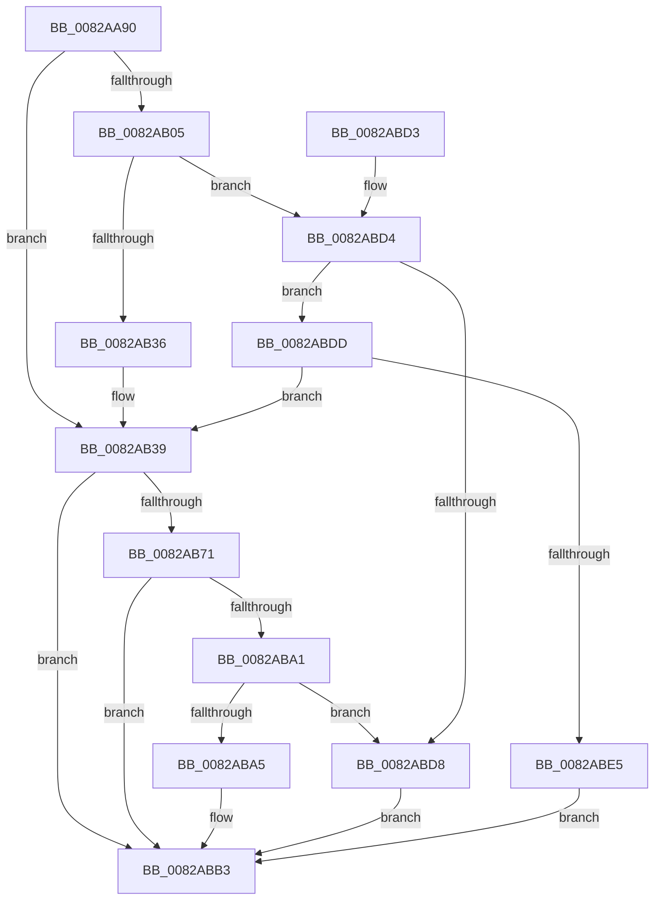

# CmSetInstallerClassRegProp

- RVA: `0x0082AA90`–`0x0082ABEC` (길이 `348` bytes)
- VA: `0x000000014082AA90`
- 실행 섹션: `PAGE`
- PDB 이름 있음: `예`; PDB Function 태그: `아니요`
- unwind 정보 RVA: `0x000DA864`
- 디코드: `104`개 명령, `348/348` bytes 표시
- 미해석 바이트: `0` (있으면 어셈블리에 `.byte`로 보존)

> 이 문서는 커널 이미지의 기계어와 PDB 기호를 분석해 생성했습니다. 4번과 5번은 함수 원형과 자료형을 바이너리 사용 방식에서 추정한 C 해석이며 원본 소스 복구 결과는 아닙니다.

## 1. Dependencies

- 직접 호출 지점: **5**; 고유 호출 대상: **4**
- 직접 호출자로 확인된 함수: **2**
- RIP 상대 이미지 참조: **1**

### Outgoing calls
- `0x0082AACF` → [memset](../../text/6C/memset_function_006C6C40.md) (function, `0x006C6C40`)
- `0x0082AB26` → [guard_dispatch_icall](../../text/6B/guard_dispatch_icall_function_006BAAD0.md) (function, `0x006BAAD0`)
- `0x0082AB65` → [CmSetInstallerClassRegPropWorker](CmSetInstallerClassRegPropWorker_function_0082ABF4.md) (function, `0x0082ABF4`)
- `0x0082AB93` → [guard_dispatch_icall](../../text/6B/guard_dispatch_icall_function_006BAAD0.md) (function, `0x006BAAD0`)
- `0x0082ABBC` → [_security_check_cookie](../../text/6A/_security_check_cookie_function_006AC640.md) (function, `0x006AC640`)

### Direct callers
- [CmSetInstallerClassMappedPropertyFromRegProp](../83/CmSetInstallerClassMappedPropertyFromRegProp_function_008313A0.md) at `0x008314CE`
- [PiCMSetRegistryProperty](../96/PiCMSetRegistryProperty_function_00963118.md) at `0x009632BB`

### Static image references
- `0x0082AAA7` → RVA `0x00E0A740` (`.data`; read)

## 2. Other-region calls and transfers

- 다른 실행 섹션으로 향하는 call: **4**
  - `0x0082AACF` → [memset](../../text/6C/memset_function_006C6C40.md) (`PAGE` → `.text`)
  - `0x0082AB26` → [guard_dispatch_icall](../../text/6B/guard_dispatch_icall_function_006BAAD0.md) (`PAGE` → `.text`)
  - `0x0082AB93` → [guard_dispatch_icall](../../text/6B/guard_dispatch_icall_function_006BAAD0.md) (`PAGE` → `.text`)
  - `0x0082ABBC` → [_security_check_cookie](../../text/6A/_security_check_cookie_function_006AC640.md) (`PAGE` → `.text`)
- 별도 외부 분기/꼬리 이동을 확인하지 못했습니다.

## 3. Assembly (complete function range)

```asm
0082AA90  40 55                           push rbp
0082AA92  53                              push rbx
0082AA93  56                              push rsi
0082AA94  57                              push rdi
0082AA95  41 54                           push r12
0082AA97  41 56                           push r14
0082AA99  41 57                           push r15
0082AA9B  48 8D 6C 24 F9                  lea rbp, [rsp - 7]
0082AAA0  48 81 EC B0 00 00 00            sub rsp, 0xb0
0082AAA7  48 8B 05 92 FC 5D 00            mov rax, qword ptr [rip + 0x5dfc92]
0082AAAE  48 33 C4                        xor rax, rsp
0082AAB1  48 89 45 F7                     mov qword ptr [rbp - 9], rax
0082AAB5  48 8B 5D 6F                     mov rbx, qword ptr [rbp + 0x6f]
0082AAB9  4C 8B E2                        mov r12, rdx
0082AABC  33 D2                           xor edx, edx
0082AABE  49 8B F8                        mov rdi, r8
0082AAC1  4C 8B F9                        mov r15, rcx
0082AAC4  41 8B F1                        mov esi, r9d
0082AAC7  48 8D 4D 97                     lea rcx, [rbp - 0x69]
0082AACB  44 8D 42 58                     lea r8d, [rdx + 0x58]
0082AACF  E8 6C C1 E9 FF                  call 0x1406c6c40
0082AAD4  8B 45 67                        mov eax, dword ptr [rbp + 0x67]
0082AAD7  4D 8B B7 F8 01 00 00            mov r14, qword ptr [r15 + 0x1f8]
0082AADE  83 65 C3 00                     and dword ptr [rbp - 0x3d], 0
0082AAE2  89 45 B3                        mov dword ptr [rbp - 0x4d], eax
0082AAE5  8B 45 77                        mov eax, dword ptr [rbp + 0x77]
0082AAE8  48 89 7D A7                     mov qword ptr [rbp - 0x59], rdi
0082AAEC  BF 20 01 00 C0                  mov edi, 0xc0000120
0082AAF1  89 75 AF                        mov dword ptr [rbp - 0x51], esi
0082AAF4  BE 02 00 00 00                  mov esi, 2
0082AAF9  89 45 BF                        mov dword ptr [rbp - 0x41], eax
0082AAFC  48 89 5D B7                     mov qword ptr [rbp - 0x49], rbx
0082AB00  4D 85 F6                        test r14, r14
0082AB03  74 34                           je 0x14082ab39
0082AB05  48 8D 45 97                     lea rax, [rbp - 0x69]
0082AB09  44 8B C6                        mov r8d, esi
0082AB0C  48 89 44 24 28                  mov qword ptr [rsp + 0x28], rax
0082AB11  44 8D 4E 08                     lea r9d, [rsi + 8]
0082AB15  49 8B C6                        mov rax, r14
0082AB18  C7 44 24 20 01 00 00 00         mov dword ptr [rsp + 0x20], 1
0082AB20  49 8B D4                        mov rdx, r12
0082AB23  49 8B CF                        mov rcx, r15
0082AB26  E8 A5 FF E8 FF                  call 0x1406baad0
0082AB2B  3D 02 00 00 C0                  cmp eax, 0xc0000002
0082AB30  0F 85 9E 00 00 00               jne 0x14082abd4
0082AB36  45 33 F6                        xor r14d, r14d
0082AB39  8B 45 C3                        mov eax, dword ptr [rbp - 0x3d]
0082AB3C  49 8B D4                        mov rdx, r12
0082AB3F  44 8B 4D AF                     mov r9d, dword ptr [rbp - 0x51]
0082AB43  49 8B CF                        mov rcx, r15
0082AB46  4C 8B 45 A7                     mov r8, qword ptr [rbp - 0x59]
0082AB4A  89 44 24 38                     mov dword ptr [rsp + 0x38], eax
0082AB4E  8B 45 BF                        mov eax, dword ptr [rbp - 0x41]
0082AB51  89 44 24 30                     mov dword ptr [rsp + 0x30], eax
0082AB55  48 8B 45 B7                     mov rax, qword ptr [rbp - 0x49]
0082AB59  48 89 44 24 28                  mov qword ptr [rsp + 0x28], rax
0082AB5E  8B 45 B3                        mov eax, dword ptr [rbp - 0x4d]
0082AB61  89 44 24 20                     mov dword ptr [rsp + 0x20], eax
0082AB65  E8 8A 00 00 00                  call 0x14082abf4
0082AB6A  8B D8                           mov ebx, eax
0082AB6C  4D 85 F6                        test r14, r14
0082AB6F  74 42                           je 0x14082abb3
0082AB71  89 45 97                        mov dword ptr [rbp - 0x69], eax
0082AB74  41 B9 0A 00 00 00               mov r9d, 0xa
0082AB7A  48 8D 45 97                     lea rax, [rbp - 0x69]
0082AB7E  44 8B C6                        mov r8d, esi
0082AB81  48 89 44 24 28                  mov qword ptr [rsp + 0x28], rax
0082AB86  49 8B D4                        mov rdx, r12
0082AB89  49 8B C6                        mov rax, r14
0082AB8C  89 74 24 20                     mov dword ptr [rsp + 0x20], esi
0082AB90  49 8B CF                        mov rcx, r15
0082AB93  E8 38 FF E8 FF                  call 0x1406baad0
0082AB98  8B C8                           mov ecx, eax
0082AB9A  3D 02 00 00 C0                  cmp eax, 0xc0000002
0082AB9F  74 12                           je 0x14082abb3
0082ABA1  3B C7                           cmp eax, edi
0082ABA3  74 33                           je 0x14082abd8
0082ABA5  8B C3                           mov eax, ebx
0082ABA7  85 C9                           test ecx, ecx
0082ABA9  BB E5 00 00 C0                  mov ebx, 0xc00000e5
0082ABAE  0F 45 C3                        cmovne eax, ebx
0082ABB1  8B D8                           mov ebx, eax
0082ABB3  8B C3                           mov eax, ebx
0082ABB5  48 8B 4D F7                     mov rcx, qword ptr [rbp - 9]
0082ABB9  48 33 CC                        xor rcx, rsp
0082ABBC  E8 7F 1A E8 FF                  call 0x1406ac640
0082ABC1  48 81 C4 B0 00 00 00            add rsp, 0xb0
0082ABC8  41 5F                           pop r15
0082ABCA  41 5E                           pop r14
0082ABCC  41 5C                           pop r12
0082ABCE  5F                              pop rdi
0082ABCF  5E                              pop rsi
0082ABD0  5B                              pop rbx
0082ABD1  5D                              pop rbp
0082ABD2  C3                              ret
0082ABD3  CC                              int3
0082ABD4  3B C7                           cmp eax, edi
0082ABD6  75 05                           jne 0x14082abdd
0082ABD8  8B 5D 97                        mov ebx, dword ptr [rbp - 0x69]
0082ABDB  EB D6                           jmp 0x14082abb3
0082ABDD  85 C0                           test eax, eax
0082ABDF  0F 84 54 FF FF FF               je 0x14082ab39
0082ABE5  BB E5 00 00 C0                  mov ebx, 0xc00000e5
0082ABEA  EB C7                           jmp 0x14082abb3
```

## 4. C-style interpretation (structured pseudocode)

```c
__int64 __fastcall CmSetInstallerClassRegProp(__int64 a1, __int64 a2, __int64 a3, int a4, unsigned int a5, __int64 a6, unsigned int a7)
{
    __int64 result;
    __int64 v_r14;
    __int64 v_rsp;
    unsigned __int64 v_stack_m3F;
    unsigned __int64 v_stack_m48;
    unsigned int v_stack_m7C;
    unsigned int v_stack_m80;
    unsigned __int64 v_stack_m88;
    unsigned int v_stack_m8C;
    unsigned int v_stack_m90;
    unsigned __int64 v_stack_m98;
    unsigned __int64 v_stack_mA8;
    unsigned int v_stack_mB0;
    unsigned int v_stack_mB8;
    unsigned __int64 v_stack_mC0;
    unsigned int v_stack_mC8;

    v_rsp = (v_rsp) - (176);
    result = (*(unsigned __int64 *)(v_rip + 6159506)) ^ (v_rsp);
    v_stack_m48 = result;
    a2 = 0;
    result = memset(v_stack_mA8, a2, a2 + 88, a4);
    v_stack_m8C = (unsigned int)((unsigned int)(a5));
    v_stack_m98 = a3;
    v_stack_m90 = (unsigned int)((unsigned int)(a4));
    v_stack_m80 = (unsigned int)((unsigned int)(a7));
    v_stack_m88 = a6;
    if (*(unsigned __int64 *)(a1 + 504) == 0) goto loc_0082AB39;
    v_stack_mC0 = v_stack_mA8;
    v_stack_mC8 = 1;
    result = guard_dispatch_icall(a1, 0, 2, 2 + 8);
    if (((unsigned int)(result)) != 0xC0000002ULL) goto loc_0082ABD4;
    v_r14 = 0;
loc_0082AB39:
    v_stack_mB0 = (unsigned int)((unsigned int)(v_stack_m7C));
    v_stack_mB8 = (unsigned int)((unsigned int)(v_stack_m80));
    v_stack_mC0 = v_stack_m88;
    v_stack_mC8 = (unsigned int)((unsigned int)(v_stack_m8C));
    result = CmSetInstallerClassRegPropWorker(a1, 0, v_stack_m98, (unsigned int)(v_stack_m90));
    if (0 == 0) goto loc_0082ABB3;
    v_stack_mA8 = (unsigned int)(result);
    v_stack_mC0 = v_stack_mA8;
    v_stack_mC8 = 2;
    result = guard_dispatch_icall(a1, 0, 2, 10);
    if (((unsigned int)(result)) == 0xC0000002ULL) goto loc_0082ABB3;
    if (((unsigned int)(result)) == ((unsigned int)((unsigned int)(0xC0000120ULL)))) goto loc_0082ABD8;
    result = (unsigned int)((unsigned int)((unsigned int)((unsigned int)(result))));
    if ((unsigned int)((unsigned int)((unsigned int)(result))) != 0) { result = (unsigned int)((unsigned int)(0xC00000E5ULL)); }
loc_0082ABB3:
    a1 = (v_stack_m48) ^ (v_rsp);
    result = _security_check_cookie(a1, 0, 2, 10);
    v_rsp = (v_rsp) + (176);
    return result;
loc_0082ABD4:
    if (((unsigned int)(result)) != ((unsigned int)((unsigned int)(0xC0000120ULL)))) goto loc_0082ABDD;
loc_0082ABD8:
    goto loc_0082ABB3;
loc_0082ABDD:
    if ((unsigned int)(result) == 0) goto loc_0082AB39;
    goto loc_0082ABB3;
}
```

## 5. (Beta) C Style

```c
int64_t CmSetInstallerClassRegProp(void *Arg1, int64_t Arg2, int64_t Arg3, int32_t Arg4, uint32_t Arg5, int64_t Arg6, uint32_t Arg7)
{
    uint8_t *arg1 = (uint8_t *)Arg1;

    int64_t result;
    int64_t local_r14;
    int64_t local_rsp;
    uint64_t v_stack_m3F;
    uint64_t v_stack_m48;
    uint32_t v_stack_m7C;
    uint32_t v_stack_m80;
    uint64_t v_stack_m88;
    uint32_t v_stack_m8C;
    uint32_t v_stack_m90;
    uint64_t v_stack_m98;
    uint64_t v_stack_mA8;
    uint32_t v_stack_mB0;
    uint32_t v_stack_mB8;
    uint64_t v_stack_mC0;
    uint32_t v_stack_mC8;

    local_rsp = (local_rsp) - (176);
    result = (*(uint64_t *)(v_rip + 0x5DFC92)) ^ (local_rsp);
    v_stack_m48 = result;
    Arg2 = 0;
    result = memset(v_stack_mA8, Arg2, Arg2 + 88, Arg4);
    v_stack_m8C = (uint32_t)((uint32_t)(Arg5));
    v_stack_m98 = Arg3;
    v_stack_m90 = (uint32_t)((uint32_t)(Arg4));
    v_stack_m80 = (uint32_t)((uint32_t)(Arg7));
    v_stack_m88 = Arg6;
    if (*(uint64_t *)(arg1 + 0x1F8) == 0) goto loc_0082AB39;
    v_stack_mC0 = v_stack_mA8;
    v_stack_mC8 = 1;
    result = guard_dispatch_icall(Arg1, 0, 2, 2 + 8);
    if (((uint32_t)(result)) != 0xC0000002ULL) goto loc_0082ABD4;
    local_r14 = 0;
loc_0082AB39:
    v_stack_mB0 = (uint32_t)((uint32_t)(v_stack_m7C));
    v_stack_mB8 = (uint32_t)((uint32_t)(v_stack_m80));
    v_stack_mC0 = v_stack_m88;
    v_stack_mC8 = (uint32_t)((uint32_t)(v_stack_m8C));
    result = CmSetInstallerClassRegPropWorker(Arg1, 0, v_stack_m98, (uint32_t)(v_stack_m90));
    if (0 == 0) goto loc_0082ABB3;
    v_stack_mA8 = (uint32_t)(result);
    v_stack_mC0 = v_stack_mA8;
    v_stack_mC8 = 2;
    result = guard_dispatch_icall(Arg1, 0, 2, 10);
    if (((uint32_t)(result)) == 0xC0000002ULL) goto loc_0082ABB3;
    if (((uint32_t)(result)) == ((uint32_t)((uint32_t)(0xC0000120ULL)))) goto loc_0082ABD8;
    result = (uint32_t)((uint32_t)((uint32_t)((uint32_t)(result))));
    if ((uint32_t)((uint32_t)((uint32_t)(result))) != 0) { result = (uint32_t)((uint32_t)(0xC00000E5ULL)); }
loc_0082ABB3:
    Arg1 = (v_stack_m48) ^ (local_rsp);
    result = _security_check_cookie(Arg1, 0, 2, 10);
    local_rsp = (local_rsp) + (176);
    return result;
loc_0082ABD4:
    if (((uint32_t)(result)) != ((uint32_t)((uint32_t)(0xC0000120ULL)))) goto loc_0082ABDD;
loc_0082ABD8:
    goto loc_0082ABB3;
loc_0082ABDD:
    if ((uint32_t)(result) == 0) goto loc_0082AB39;
    goto loc_0082ABB3;
}
```

### 관측된 메모리 오프셋

구조체 형식이 확인되지 않은 접근은 인자 기준의 오프셋으로만 기록했습니다.

| 기준 인자 | 오프셋 표현 | 폭 (bit) | 접근 |
|---|---:|---:|---|
| `Arg1` | `+ 0x1F8` | `64` | `R` |

## 6. Execution-region graph

[열기: 2D/3D 그래프와 함수 탐색 컨트롤 패널](../../../control-panel.html?section=page&rva=0x0082AA90&view=graph)

- 2D 그래프는 위에서 아래로 흐르고, 3D 그래프는 빈 공간을 드래그해 회전합니다. Shift+드래그는 이동, 휠은 확대·축소, 함수 노드 선택은 대상 보고서 이동입니다.

### Static fallback


