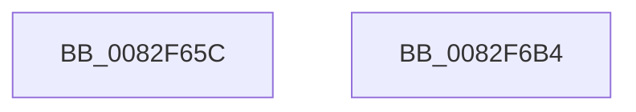

# CmValidateDevicePanelName

- RVA: `0x0082F65C`–`0x0082F6B5` (길이 `89` bytes)
- VA: `0x000000014082F65C`
- 실행 섹션: `PAGE`
- PDB 이름 있음: `예`; PDB Function 태그: `아니요`
- unwind 정보 RVA: `0x000C4098`
- 디코드: `22`개 명령, `89/89` bytes 표시
- 미해석 바이트: `0` (있으면 어셈블리에 `.byte`로 보존)

> 이 문서는 커널 이미지의 기계어와 PDB 기호를 분석해 생성했습니다. 4번과 5번은 함수 원형과 자료형을 바이너리 사용 방식에서 추정한 C 해석이며 원본 소스 복구 결과는 아닙니다.

## 1. Dependencies

- 직접 호출 지점: **2**; 고유 호출 대상: **2**
- 직접 호출자로 확인된 함수: **2**
- RIP 상대 이미지 참조: **1**

### Outgoing calls
- `0x0082F693` → [CmSplitDevicePanelId](../AC/CmSplitDevicePanelId_function_00ACEA18.md) (function, `0x00ACEA18`)
- `0x0082F6AA` → [_security_check_cookie](../../text/6A/_security_check_cookie_function_006AC640.md) (function, `0x006AC640`)

### Direct callers
- [CmGetDevicePanelRegKeyPath](CmGetDevicePanelRegKeyPath_function_0082EE7C.md) at `0x0082EE9D`
- [PnpDispatchDevicePanel](../83/PnpDispatchDevicePanel_function_00831830.md) at `0x00831A4D`

### Static image references
- `0x0082F660` → RVA `0x00E0A740` (`.data`; read)

## 2. Other-region calls and transfers

- 다른 실행 섹션으로 향하는 call: **1**
  - `0x0082F6AA` → [_security_check_cookie](../../text/6A/_security_check_cookie_function_006AC640.md) (`PAGE` → `.text`)
- 별도 외부 분기/꼬리 이동을 확인하지 못했습니다.

## 3. Assembly (complete function range)

```asm
0082F65C  48 83 EC 48                     sub rsp, 0x48
0082F660  48 8B 05 D9 B0 5D 00            mov rax, qword ptr [rip + 0x5db0d9]
0082F667  48 33 C4                        xor rax, rsp
0082F66A  48 89 44 24 38                  mov qword ptr [rsp + 0x38], rax
0082F66F  83 64 24 24 00                  and dword ptr [rsp + 0x24], 0
0082F674  4C 8D 4C 24 20                  lea r9, [rsp + 0x20]
0082F679  83 64 24 20 00                  and dword ptr [rsp + 0x20], 0
0082F67E  4C 8D 44 24 24                  lea r8, [rsp + 0x24]
0082F683  48 8B CA                        mov rcx, rdx
0082F686  0F 57 C0                        xorps xmm0, xmm0
0082F689  48 8D 54 24 28                  lea rdx, [rsp + 0x28]
0082F68E  0F 11 44 24 28                  movups xmmword ptr [rsp + 0x28], xmm0
0082F693  E8 80 F3 29 00                  call 0x140acea18
0082F698  85 C0                           test eax, eax
0082F69A  B9 33 00 00 C0                  mov ecx, 0xc0000033
0082F69F  0F 48 C1                        cmovs eax, ecx
0082F6A2  48 8B 4C 24 38                  mov rcx, qword ptr [rsp + 0x38]
0082F6A7  48 33 CC                        xor rcx, rsp
0082F6AA  E8 91 CF E7 FF                  call 0x1406ac640
0082F6AF  48 83 C4 48                     add rsp, 0x48
0082F6B3  C3                              ret
0082F6B4  CC                              int3
```

## 4. C-style interpretation (structured pseudocode)

```c
__int64 __fastcall CmValidateDevicePanelName(__int64 a1, __int64 a2)
{
    __int64 result;
    __int64 v_rsp;
    unsigned __int64 v_stack_m10;
    unsigned __int64 v_stack_m20;
    unsigned int v_stack_m24;
    unsigned __int64 v_stack_m28;

    v_rsp = (v_rsp) - (72);
    result = (*(unsigned __int64 *)(v_rip + 6140121)) ^ (v_rsp);
    v_stack_m10 = result;
    v_stack_m20 = v_xmm0;
    result = CmSplitDevicePanelId(a2, v_stack_m20, v_stack_m24, v_stack_m28);
    if (sign_flag) { result = (unsigned int)((unsigned int)(0xC0000033ULL)); }
    a1 = (v_stack_m10) ^ (v_rsp);
    result = _security_check_cookie(a1, v_stack_m20, v_stack_m24, v_stack_m28);
    v_rsp = (v_rsp) + (72);
    return result;
}
```

## 5. (Beta) C Style

```c
int64_t CmValidateDevicePanelName(int64_t Arg1, int64_t Arg2)
{
    int64_t result;
    int64_t local_rsp;
    uint64_t v_stack_m10;
    uint64_t v_stack_m20;
    uint32_t v_stack_m24;
    uint64_t v_stack_m28;

    local_rsp = (local_rsp) - (72);
    result = (*(uint64_t *)(v_rip + 0x5DB0D9)) ^ (local_rsp);
    v_stack_m10 = result;
    v_stack_m20 = v_xmm0;
    result = CmSplitDevicePanelId(Arg2, v_stack_m20, v_stack_m24, v_stack_m28);
    if (sign_flag) { result = (uint32_t)((uint32_t)(0xC0000033ULL)); }
    Arg1 = (v_stack_m10) ^ (local_rsp);
    result = _security_check_cookie(Arg1, v_stack_m20, v_stack_m24, v_stack_m28);
    local_rsp = (local_rsp) + (72);
    return result;
}
```

## 6. Execution-region graph

[열기: 2D/3D 그래프와 함수 탐색 컨트롤 패널](../../../control-panel.html?section=page&rva=0x0082F65C&view=graph)

- 2D 그래프는 위에서 아래로 흐르고, 3D 그래프는 빈 공간을 드래그해 회전합니다. Shift+드래그는 이동, 휠은 확대·축소, 함수 노드 선택은 대상 보고서 이동입니다.

### Static fallback


