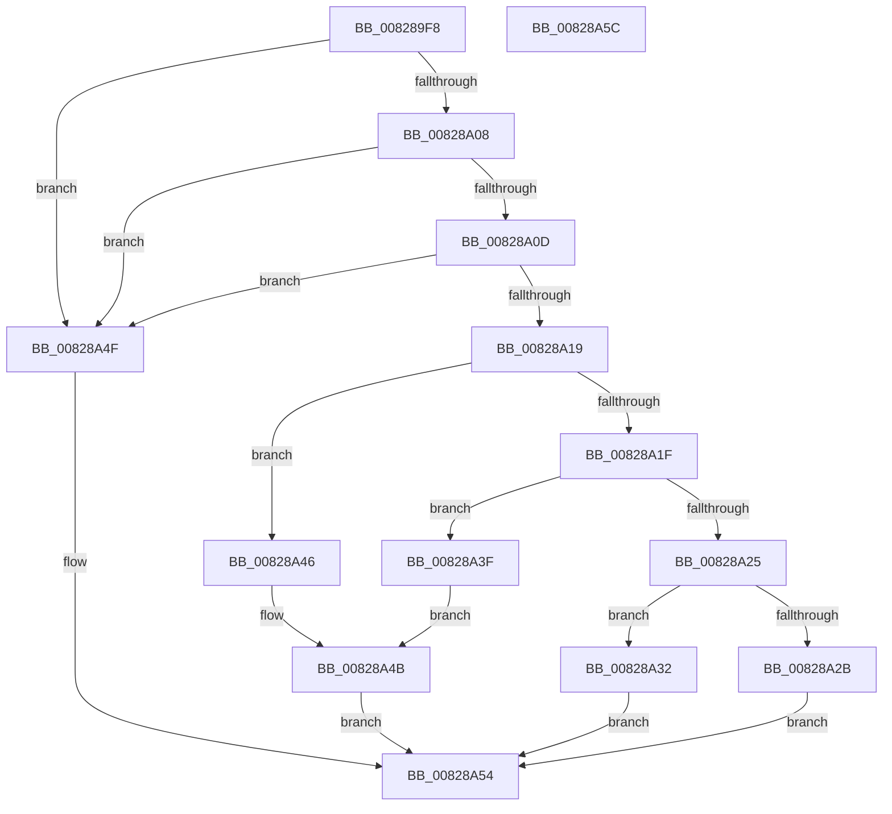

# IidCloneDeviceId

- RVA: `0x008289F8`–`0x00828A5D` (길이 `101` bytes)
- VA: `0x00000001408289F8`
- 실행 섹션: `PAGE`
- PDB 이름 있음: `예`; PDB Function 태그: `아니요`
- unwind 정보 RVA: `0x0005CF00`
- 디코드: `35`개 명령, `101/101` bytes 표시
- 미해석 바이트: `0` (있으면 어셈블리에 `.byte`로 보존)

> 이 문서는 커널 이미지의 기계어와 PDB 기호를 분석해 생성했습니다. 4번과 5번은 함수 원형과 자료형을 바이너리 사용 방식에서 추정한 C 해석이며 원본 소스 복구 결과는 아닙니다.

## 1. Dependencies

- 직접 호출 지점: **3**; 고유 호출 대상: **3**
- 직접 호출자로 확인된 함수: **2**
- RIP 상대 이미지 참조: **0**

### Outgoing calls
- `0x00828A38` → [memcpy](../../text/6C/memcpy_function_006C6840.md) (function, `0x006C6840`)
- `0x00828A3F` → [IidCloneDeviceIdAcpi](../../text/6A/IidCloneDeviceIdAcpi_function_006A2C88.md) (function, `0x006A2C88`)
- `0x00828A46` → [IidCloneDeviceIdPci](../../text/6A/IidCloneDeviceIdPci_function_006A2CD0.md) (function, `0x006A2CD0`)

### Direct callers
- [HalpIommuCloneDeviceId](../../text/4E/HalpIommuCloneDeviceId_function_004E4228.md) at `0x004E4270`
- [HalpDmaAllocateChildAdapterV3](../70/HalpDmaAllocateChildAdapterV3_function_007066A0.md) at `0x00706AF1`

### Static image references
- 디코드된 RIP-relative 메모리 참조가 없습니다.

## 2. Other-region calls and transfers

- 다른 실행 섹션으로 향하는 call: **3**
  - `0x00828A38` → [memcpy](../../text/6C/memcpy_function_006C6840.md) (`PAGE` → `.text`)
  - `0x00828A3F` → [IidCloneDeviceIdAcpi](../../text/6A/IidCloneDeviceIdAcpi_function_006A2C88.md) (`PAGE` → `.text`)
  - `0x00828A46` → [IidCloneDeviceIdPci](../../text/6A/IidCloneDeviceIdPci_function_006A2CD0.md) (`PAGE` → `.text`)
- 별도 외부 분기/꼬리 이동을 확인하지 못했습니다.

## 3. Assembly (complete function range)

```asm
008289F8  40 53                           push rbx
008289FA  48 83 EC 20                     sub rsp, 0x20
008289FE  33 DB                           xor ebx, ebx
00828A00  4C 8B D2                        mov r10, rdx
00828A03  48 85 C9                        test rcx, rcx
00828A06  74 47                           je 0x140828a4f
00828A08  48 85 D2                        test rdx, rdx
00828A0B  74 42                           je 0x140828a4f
00828A0D  44 8B 09                        mov r9d, dword ptr [rcx]
00828A10  41 8D 41 FF                     lea eax, [r9 - 1]
00828A14  83 F8 04                        cmp eax, 4
00828A17  77 36                           ja 0x140828a4f
00828A19  41 83 E9 01                     sub r9d, 1
00828A1D  74 27                           je 0x140828a46
00828A1F  41 83 E9 01                     sub r9d, 1
00828A23  74 1A                           je 0x140828a3f
00828A25  41 83 F9 03                     cmp r9d, 3
00828A29  74 07                           je 0x140828a32
00828A2B  BB BB 00 00 C0                  mov ebx, 0xc00000bb
00828A30  EB 22                           jmp 0x140828a54
00828A32  48 8B D1                        mov rdx, rcx
00828A35  49 8B CA                        mov rcx, r10
00828A38  E8 03 DE E9 FF                  call 0x1406c6840
00828A3D  EB 15                           jmp 0x140828a54
00828A3F  E8 44 A2 E7 FF                  call 0x1406a2c88
00828A44  EB 05                           jmp 0x140828a4b
00828A46  E8 85 A2 E7 FF                  call 0x1406a2cd0
00828A4B  8B D8                           mov ebx, eax
00828A4D  EB 05                           jmp 0x140828a54
00828A4F  BB 0D 00 00 C0                  mov ebx, 0xc000000d
00828A54  8B C3                           mov eax, ebx
00828A56  48 83 C4 20                     add rsp, 0x20
00828A5A  5B                              pop rbx
00828A5B  C3                              ret
00828A5C  CC                              int3
```

## 4. C-style interpretation (structured pseudocode)

```c
__int64 __fastcall IidCloneDeviceId(__int64 a1, __int64 a2)
{
    __int64 result;
    __int64 v_rbx;
    __int64 v_rsp;

    v_rsp = (v_rsp) - (32);
    v_rbx = 0;
    if (a1 == 0) goto loc_00828A4F;
    if (a2 == 0) goto loc_00828A4F;
    if (((unsigned int)((unsigned int)(*(unsigned int *)(a1)) - 1)) > 4) goto loc_00828A4F;
    a4 = (unsigned int)(((unsigned int)(*(unsigned int *)(a1))) - (1));
    if (condition_is_equal) goto loc_00828A46;
    a4 = (unsigned int)((a4) - (1));
    if (condition_is_equal) goto loc_00828A3F;
    if (((unsigned int)(a4)) == 3) goto loc_00828A32;
    goto loc_00828A54;
loc_00828A32:
    result = memcpy(a2, a1, a3, a4);
    goto loc_00828A54;
loc_00828A3F:
    result = IidCloneDeviceIdAcpi(a2, a1, a3, a4);
    goto loc_00828A4B;
loc_00828A46:
    result = IidCloneDeviceIdPci(a2, a1, a3, a4);
loc_00828A4B:
    goto loc_00828A54;
loc_00828A4F:
loc_00828A54:
    v_rsp = (v_rsp) + (32);
    return (unsigned int)((unsigned int)((unsigned int)(0xC000000DULL)));
}
```

## 5. (Beta) C Style

```c
int64_t IidCloneDeviceId(int64_t Arg1, int64_t Arg2)
{
    int64_t result;
    int64_t local_rbx;
    int64_t local_rsp;

    local_rsp = (local_rsp) - (32);
    local_rbx = 0;
    if (Arg1 == 0) goto loc_00828A4F;
    if (Arg2 == 0) goto loc_00828A4F;
    if (((uint32_t)((uint32_t)(*(uint32_t *)(Arg1)) - 1)) > 4) goto loc_00828A4F;
    a4 = (uint32_t)(((uint32_t)(*(uint32_t *)(Arg1))) - (1));
    if (condition_is_equal) goto loc_00828A46;
    a4 = (uint32_t)((a4) - (1));
    if (condition_is_equal) goto loc_00828A3F;
    if (((uint32_t)(a4)) == 3) goto loc_00828A32;
    goto loc_00828A54;
loc_00828A32:
    result = memcpy(Arg2, Arg1, a3, a4);
    goto loc_00828A54;
loc_00828A3F:
    result = IidCloneDeviceIdAcpi(Arg2, Arg1, a3, a4);
    goto loc_00828A4B;
loc_00828A46:
    result = IidCloneDeviceIdPci(Arg2, Arg1, a3, a4);
loc_00828A4B:
    goto loc_00828A54;
loc_00828A4F:
loc_00828A54:
    local_rsp = (local_rsp) + (32);
    return (uint32_t)((uint32_t)((uint32_t)(0xC000000DULL)));
}
```

## 6. Execution-region graph

[열기: 2D/3D 그래프와 함수 탐색 컨트롤 패널](../../../control-panel.html?section=page&rva=0x008289F8&view=graph)

- 2D 그래프는 위에서 아래로 흐르고, 3D 그래프는 빈 공간을 드래그해 회전합니다. Shift+드래그는 이동, 휠은 확대·축소, 함수 노드 선택은 대상 보고서 이동입니다.

### Static fallback


