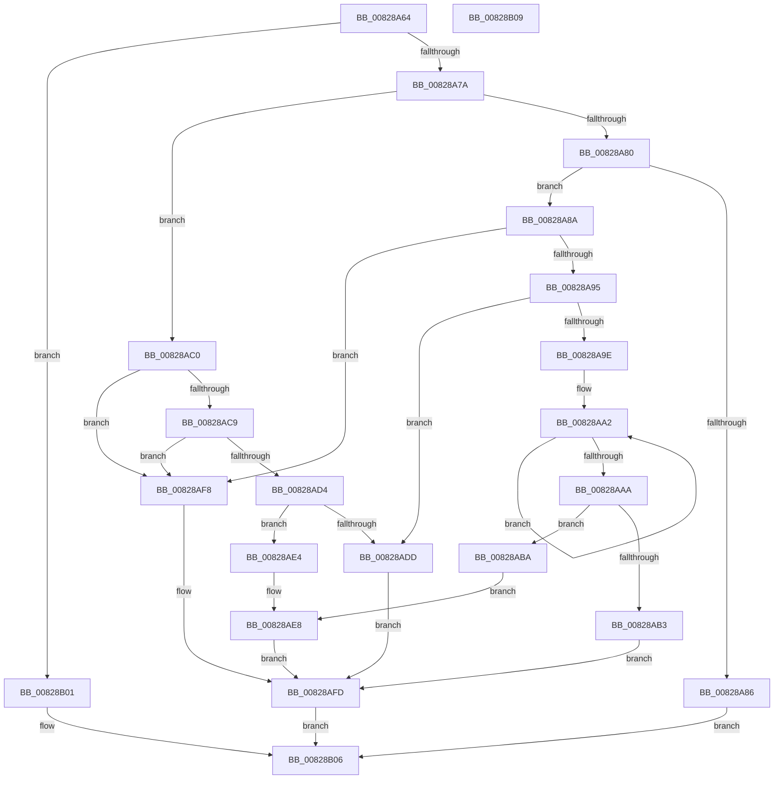

# IidValidateDeviceId

- RVA: `0x00828A64`–`0x00828B0A` (길이 `166` bytes)
- VA: `0x0000000140828A64`
- 실행 섹션: `PAGE`
- PDB 이름 있음: `예`; PDB Function 태그: `아니요`
- unwind 정보 RVA: `0x000DB714`
- 디코드: `54`개 명령, `166/166` bytes 표시
- 미해석 바이트: `0` (있으면 어셈블리에 `.byte`로 보존)

> 이 문서는 커널 이미지의 기계어와 PDB 기호를 분석해 생성했습니다. 4번과 5번은 함수 원형과 자료형을 바이너리 사용 방식에서 추정한 C 해석이며 원본 소스 복구 결과는 아닙니다.

## 1. Dependencies

- 직접 호출 지점: **0**; 고유 호출 대상: **0**
- 직접 호출자로 확인된 함수: **1**
- RIP 상대 이미지 참조: **0**

### Outgoing calls
- 직접 디코드된 call 명령이 없습니다.

### Direct callers
- [PipIommuRetrieveDeviceId](../74/PipIommuRetrieveDeviceId_function_00740308.md) at `0x007403AA`

### Static image references
- 디코드된 RIP-relative 메모리 참조가 없습니다.

## 2. Other-region calls and transfers

- 다른 실행 섹션으로 향하는 call: **0**
- 별도 외부 분기/꼬리 이동을 확인하지 못했습니다.

## 3. Assembly (complete function range)

```asm
00828A64  44 8B 01                        mov r8d, dword ptr [rcx]
00828A67  4C 8B D2                        mov r10, rdx
00828A6A  4C 8B C9                        mov r9, rcx
00828A6D  41 8D 40 FF                     lea eax, [r8 - 1]
00828A71  83 F8 04                        cmp eax, 4
00828A74  0F 87 87 00 00 00               ja 0x140828b01
00828A7A  41 83 E8 01                     sub r8d, 1
00828A7E  74 40                           je 0x140828ac0
00828A80  41 83 F8 01                     cmp r8d, 1
00828A84  74 04                           je 0x140828a8a
00828A86  33 C9                           xor ecx, ecx
00828A88  EB 7C                           jmp 0x140828b06
00828A8A  48 8B 51 08                     mov rdx, qword ptr [rcx + 8]
00828A8E  33 C9                           xor ecx, ecx
00828A90  48 85 D2                        test rdx, rdx
00828A93  74 63                           je 0x140828af8
00828A95  49 8D 41 18                     lea rax, [r9 + 0x18]
00828A99  48 3B D0                        cmp rdx, rax
00828A9C  72 3F                           jb 0x140828add
00828A9E  48 83 C8 FF                     or rax, 0xffffffffffffffff
00828AA2  48 FF C0                        inc rax
00828AA5  38 0C 02                        cmp byte ptr [rdx + rax], cl
00828AA8  75 F8                           jne 0x140828aa2
00828AAA  48 FF C0                        inc rax
00828AAD  48 83 F8 01                     cmp rax, 1
00828AB1  77 07                           ja 0x140828aba
00828AB3  B8 38 00 04 C0                  mov eax, 0xc0040038
00828AB8  EB 43                           jmp 0x140828afd
00828ABA  48 8D 0C 02                     lea rcx, [rdx + rax]
00828ABE  EB 28                           jmp 0x140828ae8
00828AC0  48 8B 51 10                     mov rdx, qword ptr [rcx + 0x10]
00828AC4  48 85 D2                        test rdx, rdx
00828AC7  74 2F                           je 0x140828af8
00828AC9  45 0F B7 41 0E                  movzx r8d, word ptr [r9 + 0xe]
00828ACE  66 45 85 C0                     test r8w, r8w
00828AD2  74 24                           je 0x140828af8
00828AD4  49 8D 41 18                     lea rax, [r9 + 0x18]
00828AD8  48 3B D0                        cmp rdx, rax
00828ADB  73 07                           jae 0x140828ae4
00828ADD  B8 41 01 00 C0                  mov eax, 0xc0000141
00828AE2  EB 19                           jmp 0x140828afd
00828AE4  4A 8D 0C 02                     lea rcx, [rdx + r8]
00828AE8  4B 8D 04 11                     lea rax, [r9 + r10]
00828AEC  48 3B C1                        cmp rax, rcx
00828AEF  1B C0                           sbb eax, eax
00828AF1  25 05 00 00 80                  and eax, 0x80000005
00828AF6  EB 05                           jmp 0x140828afd
00828AF8  B8 06 02 00 C0                  mov eax, 0xc0000206
00828AFD  8B C8                           mov ecx, eax
00828AFF  EB 05                           jmp 0x140828b06
00828B01  B9 0D 00 00 C0                  mov ecx, 0xc000000d
00828B06  8B C1                           mov eax, ecx
00828B08  C3                              ret
00828B09  CC                              int3
```

## 4. C-style interpretation (structured pseudocode)

```c
__int64 __fastcall IidValidateDeviceId(__int64 a1, __int64 a2)
{
    __int64 result;

    if (((unsigned int)((unsigned int)(*(unsigned int *)(a1)) - 1)) > 4) goto loc_00828B01;
    a3 = (unsigned int)(((unsigned int)(*(unsigned int *)(a1))) - (1));
    if (condition_is_equal) goto loc_00828AC0;
    if (((unsigned int)(a3)) == 1) goto loc_00828A8A;
    a1 = 0;
    goto loc_00828B06;
loc_00828A8A:
    a1 = 0;
    if (*(unsigned __int64 *)(a1 + 8) == 0) goto loc_00828AF8;
    if ((*(unsigned __int64 *)(a1 + 8)) < (a1 + 24)) goto loc_00828ADD;
    result = (a1 + 24) | (-1);
loc_00828AA2:
    result = (result) + 1;
    if ((*(unsigned __int8 *)(*(unsigned __int64 *)(a1 + 8) + result * 1)) != 0) goto loc_00828AA2;
    result = (result) + 1;
    if (result > 1) goto loc_00828ABA;
    goto loc_00828AFD;
loc_00828ABA:
    goto loc_00828AE8;
loc_00828AC0:
    if (*(unsigned __int64 *)(*(unsigned __int64 *)(a1 + 8) + (unsigned int)(0xC0040038ULL) * 1 + 16) == 0) goto loc_00828AF8;
    if ((unsigned __int16)(*(unsigned __int16 *)(a1 + 14)) == 0) goto loc_00828AF8;
    if ((*(unsigned __int64 *)(*(unsigned __int64 *)(a1 + 8) + (unsigned int)(0xC0040038ULL) * 1 + 16)) >= (a1 + 24)) goto loc_00828AE4;
loc_00828ADD:
    goto loc_00828AFD;
loc_00828AE4:
loc_00828AE8:
    result = (unsigned int)((a1 + a2 * 1) & (0x80000005ULL));
    goto loc_00828AFD;
loc_00828AF8:
loc_00828AFD:
    goto loc_00828B06;
loc_00828B01:
loc_00828B06:
    return (unsigned int)((unsigned int)((unsigned int)(0xC000000DULL)));
}
```

## 5. (Beta) C Style

```c
int64_t IidValidateDeviceId(void *Arg1, int64_t Arg2)
{
    uint8_t *arg1 = (uint8_t *)Arg1;

    int64_t result;

    if (((uint32_t)((uint32_t)(*(uint32_t *)(arg1)) - 1)) > 4) goto loc_00828B01;
    a3 = (uint32_t)(((uint32_t)(*(uint32_t *)(arg1))) - (1));
    if (condition_is_equal) goto loc_00828AC0;
    if (((uint32_t)(a3)) == 1) goto loc_00828A8A;
    Arg1 = 0;
    goto loc_00828B06;
loc_00828A8A:
    Arg1 = 0;
    if (*(uint64_t *)(arg1 + 0x8) == 0) goto loc_00828AF8;
    if ((*(uint64_t *)(arg1 + 0x8)) < (Arg1 + 24)) goto loc_00828ADD;
    result = (Arg1 + 24) | (-1);
loc_00828AA2:
    result = (result) + 1;
    if ((*(uint8_t *)(*(uint64_t *)(arg1 + 0x8) + result * 1)) != 0) goto loc_00828AA2;
    result = (result) + 1;
    if (result > 1) goto loc_00828ABA;
    goto loc_00828AFD;
loc_00828ABA:
    goto loc_00828AE8;
loc_00828AC0:
    if (*(uint64_t *)(*(uint64_t *)(arg1 + 0x8) + (uint32_t)(0xC0040038ULL) * 1 + 0x10) == 0) goto loc_00828AF8;
    if ((uint16_t)(*(uint16_t *)(arg1 + 0xE)) == 0) goto loc_00828AF8;
    if ((*(uint64_t *)(*(uint64_t *)(arg1 + 0x8) + (uint32_t)(0xC0040038ULL) * 1 + 0x10)) >= (Arg1 + 24)) goto loc_00828AE4;
loc_00828ADD:
    goto loc_00828AFD;
loc_00828AE4:
loc_00828AE8:
    result = (uint32_t)((Arg1 + Arg2 * 1) & (0x80000005ULL));
    goto loc_00828AFD;
loc_00828AF8:
loc_00828AFD:
    goto loc_00828B06;
loc_00828B01:
loc_00828B06:
    return (uint32_t)((uint32_t)((uint32_t)(0xC000000DULL)));
}
```

### 관측된 메모리 오프셋

구조체 형식이 확인되지 않은 접근은 인자 기준의 오프셋으로만 기록했습니다.

| 기준 인자 | 오프셋 표현 | 폭 (bit) | 접근 |
|---|---:|---:|---|
| `Arg1` | `+ 0x0` | `32` | `R` |
| `Arg1` | `+ 0x0 + r10*1` | `64` | `R` |
| `Arg1` | `+ 0x8` | `64` | `R` |
| `Arg1` | `+ 0xE` | `16` | `R` |
| `Arg1` | `+ 0x10` | `64` | `R` |
| `Arg1` | `+ 0x18` | `64` | `R` |

## 6. Execution-region graph

[열기: 2D/3D 그래프와 함수 탐색 컨트롤 패널](../../../control-panel.html?section=page&rva=0x00828A64&view=graph)

- 2D 그래프는 위에서 아래로 흐르고, 3D 그래프는 빈 공간을 드래그해 회전합니다. Shift+드래그는 이동, 휠은 확대·축소, 함수 노드 선택은 대상 보고서 이동입니다.

### Static fallback


