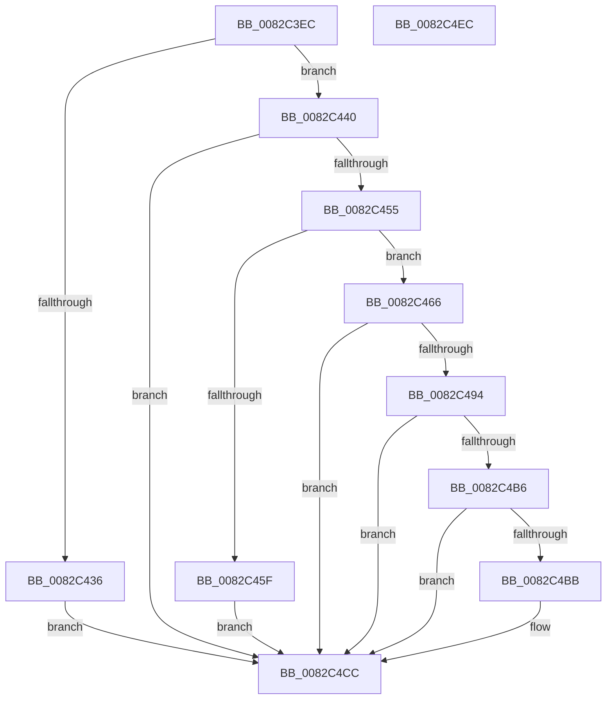

# PnpCreateObjectDispatch

- RVA: `0x0082C3EC`–`0x0082C4ED` (길이 `257` bytes)
- VA: `0x000000014082C3EC`
- 실행 섹션: `PAGE`
- PDB 이름 있음: `예`; PDB Function 태그: `아니요`
- unwind 정보 RVA: `0x00068E0C`
- 디코드: `70`개 명령, `257/257` bytes 표시
- 미해석 바이트: `0` (있으면 어셈블리에 `.byte`로 보존)

> 이 문서는 커널 이미지의 기계어와 PDB 기호를 분석해 생성했습니다. 4번과 5번은 함수 원형과 자료형을 바이너리 사용 방식에서 추정한 C 해석이며 원본 소스 복구 결과는 아닙니다.

## 1. Dependencies

- 직접 호출 지점: **4**; 고유 호출 대상: **4**
- 직접 호출자로 확인된 함수: **1**
- RIP 상대 이미지 참조: **0**

### Outgoing calls
- `0x0082C423` → [memset](../../text/6C/memset_function_006C6C40.md) (function, `0x006C6C40`)
- `0x0082C44A` → [PnpCtxGetObjectDispatchCallback](../A0/PnpCtxGetObjectDispatchCallback_function_00A044EC.md) (function, `0x00A044EC`)
- `0x0082C489` → [guard_dispatch_icall](../../text/6B/guard_dispatch_icall_function_006BAAD0.md) (function, `0x006BAAD0`)
- `0x0082C4C7` → [PnpObjectRaiseCreateEvent](../8F/PnpObjectRaiseCreateEvent_function_008FF9CC.md) (function, `0x008FF9CC`)

### Direct callers
- [PnpCreateObject](PnpCreateObject_function_0082C27C.md) at `0x0082C33D`

### Static image references
- 디코드된 RIP-relative 메모리 참조가 없습니다.

## 2. Other-region calls and transfers

- 다른 실행 섹션으로 향하는 call: **2**
  - `0x0082C423` → [memset](../../text/6C/memset_function_006C6C40.md) (`PAGE` → `.text`)
  - `0x0082C489` → [guard_dispatch_icall](../../text/6B/guard_dispatch_icall_function_006BAAD0.md) (`PAGE` → `.text`)
- 별도 외부 분기/꼬리 이동을 확인하지 못했습니다.

## 3. Assembly (complete function range)

```asm
0082C3EC  48 8B C4                        mov rax, rsp
0082C3EF  48 89 58 08                     mov qword ptr [rax + 8], rbx
0082C3F3  48 89 68 10                     mov qword ptr [rax + 0x10], rbp
0082C3F7  48 89 70 18                     mov qword ptr [rax + 0x18], rsi
0082C3FB  48 89 78 20                     mov qword ptr [rax + 0x20], rdi
0082C3FF  41 56                           push r14
0082C401  48 81 EC 80 00 00 00            sub rsp, 0x80
0082C408  48 83 60 A8 00                  and qword ptr [rax - 0x58], 0
0082C40D  48 8B EA                        mov rbp, rdx
0082C410  33 D2                           xor edx, edx
0082C412  41 8B F8                        mov edi, r8d
0082C415  48 8B F1                        mov rsi, rcx
0082C418  45 8B F1                        mov r14d, r9d
0082C41B  48 8D 48 B8                     lea rcx, [rax - 0x48]
0082C41F  44 8D 42 40                     lea r8d, [rdx + 0x40]
0082C423  E8 18 A8 E9 FF                  call 0x1406c6c40
0082C428  44 8B 94 24 C0 00 00 00         mov r10d, dword ptr [rsp + 0xc0]
0082C430  66 45 85 D2                     test r10w, r10w
0082C434  74 0A                           je 0x14082c440
0082C436  BB 0D 00 00 C0                  mov ebx, 0xc000000d
0082C43B  E9 8C 00 00 00                  jmp 0x14082c4cc
0082C440  4C 8D 44 24 30                  lea r8, [rsp + 0x30]
0082C445  8B D7                           mov edx, edi
0082C447  48 8B CE                        mov rcx, rsi
0082C44A  E8 9D 80 1D 00                  call 0x140a044ec
0082C44F  8B D8                           mov ebx, eax
0082C451  85 C0                           test eax, eax
0082C453  78 77                           js 0x14082c4cc
0082C455  48 8B 44 24 30                  mov rax, qword ptr [rsp + 0x30]
0082C45A  48 85 C0                        test rax, rax
0082C45D  75 07                           jne 0x14082c466
0082C45F  BB 02 00 00 C0                  mov ebx, 0xc0000002
0082C464  EB 66                           jmp 0x14082c4cc
0082C466  48 8D 4C 24 40                  lea rcx, [rsp + 0x40]
0082C46B  44 89 74 24 40                  mov dword ptr [rsp + 0x40], r14d
0082C470  48 89 4C 24 20                  mov qword ptr [rsp + 0x20], rcx
0082C475  41 B9 03 00 00 00               mov r9d, 3
0082C47B  48 8B CE                        mov rcx, rsi
0082C47E  44 89 54 24 54                  mov dword ptr [rsp + 0x54], r10d
0082C483  44 8B C7                        mov r8d, edi
0082C486  48 8B D5                        mov rdx, rbp
0082C489  E8 42 E6 E8 FF                  call 0x1406baad0
0082C48E  8B D8                           mov ebx, eax
0082C490  85 C0                           test eax, eax
0082C492  78 38                           js 0x14082c4cc
0082C494  48 8B 44 24 48                  mov rax, qword ptr [rsp + 0x48]
0082C499  8A 4C 24 50                     mov cl, byte ptr [rsp + 0x50]
0082C49D  4C 8B 8C 24 B0 00 00 00         mov r9, qword ptr [rsp + 0xb0]
0082C4A5  49 89 01                        mov qword ptr [r9], rax
0082C4A8  48 8B 84 24 B8 00 00 00         mov rax, qword ptr [rsp + 0xb8]
0082C4B0  88 08                           mov byte ptr [rax], cl
0082C4B2  84 C9                           test cl, cl
0082C4B4  74 16                           je 0x14082c4cc
0082C4B6  83 FF 07                        cmp edi, 7
0082C4B9  7C 11                           jl 0x14082c4cc
0082C4BB  4D 8B 09                        mov r9, qword ptr [r9]
0082C4BE  44 8B C7                        mov r8d, edi
0082C4C1  48 8B D5                        mov rdx, rbp
0082C4C4  48 8B CE                        mov rcx, rsi
0082C4C7  E8 00 35 0D 00                  call 0x1408ff9cc
0082C4CC  4C 8D 9C 24 80 00 00 00         lea r11, [rsp + 0x80]
0082C4D4  8B C3                           mov eax, ebx
0082C4D6  49 8B 5B 10                     mov rbx, qword ptr [r11 + 0x10]
0082C4DA  49 8B 6B 18                     mov rbp, qword ptr [r11 + 0x18]
0082C4DE  49 8B 73 20                     mov rsi, qword ptr [r11 + 0x20]
0082C4E2  49 8B 7B 28                     mov rdi, qword ptr [r11 + 0x28]
0082C4E6  49 8B E3                        mov rsp, r11
0082C4E9  41 5E                           pop r14
0082C4EB  C3                              ret
0082C4EC  CC                              int3
```

## 4. C-style interpretation (structured pseudocode)

```c
__int64 __fastcall PnpCreateObjectDispatch(__int64 a1, __int64 a2, int a3, int a4, __int64 a5, __int64 a6, unsigned int a7)
{
    __int64 result;
    __int64 v_rsp;
    unsigned int v_stack_m34;
    unsigned __int8 v_stack_m38;
    unsigned __int64 v_stack_m40;
    unsigned __int64 v_stack_m48;
    unsigned __int64 v_stack_m58;
    unsigned __int64 v_stack_m68;
    unsigned __int64 v_stack_m8;

    *(unsigned __int64 *)(v_rsp + 8) = v_rbx;
    *(unsigned __int64 *)(v_rsp + 16) = v_rbp;
    *(unsigned __int64 *)(v_rsp + 24) = v_rsi;
    *(unsigned __int64 *)(v_rsp + 32) = v_rdi;
    v_rsp = (v_rsp) - (128);
    a2 = 0;
    result = memset(v_rsp - 72, a2, a2 + 64, a4);
    if ((unsigned __int16)((unsigned int)(a7)) == 0) goto loc_0082C440;
    goto loc_0082C4CC;
loc_0082C440:
    result = PnpCtxGetObjectDispatchCallback(a1, (unsigned int)((unsigned int)((unsigned int)(a3))), v_stack_m58, a4);
    if (sign_flag) goto loc_0082C4CC;
    if (v_stack_m58 != 0) goto loc_0082C466;
    goto loc_0082C4CC;
loc_0082C466:
    v_stack_m48 = (unsigned int)((unsigned int)(a4));
    v_stack_m68 = v_stack_m48;
    v_stack_m34 = (unsigned int)((unsigned int)(a7));
    result = guard_dispatch_icall(a1, 0, (unsigned int)((unsigned int)((unsigned int)(a3))), 3);
    if (sign_flag) goto loc_0082C4CC;
    *(unsigned __int64 *)(a5) = v_stack_m40;
    *(unsigned __int8 *)(a6) = (unsigned __int8)(v_stack_m38);
    if ((unsigned __int8)(v_stack_m38) == 0) goto loc_0082C4CC;
    result = a6;
    if (((unsigned int)((unsigned int)(a3))) >= 7) {
        a4 = *(unsigned __int64 *)(a5);
        a3 = (unsigned int)((unsigned int)(a3));
        a2 = 0;
        a1 = a1;
        result = PnpObjectRaiseCreateEvent(a1, a2, a3, a4);
    }
    return (unsigned int)((unsigned int)((unsigned int)((unsigned int)(result))));
}
```

## 5. (Beta) C Style

```c
int64_t PnpCreateObjectDispatch(int64_t Arg1, int64_t Arg2, int32_t Arg3, int32_t Arg4, void *Arg5, void *Arg6, uint32_t Arg7)
{
    uint8_t *arg5 = (uint8_t *)Arg5;
    uint8_t *arg6 = (uint8_t *)Arg6;

    int64_t result;
    int64_t local_rsp;
    uint32_t v_stack_m34;
    uint8_t v_stack_m38;
    uint64_t v_stack_m40;
    uint64_t v_stack_m48;
    uint64_t v_stack_m58;
    uint64_t v_stack_m68;
    uint64_t v_stack_m8;

    *(uint64_t *)(local_rsp + 0x8) = local_rbx;
    *(uint64_t *)(local_rsp + 0x10) = local_rbp;
    *(uint64_t *)(local_rsp + 0x18) = local_rsi;
    *(uint64_t *)(local_rsp + 0x20) = local_rdi;
    local_rsp = (local_rsp) - (128);
    Arg2 = 0;
    result = memset(local_rsp - 72, Arg2, Arg2 + 64, Arg4);
    if ((uint16_t)((uint32_t)(Arg7)) == 0) goto loc_0082C440;
    goto loc_0082C4CC;
loc_0082C440:
    result = PnpCtxGetObjectDispatchCallback(Arg1, (uint32_t)((uint32_t)((uint32_t)(Arg3))), v_stack_m58, Arg4);
    if (sign_flag) goto loc_0082C4CC;
    if (v_stack_m58 != 0) goto loc_0082C466;
    goto loc_0082C4CC;
loc_0082C466:
    v_stack_m48 = (uint32_t)((uint32_t)(Arg4));
    v_stack_m68 = v_stack_m48;
    v_stack_m34 = (uint32_t)((uint32_t)(Arg7));
    result = guard_dispatch_icall(Arg1, 0, (uint32_t)((uint32_t)((uint32_t)(Arg3))), 3);
    if (sign_flag) goto loc_0082C4CC;
    *(uint64_t *)(arg5) = v_stack_m40;
    *(uint8_t *)(arg6) = (uint8_t)(v_stack_m38);
    if ((uint8_t)(v_stack_m38) == 0) goto loc_0082C4CC;
    result = Arg6;
    if (((uint32_t)((uint32_t)(Arg3))) >= 7) {
        Arg4 = *(uint64_t *)(arg5);
        Arg3 = (uint32_t)((uint32_t)(Arg3));
        Arg2 = 0;
        Arg1 = Arg1;
        result = PnpObjectRaiseCreateEvent(Arg1, Arg2, Arg3, Arg4);
    }
    return (uint32_t)((uint32_t)((uint32_t)((uint32_t)(result))));
}
```

### 관측된 메모리 오프셋

구조체 형식이 확인되지 않은 접근은 인자 기준의 오프셋으로만 기록했습니다.

| 기준 인자 | 오프셋 표현 | 폭 (bit) | 접근 |
|---|---:|---:|---|
| `Arg5` | `+ 0x0` | `64` | `R` |
| `Arg5` | `+ 0x0` | `64` | `W` |
| `Arg6` | `+ 0x0` | `8` | `W` |

## 6. Execution-region graph

[열기: 2D/3D 그래프와 함수 탐색 컨트롤 패널](../../../control-panel.html?section=page&rva=0x0082C3EC&view=graph)

- 2D 그래프는 위에서 아래로 흐르고, 3D 그래프는 빈 공간을 드래그해 회전합니다. Shift+드래그는 이동, 휠은 확대·축소, 함수 노드 선택은 대상 보고서 이동입니다.

### Static fallback


