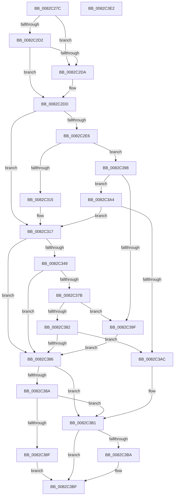

# PnpCreateObject

- RVA: `0x0082C27C`–`0x0082C3E3` (길이 `359` bytes)
- VA: `0x000000014082C27C`
- 실행 섹션: `PAGE`
- PDB 이름 있음: `예`; PDB Function 태그: `아니요`
- unwind 정보 RVA: `0x000DA944`
- 디코드: `102`개 명령, `359/359` bytes 표시
- 미해석 바이트: `0` (있으면 어셈블리에 `.byte`로 보존)

> 이 문서는 커널 이미지의 기계어와 PDB 기호를 분석해 생성했습니다. 4번과 5번은 함수 원형과 자료형을 바이너리 사용 방식에서 추정한 C 해석이며 원본 소스 복구 결과는 아닙니다.

## 1. Dependencies

- 직접 호출 지점: **5**; 고유 호출 대상: **4**
- 직접 호출자로 확인된 함수: **2**
- RIP 상대 이미지 참조: **1**

### Outgoing calls
- `0x0082C2B9` → [memset](../../text/6C/memset_function_006C6C40.md) (function, `0x006C6C40`)
- `0x0082C305` → [guard_dispatch_icall](../../text/6B/guard_dispatch_icall_function_006BAAD0.md) (function, `0x006BAAD0`)
- `0x0082C33D` → [PnpCreateObjectDispatch](PnpCreateObjectDispatch_function_0082C3EC.md) (function, `0x0082C3EC`)
- `0x0082C36F` → [guard_dispatch_icall](../../text/6B/guard_dispatch_icall_function_006BAAD0.md) (function, `0x006BAAD0`)
- `0x0082C3BA` → [ZwClose](../../text/6A/ZwClose_function_006AD2B0.md) (function, `0x006AD2B0`)

### Direct callers
- [PiCMCreateObject](../70/PiCMCreateObject_function_007015EC.md) at `0x0070173D`
- [sub_00B27F5C](../B2/Unknown_function_00B27F5C.md) at `0x00B27F70`

### Static image references
- `0x0082C29F` → RVA `0x00E66398` (`.data`; read)

## 2. Other-region calls and transfers

- 다른 실행 섹션으로 향하는 call: **4**
  - `0x0082C2B9` → [memset](../../text/6C/memset_function_006C6C40.md) (`PAGE` → `.text`)
  - `0x0082C305` → [guard_dispatch_icall](../../text/6B/guard_dispatch_icall_function_006BAAD0.md) (`PAGE` → `.text`)
  - `0x0082C36F` → [guard_dispatch_icall](../../text/6B/guard_dispatch_icall_function_006BAAD0.md) (`PAGE` → `.text`)
  - `0x0082C3BA` → [ZwClose](../../text/6A/ZwClose_function_006AD2B0.md) (`PAGE` → `.text`)
- 별도 외부 분기/꼬리 이동을 확인하지 못했습니다.

## 3. Assembly (complete function range)

```asm
0082C27C  48 8B C4                        mov rax, rsp
0082C27F  48 89 58 08                     mov qword ptr [rax + 8], rbx
0082C283  48 89 70 10                     mov qword ptr [rax + 0x10], rsi
0082C287  48 89 78 18                     mov qword ptr [rax + 0x18], rdi
0082C28B  4C 89 60 20                     mov qword ptr [rax + 0x20], r12
0082C28F  55                              push rbp
0082C290  41 56                           push r14
0082C292  41 57                           push r15
0082C294  48 8D 68 B9                     lea rbp, [rax - 0x47]
0082C298  48 81 EC 90 00 00 00            sub rsp, 0x90
0082C29F  4C 8B 35 F2 A0 63 00            mov r14, qword ptr [rip + 0x63a0f2]
0082C2A6  48 8D 4D DF                     lea rcx, [rbp - 0x21]
0082C2AA  4C 8B E2                        mov r12, rdx
0082C2AD  45 8B F8                        mov r15d, r8d
0082C2B0  33 D2                           xor edx, edx
0082C2B2  41 8B D9                        mov ebx, r9d
0082C2B5  44 8D 42 50                     lea r8d, [rdx + 0x50]
0082C2B9  E8 82 A9 E9 FF                  call 0x1406c6c40
0082C2BE  49 8B B6 E8 01 00 00            mov rsi, qword ptr [r14 + 0x1e8]
0082C2C5  B9 01 00 00 00                  mov ecx, 1
0082C2CA  48 8B 7D 6F                     mov rdi, qword ptr [rbp + 0x6f]
0082C2CE  85 DB                           test ebx, ebx
0082C2D0  75 08                           jne 0x14082c2da
0082C2D2  89 4D EF                        mov dword ptr [rbp - 0x11], ecx
0082C2D5  48 85 FF                        test rdi, rdi
0082C2D8  74 03                           je 0x14082c2dd
0082C2DA  89 5D EF                        mov dword ptr [rbp - 0x11], ebx
0082C2DD  83 65 03 00                     and dword ptr [rbp + 3], 0
0082C2E1  48 85 F6                        test rsi, rsi
0082C2E4  74 31                           je 0x14082c317
0082C2E6  48 8D 45 DF                     lea rax, [rbp - 0x21]
0082C2EA  41 B9 03 00 00 00               mov r9d, 3
0082C2F0  48 89 44 24 28                  mov qword ptr [rsp + 0x28], rax
0082C2F5  45 8B C7                        mov r8d, r15d
0082C2F8  89 4C 24 20                     mov dword ptr [rsp + 0x20], ecx
0082C2FC  49 8B D4                        mov rdx, r12
0082C2FF  49 8B CE                        mov rcx, r14
0082C302  48 8B C6                        mov rax, rsi
0082C305  E8 C6 E7 E8 FF                  call 0x1406baad0
0082C30A  3D 02 00 00 C0                  cmp eax, 0xc0000002
0082C30F  0F 85 83 00 00 00               jne 0x14082c398
0082C315  33 F6                           xor esi, esi
0082C317  8B 45 03                        mov eax, dword ptr [rbp + 3]
0082C31A  45 8B C7                        mov r8d, r15d
0082C31D  44 8B 4D EF                     mov r9d, dword ptr [rbp - 0x11]
0082C321  49 8B D4                        mov rdx, r12
0082C324  89 44 24 30                     mov dword ptr [rsp + 0x30], eax
0082C328  49 8B CE                        mov rcx, r14
0082C32B  48 8D 45 FF                     lea rax, [rbp - 1]
0082C32F  48 89 44 24 28                  mov qword ptr [rsp + 0x28], rax
0082C334  48 8D 45 F7                     lea rax, [rbp - 9]
0082C338  48 89 44 24 20                  mov qword ptr [rsp + 0x20], rax
0082C33D  E8 AA 00 00 00                  call 0x14082c3ec
0082C342  8B D8                           mov ebx, eax
0082C344  48 85 F6                        test rsi, rsi
0082C347  74 3D                           je 0x14082c386
0082C349  89 45 DF                        mov dword ptr [rbp - 0x21], eax
0082C34C  41 B9 03 00 00 00               mov r9d, 3
0082C352  48 8D 45 DF                     lea rax, [rbp - 0x21]
0082C356  45 8B C7                        mov r8d, r15d
0082C359  48 89 44 24 28                  mov qword ptr [rsp + 0x28], rax
0082C35E  49 8B D4                        mov rdx, r12
0082C361  48 8B C6                        mov rax, rsi
0082C364  C7 44 24 20 02 00 00 00         mov dword ptr [rsp + 0x20], 2
0082C36C  49 8B CE                        mov rcx, r14
0082C36F  E8 5C E7 E8 FF                  call 0x1406baad0
0082C374  3D 02 00 00 C0                  cmp eax, 0xc0000002
0082C379  74 0B                           je 0x14082c386
0082C37B  3D 20 01 00 C0                  cmp eax, 0xc0000120
0082C380  74 1D                           je 0x14082c39f
0082C382  85 C0                           test eax, eax
0082C384  75 26                           jne 0x14082c3ac
0082C386  85 DB                           test ebx, ebx
0082C388  78 27                           js 0x14082c3b1
0082C38A  48 85 FF                        test rdi, rdi
0082C38D  74 22                           je 0x14082c3b1
0082C38F  48 8B 45 F7                     mov rax, qword ptr [rbp - 9]
0082C393  48 89 07                        mov qword ptr [rdi], rax
0082C396  EB 27                           jmp 0x14082c3bf
0082C398  3D 20 01 00 C0                  cmp eax, 0xc0000120
0082C39D  75 05                           jne 0x14082c3a4
0082C39F  8B 5D DF                        mov ebx, dword ptr [rbp - 0x21]
0082C3A2  EB E2                           jmp 0x14082c386
0082C3A4  85 C0                           test eax, eax
0082C3A6  0F 84 6B FF FF FF               je 0x14082c317
0082C3AC  BB E5 00 00 C0                  mov ebx, 0xc00000e5
0082C3B1  48 8B 4D F7                     mov rcx, qword ptr [rbp - 9]
0082C3B5  48 85 C9                        test rcx, rcx
0082C3B8  74 05                           je 0x14082c3bf
0082C3BA  E8 F1 0E E8 FF                  call 0x1406ad2b0
0082C3BF  4C 8D 9C 24 90 00 00 00         lea r11, [rsp + 0x90]
0082C3C7  8B C3                           mov eax, ebx
0082C3C9  49 8B 5B 20                     mov rbx, qword ptr [r11 + 0x20]
0082C3CD  49 8B 73 28                     mov rsi, qword ptr [r11 + 0x28]
0082C3D1  49 8B 7B 30                     mov rdi, qword ptr [r11 + 0x30]
0082C3D5  4D 8B 63 38                     mov r12, qword ptr [r11 + 0x38]
0082C3D9  49 8B E3                        mov rsp, r11
0082C3DC  41 5F                           pop r15
0082C3DE  41 5E                           pop r14
0082C3E0  5D                              pop rbp
0082C3E1  C3                              ret
0082C3E2  CC                              int3
```

## 4. C-style interpretation (structured pseudocode)

```c
__int64 __fastcall PnpCreateObject(__int64 a1, __int64 a2, int a3, int a4)
{
    __int64 result;
    __int64 v_rsi;
    __int64 v_rsp;
    unsigned __int64 v_stack_m18;
    unsigned int v_stack_m78;
    unsigned __int64 v_stack_m80;
    unsigned int v_stack_m88;

    *(unsigned __int64 *)(v_rsp + 8) = v_rbx;
    *(unsigned __int64 *)(v_rsp + 16) = v_rsi;
    *(unsigned __int64 *)(v_rsp + 24) = v_rdi;
    *(unsigned __int64 *)(v_rsp + 32) = v_r12;
    v_rsp = (v_rsp) - (144);
    a2 = 0;
    result = memset(v_rsp - 71 - 33, a2, a2 + 80, a4);
    if ((unsigned int)((unsigned int)(a4)) != 0) goto loc_0082C2DA;
    *(unsigned int *)(v_rsp - 71 - 17) = 1;
    if (*(unsigned __int64 *)(v_rsp - 71 + 111) != 0) {
        *(unsigned int *)(v_rsp - 71 - 17) = (unsigned int)((unsigned int)(a4));
    }
    if (*(unsigned __int64 *)(*(unsigned __int64 *)(v_rip + 6529266) + 488) == 0) goto loc_0082C317;
    v_stack_m80 = v_rsp - 71 - 33;
    v_stack_m88 = 1;
    result = guard_dispatch_icall(*(unsigned __int64 *)(v_rip + 6529266), 0, (unsigned int)((unsigned int)((unsigned int)(a3))), 3);
    if (((unsigned int)(result)) != 0xC0000002ULL) goto loc_0082C398;
    v_rsi = 0;
loc_0082C317:
    v_stack_m78 = (unsigned int)((unsigned int)(*(unsigned int *)(v_rsp - 71 + 3)));
    v_stack_m80 = v_rsp - 71 - 1;
    v_stack_m88 = v_rsp - 71 - 9;
    result = PnpCreateObjectDispatch(*(unsigned __int64 *)(v_rip + 6529266), 0, (unsigned int)((unsigned int)((unsigned int)(a3))), (unsigned int)(*(unsigned int *)(v_rsp - 71 - 17)));
    if (0 == 0) goto loc_0082C386;
    *(unsigned int *)(v_rsp - 71 - 33) = (unsigned int)(result);
    v_stack_m80 = v_rsp - 71 - 33;
    v_stack_m88 = 2;
    result = guard_dispatch_icall(*(unsigned __int64 *)(v_rip + 6529266), 0, (unsigned int)((unsigned int)((unsigned int)(a3))), 3);
    if (((unsigned int)(result)) == 0xC0000002ULL) goto loc_0082C386;
    if (((unsigned int)(result)) == 0xC0000120ULL) goto loc_0082C39F;
    if ((unsigned int)(result) != 0) goto loc_0082C3AC;
loc_0082C386:
    if (sign_flag) goto loc_0082C3B1;
    if (*(unsigned __int64 *)(v_rsp - 71 + 111) == 0) goto loc_0082C3B1;
    *(unsigned __int64 *)(*(unsigned __int64 *)(v_rsp - 71 + 111)) = *(unsigned __int64 *)(v_rsp - 71 - 9);
    goto loc_0082C3BF;
loc_0082C398:
    if (((unsigned int)(*(unsigned __int64 *)(v_rsp - 71 - 9))) != 0xC0000120ULL) goto loc_0082C3A4;
loc_0082C39F:
    goto loc_0082C386;
loc_0082C3A4:
    if ((unsigned int)(*(unsigned __int64 *)(v_rsp - 71 - 9)) == 0) goto loc_0082C317;
loc_0082C3AC:
loc_0082C3B1:
    result = *(unsigned __int64 *)(v_rsp - 71 - 9);
    if (*(unsigned __int64 *)(v_rsp - 71 - 9) != 0) {
        result = ZwClose(*(unsigned __int64 *)(v_rsp - 71 - 9), 0, (unsigned int)((unsigned int)((unsigned int)(a3))), 3);
    }
    return (unsigned int)((unsigned int)((unsigned int)(0xC00000E5ULL)));
}
```

## 5. (Beta) C Style

```c
int64_t PnpCreateObject(int64_t Arg1, int64_t Arg2, int32_t Arg3, int32_t Arg4)
{
    int64_t result;
    int64_t local_rsi;
    int64_t local_rsp;
    uint64_t v_stack_m18;
    uint32_t v_stack_m78;
    uint64_t v_stack_m80;
    uint32_t v_stack_m88;

    *(uint64_t *)(local_rsp + 0x8) = local_rbx;
    *(uint64_t *)(local_rsp + 0x10) = local_rsi;
    *(uint64_t *)(local_rsp + 0x18) = local_rdi;
    *(uint64_t *)(local_rsp + 0x20) = local_r12;
    local_rsp = (local_rsp) - (144);
    Arg2 = 0;
    result = memset(local_rsp - 71 - 33, Arg2, Arg2 + 80, Arg4);
    if ((uint32_t)((uint32_t)(Arg4)) != 0) goto loc_0082C2DA;
    *(uint32_t *)(local_rsp - 0x47 - 0x11) = 1;
    if (*(uint64_t *)(local_rsp - 0x47 + 0x6F) != 0) {
        *(uint32_t *)(local_rsp - 0x47 - 0x11) = (uint32_t)((uint32_t)(Arg4));
    }
    if (*(uint64_t *)(*(uint64_t *)(v_rip + 0x63A0F2) + 0x1E8) == 0) goto loc_0082C317;
    v_stack_m80 = local_rsp - 71 - 33;
    v_stack_m88 = 1;
    result = guard_dispatch_icall(*(uint64_t *)(v_rip + 0x63A0F2), 0, (uint32_t)((uint32_t)((uint32_t)(Arg3))), 3);
    if (((uint32_t)(result)) != 0xC0000002ULL) goto loc_0082C398;
    local_rsi = 0;
loc_0082C317:
    v_stack_m78 = (uint32_t)((uint32_t)(*(uint32_t *)(local_rsp - 0x47 + 0x3)));
    v_stack_m80 = local_rsp - 71 - 1;
    v_stack_m88 = local_rsp - 71 - 9;
    result = PnpCreateObjectDispatch(*(uint64_t *)(v_rip + 0x63A0F2), 0, (uint32_t)((uint32_t)((uint32_t)(Arg3))), (uint32_t)(*(uint32_t *)(local_rsp - 0x47 - 0x11)));
    if (0 == 0) goto loc_0082C386;
    *(uint32_t *)(local_rsp - 0x47 - 0x21) = (uint32_t)(result);
    v_stack_m80 = local_rsp - 71 - 33;
    v_stack_m88 = 2;
    result = guard_dispatch_icall(*(uint64_t *)(v_rip + 0x63A0F2), 0, (uint32_t)((uint32_t)((uint32_t)(Arg3))), 3);
    if (((uint32_t)(result)) == 0xC0000002ULL) goto loc_0082C386;
    if (((uint32_t)(result)) == 0xC0000120ULL) goto loc_0082C39F;
    if ((uint32_t)(result) != 0) goto loc_0082C3AC;
loc_0082C386:
    if (sign_flag) goto loc_0082C3B1;
    if (*(uint64_t *)(local_rsp - 0x47 + 0x6F) == 0) goto loc_0082C3B1;
    *(uint64_t *)(*(uint64_t *)(local_rsp - 0x47 + 0x6F)) = *(uint64_t *)(local_rsp - 0x47 - 0x9);
    goto loc_0082C3BF;
loc_0082C398:
    if (((uint32_t)(*(uint64_t *)(local_rsp - 0x47 - 0x9))) != 0xC0000120ULL) goto loc_0082C3A4;
loc_0082C39F:
    goto loc_0082C386;
loc_0082C3A4:
    if ((uint32_t)(*(uint64_t *)(local_rsp - 0x47 - 0x9)) == 0) goto loc_0082C317;
loc_0082C3AC:
loc_0082C3B1:
    result = *(uint64_t *)(local_rsp - 0x47 - 0x9);
    if (*(uint64_t *)(local_rsp - 0x47 - 0x9) != 0) {
        result = ZwClose(*(uint64_t *)(local_rsp - 0x47 - 0x9), 0, (uint32_t)((uint32_t)((uint32_t)(Arg3))), 3);
    }
    return (uint32_t)((uint32_t)((uint32_t)(0xC00000E5ULL)));
}
```

## 6. Execution-region graph

[열기: 2D/3D 그래프와 함수 탐색 컨트롤 패널](../../../control-panel.html?section=page&rva=0x0082C27C&view=graph)

- 2D 그래프는 위에서 아래로 흐르고, 3D 그래프는 빈 공간을 드래그해 회전합니다. Shift+드래그는 이동, 휠은 확대·축소, 함수 노드 선택은 대상 보고서 이동입니다.

### Static fallback


