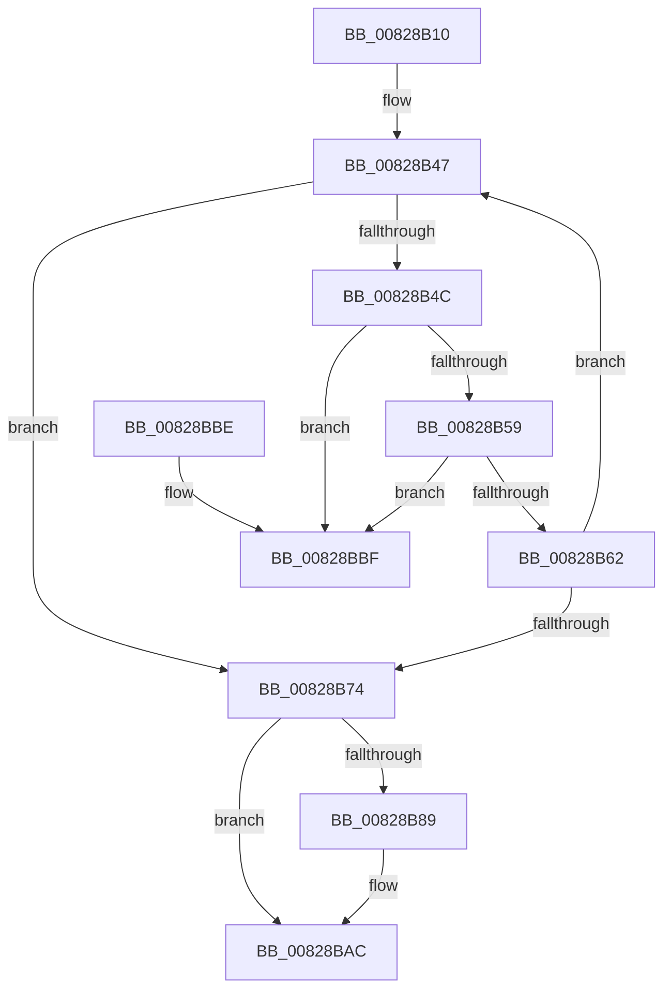

# PnpCtxCloseMachine

- RVA: `0x00828B10`–`0x00828BC6` (길이 `182` bytes)
- VA: `0x0000000140828B10`
- 실행 섹션: `PAGE`
- PDB 이름 있음: `예`; PDB Function 태그: `아니요`
- unwind 정보 RVA: `0x0006383C`
- 디코드: `51`개 명령, `182/182` bytes 표시
- 미해석 바이트: `0` (있으면 어셈블리에 `.byte`로 보존)

> 이 문서는 커널 이미지의 기계어와 PDB 기호를 분석해 생성했습니다. 4번과 5번은 함수 원형과 자료형을 바이너리 사용 방식에서 추정한 C 해석이며 원본 소스 복구 결과는 아닙니다.

## 1. Dependencies

- 직접 호출 지점: **7**; 고유 호출 대상: **6**
- 직접 호출자로 확인된 함수: **2**
- RIP 상대 이미지 참조: **0**

### Outgoing calls
- `0x00828B3E` → [ExAcquireResourceExclusiveLite](../../text/21/ExAcquireResourceExclusiveLite_function_00214E20.md) (function, `0x00214E20`)
- `0x00828B69` → [PnpCtxDestroyNode](PnpCtxDestroyNode_function_00828D50.md) (function, `0x00828D50`)
- `0x00828B7B` → [ExReleaseResourceLite](../../text/25/ExReleaseResourceLite_function_0025FA10.md) (function, `0x0025FA10`)
- `0x00828B80` → [KeLeaveCriticalRegion](../../text/25/KeLeaveCriticalRegion_function_0025D8B0.md) (function, `0x0025D8B0`)
- `0x00828B93` → [ExDeleteResourceLite](../../text/38/ExDeleteResourceLite_function_0038BA60.md) (function, `0x0038BA60`)
- `0x00828B9D` → [ExFreePoolWithTag](../../poolcode/B8/ExFreePoolWithTag_function_00B82870.md) (function, `0x00B82870`)
- `0x00828BA7` → [ExFreePoolWithTag](../../poolcode/B8/ExFreePoolWithTag_function_00B82870.md) (function, `0x00B82870`)

### Direct callers
- [PiDevCfgInitDriverDatabaseCallback](../73/PiDevCfgInitDriverDatabaseCallback_function_00733958.md) at `0x00733B8C`
- [PipMigratePnpState](../../init/C3/PipMigratePnpState_function_00C317D4.md) at `0x00C31CB1`

### Static image references
- 디코드된 RIP-relative 메모리 참조가 없습니다.

## 2. Other-region calls and transfers

- 다른 실행 섹션으로 향하는 call: **6**
  - `0x00828B3E` → [ExAcquireResourceExclusiveLite](../../text/21/ExAcquireResourceExclusiveLite_function_00214E20.md) (`PAGE` → `.text`)
  - `0x00828B7B` → [ExReleaseResourceLite](../../text/25/ExReleaseResourceLite_function_0025FA10.md) (`PAGE` → `.text`)
  - `0x00828B80` → [KeLeaveCriticalRegion](../../text/25/KeLeaveCriticalRegion_function_0025D8B0.md) (`PAGE` → `.text`)
  - `0x00828B93` → [ExDeleteResourceLite](../../text/38/ExDeleteResourceLite_function_0038BA60.md) (`PAGE` → `.text`)
  - `0x00828B9D` → [ExFreePoolWithTag](../../poolcode/B8/ExFreePoolWithTag_function_00B82870.md) (`PAGE` → `POOLCODE`)
  - `0x00828BA7` → [ExFreePoolWithTag](../../poolcode/B8/ExFreePoolWithTag_function_00B82870.md) (`PAGE` → `POOLCODE`)
- 별도 외부 분기/꼬리 이동을 확인하지 못했습니다.

## 3. Assembly (complete function range)

```asm
00828B10  48 89 5C 24 08                  mov qword ptr [rsp + 8], rbx
00828B15  48 89 74 24 10                  mov qword ptr [rsp + 0x10], rsi
00828B1A  57                              push rdi
00828B1B  48 83 EC 20                     sub rsp, 0x20
00828B1F  65 48 8B 04 25 88 01 00 00      mov rax, qword ptr gs:[0x188]
00828B28  48 8B F9                        mov rdi, rcx
00828B2B  33 F6                           xor esi, esi
00828B2D  B2 01                           mov dl, 1
00828B2F  66 FF 88 E4 01 00 00            dec word ptr [rax + 0x1e4]
00828B36  90                              nop
00828B37  48 8B 89 F0 00 00 00            mov rcx, qword ptr [rcx + 0xf0]
00828B3E  E8 DD C2 9E FF                  call 0x140214e20
00828B43  48 8D 5F 08                     lea rbx, [rdi + 8]
00828B47  48 39 1B                        cmp qword ptr [rbx], rbx
00828B4A  74 28                           je 0x140828b74
00828B4C  48 8B 4F 10                     mov rcx, qword ptr [rdi + 0x10]
00828B50  48 8B 11                        mov rdx, qword ptr [rcx]
00828B53  48 39 4A 08                     cmp qword ptr [rdx + 8], rcx
00828B57  75 66                           jne 0x140828bbf
00828B59  48 8B 41 08                     mov rax, qword ptr [rcx + 8]
00828B5D  48 39 08                        cmp qword ptr [rax], rcx
00828B60  75 5D                           jne 0x140828bbf
00828B62  48 89 10                        mov qword ptr [rax], rdx
00828B65  48 89 42 08                     mov qword ptr [rdx + 8], rax
00828B69  E8 E2 01 00 00                  call 0x140828d50
00828B6E  8B F0                           mov esi, eax
00828B70  85 C0                           test eax, eax
00828B72  79 D3                           jns 0x140828b47
00828B74  48 8B 8F F0 00 00 00            mov rcx, qword ptr [rdi + 0xf0]
00828B7B  E8 90 6E A3 FF                  call 0x14025fa10
00828B80  E8 2B 4D A3 FF                  call 0x14025d8b0
00828B85  85 F6                           test esi, esi
00828B87  78 23                           js 0x140828bac
00828B89  48 8B 9F F0 00 00 00            mov rbx, qword ptr [rdi + 0xf0]
00828B90  48 8B CB                        mov rcx, rbx
00828B93  E8 C8 2E B6 FF                  call 0x14038ba60
00828B98  33 D2                           xor edx, edx
00828B9A  48 8B CB                        mov rcx, rbx
00828B9D  E8 CE 9C 35 00                  call 0x140b82870
00828BA2  33 D2                           xor edx, edx
00828BA4  48 8B CF                        mov rcx, rdi
00828BA7  E8 C4 9C 35 00                  call 0x140b82870
00828BAC  48 8B 5C 24 30                  mov rbx, qword ptr [rsp + 0x30]
00828BB1  8B C6                           mov eax, esi
00828BB3  48 8B 74 24 38                  mov rsi, qword ptr [rsp + 0x38]
00828BB8  48 83 C4 20                     add rsp, 0x20
00828BBC  5F                              pop rdi
00828BBD  C3                              ret
00828BBE  CC                              int3
00828BBF  B9 03 00 00 00                  mov ecx, 3
00828BC4  CD 29                           int 0x29
```

## 4. C-style interpretation (structured pseudocode)

```c
__int64 __fastcall PnpCtxCloseMachine(__int64 a1)
{
    __int64 result;
    __int64 v_rbx;
    __int64 v_rsi;
    __int64 v_rsp;
    unsigned __int64 v_stack_p10;
    unsigned __int64 v_stack_p8;

    v_stack_p8 = v_rbx;
    v_stack_p10 = v_rsi;
    v_rsp = (v_rsp) - (32);
    v_rsi = 0;
    result = ExAcquireResourceExclusiveLite(*(unsigned __int64 *)(a1 + 240), 1, a3, a4);
loc_00828B47:
    if ((*(unsigned __int64 *)(a1 + 8)) == (a1 + 8)) goto loc_00828B74;
    if ((*(unsigned __int64 *)(*(unsigned __int64 *)(*(unsigned __int64 *)(a1 + 16)) + 8)) != (*(unsigned __int64 *)(a1 + 16))) goto loc_00828BBF;
    if ((*(unsigned __int64 *)(*(unsigned __int64 *)(*(unsigned __int64 *)(a1 + 16) + 8))) != (*(unsigned __int64 *)(a1 + 16))) goto loc_00828BBF;
    *(unsigned __int64 *)(*(unsigned __int64 *)(*(unsigned __int64 *)(a1 + 16) + 8)) = *(unsigned __int64 *)(*(unsigned __int64 *)(a1 + 16));
    *(unsigned __int64 *)(*(unsigned __int64 *)(*(unsigned __int64 *)(a1 + 16)) + 8) = *(unsigned __int64 *)(*(unsigned __int64 *)(a1 + 16) + 8);
    result = PnpCtxDestroyNode(*(unsigned __int64 *)(a1 + 16), *(unsigned __int64 *)(*(unsigned __int64 *)(a1 + 16)), a3, a4);
    if (!sign_flag) goto loc_00828B47;
loc_00828B74:
    result = ExReleaseResourceLite(*(unsigned __int64 *)(a1 + 240), *(unsigned __int64 *)(*(unsigned __int64 *)(a1 + 16)), a3, a4);
    result = KeLeaveCriticalRegion(*(unsigned __int64 *)(a1 + 240), *(unsigned __int64 *)(*(unsigned __int64 *)(a1 + 16)), a3, a4);
    v_rbx = a1 + 8;
    if (!(sign_flag)) {
        v_rbx = *(unsigned __int64 *)(a1 + 240);
        a1 = v_rbx;
        result = ExDeleteResourceLite(a1, *(unsigned __int64 *)(*(unsigned __int64 *)(a1 + 16)), a3, a4);
        a2 = 0;
        a1 = v_rbx;
        result = ExFreePoolWithTag(a1, a2, a3, a4);
        a2 = 0;
        a1 = a1;
        result = ExFreePoolWithTag(a1, a2, a3, a4);
    }
    v_rsp = (v_rsp) + (32);
    return (unsigned int)((unsigned int)((unsigned int)((unsigned int)(result))));
loc_00828BBF:
    return (unsigned int)((unsigned int)((unsigned int)((unsigned int)(result))));
}
```

## 5. (Beta) C Style

```c
int64_t PnpCtxCloseMachine(void *Arg1)
{
    uint8_t *arg1 = (uint8_t *)Arg1;

    int64_t result;
    int64_t local_rbx;
    int64_t local_rsi;
    int64_t local_rsp;
    uint64_t v_stack_p10;
    uint64_t v_stack_p8;

    v_stack_p8 = local_rbx;
    v_stack_p10 = local_rsi;
    local_rsp = (local_rsp) - (32);
    local_rsi = 0;
    result = ExAcquireResourceExclusiveLite(*(uint64_t *)(arg1 + 0xF0), 1, a3, a4);
loc_00828B47:
    if ((*(uint64_t *)(arg1 + 0x8)) == (Arg1 + 8)) goto loc_00828B74;
    if ((*(uint64_t *)(*(uint64_t *)(*(uint64_t *)(arg1 + 0x10)) + 0x8)) != (*(uint64_t *)(arg1 + 0x10))) goto loc_00828BBF;
    if ((*(uint64_t *)(*(uint64_t *)(*(uint64_t *)(arg1 + 0x10) + 0x8))) != (*(uint64_t *)(arg1 + 0x10))) goto loc_00828BBF;
    *(uint64_t *)(*(uint64_t *)(*(uint64_t *)(arg1 + 0x10) + 0x8)) = *(uint64_t *)(*(uint64_t *)(arg1 + 0x10));
    *(uint64_t *)(*(uint64_t *)(*(uint64_t *)(arg1 + 0x10)) + 0x8) = *(uint64_t *)(*(uint64_t *)(arg1 + 0x10) + 0x8);
    result = PnpCtxDestroyNode(*(uint64_t *)(arg1 + 0x10), *(uint64_t *)(*(uint64_t *)(arg1 + 0x10)), a3, a4);
    if (!sign_flag) goto loc_00828B47;
loc_00828B74:
    result = ExReleaseResourceLite(*(uint64_t *)(arg1 + 0xF0), *(uint64_t *)(*(uint64_t *)(arg1 + 0x10)), a3, a4);
    result = KeLeaveCriticalRegion(*(uint64_t *)(arg1 + 0xF0), *(uint64_t *)(*(uint64_t *)(arg1 + 0x10)), a3, a4);
    local_rbx = Arg1 + 8;
    if (!(sign_flag)) {
        local_rbx = *(uint64_t *)(arg1 + 0xF0);
        Arg1 = local_rbx;
        result = ExDeleteResourceLite(Arg1, *(uint64_t *)(*(uint64_t *)(arg1 + 0x10)), a3, a4);
        a2 = 0;
        Arg1 = local_rbx;
        result = ExFreePoolWithTag(Arg1, a2, a3, a4);
        a2 = 0;
        Arg1 = Arg1;
        result = ExFreePoolWithTag(Arg1, a2, a3, a4);
    }
    local_rsp = (local_rsp) + (32);
    return (uint32_t)((uint32_t)((uint32_t)((uint32_t)(result))));
loc_00828BBF:
    return (uint32_t)((uint32_t)((uint32_t)((uint32_t)(result))));
}
```

### 관측된 메모리 오프셋

구조체 형식이 확인되지 않은 접근은 인자 기준의 오프셋으로만 기록했습니다.

| 기준 인자 | 오프셋 표현 | 폭 (bit) | 접근 |
|---|---:|---:|---|
| `Arg1` | `+ 0x0` | `64` | `R` |
| `Arg1` | `+ 0x8` | `64` | `R` |
| `Arg1` | `+ 0x10` | `64` | `R` |
| `Arg1` | `+ 0xF0` | `64` | `R` |

## 6. Execution-region graph

[열기: 2D/3D 그래프와 함수 탐색 컨트롤 패널](../../../control-panel.html?section=page&rva=0x00828B10&view=graph)

- 2D 그래프는 위에서 아래로 흐르고, 3D 그래프는 빈 공간을 드래그해 회전합니다. Shift+드래그는 이동, 휠은 확대·축소, 함수 노드 선택은 대상 보고서 이동입니다.

### Static fallback


