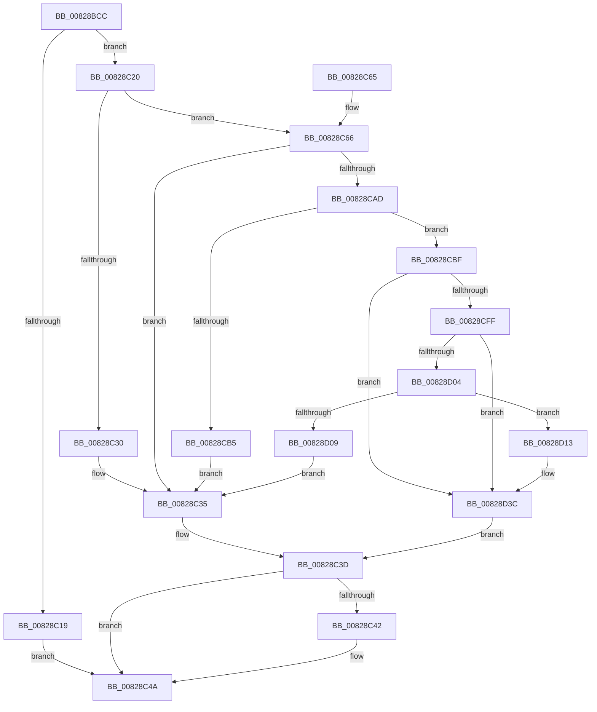

# PnpCtxCreateNode

- RVA: `0x00828BCC`–`0x00828D4A` (길이 `382` bytes)
- VA: `0x0000000140828BCC`
- 실행 섹션: `PAGE`
- PDB 이름 있음: `예`; PDB Function 태그: `아니요`
- unwind 정보 RVA: `0x000DA7C0`
- 디코드: `94`개 명령, `382/382` bytes 표시
- 미해석 바이트: `0` (있으면 어셈블리에 `.byte`로 보존)

> 이 문서는 커널 이미지의 기계어와 PDB 기호를 분석해 생성했습니다. 4번과 5번은 함수 원형과 자료형을 바이너리 사용 방식에서 추정한 C 해석이며 원본 소스 복구 결과는 아닙니다.

## 1. Dependencies

- 직접 호출 지점: **5**; 고유 호출 대상: **5**
- 직접 호출자로 확인된 함수: **2**
- RIP 상대 이미지 참조: **0**

### Outgoing calls
- `0x00828C0C` → [ExAllocatePool2](../../poolcode/B8/ExAllocatePool2_function_00B820F0.md) (function, `0x00B820F0`)
- `0x00828C27` → [RtlCreateUnicodeString](../9B/RtlCreateUnicodeString_function_009BD860.md) (function, `0x009BD860`)
- `0x00828C38` → [PnpCtxDestroyNode](PnpCtxDestroyNode_function_00828D50.md) (function, `0x00828D50`)
- `0x00828C45` → [SysCtxCloseMachine](../83/SysCtxCloseMachine_function_00831A70.md) (function, `0x00831A70`)
- `0x00828C9A` → [SysCtxOpenMachine](../83/SysCtxOpenMachine_function_00831D24.md) (function, `0x00831D24`)

### Direct callers
- [PnpCtxOpenMachine](PnpCtxOpenMachine_function_00828FB0.md) at `0x00829065`
- [PnpCtxRegisterMachineNode](PnpCtxRegisterMachineNode_function_008292BC.md) at `0x0082939D`

### Static image references
- 디코드된 RIP-relative 메모리 참조가 없습니다.

## 2. Other-region calls and transfers

- 다른 실행 섹션으로 향하는 call: **1**
  - `0x00828C0C` → [ExAllocatePool2](../../poolcode/B8/ExAllocatePool2_function_00B820F0.md) (`PAGE` → `POOLCODE`)
- 별도 외부 분기/꼬리 이동을 확인하지 못했습니다.

## 3. Assembly (complete function range)

```asm
00828BCC  48 8B C4                        mov rax, rsp
00828BCF  48 89 58 08                     mov qword ptr [rax + 8], rbx
00828BD3  48 89 68 10                     mov qword ptr [rax + 0x10], rbp
00828BD7  48 89 70 18                     mov qword ptr [rax + 0x18], rsi
00828BDB  57                              push rdi
00828BDC  41 56                           push r14
00828BDE  41 57                           push r15
00828BE0  48 83 EC 40                     sub rsp, 0x40
00828BE4  4C 8B B4 24 A0 00 00 00         mov r14, qword ptr [rsp + 0xa0]
00828BEC  48 8B FA                        mov rdi, rdx
00828BEF  BA 98 00 00 00                  mov edx, 0x98
00828BF4  41 8B E8                        mov ebp, r8d
00828BF7  4C 8B F9                        mov r15, rcx
00828BFA  33 F6                           xor esi, esi
00828BFC  41 B8 50 4E 50 52               mov r8d, 0x52504e50
00828C02  48 89 70 30                     mov qword ptr [rax + 0x30], rsi
00828C06  49 21 36                        and qword ptr [r14], rsi
00828C09  8D 4A 68                        lea ecx, [rdx + 0x68]
00828C0C  E8 DF 94 35 00                  call 0x140b820f0
00828C11  48 8B D8                        mov rbx, rax
00828C14  48 85 C0                        test rax, rax
00828C17  75 07                           jne 0x140828c20
00828C19  BF 17 00 00 C0                  mov edi, 0xc0000017
00828C1E  EB 2A                           jmp 0x140828c4a
00828C20  48 8D 48 20                     lea rcx, [rax + 0x20]
00828C24  48 8B D7                        mov rdx, rdi
00828C27  E8 34 4C 19 00                  call 0x1409bd860
00828C2C  84 C0                           test al, al
00828C2E  75 36                           jne 0x140828c66
00828C30  BF 17 00 00 C0                  mov edi, 0xc0000017
00828C35  48 8B CB                        mov rcx, rbx
00828C38  E8 13 01 00 00                  call 0x140828d50
00828C3D  48 85 F6                        test rsi, rsi
00828C40  74 08                           je 0x140828c4a
00828C42  48 8B CE                        mov rcx, rsi
00828C45  E8 26 8E 00 00                  call 0x140831a70
00828C4A  48 8B 5C 24 60                  mov rbx, qword ptr [rsp + 0x60]
00828C4F  8B C7                           mov eax, edi
00828C51  48 8B 6C 24 68                  mov rbp, qword ptr [rsp + 0x68]
00828C56  48 8B 74 24 70                  mov rsi, qword ptr [rsp + 0x70]
00828C5B  48 83 C4 40                     add rsp, 0x40
00828C5F  41 5F                           pop r15
00828C61  41 5E                           pop r14
00828C63  5F                              pop rdi
00828C64  C3                              ret
00828C65  CC                              int3
00828C66  4C 8B 8C 24 90 00 00 00         mov r9, qword ptr [rsp + 0x90]
00828C6E  48 8D 84 24 88 00 00 00         lea rax, [rsp + 0x88]
00828C76  48 8B 94 24 80 00 00 00         mov rdx, qword ptr [rsp + 0x80]
00828C7E  48 89 44 24 30                  mov qword ptr [rsp + 0x30], rax
00828C83  89 6B 30                        mov dword ptr [rbx + 0x30], ebp
00828C86  41 8B 07                        mov eax, dword ptr [r15]
00828C89  89 44 24 28                     mov dword ptr [rsp + 0x28], eax
00828C8D  48 8B 84 24 98 00 00 00         mov rax, qword ptr [rsp + 0x98]
00828C95  48 89 44 24 20                  mov qword ptr [rsp + 0x20], rax
00828C9A  E8 85 90 00 00                  call 0x140831d24
00828C9F  48 8B B4 24 88 00 00 00         mov rsi, qword ptr [rsp + 0x88]
00828CA7  8B F8                           mov edi, eax
00828CA9  85 C0                           test eax, eax
00828CAB  78 88                           js 0x140828c35
00828CAD  81 3E 00 00 00 0A               cmp dword ptr [rsi], 0xa000000
00828CB3  73 0A                           jae 0x140828cbf
00828CB5  BF BB 00 00 C0                  mov edi, 0xc00000bb
00828CBA  E9 76 FF FF FF                  jmp 0x140828c35
00828CBF  48 83 63 40 00                  and qword ptr [rbx + 0x40], 0
00828CC4  48 83 63 48 00                  and qword ptr [rbx + 0x48], 0
00828CC9  48 83 63 50 00                  and qword ptr [rbx + 0x50], 0
00828CCE  48 83 63 58 00                  and qword ptr [rbx + 0x58], 0
00828CD3  48 83 63 60 00                  and qword ptr [rbx + 0x60], 0
00828CD8  48 83 63 68 00                  and qword ptr [rbx + 0x68], 0
00828CDD  48 83 63 70 00                  and qword ptr [rbx + 0x70], 0
00828CE2  48 83 A3 80 00 00 00 00         and qword ptr [rbx + 0x80], 0
00828CEA  48 83 A3 88 00 00 00 00         and qword ptr [rbx + 0x88], 0
00828CF2  48 83 A3 90 00 00 00 00         and qword ptr [rbx + 0x90], 0
00828CFA  83 ED 01                        sub ebp, 1
00828CFD  74 3D                           je 0x140828d3c
00828CFF  83 ED 01                        sub ebp, 1
00828D02  74 38                           je 0x140828d3c
00828D04  83 FD 01                        cmp ebp, 1
00828D07  74 0A                           je 0x140828d13
00828D09  BF 0D 00 00 C0                  mov edi, 0xc000000d
00828D0E  E9 22 FF FF FF                  jmp 0x140828c35
00828D13  48 83 C8 FF                     or rax, 0xffffffffffffffff
00828D17  48 89 43 40                     mov qword ptr [rbx + 0x40], rax
00828D1B  48 89 43 60                     mov qword ptr [rbx + 0x60], rax
00828D1F  48 89 43 68                     mov qword ptr [rbx + 0x68], rax
00828D23  48 89 43 70                     mov qword ptr [rbx + 0x70], rax
00828D27  48 89 83 80 00 00 00            mov qword ptr [rbx + 0x80], rax
00828D2E  48 89 83 88 00 00 00            mov qword ptr [rbx + 0x88], rax
00828D35  48 89 83 90 00 00 00            mov qword ptr [rbx + 0x90], rax
00828D3C  48 89 73 38                     mov qword ptr [rbx + 0x38], rsi
00828D40  33 F6                           xor esi, esi
00828D42  49 89 1E                        mov qword ptr [r14], rbx
00828D45  E9 F3 FE FF FF                  jmp 0x140828c3d
```

## 4. C-style interpretation (structured pseudocode)

```c
__int64 __fastcall PnpCtxCreateNode(__int64 a1, __int64 a2, int a3, __int64 a4, __int64 a5, __int64 a6, __int64 a7, __int64 a8, __int64 a9)
{
    __int64 result;
    __int64 v_rbp;
    __int64 v_rsi;
    __int64 v_rsp;
    unsigned __int64 v_stack_p10;
    unsigned __int64 v_stack_p18;
    unsigned __int64 v_stack_p20;
    unsigned int v_stack_p28;
    unsigned __int64 v_stack_p30;
    unsigned __int64 v_stack_p8;

    *(unsigned __int64 *)(v_rsp + 8) = v_rbx;
    *(unsigned __int64 *)(v_rsp + 16) = v_rbp;
    *(unsigned __int64 *)(v_rsp + 24) = v_rsi;
    v_rsp = (v_rsp) - (64);
    v_rsi = 0;
    *(unsigned __int64 *)(v_rsp + 48) = 0;
    result = ExAllocatePool2(152 + 104, 152, (unsigned int)(0x52504E50ULL), a4);
    if (result != 0) goto loc_00828C20;
    goto loc_00828C4A;
loc_00828C20:
    result = RtlCreateUnicodeString(result + 32, (unsigned int)(0xC0000017ULL), (unsigned int)(0x52504E50ULL), a4);
    if ((unsigned __int8)(result) != 0) goto loc_00828C66;
loc_00828C35:
    result = PnpCtxDestroyNode(result, (unsigned int)(0xC0000017ULL), (unsigned int)(0x52504E50ULL), a4);
loc_00828C3D:
    if (0 != 0) {
        a1 = 0;
        result = SysCtxCloseMachine(a1, (unsigned int)(0xC0000017ULL), (unsigned int)(0x52504E50ULL), a4);
    }
    v_rsp = (v_rsp) + (64);
    return (unsigned int)((unsigned int)((unsigned int)(0xC0000017ULL)));
loc_00828C66:
    v_stack_p30 = a6;
    *(unsigned int *)(v_stack_p8 + 48) = (unsigned int)(v_stack_p10);
    v_stack_p28 = (unsigned int)((unsigned int)(*(unsigned int *)(a1)));
    v_stack_p20 = a8;
    result = SysCtxOpenMachine(a1, a5, (unsigned int)(0x52504E50ULL), a7);
    if (sign_flag) goto loc_00828C35;
    if ((*(unsigned int *)(a6)) >= 0xA000000ULL) goto loc_00828CBF;
    goto loc_00828C35;
loc_00828CBF:
    v_rbp = (unsigned int)((v_stack_p10) - (1));
    if (condition_is_equal) goto loc_00828D3C;
    v_rbp = (unsigned int)((v_rbp) - (1));
    if (condition_is_equal) goto loc_00828D3C;
    if (((unsigned int)(v_rbp)) == 1) goto loc_00828D13;
    goto loc_00828C35;
loc_00828D13:
    result = (result) | (-1);
    *(unsigned __int64 *)(v_stack_p8 + 64) = result;
    *(unsigned __int64 *)(v_stack_p8 + 96) = result;
    *(unsigned __int64 *)(v_stack_p8 + 104) = result;
    *(unsigned __int64 *)(v_stack_p8 + 112) = result;
    *(unsigned __int64 *)(v_stack_p8 + 128) = result;
    *(unsigned __int64 *)(v_stack_p8 + 136) = result;
    *(unsigned __int64 *)(v_stack_p8 + 144) = result;
loc_00828D3C:
    *(unsigned __int64 *)(v_stack_p8 + 56) = a6;
    v_rsi = 0;
    *(unsigned __int64 *)(a9) = v_stack_p8;
    goto loc_00828C3D;
}
```

## 5. (Beta) C Style

```c
int64_t PnpCtxCreateNode(void *Arg1, int64_t Arg2, int32_t Arg3, int64_t Arg4, int64_t Arg5, void *Arg6, int64_t Arg7, int64_t Arg8, void *Arg9)
{
    uint8_t *arg1 = (uint8_t *)Arg1;
    uint8_t *arg6 = (uint8_t *)Arg6;
    uint8_t *arg9 = (uint8_t *)Arg9;

    int64_t result;
    int64_t local_rbp;
    int64_t local_rsi;
    int64_t local_rsp;
    uint64_t v_stack_p10;
    uint64_t v_stack_p18;
    uint64_t v_stack_p20;
    uint32_t v_stack_p28;
    uint64_t v_stack_p30;
    uint64_t v_stack_p8;

    *(uint64_t *)(local_rsp + 0x8) = local_rbx;
    *(uint64_t *)(local_rsp + 0x10) = local_rbp;
    *(uint64_t *)(local_rsp + 0x18) = local_rsi;
    local_rsp = (local_rsp) - (64);
    local_rsi = 0;
    *(uint64_t *)(local_rsp + 0x30) = 0;
    result = ExAllocatePool2(152 + 104, 152, (uint32_t)(0x52504E50ULL), Arg4);
    if (result != 0) goto loc_00828C20;
    goto loc_00828C4A;
loc_00828C20:
    result = RtlCreateUnicodeString(result + 32, (uint32_t)(0xC0000017ULL), (uint32_t)(0x52504E50ULL), Arg4);
    if ((uint8_t)(result) != 0) goto loc_00828C66;
loc_00828C35:
    result = PnpCtxDestroyNode(result, (uint32_t)(0xC0000017ULL), (uint32_t)(0x52504E50ULL), Arg4);
loc_00828C3D:
    if (0 != 0) {
        Arg1 = 0;
        result = SysCtxCloseMachine(Arg1, (uint32_t)(0xC0000017ULL), (uint32_t)(0x52504E50ULL), Arg4);
    }
    local_rsp = (local_rsp) + (64);
    return (uint32_t)((uint32_t)((uint32_t)(0xC0000017ULL)));
loc_00828C66:
    v_stack_p30 = Arg6;
    *(uint32_t *)(v_stack_p8 + 0x30) = (uint32_t)(v_stack_p10);
    v_stack_p28 = (uint32_t)((uint32_t)(*(uint32_t *)(arg1)));
    v_stack_p20 = Arg8;
    result = SysCtxOpenMachine(Arg1, Arg5, (uint32_t)(0x52504E50ULL), Arg7);
    if (sign_flag) goto loc_00828C35;
    if ((*(uint32_t *)(arg6)) >= 0xA000000ULL) goto loc_00828CBF;
    goto loc_00828C35;
loc_00828CBF:
    local_rbp = (uint32_t)((v_stack_p10) - (1));
    if (condition_is_equal) goto loc_00828D3C;
    local_rbp = (uint32_t)((local_rbp) - (1));
    if (condition_is_equal) goto loc_00828D3C;
    if (((uint32_t)(local_rbp)) == 1) goto loc_00828D13;
    goto loc_00828C35;
loc_00828D13:
    result = (result) | (-1);
    *(uint64_t *)(v_stack_p8 + 0x40) = result;
    *(uint64_t *)(v_stack_p8 + 0x60) = result;
    *(uint64_t *)(v_stack_p8 + 0x68) = result;
    *(uint64_t *)(v_stack_p8 + 0x70) = result;
    *(uint64_t *)(v_stack_p8 + 0x80) = result;
    *(uint64_t *)(v_stack_p8 + 0x88) = result;
    *(uint64_t *)(v_stack_p8 + 0x90) = result;
loc_00828D3C:
    *(void **)(v_stack_p8 + 0x38) = Arg6;
    local_rsi = 0;
    *(uint64_t *)(arg9) = v_stack_p8;
    goto loc_00828C3D;
}
```

### 관측된 메모리 오프셋

구조체 형식이 확인되지 않은 접근은 인자 기준의 오프셋으로만 기록했습니다.

| 기준 인자 | 오프셋 표현 | 폭 (bit) | 접근 |
|---|---:|---:|---|
| `Arg1` | `+ 0x0` | `32` | `R` |
| `Arg6` | `+ 0x0` | `32` | `R` |
| `Arg9` | `+ 0x0` | `64` | `R/W` |
| `Arg9` | `+ 0x0` | `64` | `W` |

## 6. Execution-region graph

[열기: 2D/3D 그래프와 함수 탐색 컨트롤 패널](../../../control-panel.html?section=page&rva=0x00828BCC&view=graph)

- 2D 그래프는 위에서 아래로 흐르고, 3D 그래프는 빈 공간을 드래그해 회전합니다. Shift+드래그는 이동, 휠은 확대·축소, 함수 노드 선택은 대상 보고서 이동입니다.

### Static fallback


