# PnpCtxDestroyNode

- RVA: `0x00828D50`–`0x00828E4A` (길이 `250` bytes)
- VA: `0x0000000140828D50`
- 실행 섹션: `PAGE`
- PDB 이름 있음: `예`; PDB Function 태그: `아니요`
- unwind 정보 RVA: `0x0005CF00`
- 디코드: `67`개 명령, `250/250` bytes 표시
- 미해석 바이트: `0` (있으면 어셈블리에 `.byte`로 보존)

> 이 문서는 커널 이미지의 기계어와 PDB 기호를 분석해 생성했습니다. 4번과 5번은 함수 원형과 자료형을 바이너리 사용 방식에서 추정한 C 해석이며 원본 소스 복구 결과는 아닙니다.

## 1. Dependencies

- 직접 호출 지점: **13**; 고유 호출 대상: **4**
- 직접 호출자로 확인된 함수: **5**
- RIP 상대 이미지 참조: **0**

### Outgoing calls
- `0x00828D5D` → [RtlFreeAnsiString](../9C/RtlFreeAnsiString_function_009C0800.md) (function, `0x009C0800`)
- `0x00828D70` → [ZwClose](../../text/6A/ZwClose_function_006AD2B0.md) (function, `0x006AD2B0`)
- `0x00828D83` → [ZwClose](../../text/6A/ZwClose_function_006AD2B0.md) (function, `0x006AD2B0`)
- `0x00828D96` → [ZwClose](../../text/6A/ZwClose_function_006AD2B0.md) (function, `0x006AD2B0`)
- `0x00828DA9` → [ZwClose](../../text/6A/ZwClose_function_006AD2B0.md) (function, `0x006AD2B0`)
- `0x00828DBC` → [ZwClose](../../text/6A/ZwClose_function_006AD2B0.md) (function, `0x006AD2B0`)
- `0x00828DCF` → [ZwClose](../../text/6A/ZwClose_function_006AD2B0.md) (function, `0x006AD2B0`)
- `0x00828DE2` → [ZwClose](../../text/6A/ZwClose_function_006AD2B0.md) (function, `0x006AD2B0`)
- `0x00828DF8` → [ZwClose](../../text/6A/ZwClose_function_006AD2B0.md) (function, `0x006AD2B0`)
- `0x00828E0E` → [ZwClose](../../text/6A/ZwClose_function_006AD2B0.md) (function, `0x006AD2B0`)
- `0x00828E24` → [ZwClose](../../text/6A/ZwClose_function_006AD2B0.md) (function, `0x006AD2B0`)
- `0x00828E32` → [SysCtxCloseMachine](../83/SysCtxCloseMachine_function_00831A70.md) (function, `0x00831A70`)
- `0x00828E3C` → [ExFreePoolWithTag](../../poolcode/B8/ExFreePoolWithTag_function_00B82870.md) (function, `0x00B82870`)

### Direct callers
- [PnpCtxCloseMachine](PnpCtxCloseMachine_function_00828B10.md) at `0x00828B69`
- [PnpCtxCreateNode](PnpCtxCreateNode_function_00828BCC.md) at `0x00828C38`
- [PnpCtxOpenMachine](PnpCtxOpenMachine_function_00828FB0.md) at `0x008291B4`
- [PnpCtxRegisterMachineNode](PnpCtxRegisterMachineNode_function_008292BC.md) at `0x0082942E`
- [PnpCtxUnregisterMachineNode](PnpCtxUnregisterMachineNode_function_008294DC.md) at `0x0082957E`

### Static image references
- 디코드된 RIP-relative 메모리 참조가 없습니다.

## 2. Other-region calls and transfers

- 다른 실행 섹션으로 향하는 call: **11**
  - `0x00828D70` → [ZwClose](../../text/6A/ZwClose_function_006AD2B0.md) (`PAGE` → `.text`)
  - `0x00828D83` → [ZwClose](../../text/6A/ZwClose_function_006AD2B0.md) (`PAGE` → `.text`)
  - `0x00828D96` → [ZwClose](../../text/6A/ZwClose_function_006AD2B0.md) (`PAGE` → `.text`)
  - `0x00828DA9` → [ZwClose](../../text/6A/ZwClose_function_006AD2B0.md) (`PAGE` → `.text`)
  - `0x00828DBC` → [ZwClose](../../text/6A/ZwClose_function_006AD2B0.md) (`PAGE` → `.text`)
  - `0x00828DCF` → [ZwClose](../../text/6A/ZwClose_function_006AD2B0.md) (`PAGE` → `.text`)
  - `0x00828DE2` → [ZwClose](../../text/6A/ZwClose_function_006AD2B0.md) (`PAGE` → `.text`)
  - `0x00828DF8` → [ZwClose](../../text/6A/ZwClose_function_006AD2B0.md) (`PAGE` → `.text`)
  - `0x00828E0E` → [ZwClose](../../text/6A/ZwClose_function_006AD2B0.md) (`PAGE` → `.text`)
  - `0x00828E24` → [ZwClose](../../text/6A/ZwClose_function_006AD2B0.md) (`PAGE` → `.text`)
  - `0x00828E3C` → [ExFreePoolWithTag](../../poolcode/B8/ExFreePoolWithTag_function_00B82870.md) (`PAGE` → `POOLCODE`)
- 별도 외부 분기/꼬리 이동을 확인하지 못했습니다.

## 3. Assembly (complete function range)

```asm
00828D50  40 53                           push rbx
00828D52  48 83 EC 20                     sub rsp, 0x20
00828D56  48 8B D9                        mov rbx, rcx
00828D59  48 83 C1 20                     add rcx, 0x20
00828D5D  E8 9E 7A 19 00                  call 0x1409c0800
00828D62  48 8B 4B 40                     mov rcx, qword ptr [rbx + 0x40]
00828D66  48 8D 41 FF                     lea rax, [rcx - 1]
00828D6A  48 83 F8 FD                     cmp rax, -3
00828D6E  77 05                           ja 0x140828d75
00828D70  E8 3B 45 E8 FF                  call 0x1406ad2b0
00828D75  48 8B 4B 48                     mov rcx, qword ptr [rbx + 0x48]
00828D79  48 8D 41 FF                     lea rax, [rcx - 1]
00828D7D  48 83 F8 FD                     cmp rax, -3
00828D81  77 05                           ja 0x140828d88
00828D83  E8 28 45 E8 FF                  call 0x1406ad2b0
00828D88  48 8B 4B 50                     mov rcx, qword ptr [rbx + 0x50]
00828D8C  48 8D 41 FF                     lea rax, [rcx - 1]
00828D90  48 83 F8 FD                     cmp rax, -3
00828D94  77 05                           ja 0x140828d9b
00828D96  E8 15 45 E8 FF                  call 0x1406ad2b0
00828D9B  48 8B 4B 58                     mov rcx, qword ptr [rbx + 0x58]
00828D9F  48 8D 41 FF                     lea rax, [rcx - 1]
00828DA3  48 83 F8 FD                     cmp rax, -3
00828DA7  77 05                           ja 0x140828dae
00828DA9  E8 02 45 E8 FF                  call 0x1406ad2b0
00828DAE  48 8B 4B 60                     mov rcx, qword ptr [rbx + 0x60]
00828DB2  48 8D 41 FF                     lea rax, [rcx - 1]
00828DB6  48 83 F8 FD                     cmp rax, -3
00828DBA  77 05                           ja 0x140828dc1
00828DBC  E8 EF 44 E8 FF                  call 0x1406ad2b0
00828DC1  48 8B 4B 68                     mov rcx, qword ptr [rbx + 0x68]
00828DC5  48 8D 41 FF                     lea rax, [rcx - 1]
00828DC9  48 83 F8 FD                     cmp rax, -3
00828DCD  77 05                           ja 0x140828dd4
00828DCF  E8 DC 44 E8 FF                  call 0x1406ad2b0
00828DD4  48 8B 4B 70                     mov rcx, qword ptr [rbx + 0x70]
00828DD8  48 8D 41 FF                     lea rax, [rcx - 1]
00828DDC  48 83 F8 FD                     cmp rax, -3
00828DE0  77 05                           ja 0x140828de7
00828DE2  E8 C9 44 E8 FF                  call 0x1406ad2b0
00828DE7  48 8B 8B 80 00 00 00            mov rcx, qword ptr [rbx + 0x80]
00828DEE  48 8D 41 FF                     lea rax, [rcx - 1]
00828DF2  48 83 F8 FD                     cmp rax, -3
00828DF6  77 05                           ja 0x140828dfd
00828DF8  E8 B3 44 E8 FF                  call 0x1406ad2b0
00828DFD  48 8B 8B 88 00 00 00            mov rcx, qword ptr [rbx + 0x88]
00828E04  48 8D 41 FF                     lea rax, [rcx - 1]
00828E08  48 83 F8 FD                     cmp rax, -3
00828E0C  77 05                           ja 0x140828e13
00828E0E  E8 9D 44 E8 FF                  call 0x1406ad2b0
00828E13  48 8B 8B 90 00 00 00            mov rcx, qword ptr [rbx + 0x90]
00828E1A  48 8D 41 FF                     lea rax, [rcx - 1]
00828E1E  48 83 F8 FD                     cmp rax, -3
00828E22  77 05                           ja 0x140828e29
00828E24  E8 87 44 E8 FF                  call 0x1406ad2b0
00828E29  48 8B 4B 38                     mov rcx, qword ptr [rbx + 0x38]
00828E2D  48 85 C9                        test rcx, rcx
00828E30  74 05                           je 0x140828e37
00828E32  E8 39 8C 00 00                  call 0x140831a70
00828E37  33 D2                           xor edx, edx
00828E39  48 8B CB                        mov rcx, rbx
00828E3C  E8 2F 9A 35 00                  call 0x140b82870
00828E41  33 C0                           xor eax, eax
00828E43  48 83 C4 20                     add rsp, 0x20
00828E47  5B                              pop rbx
00828E48  C3                              ret
00828E49  CC                              int3
```

## 4. C-style interpretation (structured pseudocode)

```c
__int64 __fastcall PnpCtxDestroyNode(__int64 a1, int a2)
{
    __int64 result;
    __int64 v_rsp;

    v_rsp = (v_rsp) - (32);
    a1 = (a1) + (32);
    result = RtlFreeAnsiString(a1, a2, a3, a4);
    result = *(unsigned __int64 *)(a1 + 64) - 1;
    if ((*(unsigned __int64 *)(a1 + 64) - 1) <= -3) {
        result = ZwClose(*(unsigned __int64 *)(a1 + 64), a2, a3, a4);
    }
    result = *(unsigned __int64 *)(a1 + 72) - 1;
    if ((*(unsigned __int64 *)(a1 + 72) - 1) <= -3) {
        result = ZwClose(*(unsigned __int64 *)(a1 + 72), a2, a3, a4);
    }
    result = *(unsigned __int64 *)(a1 + 80) - 1;
    if ((*(unsigned __int64 *)(a1 + 80) - 1) <= -3) {
        result = ZwClose(*(unsigned __int64 *)(a1 + 80), a2, a3, a4);
    }
    result = *(unsigned __int64 *)(a1 + 88) - 1;
    if ((*(unsigned __int64 *)(a1 + 88) - 1) <= -3) {
        result = ZwClose(*(unsigned __int64 *)(a1 + 88), a2, a3, a4);
    }
    result = *(unsigned __int64 *)(a1 + 96) - 1;
    if ((*(unsigned __int64 *)(a1 + 96) - 1) <= -3) {
        result = ZwClose(*(unsigned __int64 *)(a1 + 96), a2, a3, a4);
    }
    result = *(unsigned __int64 *)(a1 + 104) - 1;
    if ((*(unsigned __int64 *)(a1 + 104) - 1) <= -3) {
        result = ZwClose(*(unsigned __int64 *)(a1 + 104), a2, a3, a4);
    }
    result = *(unsigned __int64 *)(a1 + 112) - 1;
    if ((*(unsigned __int64 *)(a1 + 112) - 1) <= -3) {
        result = ZwClose(*(unsigned __int64 *)(a1 + 112), a2, a3, a4);
    }
    result = *(unsigned __int64 *)(a1 + 128) - 1;
    if ((*(unsigned __int64 *)(a1 + 128) - 1) <= -3) {
        result = ZwClose(*(unsigned __int64 *)(a1 + 128), a2, a3, a4);
    }
    result = *(unsigned __int64 *)(a1 + 136) - 1;
    if ((*(unsigned __int64 *)(a1 + 136) - 1) <= -3) {
        result = ZwClose(*(unsigned __int64 *)(a1 + 136), a2, a3, a4);
    }
    result = *(unsigned __int64 *)(a1 + 144) - 1;
    if ((*(unsigned __int64 *)(a1 + 144) - 1) <= -3) {
        result = ZwClose(*(unsigned __int64 *)(a1 + 144), a2, a3, a4);
    }
    if (*(unsigned __int64 *)(a1 + 56) != 0) {
        result = SysCtxCloseMachine(*(unsigned __int64 *)(a1 + 56), a2, a3, a4);
    }
    a2 = 0;
    result = ExFreePoolWithTag(a1, a2, a3, a4);
    result = 0;
    v_rsp = (v_rsp) + (32);
    return result;
}
```

## 5. (Beta) C Style

```c
int64_t PnpCtxDestroyNode(void *Arg1, int32_t Arg2)
{
    uint8_t *arg1 = (uint8_t *)Arg1;

    int64_t result;
    int64_t local_rsp;

    local_rsp = (local_rsp) - (32);
    Arg1 = (Arg1) + (32);
    result = RtlFreeAnsiString(Arg1, Arg2, a3, a4);
    result = *(uint64_t *)(arg1 + 0x40) - 1;
    if ((*(uint64_t *)(arg1 + 0x40) - 1) <= -3) {
        result = ZwClose(*(uint64_t *)(arg1 + 0x40), Arg2, a3, a4);
    }
    result = *(uint64_t *)(arg1 + 0x48) - 1;
    if ((*(uint64_t *)(arg1 + 0x48) - 1) <= -3) {
        result = ZwClose(*(uint64_t *)(arg1 + 0x48), Arg2, a3, a4);
    }
    result = *(uint64_t *)(arg1 + 0x50) - 1;
    if ((*(uint64_t *)(arg1 + 0x50) - 1) <= -3) {
        result = ZwClose(*(uint64_t *)(arg1 + 0x50), Arg2, a3, a4);
    }
    result = *(uint64_t *)(arg1 + 0x58) - 1;
    if ((*(uint64_t *)(arg1 + 0x58) - 1) <= -3) {
        result = ZwClose(*(uint64_t *)(arg1 + 0x58), Arg2, a3, a4);
    }
    result = *(uint64_t *)(arg1 + 0x60) - 1;
    if ((*(uint64_t *)(arg1 + 0x60) - 1) <= -3) {
        result = ZwClose(*(uint64_t *)(arg1 + 0x60), Arg2, a3, a4);
    }
    result = *(uint64_t *)(arg1 + 0x68) - 1;
    if ((*(uint64_t *)(arg1 + 0x68) - 1) <= -3) {
        result = ZwClose(*(uint64_t *)(arg1 + 0x68), Arg2, a3, a4);
    }
    result = *(uint64_t *)(arg1 + 0x70) - 1;
    if ((*(uint64_t *)(arg1 + 0x70) - 1) <= -3) {
        result = ZwClose(*(uint64_t *)(arg1 + 0x70), Arg2, a3, a4);
    }
    result = *(uint64_t *)(arg1 + 0x80) - 1;
    if ((*(uint64_t *)(arg1 + 0x80) - 1) <= -3) {
        result = ZwClose(*(uint64_t *)(arg1 + 0x80), Arg2, a3, a4);
    }
    result = *(uint64_t *)(arg1 + 0x88) - 1;
    if ((*(uint64_t *)(arg1 + 0x88) - 1) <= -3) {
        result = ZwClose(*(uint64_t *)(arg1 + 0x88), Arg2, a3, a4);
    }
    result = *(uint64_t *)(arg1 + 0x90) - 1;
    if ((*(uint64_t *)(arg1 + 0x90) - 1) <= -3) {
        result = ZwClose(*(uint64_t *)(arg1 + 0x90), Arg2, a3, a4);
    }
    if (*(uint64_t *)(arg1 + 0x38) != 0) {
        result = SysCtxCloseMachine(*(uint64_t *)(arg1 + 0x38), Arg2, a3, a4);
    }
    Arg2 = 0;
    result = ExFreePoolWithTag(Arg1, Arg2, a3, a4);
    result = 0;
    local_rsp = (local_rsp) + (32);
    return result;
}
```

### 관측된 메모리 오프셋

구조체 형식이 확인되지 않은 접근은 인자 기준의 오프셋으로만 기록했습니다.

| 기준 인자 | 오프셋 표현 | 폭 (bit) | 접근 |
|---|---:|---:|---|
| `Arg1` | `+ 0x38` | `64` | `R` |
| `Arg1` | `+ 0x40` | `64` | `R` |
| `Arg1` | `+ 0x48` | `64` | `R` |
| `Arg1` | `+ 0x50` | `64` | `R` |
| `Arg1` | `+ 0x58` | `64` | `R` |
| `Arg1` | `+ 0x60` | `64` | `R` |
| `Arg1` | `+ 0x68` | `64` | `R` |
| `Arg1` | `+ 0x70` | `64` | `R` |
| `Arg1` | `+ 0x80` | `64` | `R` |
| `Arg1` | `+ 0x88` | `64` | `R` |
| `Arg1` | `+ 0x90` | `64` | `R` |

## 6. Execution-region graph

[열기: 2D/3D 그래프와 함수 탐색 컨트롤 패널](../../../control-panel.html?section=page&rva=0x00828D50&view=graph)

- 2D 그래프는 위에서 아래로 흐르고, 3D 그래프는 빈 공간을 드래그해 회전합니다. Shift+드래그는 이동, 휠은 확대·축소, 함수 노드 선택은 대상 보고서 이동입니다.

### Static fallback

```mermaid
flowchart TD
  bb_00828D50[BB_00828D50]
  bb_00828D70[BB_00828D70]
  bb_00828D75[BB_00828D75]
  bb_00828D83[BB_00828D83]
  bb_00828D88[BB_00828D88]
  bb_00828D96[BB_00828D96]
  bb_00828D9B[BB_00828D9B]
  bb_00828DA9[BB_00828DA9]
  bb_00828DAE[BB_00828DAE]
  bb_00828DBC[BB_00828DBC]
  bb_00828DC1[BB_00828DC1]
  bb_00828DCF[BB_00828DCF]
  bb_00828DD4[BB_00828DD4]
  bb_00828DE2[BB_00828DE2]
  bb_00828DE7[BB_00828DE7]
  bb_00828DF8[BB_00828DF8]
  bb_00828DFD[BB_00828DFD]
  bb_00828E0E[BB_00828E0E]
  bb_00828E13[BB_00828E13]
  bb_00828E24[BB_00828E24]
  bb_00828E29[BB_00828E29]
  bb_00828E32[BB_00828E32]
  bb_00828E37[BB_00828E37]
  bb_00828E49[BB_00828E49]
  bb_00828D50 -->|branch| bb_00828D75
  bb_00828D50 -->|fallthrough| bb_00828D70
  bb_00828D70 -->|flow| bb_00828D75
  bb_00828D75 -->|branch| bb_00828D88
  bb_00828D75 -->|fallthrough| bb_00828D83
  bb_00828D83 -->|flow| bb_00828D88
  bb_00828D88 -->|branch| bb_00828D9B
  bb_00828D88 -->|fallthrough| bb_00828D96
  bb_00828D96 -->|flow| bb_00828D9B
  bb_00828D9B -->|branch| bb_00828DAE
  bb_00828D9B -->|fallthrough| bb_00828DA9
  bb_00828DA9 -->|flow| bb_00828DAE
  bb_00828DAE -->|branch| bb_00828DC1
  bb_00828DAE -->|fallthrough| bb_00828DBC
  bb_00828DBC -->|flow| bb_00828DC1
  bb_00828DC1 -->|branch| bb_00828DD4
  bb_00828DC1 -->|fallthrough| bb_00828DCF
  bb_00828DCF -->|flow| bb_00828DD4
  bb_00828DD4 -->|branch| bb_00828DE7
  bb_00828DD4 -->|fallthrough| bb_00828DE2
  bb_00828DE2 -->|flow| bb_00828DE7
  bb_00828DE7 -->|branch| bb_00828DFD
  bb_00828DE7 -->|fallthrough| bb_00828DF8
  bb_00828DF8 -->|flow| bb_00828DFD
  bb_00828DFD -->|branch| bb_00828E13
  bb_00828DFD -->|fallthrough| bb_00828E0E
  bb_00828E0E -->|flow| bb_00828E13
  bb_00828E13 -->|branch| bb_00828E29
  bb_00828E13 -->|fallthrough| bb_00828E24
  bb_00828E24 -->|flow| bb_00828E29
  bb_00828E29 -->|branch| bb_00828E37
  bb_00828E29 -->|fallthrough| bb_00828E32
  bb_00828E32 -->|flow| bb_00828E37
```


