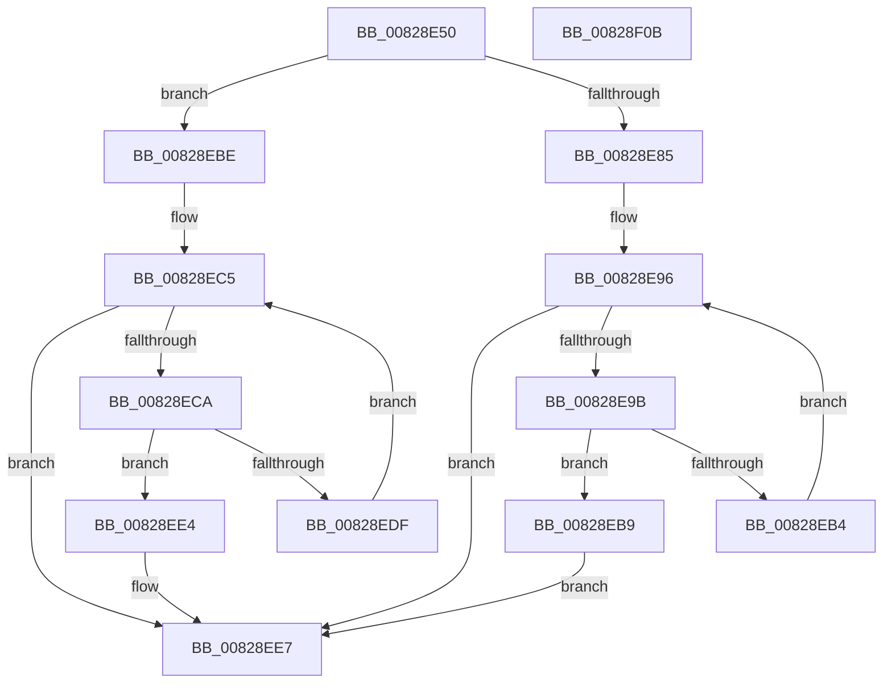

# PnpCtxFindNode

- RVA: `0x00828E50`–`0x00828F0C` (길이 `188` bytes)
- VA: `0x0000000140828E50`
- 실행 섹션: `PAGE`
- PDB 이름 있음: `예`; PDB Function 태그: `아니요`
- unwind 정보 RVA: `0x00066400`
- 디코드: `59`개 명령, `188/188` bytes 표시
- 미해석 바이트: `0` (있으면 어셈블리에 `.byte`로 보존)

> 이 문서는 커널 이미지의 기계어와 PDB 기호를 분석해 생성했습니다. 4번과 5번은 함수 원형과 자료형을 바이너리 사용 방식에서 추정한 C 해석이며 원본 소스 복구 결과는 아닙니다.

## 1. Dependencies

- 직접 호출 지점: **3**; 고유 호출 대상: **2**
- 직접 호출자로 확인된 함수: **2**
- RIP 상대 이미지 참조: **0**

### Outgoing calls
- `0x00828E7C` → [RtlInitUnicodeString](../../text/42/RtlInitUnicodeString_function_0042A780.md) (function, `0x0042A780`)
- `0x00828EAB` → [RtlEqualUnicodeString](../93/RtlEqualUnicodeString_function_00932A20.md) (function, `0x00932A20`)
- `0x00828ED6` → [RtlEqualUnicodeString](../93/RtlEqualUnicodeString_function_00932A20.md) (function, `0x00932A20`)

### Direct callers
- [PnpCtxRegisterMachineNode](PnpCtxRegisterMachineNode_function_008292BC.md) at `0x0082932E`
- [PnpCtxUnregisterMachineNode](PnpCtxUnregisterMachineNode_function_008294DC.md) at `0x00829502`

### Static image references
- 디코드된 RIP-relative 메모리 참조가 없습니다.

## 2. Other-region calls and transfers

- 다른 실행 섹션으로 향하는 call: **1**
  - `0x00828E7C` → [RtlInitUnicodeString](../../text/42/RtlInitUnicodeString_function_0042A780.md) (`PAGE` → `.text`)
- 별도 외부 분기/꼬리 이동을 확인하지 못했습니다.

## 3. Assembly (complete function range)

```asm
00828E50  48 8B C4                        mov rax, rsp
00828E53  48 89 58 08                     mov qword ptr [rax + 8], rbx
00828E57  48 89 68 10                     mov qword ptr [rax + 0x10], rbp
00828E5B  48 89 70 18                     mov qword ptr [rax + 0x18], rsi
00828E5F  57                              push rdi
00828E60  48 83 EC 30                     sub rsp, 0x30
00828E64  49 83 21 00                     and qword ptr [r9], 0
00828E68  48 8B F1                        mov rsi, rcx
00828E6B  0F 57 C0                        xorps xmm0, xmm0
00828E6E  49 63 D8                        movsxd rbx, r8d
00828E71  48 8D 48 E8                     lea rcx, [rax - 0x18]
00828E75  49 8B F9                        mov rdi, r9
00828E78  0F 11 40 E8                     movups xmmword ptr [rax - 0x18], xmm0
00828E7C  E8 FF 18 C0 FF                  call 0x14042a780
00828E81  85 DB                           test ebx, ebx
00828E83  74 39                           je 0x140828ebe
00828E85  48 8B C3                        mov rax, rbx
00828E88  48 83 C6 18                     add rsi, 0x18
00828E8C  48 C1 E0 04                     shl rax, 4
00828E90  48 03 F0                        add rsi, rax
00828E93  48 8B 1E                        mov rbx, qword ptr [rsi]
00828E96  48 3B DE                        cmp rbx, rsi
00828E99  74 4C                           je 0x140828ee7
00828E9B  48 8D 6B F0                     lea rbp, [rbx - 0x10]
00828E9F  41 B0 01                        mov r8b, 1
00828EA2  48 8D 4D 20                     lea rcx, [rbp + 0x20]
00828EA6  48 8D 54 24 20                  lea rdx, [rsp + 0x20]
00828EAB  E8 70 9B 10 00                  call 0x140932a20
00828EB0  84 C0                           test al, al
00828EB2  75 05                           jne 0x140828eb9
00828EB4  48 8B 1B                        mov rbx, qword ptr [rbx]
00828EB7  EB DD                           jmp 0x140828e96
00828EB9  48 89 2F                        mov qword ptr [rdi], rbp
00828EBC  EB 29                           jmp 0x140828ee7
00828EBE  48 83 C6 08                     add rsi, 8
00828EC2  48 8B 1E                        mov rbx, qword ptr [rsi]
00828EC5  48 3B DE                        cmp rbx, rsi
00828EC8  74 1D                           je 0x140828ee7
00828ECA  48 8D 4B 20                     lea rcx, [rbx + 0x20]
00828ECE  41 B0 01                        mov r8b, 1
00828ED1  48 8D 54 24 20                  lea rdx, [rsp + 0x20]
00828ED6  E8 45 9B 10 00                  call 0x140932a20
00828EDB  84 C0                           test al, al
00828EDD  75 05                           jne 0x140828ee4
00828EDF  48 8B 1B                        mov rbx, qword ptr [rbx]
00828EE2  EB E1                           jmp 0x140828ec5
00828EE4  48 89 1F                        mov qword ptr [rdi], rbx
00828EE7  48 8B 07                        mov rax, qword ptr [rdi]
00828EEA  48 8B 5C 24 40                  mov rbx, qword ptr [rsp + 0x40]
00828EEF  48 F7 D8                        neg rax
00828EF2  48 8B 6C 24 48                  mov rbp, qword ptr [rsp + 0x48]
00828EF7  48 8B 74 24 50                  mov rsi, qword ptr [rsp + 0x50]
00828EFC  1B C0                           sbb eax, eax
00828EFE  F7 D0                           not eax
00828F00  25 34 00 00 C0                  and eax, 0xc0000034
00828F05  48 83 C4 30                     add rsp, 0x30
00828F09  5F                              pop rdi
00828F0A  C3                              ret
00828F0B  CC                              int3
```

## 4. C-style interpretation (structured pseudocode)

```c
__int64 __fastcall PnpCtxFindNode(__int64 a1, __int64 a2, int a3, __int64 a4)
{
    __int64 result;
    __int64 v_rsi;
    __int64 v_rsp;
    unsigned __int64 v_stack_m18;
    unsigned __int64 v_stack_p10;
    unsigned __int64 v_stack_p18;
    unsigned __int64 v_stack_p8;

    *(unsigned __int64 *)(v_rsp + 8) = v_rbx;
    *(unsigned __int64 *)(v_rsp + 16) = v_rbp;
    *(unsigned __int64 *)(v_rsp + 24) = v_rsi;
    v_rsp = (v_rsp) - (48);
    *(unsigned __int64 *)(v_rsp - 24) = v_xmm0;
    result = RtlInitUnicodeString(v_rsp - 24, a2, a3, a4);
    if ((unsigned int)((int)(a3)) == 0) goto loc_00828EBE;
    v_rsi = (a1) + (24);
    result = ((int)(a3)) << (4);
    v_rsi = (v_rsi) + (result);
loc_00828E96:
    if ((*(unsigned __int64 *)(v_rsi)) == v_rsi) goto loc_00828EE7;
    result = RtlEqualUnicodeString(*(unsigned __int64 *)(v_rsi) - 16 + 32, v_stack_m18, 1, a4);
    if ((unsigned __int8)(result) != 0) goto loc_00828EB9;
    goto loc_00828E96;
loc_00828EB9:
    *(unsigned __int64 *)(a4) = *(unsigned __int64 *)(v_rsi) - 16;
    goto loc_00828EE7;
loc_00828EBE:
    v_rsi = (v_rsi) + (8);
loc_00828EC5:
    if ((*(unsigned __int64 *)(v_rsi)) == v_rsi) goto loc_00828EE7;
    result = RtlEqualUnicodeString(*(unsigned __int64 *)(v_rsi) + 32, v_stack_m18, 1, a4);
    if ((unsigned __int8)(result) != 0) goto loc_00828EE4;
    goto loc_00828EC5;
loc_00828EE4:
    *(unsigned __int64 *)(a4) = *(unsigned __int64 *)(*(unsigned __int64 *)(v_rsi));
loc_00828EE7:
    result = -(*(unsigned __int64 *)(a4));
    result = (unsigned int)(~(result));
    result = (unsigned int)((result) & (0xC0000034ULL));
    v_rsp = (v_rsp) + (48);
    return result;
}
```

## 5. (Beta) C Style

```c
int64_t PnpCtxFindNode(void *Arg1, int64_t Arg2, int32_t Arg3, void *Arg4)
{
    uint8_t *arg1 = (uint8_t *)Arg1;
    uint8_t *arg4 = (uint8_t *)Arg4;

    int64_t result;
    int64_t local_rsi;
    int64_t local_rsp;
    uint64_t v_stack_m18;
    uint64_t v_stack_p10;
    uint64_t v_stack_p18;
    uint64_t v_stack_p8;

    *(uint64_t *)(local_rsp + 0x8) = local_rbx;
    *(uint64_t *)(local_rsp + 0x10) = local_rbp;
    *(uint64_t *)(local_rsp + 0x18) = local_rsi;
    local_rsp = (local_rsp) - (48);
    *(uint64_t *)(local_rsp - 0x18) = v_xmm0;
    result = RtlInitUnicodeString(local_rsp - 24, Arg2, Arg3, Arg4);
    if ((uint32_t)((int32_t)(Arg3)) == 0) goto loc_00828EBE;
    local_rsi = (Arg1) + (24);
    result = ((int32_t)(Arg3)) << (4);
    local_rsi = (local_rsi) + (result);
loc_00828E96:
    if ((*(uint64_t *)(local_rsi)) == local_rsi) goto loc_00828EE7;
    result = RtlEqualUnicodeString(*(uint64_t *)(local_rsi) - 16 + 32, v_stack_m18, 1, Arg4);
    if ((uint8_t)(result) != 0) goto loc_00828EB9;
    goto loc_00828E96;
loc_00828EB9:
    *(uint64_t *)(arg4) = *(uint64_t *)(local_rsi) - 16;
    goto loc_00828EE7;
loc_00828EBE:
    local_rsi = (local_rsi) + (8);
loc_00828EC5:
    if ((*(uint64_t *)(local_rsi)) == local_rsi) goto loc_00828EE7;
    result = RtlEqualUnicodeString(*(uint64_t *)(local_rsi) + 32, v_stack_m18, 1, Arg4);
    if ((uint8_t)(result) != 0) goto loc_00828EE4;
    goto loc_00828EC5;
loc_00828EE4:
    *(uint64_t *)(arg4) = *(uint64_t *)(*(uint64_t *)(local_rsi));
loc_00828EE7:
    result = -(*(uint64_t *)(arg4));
    result = (uint32_t)(~(result));
    result = (uint32_t)((result) & (0xC0000034ULL));
    local_rsp = (local_rsp) + (48);
    return result;
}
```

### 관측된 메모리 오프셋

구조체 형식이 확인되지 않은 접근은 인자 기준의 오프셋으로만 기록했습니다.

| 기준 인자 | 오프셋 표현 | 폭 (bit) | 접근 |
|---|---:|---:|---|
| `Arg1` | `+ 0x0` | `64` | `R` |
| `Arg4` | `+ 0x0` | `64` | `R` |
| `Arg4` | `+ 0x0` | `64` | `R/W` |
| `Arg4` | `+ 0x0` | `64` | `W` |

## 6. Execution-region graph

[열기: 2D/3D 그래프와 함수 탐색 컨트롤 패널](../../../control-panel.html?section=page&rva=0x00828E50&view=graph)

- 2D 그래프는 위에서 아래로 흐르고, 3D 그래프는 빈 공간을 드래그해 회전합니다. Shift+드래그는 이동, 휠은 확대·축소, 함수 노드 선택은 대상 보고서 이동입니다.

### Static fallback


