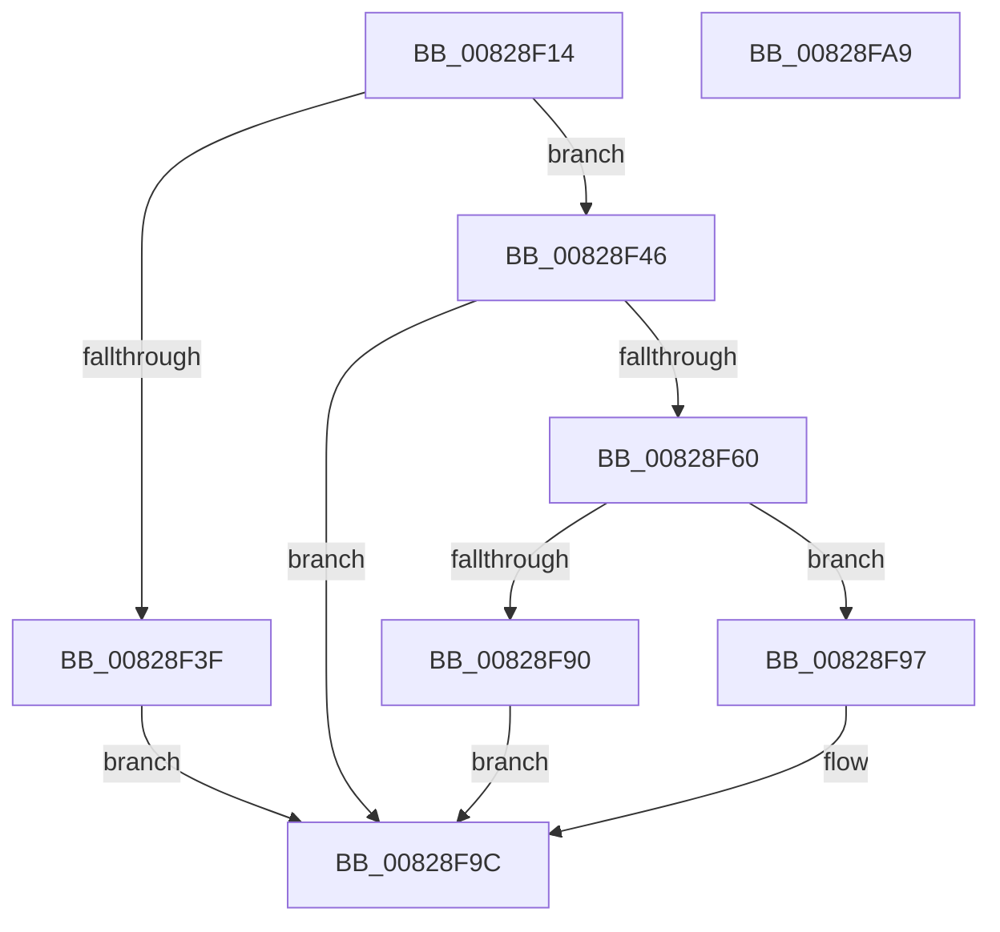

# PnpCtxOpenContextNodeBaseKey

- RVA: `0x00828F14`–`0x00828FAA` (길이 `150` bytes)
- VA: `0x0000000140828F14`
- 실행 섹션: `PAGE`
- PDB 이름 있음: `예`; PDB Function 태그: `아니요`
- unwind 정보 RVA: `0x000B3D80`
- 디코드: `41`개 명령, `150/150` bytes 표시
- 미해석 바이트: `0` (있으면 어셈블리에 `.byte`로 보존)

> 이 문서는 커널 이미지의 기계어와 PDB 기호를 분석해 생성했습니다. 4번과 5번은 함수 원형과 자료형을 바이너리 사용 방식에서 추정한 C 해석이며 원본 소스 복구 결과는 아닙니다.

## 1. Dependencies

- 직접 호출 지점: **2**; 고유 호출 대상: **2**
- 직접 호출자로 확인된 함수: **1**
- RIP 상대 이미지 참조: **2**

### Outgoing calls
- `0x00828F55` → [_PnpCtxGetCachedNodeBaseKey](../8E/_PnpCtxGetCachedNodeBaseKey_function_008EF9C0.md) (function, `0x008EF9C0`)
- `0x00828F84` → [PnpCtxRegOpenKey](../8E/PnpCtxRegOpenKey_function_008EF7B8.md) (function, `0x008EF7B8`)

### Direct callers
- [PiDevCfgEnumDeviceKeys](../96/PiDevCfgEnumDeviceKeys_function_00964EE8.md) at `0x00965156`

### Static image references
- `0x00828F23` → RVA `0x00E66398` (`.data`; read)
- `0x00828F65` → RVA `0x00AFCAD0` (` ?? ::NNGAKEGL::`string'`; read)

## 2. Other-region calls and transfers

- 다른 실행 섹션으로 향하는 call: **0**
- 별도 외부 분기/꼬리 이동을 확인하지 못했습니다.

## 3. Assembly (complete function range)

```asm
00828F14  48 89 5C 24 08                  mov qword ptr [rsp + 8], rbx
00828F19  4C 89 44 24 18                  mov qword ptr [rsp + 0x18], r8
00828F1E  57                              push rdi
00828F1F  48 83 EC 30                     sub rsp, 0x30
00828F23  48 8B 3D 6E D4 63 00            mov rdi, qword ptr [rip + 0x63d46e]
00828F2A  45 8B D1                        mov r10d, r9d
00828F2D  48 83 64 24 50 00               and qword ptr [rsp + 0x50], 0
00828F33  48 8D 47 38                     lea rax, [rdi + 0x38]
00828F37  48 8B 10                        mov rdx, qword ptr [rax]
00828F3A  48 3B D0                        cmp rdx, rax
00828F3D  75 07                           jne 0x140828f46
00828F3F  BB 34 00 00 C0                  mov ebx, 0xc0000034
00828F44  EB 56                           jmp 0x140828f9c
00828F46  48 83 C2 F0                     add rdx, -0x10
00828F4A  4C 8D 4C 24 50                  lea r9, [rsp + 0x50]
00828F4F  45 8B C2                        mov r8d, r10d
00828F52  48 8B CF                        mov rcx, rdi
00828F55  E8 66 6A 0C 00                  call 0x1408ef9c0
00828F5A  8B D8                           mov ebx, eax
00828F5C  85 C0                           test eax, eax
00828F5E  78 3C                           js 0x140828f9c
00828F60  48 8B 44 24 70                  mov rax, qword ptr [rsp + 0x70]
00828F65  4C 8D 05 64 3B 2D 00            lea r8, [rip + 0x2d3b64]
00828F6C  48 8B 54 24 50                  mov rdx, qword ptr [rsp + 0x50]
00828F71  45 33 C9                        xor r9d, r9d
00828F74  48 89 44 24 28                  mov qword ptr [rsp + 0x28], rax
00828F79  48 8B CF                        mov rcx, rdi
00828F7C  C7 44 24 20 3F 00 0F 00         mov dword ptr [rsp + 0x20], 0xf003f
00828F84  E8 2F 68 0C 00                  call 0x1408ef7b8
00828F89  3D 7C 01 00 C0                  cmp eax, 0xc000017c
00828F8E  75 07                           jne 0x140828f97
00828F90  BB E5 00 00 C0                  mov ebx, 0xc00000e5
00828F95  EB 05                           jmp 0x140828f9c
00828F97  85 C0                           test eax, eax
00828F99  0F 48 D8                        cmovs ebx, eax
00828F9C  8B C3                           mov eax, ebx
00828F9E  48 8B 5C 24 40                  mov rbx, qword ptr [rsp + 0x40]
00828FA3  48 83 C4 30                     add rsp, 0x30
00828FA7  5F                              pop rdi
00828FA8  C3                              ret
00828FA9  CC                              int3
```

## 4. C-style interpretation (structured pseudocode)

```c
__int64 __fastcall PnpCtxOpenContextNodeBaseKey(__int64 a1, __int64 a2, __int64 a3, int a4, __int64 a5, __int64 a6, __int64 a7)
{
    __int64 result;
    __int64 v_rbx;
    __int64 v_rsp;
    unsigned __int64 v_stack_m10;
    unsigned int v_stack_m18;
    unsigned __int64 v_stack_p18;
    unsigned __int64 v_stack_p8;

    v_stack_p8 = v_rbx;
    v_stack_p18 = a3;
    v_rsp = (v_rsp) - (48);
    if ((*(unsigned __int64 *)(*(unsigned __int64 *)(v_rip + 6542446) + 56)) != (*(unsigned __int64 *)(v_rip + 6542446) + 56)) goto loc_00828F46;
    goto loc_00828F9C;
loc_00828F46:
    a2 = (*(unsigned __int64 *)(*(unsigned __int64 *)(v_rip + 6542446) + 56)) + (-16);
    result = _PnpCtxGetCachedNodeBaseKey(*(unsigned __int64 *)(v_rip + 6542446), a2, (unsigned int)((unsigned int)((unsigned int)(a4))), v_stack_p18);
    if (sign_flag) goto loc_00828F9C;
    a4 = 0;
    v_stack_m10 = a7;
    v_stack_m18 = 0xF003FULL;
    result = PnpCtxRegOpenKey(*(unsigned __int64 *)(v_rip + 6542446), v_stack_p18, v_rip + 2964324, a4);
    if (((unsigned int)(result)) != 0xC000017CULL) goto loc_00828F97;
    goto loc_00828F9C;
loc_00828F97:
    v_rbx = (unsigned int)(0xC00000E5ULL);
    if (sign_flag) { v_rbx = (unsigned int)(result); }
loc_00828F9C:
    v_rsp = (v_rsp) + (48);
    return (unsigned int)((unsigned int)(v_rbx));
}
```

## 5. (Beta) C Style

```c
int64_t PnpCtxOpenContextNodeBaseKey(int64_t Arg1, int64_t Arg2, int64_t Arg3, int32_t Arg4, uint64_t Arg5, uint64_t Arg6, int64_t Arg7)
{
    int64_t result;
    int64_t local_rbx;
    int64_t local_rsp;
    uint64_t v_stack_m10;
    uint32_t v_stack_m18;
    uint64_t v_stack_p18;
    uint64_t v_stack_p8;

    v_stack_p8 = local_rbx;
    v_stack_p18 = Arg3;
    local_rsp = (local_rsp) - (48);
    if ((*(uint64_t *)(*(uint64_t *)(v_rip + 0x63D46E) + 0x38)) != (*(uint64_t *)(v_rip + 0x63D46E) + 56)) goto loc_00828F46;
    goto loc_00828F9C;
loc_00828F46:
    Arg2 = (*(uint64_t *)(*(uint64_t *)(v_rip + 0x63D46E) + 0x38)) + (-16);
    result = _PnpCtxGetCachedNodeBaseKey(*(uint64_t *)(v_rip + 0x63D46E), Arg2, (uint32_t)((uint32_t)((uint32_t)(Arg4))), v_stack_p18);
    if (sign_flag) goto loc_00828F9C;
    Arg4 = 0;
    v_stack_m10 = Arg7;
    v_stack_m18 = 0xF003FULL;
    result = PnpCtxRegOpenKey(*(uint64_t *)(v_rip + 0x63D46E), v_stack_p18, v_rip + 2964324, Arg4);
    if (((uint32_t)(result)) != 0xC000017CULL) goto loc_00828F97;
    goto loc_00828F9C;
loc_00828F97:
    local_rbx = (uint32_t)(0xC00000E5ULL);
    if (sign_flag) { local_rbx = (uint32_t)(result); }
loc_00828F9C:
    local_rsp = (local_rsp) + (48);
    return (uint32_t)((uint32_t)(local_rbx));
}
```

## 6. Execution-region graph

[열기: 2D/3D 그래프와 함수 탐색 컨트롤 패널](../../../control-panel.html?section=page&rva=0x00828F14&view=graph)

- 2D 그래프는 위에서 아래로 흐르고, 3D 그래프는 빈 공간을 드래그해 회전합니다. Shift+드래그는 이동, 휠은 확대·축소, 함수 노드 선택은 대상 보고서 이동입니다.

### Static fallback


