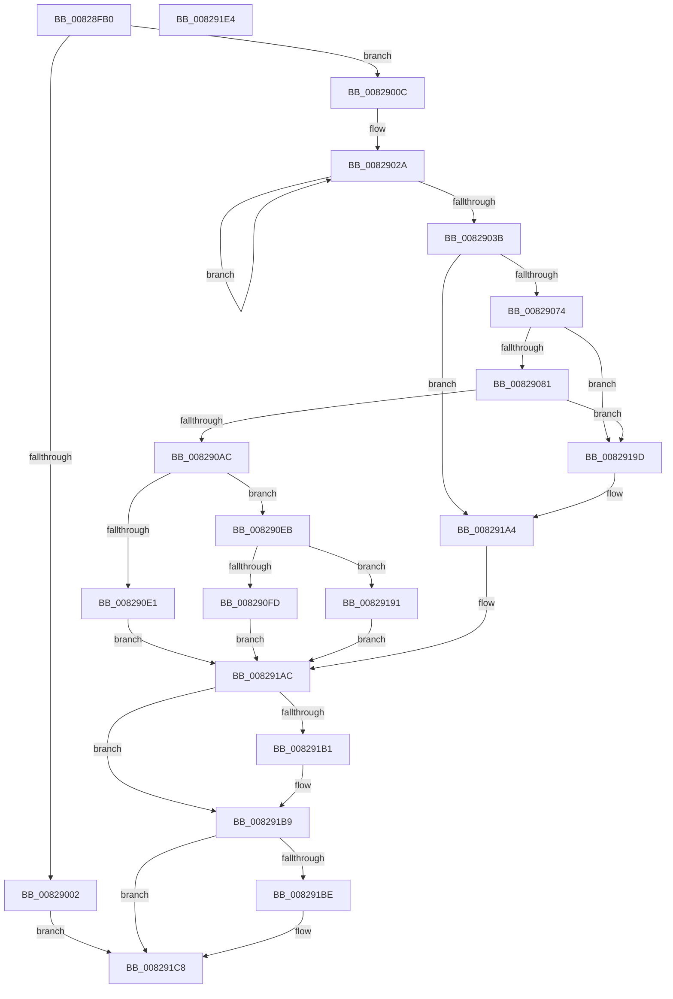

# PnpCtxOpenMachine

- RVA: `0x00828FB0`–`0x008291E5` (길이 `565` bytes)
- VA: `0x0000000140828FB0`
- 실행 섹션: `PAGE`
- PDB 이름 있음: `예`; PDB Function 태그: `아니요`
- unwind 정보 RVA: `0x000DA804`
- 디코드: `132`개 명령, `565/565` bytes 표시
- 미해석 바이트: `0` (있으면 어셈블리에 `.byte`로 보존)

> 이 문서는 커널 이미지의 기계어와 PDB 기호를 분석해 생성했습니다. 4번과 5번은 함수 원형과 자료형을 바이너리 사용 방식에서 추정한 C 해석이며 원본 소스 복구 결과는 아닙니다.

## 1. Dependencies

- 직접 호출 지점: **7**; 고유 호출 대상: **5**
- 직접 호출자로 확인된 함수: **3**
- RIP 상대 이미지 참조: **7**

### Outgoing calls
- `0x00828FF5` → [ExAllocatePool2](../../poolcode/B8/ExAllocatePool2_function_00B820F0.md) (function, `0x00B820F0`)
- `0x00829065` → [PnpCtxCreateNode](PnpCtxCreateNode_function_00828BCC.md) (function, `0x00828BCC`)
- `0x008290D4` → [ExAllocatePool2](../../poolcode/B8/ExAllocatePool2_function_00B820F0.md) (function, `0x00B820F0`)
- `0x008290EE` → [ExInitializeResourceLite](../../text/41/ExInitializeResourceLite_function_0041F9A0.md) (function, `0x0041F9A0`)
- `0x00829196` → [ExFreePoolWithTag](../../poolcode/B8/ExFreePoolWithTag_function_00B82870.md) (function, `0x00B82870`)
- `0x008291B4` → [PnpCtxDestroyNode](PnpCtxDestroyNode_function_00828D50.md) (function, `0x00828D50`)
- `0x008291C3` → [ExFreePoolWithTag](../../poolcode/B8/ExFreePoolWithTag_function_00B82870.md) (function, `0x00B82870`)

### Direct callers
- [PiPnpRtlInit](../73/PiPnpRtlInit_function_007300A4.md) at `0x00730110`
- [PiDevCfgInitDriverDatabaseCallback](../73/PiDevCfgInitDriverDatabaseCallback_function_00733958.md) at `0x007339D7`
- [PipMigratePnpState](../../init/C3/PipMigratePnpState_function_00C317D4.md) at `0x00C31C3B`

### Static image references
- `0x00829051` → RVA `0x00AFF500` (` ?? ::NNGAKEGL::`string'`; read)
- `0x00829105` → RVA `0x008E1D60` (`_PnpDispatchDevice`; read)
- `0x00829142` → RVA `0x009D3580` (`_PnpDispatchInstallerClass`; read)
- `0x00829150` → RVA `0x008E0DB0` (`_PnpDispatchDeviceInterface`; read)
- `0x0082915E` → RVA `0x00993BD0` (`_PnpDispatchInterfaceClass`; read)
- `0x0082916C` → RVA `0x008F6880` (`_PnpDispatchDeviceContainer`; read)
- `0x0082917A` → RVA `0x00831830` (`PnpDispatchDevicePanel`; read)

## 2. Other-region calls and transfers

- 다른 실행 섹션으로 향하는 call: **5**
  - `0x00828FF5` → [ExAllocatePool2](../../poolcode/B8/ExAllocatePool2_function_00B820F0.md) (`PAGE` → `POOLCODE`)
  - `0x008290D4` → [ExAllocatePool2](../../poolcode/B8/ExAllocatePool2_function_00B820F0.md) (`PAGE` → `POOLCODE`)
  - `0x008290EE` → [ExInitializeResourceLite](../../text/41/ExInitializeResourceLite_function_0041F9A0.md) (`PAGE` → `.text`)
  - `0x00829196` → [ExFreePoolWithTag](../../poolcode/B8/ExFreePoolWithTag_function_00B82870.md) (`PAGE` → `POOLCODE`)
  - `0x008291C3` → [ExFreePoolWithTag](../../poolcode/B8/ExFreePoolWithTag_function_00B82870.md) (`PAGE` → `POOLCODE`)
- 별도 외부 분기/꼬리 이동을 확인하지 못했습니다.

## 3. Assembly (complete function range)

```asm
00828FB0  48 8B C4                        mov rax, rsp
00828FB3  48 89 58 08                     mov qword ptr [rax + 8], rbx
00828FB7  48 89 68 10                     mov qword ptr [rax + 0x10], rbp
00828FBB  48 89 70 20                     mov qword ptr [rax + 0x20], rsi
00828FBF  4C 89 40 18                     mov qword ptr [rax + 0x18], r8
00828FC3  57                              push rdi
00828FC4  41 56                           push r14
00828FC6  41 57                           push r15
00828FC8  48 83 EC 50                     sub rsp, 0x50
00828FCC  4C 8B BC 24 A0 00 00 00         mov r15, qword ptr [rsp + 0xa0]
00828FD4  48 8B F2                        mov rsi, rdx
00828FD7  48 83 60 18 00                  and qword ptr [rax + 0x18], 0
00828FDC  BD 50 4E 50 52                  mov ebp, 0x52504e50
00828FE1  44 8B C5                        mov r8d, ebp
00828FE4  BA 10 02 00 00                  mov edx, 0x210
00828FE9  B9 00 01 00 00                  mov ecx, 0x100
00828FEE  49 8B F9                        mov rdi, r9
00828FF1  49 83 27 00                     and qword ptr [r15], 0
00828FF5  E8 F6 90 35 00                  call 0x140b820f0
00828FFA  48 8B D8                        mov rbx, rax
00828FFD  48 85 C0                        test rax, rax
00829000  75 0A                           jne 0x14082900c
00829002  BF 17 00 00 C0                  mov edi, 0xc0000017
00829007  E9 BC 01 00 00                  jmp 0x1408291c8
0082900C  4C 8D 70 08                     lea r14, [rax + 8]
00829010  C7 00 00 00 00 0A               mov dword ptr [rax], 0xa000000
00829016  C6 40 04 00                     mov byte ptr [rax + 4], 0
0082901A  B9 04 00 00 00                  mov ecx, 4
0082901F  4D 89 76 08                     mov qword ptr [r14 + 8], r14
00829023  48 83 C0 18                     add rax, 0x18
00829027  4D 89 36                        mov qword ptr [r14], r14
0082902A  48 89 40 08                     mov qword ptr [rax + 8], rax
0082902E  48 89 00                        mov qword ptr [rax], rax
00829031  48 83 C0 10                     add rax, 0x10
00829035  48 83 E9 01                     sub rcx, 1
00829039  75 EF                           jne 0x14082902a
0082903B  48 8D 84 24 80 00 00 00         lea rax, [rsp + 0x80]
00829043  48 89 44 24 40                  mov qword ptr [rsp + 0x40], rax
00829048  44 8D 41 01                     lea r8d, [rcx + 1]
0082904C  48 21 4C 24 38                  and qword ptr [rsp + 0x38], rcx
00829051  48 8D 15 A8 64 2D 00            lea rdx, [rip + 0x2d64a8]
00829058  48 89 7C 24 30                  mov qword ptr [rsp + 0x30], rdi
0082905D  48 8B CB                        mov rcx, rbx
00829060  48 89 74 24 20                  mov qword ptr [rsp + 0x20], rsi
00829065  E8 62 FB FF FF                  call 0x140828bcc
0082906A  8B F8                           mov edi, eax
0082906C  85 C0                           test eax, eax
0082906E  0F 88 30 01 00 00               js 0x1408291a4
00829074  49 8B 46 08                     mov rax, qword ptr [r14 + 8]
00829078  4C 39 30                        cmp qword ptr [rax], r14
0082907B  0F 85 1C 01 00 00               jne 0x14082919d
00829081  48 8B B4 24 80 00 00 00         mov rsi, qword ptr [rsp + 0x80]
00829089  48 89 46 08                     mov qword ptr [rsi + 8], rax
0082908D  48 8D 4E 10                     lea rcx, [rsi + 0x10]
00829091  4C 89 36                        mov qword ptr [rsi], r14
00829094  48 89 30                        mov qword ptr [rax], rsi
00829097  48 8D 43 28                     lea rax, [rbx + 0x28]
0082909B  49 89 76 08                     mov qword ptr [r14 + 8], rsi
0082909F  48 8B 50 08                     mov rdx, qword ptr [rax + 8]
008290A3  48 39 02                        cmp qword ptr [rdx], rax
008290A6  0F 85 F1 00 00 00               jne 0x14082919d
008290AC  48 89 51 08                     mov qword ptr [rcx + 8], rdx
008290B0  44 8B C5                        mov r8d, ebp
008290B3  48 89 01                        mov qword ptr [rcx], rax
008290B6  48 89 0A                        mov qword ptr [rdx], rcx
008290B9  BA 68 00 00 00                  mov edx, 0x68
008290BE  48 89 48 08                     mov qword ptr [rax + 8], rcx
008290C2  48 89 73 58                     mov qword ptr [rbx + 0x58], rsi
008290C6  48 8B 46 38                     mov rax, qword ptr [rsi + 0x38]
008290CA  8D 4A D8                        lea ecx, [rdx - 0x28]
008290CD  48 89 83 E0 00 00 00            mov qword ptr [rbx + 0xe0], rax
008290D4  E8 17 90 35 00                  call 0x140b820f0
008290D9  48 8B E8                        mov rbp, rax
008290DC  48 85 C0                        test rax, rax
008290DF  75 0A                           jne 0x1408290eb
008290E1  BF 17 00 00 C0                  mov edi, 0xc0000017
008290E6  E9 C1 00 00 00                  jmp 0x1408291ac
008290EB  48 8B CD                        mov rcx, rbp
008290EE  E8 AD 68 BF FF                  call 0x14041f9a0
008290F3  8B F8                           mov edi, eax
008290F5  85 C0                           test eax, eax
008290F7  0F 88 94 00 00 00               js 0x140829191
008290FD  48 83 A3 E8 00 00 00 00         and qword ptr [rbx + 0xe8], 0
00829105  48 8D 05 54 8C 0B 00            lea rax, [rip + 0xb8c54]
0082910C  48 83 A3 E8 01 00 00 00         and qword ptr [rbx + 0x1e8], 0
00829114  48 83 A3 F0 01 00 00 00         and qword ptr [rbx + 0x1f0], 0
0082911C  48 83 A3 F8 01 00 00 00         and qword ptr [rbx + 0x1f8], 0
00829124  48 83 A3 00 02 00 00 00         and qword ptr [rbx + 0x200], 0
0082912C  48 83 A3 08 02 00 00 00         and qword ptr [rbx + 0x208], 0
00829134  48 89 AB F0 00 00 00            mov qword ptr [rbx + 0xf0], rbp
0082913B  48 89 83 30 01 00 00            mov qword ptr [rbx + 0x130], rax
00829142  48 8D 05 37 A4 1A 00            lea rax, [rip + 0x1aa437]
00829149  48 89 83 38 01 00 00            mov qword ptr [rbx + 0x138], rax
00829150  48 8D 05 59 7C 0B 00            lea rax, [rip + 0xb7c59]
00829157  48 89 83 40 01 00 00            mov qword ptr [rbx + 0x140], rax
0082915E  48 8D 05 6B AA 16 00            lea rax, [rip + 0x16aa6b]
00829165  48 89 83 48 01 00 00            mov qword ptr [rbx + 0x148], rax
0082916C  48 8D 05 0D D7 0C 00            lea rax, [rip + 0xcd70d]
00829173  48 89 83 50 01 00 00            mov qword ptr [rbx + 0x150], rax
0082917A  48 8D 05 AF 86 00 00            lea rax, [rip + 0x86af]
00829181  48 89 83 58 01 00 00            mov qword ptr [rbx + 0x158], rax
00829188  49 89 1F                        mov qword ptr [r15], rbx
0082918B  33 DB                           xor ebx, ebx
0082918D  33 F6                           xor esi, esi
0082918F  EB 1B                           jmp 0x1408291ac
00829191  33 D2                           xor edx, edx
00829193  48 8B CD                        mov rcx, rbp
00829196  E8 D5 96 35 00                  call 0x140b82870
0082919B  EB 0F                           jmp 0x1408291ac
0082919D  B9 03 00 00 00                  mov ecx, 3
008291A2  CD 29                           int 0x29
008291A4  48 8B B4 24 80 00 00 00         mov rsi, qword ptr [rsp + 0x80]
008291AC  48 85 F6                        test rsi, rsi
008291AF  74 08                           je 0x1408291b9
008291B1  48 8B CE                        mov rcx, rsi
008291B4  E8 97 FB FF FF                  call 0x140828d50
008291B9  48 85 DB                        test rbx, rbx
008291BC  74 0A                           je 0x1408291c8
008291BE  33 D2                           xor edx, edx
008291C0  48 8B CB                        mov rcx, rbx
008291C3  E8 A8 96 35 00                  call 0x140b82870
008291C8  4C 8D 5C 24 50                  lea r11, [rsp + 0x50]
008291CD  8B C7                           mov eax, edi
008291CF  49 8B 5B 20                     mov rbx, qword ptr [r11 + 0x20]
008291D3  49 8B 6B 28                     mov rbp, qword ptr [r11 + 0x28]
008291D7  49 8B 73 38                     mov rsi, qword ptr [r11 + 0x38]
008291DB  49 8B E3                        mov rsp, r11
008291DE  41 5F                           pop r15
008291E0  41 5E                           pop r14
008291E2  5F                              pop rdi
008291E3  C3                              ret
008291E4  CC                              int3
```

## 4. C-style interpretation (structured pseudocode)

```c
__int64 __fastcall PnpCtxOpenMachine(__int64 a1, __int64 a2, __int64 a3, __int64 a4, __int64 a5, __int64 a6, __int64 a7)
{
    __int64 result;
    __int64 v_rbx;
    __int64 v_rsi;
    __int64 v_rsp;
    unsigned __int64 v_stack_m18;
    unsigned __int64 v_stack_m28;
    unsigned __int64 v_stack_m30;
    unsigned __int64 v_stack_m38;
    unsigned __int64 v_stack_m48;
    unsigned __int64 v_stack_p18;

    *(unsigned __int64 *)(v_rsp + 8) = v_rbx;
    *(unsigned __int64 *)(v_rsp + 16) = v_rbp;
    *(unsigned __int64 *)(v_rsp + 32) = v_rsi;
    *(unsigned __int64 *)(v_rsp + 24) = a3;
    v_rsp = (v_rsp) - (80);
    result = ExAllocatePool2(256, 528, (unsigned int)((unsigned int)((unsigned int)(0x52504E50ULL))), a4);
    if (result != 0) goto loc_0082900C;
    goto loc_008291C8;
loc_0082900C:
    *(unsigned int *)(result) = 0xA000000ULL;
    *(unsigned __int8 *)(result + 4) = 0;
    *(unsigned __int64 *)(result + 8 + 8) = result + 8;
    result = (result) + (24);
    *(unsigned __int64 *)(result + 8) = result + 8;
loc_0082902A:
    *(unsigned __int64 *)(result + 8) = result;
    *(unsigned __int64 *)(result) = result;
    result = (result) + (16);
    a1 = (4) - (1);
    if (condition_is_not_equal) goto loc_0082902A;
    v_stack_m28 = v_stack_p18;
    v_stack_m38 = (unsigned int)(0xC0000017ULL);
    v_stack_m48 = a2;
    result = PnpCtxCreateNode(result, v_rip + 2974888, a1 + 1, a4);
    if (sign_flag) goto loc_008291A4;
    if ((*(unsigned __int64 *)(*(unsigned __int64 *)(result + 8 + 8))) != (result + 8)) goto loc_0082919D;
    *(unsigned __int64 *)(v_stack_p18 + 8) = *(unsigned __int64 *)(result + 8 + 8);
    *(unsigned __int64 *)(v_stack_p18) = result + 8;
    *(unsigned __int64 *)(*(unsigned __int64 *)(result + 8 + 8)) = v_stack_p18;
    *(unsigned __int64 *)(result + 8 + 8) = v_stack_p18;
    if ((*(unsigned __int64 *)(*(unsigned __int64 *)(result + 40 + 8))) != (result + 40)) goto loc_0082919D;
    *(unsigned __int64 *)(v_stack_p18 + 16 + 8) = *(unsigned __int64 *)(result + 40 + 8);
    *(unsigned __int64 *)(v_stack_p18 + 16) = result + 40;
    *(unsigned __int64 *)(*(unsigned __int64 *)(result + 40 + 8)) = v_stack_p18 + 16;
    *(unsigned __int64 *)(result + 40 + 8) = v_stack_p18 + 16;
    *(unsigned __int64 *)(result + 88) = v_stack_p18;
    *(unsigned __int64 *)(result + 224) = *(unsigned __int64 *)(v_stack_p18 + 56);
    result = ExAllocatePool2(104 - 40, 104, (unsigned int)((unsigned int)((unsigned int)(0x52504E50ULL))), a4);
    if (result != 0) goto loc_008290EB;
    goto loc_008291AC;
loc_008290EB:
    result = ExInitializeResourceLite(result, 104, (unsigned int)((unsigned int)((unsigned int)(0x52504E50ULL))), a4);
    if (sign_flag) goto loc_00829191;
    *(unsigned __int64 *)(result + 240) = result;
    *(unsigned __int64 *)(result + 304) = v_rip + 756820;
    *(unsigned __int64 *)(result + 312) = v_rip + 1745975;
    *(unsigned __int64 *)(result + 320) = v_rip + 752729;
    *(unsigned __int64 *)(result + 328) = v_rip + 1485419;
    *(unsigned __int64 *)(result + 336) = v_rip + 841485;
    *(unsigned __int64 *)(result + 344) = v_rip + 34479;
    *(unsigned __int64 *)(a7) = result;
    v_rbx = 0;
    v_rsi = 0;
    goto loc_008291AC;
loc_00829191:
    a2 = 0;
    result = ExFreePoolWithTag(result, a2, (unsigned int)((unsigned int)((unsigned int)(0x52504E50ULL))), a4);
    goto loc_008291AC;
loc_0082919D:
loc_008291A4:
loc_008291AC:
    if (v_stack_p18 != 0) {
        a1 = v_stack_p18;
        result = PnpCtxDestroyNode(a1, a2, (unsigned int)((unsigned int)((unsigned int)(0x52504E50ULL))), a4);
    }
    if (0 != 0) {
        a2 = 0;
        a1 = 0;
        result = ExFreePoolWithTag(a1, a2, (unsigned int)((unsigned int)((unsigned int)(0x52504E50ULL))), a4);
    }
    return (unsigned int)((unsigned int)((unsigned int)((unsigned int)(result))));
}
```

## 5. (Beta) C Style

```c
int64_t PnpCtxOpenMachine(int64_t Arg1, int64_t Arg2, int64_t Arg3, int64_t Arg4, uint64_t Arg5, uint64_t Arg6, void *Arg7)
{
    uint8_t *arg7 = (uint8_t *)Arg7;

    int64_t result;
    int64_t local_rbx;
    int64_t local_rsi;
    int64_t local_rsp;
    uint64_t v_stack_m18;
    uint64_t v_stack_m28;
    uint64_t v_stack_m30;
    uint64_t v_stack_m38;
    uint64_t v_stack_m48;
    uint64_t v_stack_p18;

    *(uint64_t *)(local_rsp + 0x8) = local_rbx;
    *(uint64_t *)(local_rsp + 0x10) = local_rbp;
    *(uint64_t *)(local_rsp + 0x20) = local_rsi;
    *(uint64_t *)(local_rsp + 0x18) = Arg3;
    local_rsp = (local_rsp) - (80);
    result = ExAllocatePool2(256, 528, (uint32_t)((uint32_t)((uint32_t)(0x52504E50ULL))), Arg4);
    if (result != 0) goto loc_0082900C;
    goto loc_008291C8;
loc_0082900C:
    *(uint32_t *)(result) = 0xA000000ULL;
    *(uint8_t *)(result + 0x4) = 0;
    *(uint64_t *)(result + 0x8 + 0x8) = result + 8;
    result = (result) + (24);
    *(uint64_t *)(result + 0x8) = result + 8;
loc_0082902A:
    *(uint64_t *)(result + 0x8) = result;
    *(uint64_t *)(result) = result;
    result = (result) + (16);
    Arg1 = (4) - (1);
    if (condition_is_not_equal) goto loc_0082902A;
    v_stack_m28 = v_stack_p18;
    v_stack_m38 = (uint32_t)(0xC0000017ULL);
    v_stack_m48 = Arg2;
    result = PnpCtxCreateNode(result, v_rip + 2974888, Arg1 + 1, Arg4);
    if (sign_flag) goto loc_008291A4;
    if ((*(uint64_t *)(*(uint64_t *)(result + 0x8 + 0x8))) != (result + 8)) goto loc_0082919D;
    *(uint64_t *)(v_stack_p18 + 0x8) = *(uint64_t *)(result + 0x8 + 0x8);
    *(uint64_t *)(v_stack_p18) = result + 8;
    *(uint64_t *)(*(uint64_t *)(result + 0x8 + 0x8)) = v_stack_p18;
    *(uint64_t *)(result + 0x8 + 0x8) = v_stack_p18;
    if ((*(uint64_t *)(*(uint64_t *)(result + 0x28 + 0x8))) != (result + 40)) goto loc_0082919D;
    *(uint64_t *)(v_stack_p18 + 0x10 + 0x8) = *(uint64_t *)(result + 0x28 + 0x8);
    *(uint64_t *)(v_stack_p18 + 0x10) = result + 40;
    *(uint64_t *)(*(uint64_t *)(result + 0x28 + 0x8)) = v_stack_p18 + 16;
    *(uint64_t *)(result + 0x28 + 0x8) = v_stack_p18 + 16;
    *(uint64_t *)(result + 0x58) = v_stack_p18;
    *(uint64_t *)(result + 0xE0) = *(uint64_t *)(v_stack_p18 + 0x38);
    result = ExAllocatePool2(104 - 40, 104, (uint32_t)((uint32_t)((uint32_t)(0x52504E50ULL))), Arg4);
    if (result != 0) goto loc_008290EB;
    goto loc_008291AC;
loc_008290EB:
    result = ExInitializeResourceLite(result, 104, (uint32_t)((uint32_t)((uint32_t)(0x52504E50ULL))), Arg4);
    if (sign_flag) goto loc_00829191;
    *(uint64_t *)(result + 0xF0) = result;
    *(uint64_t *)(result + 0x130) = v_rip + 756820;
    *(uint64_t *)(result + 0x138) = v_rip + 1745975;
    *(uint64_t *)(result + 0x140) = v_rip + 752729;
    *(uint64_t *)(result + 0x148) = v_rip + 1485419;
    *(uint64_t *)(result + 0x150) = v_rip + 841485;
    *(uint64_t *)(result + 0x158) = v_rip + 34479;
    *(uint64_t *)(arg7) = result;
    local_rbx = 0;
    local_rsi = 0;
    goto loc_008291AC;
loc_00829191:
    Arg2 = 0;
    result = ExFreePoolWithTag(result, Arg2, (uint32_t)((uint32_t)((uint32_t)(0x52504E50ULL))), Arg4);
    goto loc_008291AC;
loc_0082919D:
loc_008291A4:
loc_008291AC:
    if (v_stack_p18 != 0) {
        Arg1 = v_stack_p18;
        result = PnpCtxDestroyNode(Arg1, Arg2, (uint32_t)((uint32_t)((uint32_t)(0x52504E50ULL))), Arg4);
    }
    if (0 != 0) {
        Arg2 = 0;
        Arg1 = 0;
        result = ExFreePoolWithTag(Arg1, Arg2, (uint32_t)((uint32_t)((uint32_t)(0x52504E50ULL))), Arg4);
    }
    return (uint32_t)((uint32_t)((uint32_t)((uint32_t)(result))));
}
```

### 관측된 메모리 오프셋

구조체 형식이 확인되지 않은 접근은 인자 기준의 오프셋으로만 기록했습니다.

| 기준 인자 | 오프셋 표현 | 폭 (bit) | 접근 |
|---|---:|---:|---|
| `Arg7` | `+ 0x0` | `64` | `R/W` |
| `Arg7` | `+ 0x0` | `64` | `W` |

## 6. Execution-region graph

[열기: 2D/3D 그래프와 함수 탐색 컨트롤 패널](../../../control-panel.html?section=page&rva=0x00828FB0&view=graph)

- 2D 그래프는 위에서 아래로 흐르고, 3D 그래프는 빈 공간을 드래그해 회전합니다. Shift+드래그는 이동, 휠은 확대·축소, 함수 노드 선택은 대상 보고서 이동입니다.

### Static fallback


