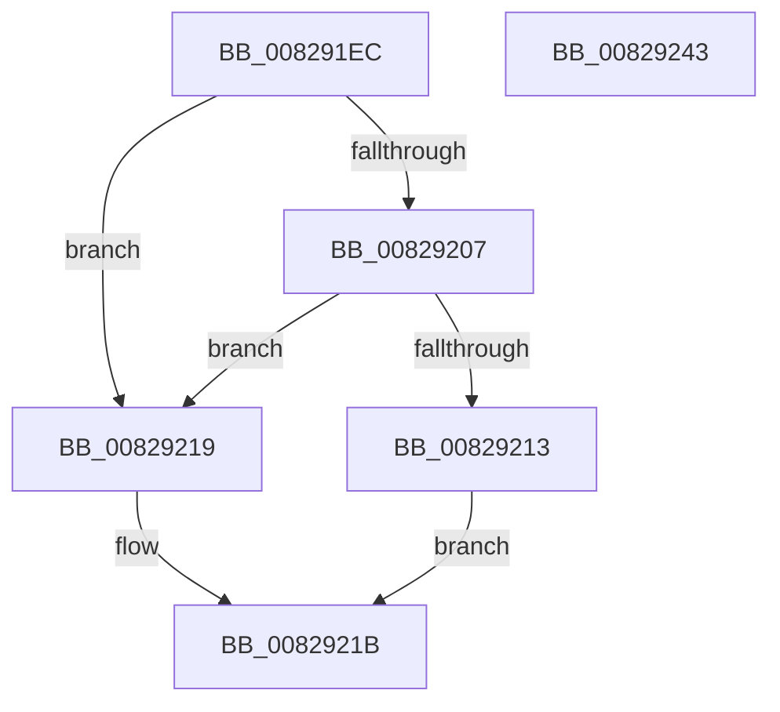

# PnpCtxRegCopyTree

- RVA: `0x008291EC`–`0x00829244` (길이 `88` bytes)
- VA: `0x00000001408291EC`
- 실행 섹션: `PAGE`
- PDB 이름 있음: `예`; PDB Function 태그: `아니요`
- unwind 정보 RVA: `0x000697A4`
- 디코드: `26`개 명령, `88/88` bytes 표시
- 미해석 바이트: `0` (있으면 어셈블리에 `.byte`로 보존)

> 이 문서는 커널 이미지의 기계어와 PDB 기호를 분석해 생성했습니다. 4번과 5번은 함수 원형과 자료형을 바이너리 사용 방식에서 추정한 C 해석이며 원본 소스 복구 결과는 아닙니다.

## 1. Dependencies

- 직접 호출 지점: **1**; 고유 호출 대상: **1**
- 직접 호출자로 확인된 함수: **3**
- RIP 상대 이미지 참조: **1**

### Outgoing calls
- `0x00829238` → [RegRtlCopyTreeInternal](../83/RegRtlCopyTreeInternal_function_008324C0.md) (function, `0x008324C0`)

### Direct callers
- [PiDevCfgConfigureSoftwareDevices](../96/PiDevCfgConfigureSoftwareDevices_function_009652EC.md) at `0x0096542F`
- [PiDevCfgConfigureDeviceFilters](../AA/PiDevCfgConfigureDeviceFilters_function_00AA67DC.md) at `0x00AA688E`
- [PipMigratePnpState](../../init/C3/PipMigratePnpState_function_00C317D4.md) at `0x00C31B34`
- [PipMigratePnpState](../../init/C3/PipMigratePnpState_function_00C317D4.md) at `0x00C31BC5`

### Static image references
- `0x008291F2` → RVA `0x00E66398` (`.data`; read)

## 2. Other-region calls and transfers

- 다른 실행 섹션으로 향하는 call: **0**
- 별도 외부 분기/꼬리 이동을 확인하지 못했습니다.

## 3. Assembly (complete function range)

```asm
008291EC  40 53                           push rbx
008291EE  48 83 EC 40                     sub rsp, 0x40
008291F2  48 8B 05 9F D1 63 00            mov rax, qword ptr [rip + 0x63d19f]
008291F9  4D 8B D1                        mov r10, r9
008291FC  4D 8B D8                        mov r11, r8
008291FF  48 8B DA                        mov rbx, rdx
00829202  48 85 C0                        test rax, rax
00829205  74 12                           je 0x140829219
00829207  48 8B 80 E0 00 00 00            mov rax, qword ptr [rax + 0xe0]
0082920E  48 85 C0                        test rax, rax
00829211  74 06                           je 0x140829219
00829213  48 8B 48 08                     mov rcx, qword ptr [rax + 8]
00829217  EB 02                           jmp 0x14082921b
00829219  33 C9                           xor ecx, ecx
0082921B  4C 8B 4C 24 70                  mov r9, qword ptr [rsp + 0x70]
00829220  4D 8B C2                        mov r8, r10
00829223  C6 44 24 30 00                  mov byte ptr [rsp + 0x30], 0
00829228  49 8B D3                        mov rdx, r11
0082922B  48 89 4C 24 28                  mov qword ptr [rsp + 0x28], rcx
00829230  48 8B CB                        mov rcx, rbx
00829233  C6 44 24 20 00                  mov byte ptr [rsp + 0x20], 0
00829238  E8 83 92 00 00                  call 0x1408324c0
0082923D  48 83 C4 40                     add rsp, 0x40
00829241  5B                              pop rbx
00829242  C3                              ret
00829243  CC                              int3
```

## 4. C-style interpretation (structured pseudocode)

```c
__int64 __fastcall PnpCtxRegCopyTree(__int64 a1, __int64 a2, __int64 a3, __int64 a4, __int64 a5)
{
    __int64 result;
    __int64 v_rsp;
    unsigned __int8 v_stack_m18;
    unsigned __int64 v_stack_m20;
    unsigned __int8 v_stack_m28;

    v_rsp = (v_rsp) - (64);
    if (*(unsigned __int64 *)(v_rip + 6541727) == 0) goto loc_00829219;
    if (*(unsigned __int64 *)(*(unsigned __int64 *)(v_rip + 6541727) + 224) == 0) goto loc_00829219;
    goto loc_0082921B;
loc_00829219:
    a1 = 0;
loc_0082921B:
    v_stack_m18 = 0;
    v_stack_m20 = 0;
    v_stack_m28 = 0;
    result = RegRtlCopyTreeInternal(a2, a3, a4, a5);
    v_rsp = (v_rsp) + (64);
    return result;
}
```

## 5. (Beta) C Style

```c
int64_t PnpCtxRegCopyTree(int64_t Arg1, int64_t Arg2, int64_t Arg3, int64_t Arg4, int64_t Arg5)
{
    int64_t result;
    int64_t local_rsp;
    uint8_t v_stack_m18;
    uint64_t v_stack_m20;
    uint8_t v_stack_m28;

    local_rsp = (local_rsp) - (64);
    if (*(uint64_t *)(v_rip + 0x63D19F) == 0) goto loc_00829219;
    if (*(uint64_t *)(*(uint64_t *)(v_rip + 0x63D19F) + 0xE0) == 0) goto loc_00829219;
    goto loc_0082921B;
loc_00829219:
    Arg1 = 0;
loc_0082921B:
    v_stack_m18 = 0;
    v_stack_m20 = 0;
    v_stack_m28 = 0;
    result = RegRtlCopyTreeInternal(Arg2, Arg3, Arg4, Arg5);
    local_rsp = (local_rsp) + (64);
    return result;
}
```

## 6. Execution-region graph

[열기: 2D/3D 그래프와 함수 탐색 컨트롤 패널](../../../control-panel.html?section=page&rva=0x008291EC&view=graph)

- 2D 그래프는 위에서 아래로 흐르고, 3D 그래프는 빈 공간을 드래그해 회전합니다. Shift+드래그는 이동, 휠은 확대·축소, 함수 노드 선택은 대상 보고서 이동입니다.

### Static fallback


