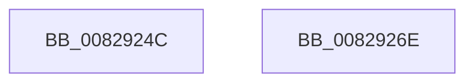

# PnpCtxRegGetKeySecurity

- RVA: `0x0082924C`–`0x0082926F` (길이 `35` bytes)
- VA: `0x000000014082924C`
- 실행 섹션: `PAGE`
- PDB 이름 있음: `예`; PDB Function 태그: `아니요`
- unwind 정보 RVA: `0x0005C788`
- 디코드: `11`개 명령, `35/35` bytes 표시
- 미해석 바이트: `0` (있으면 어셈블리에 `.byte`로 보존)

> 이 문서는 커널 이미지의 기계어와 PDB 기호를 분석해 생성했습니다. 4번과 5번은 함수 원형과 자료형을 바이너리 사용 방식에서 추정한 C 해석이며 원본 소스 복구 결과는 아닙니다.

## 1. Dependencies

- 직접 호출 지점: **1**; 고유 호출 대상: **1**
- 직접 호출자로 확인된 함수: **1**
- RIP 상대 이미지 참조: **0**

### Outgoing calls
- `0x00829264` → [RegRtlGetKeySecurity](../83/RegRtlGetKeySecurity_function_008329F4.md) (function, `0x008329F4`)

### Direct callers
- [PnpRegCopyKeySecurity](../72/PnpRegCopyKeySecurity_function_0072CAC8.md) at `0x0072CB55`
- [PnpRegCopyKeySecurity](../72/PnpRegCopyKeySecurity_function_0072CAC8.md) at `0x0072CB98`

### Static image references
- 디코드된 RIP-relative 메모리 참조가 없습니다.

## 2. Other-region calls and transfers

- 다른 실행 섹션으로 향하는 call: **0**
- 별도 외부 분기/꼬리 이동을 확인하지 못했습니다.

## 3. Assembly (complete function range)

```asm
0082924C  48 83 EC 28                     sub rsp, 0x28
00829250  49 8B C1                        mov rax, r9
00829253  45 8B D0                        mov r10d, r8d
00829256  4C 8B 4C 24 50                  mov r9, qword ptr [rsp + 0x50]
0082925B  48 8B CA                        mov rcx, rdx
0082925E  4C 8B C0                        mov r8, rax
00829261  41 8B D2                        mov edx, r10d
00829264  E8 8B 97 00 00                  call 0x1408329f4
00829269  48 83 C4 28                     add rsp, 0x28
0082926D  C3                              ret
0082926E  CC                              int3
```

## 4. C-style interpretation (structured pseudocode)

```c
__int64 __fastcall PnpCtxRegGetKeySecurity(__int64 a1, __int64 a2, int a3, __int64 a4, __int64 a5)
{
    __int64 result;
    __int64 v_rsp;

    v_rsp = (v_rsp) - (40);
    result = RegRtlGetKeySecurity(a2, (unsigned int)((unsigned int)((unsigned int)(a3))), a4, a5);
    v_rsp = (v_rsp) + (40);
    return result;
}
```

## 5. (Beta) C Style

```c
int64_t PnpCtxRegGetKeySecurity(int64_t Arg1, int64_t Arg2, int32_t Arg3, int64_t Arg4, int64_t Arg5)
{
    int64_t result;
    int64_t local_rsp;

    local_rsp = (local_rsp) - (40);
    result = RegRtlGetKeySecurity(Arg2, (uint32_t)((uint32_t)((uint32_t)(Arg3))), Arg4, Arg5);
    local_rsp = (local_rsp) + (40);
    return result;
}
```

## 6. Execution-region graph

[열기: 2D/3D 그래프와 함수 탐색 컨트롤 패널](../../../control-panel.html?section=page&rva=0x0082924C&view=graph)

- 2D 그래프는 위에서 아래로 흐르고, 3D 그래프는 빈 공간을 드래그해 회전합니다. Shift+드래그는 이동, 휠은 확대·축소, 함수 노드 선택은 대상 보고서 이동입니다.

### Static fallback


