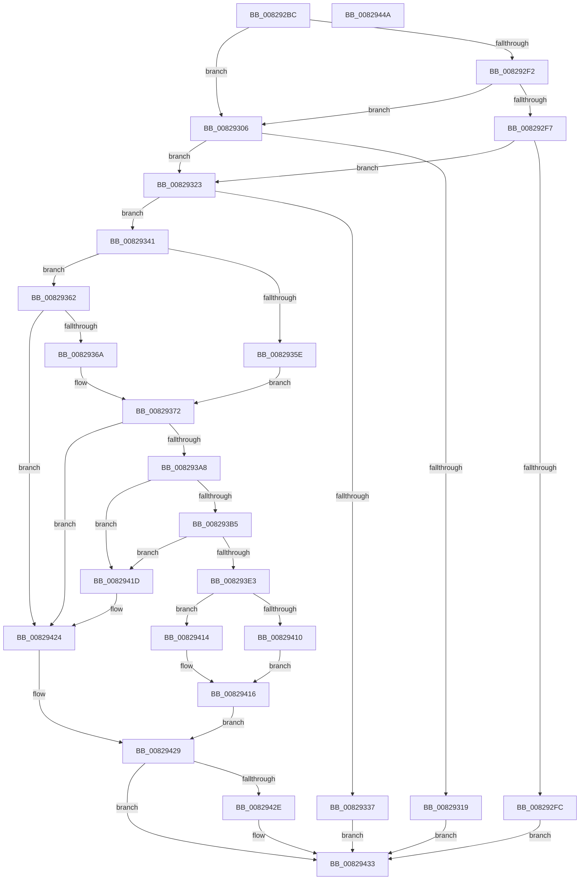

# PnpCtxRegisterMachineNode

- RVA: `0x008292BC`–`0x0082944B` (길이 `399` bytes)
- VA: `0x00000001408292BC`
- 실행 섹션: `PAGE`
- PDB 이름 있음: `예`; PDB Function 태그: `아니요`
- unwind 정보 RVA: `0x000DA7EC`
- 디코드: `110`개 명령, `399/399` bytes 표시
- 미해석 바이트: `0` (있으면 어셈블리에 `.byte`로 보존)

> 이 문서는 커널 이미지의 기계어와 PDB 기호를 분석해 생성했습니다. 4번과 5번은 함수 원형과 자료형을 바이너리 사용 방식에서 추정한 C 해석이며 원본 소스 복구 결과는 아닙니다.

## 1. Dependencies

- 직접 호출 지점: **5**; 고유 호출 대상: **5**
- 직접 호출자로 확인된 함수: **2**
- RIP 상대 이미지 참조: **1**

### Outgoing calls
- `0x0082932E` → [PnpCtxFindNode](PnpCtxFindNode_function_00828E50.md) (function, `0x00828E50`)
- `0x00829350` → [SysCtxGetTransaction](../83/SysCtxGetTransaction_function_00831AD8.md) (function, `0x00831AD8`)
- `0x0082939D` → [PnpCtxCreateNode](PnpCtxCreateNode_function_00828BCC.md) (function, `0x00828BCC`)
- `0x008293FD` → [memset](../../text/6C/memset_function_006C6C40.md) (function, `0x006C6C40`)
- `0x0082942E` → [PnpCtxDestroyNode](PnpCtxDestroyNode_function_00828D50.md) (function, `0x00828D50`)

### Direct callers
- [PiPnpRtlInit](../73/PiPnpRtlInit_function_007300A4.md) at `0x0073016E`
- [PiDrvDbRegisterNode](../74/PiDrvDbRegisterNode_function_00742658.md) at `0x00742A55`

### Static image references
- `0x008292E1` → RVA `0x00E66398` (`.data`; read)

## 2. Other-region calls and transfers

- 다른 실행 섹션으로 향하는 call: **1**
  - `0x008293FD` → [memset](../../text/6C/memset_function_006C6C40.md) (`PAGE` → `.text`)
- 별도 외부 분기/꼬리 이동을 확인하지 못했습니다.

## 3. Assembly (complete function range)

```asm
008292BC  48 8B C4                        mov rax, rsp
008292BF  48 89 58 10                     mov qword ptr [rax + 0x10], rbx
008292C3  48 89 68 18                     mov qword ptr [rax + 0x18], rbp
008292C7  48 89 70 20                     mov qword ptr [rax + 0x20], rsi
008292CB  48 89 48 08                     mov qword ptr [rax + 8], rcx
008292CF  57                              push rdi
008292D0  48 83 EC 50                     sub rsp, 0x50
008292D4  48 83 60 08 00                  and qword ptr [rax + 8], 0
008292D9  48 8B EA                        mov rbp, rdx
008292DC  48 83 60 30 00                  and qword ptr [rax + 0x30], 0
008292E1  48 8B 3D B0 D0 63 00            mov rdi, qword ptr [rip + 0x63d0b0]
008292E8  49 63 F0                        movsxd rsi, r8d
008292EB  8B CE                           mov ecx, esi
008292ED  83 E9 01                        sub ecx, 1
008292F0  74 14                           je 0x140829306
008292F2  83 E9 01                        sub ecx, 1
008292F5  74 0F                           je 0x140829306
008292F7  83 F9 01                        cmp ecx, 1
008292FA  74 27                           je 0x140829323
008292FC  BB 0D 00 00 C0                  mov ebx, 0xc000000d
00829301  E9 2D 01 00 00                  jmp 0x140829433
00829306  48 8B C6                        mov rax, rsi
00829309  48 C1 E0 04                     shl rax, 4
0082930D  48 83 C0 18                     add rax, 0x18
00829311  48 03 C7                        add rax, rdi
00829314  48 39 00                        cmp qword ptr [rax], rax
00829317  74 0A                           je 0x140829323
00829319  BB 0E 02 00 C0                  mov ebx, 0xc000020e
0082931E  E9 10 01 00 00                  jmp 0x140829433
00829323  4C 8D 4C 24 60                  lea r9, [rsp + 0x60]
00829328  45 33 C0                        xor r8d, r8d
0082932B  48 8B CF                        mov rcx, rdi
0082932E  E8 1D FB FF FF                  call 0x140828e50
00829333  85 C0                           test eax, eax
00829335  78 0A                           js 0x140829341
00829337  BB 35 00 00 C0                  mov ebx, 0xc0000035
0082933C  E9 F2 00 00 00                  jmp 0x140829433
00829341  48 8B 8F E0 00 00 00            mov rcx, qword ptr [rdi + 0xe0]
00829348  48 8D 94 24 88 00 00 00         lea rdx, [rsp + 0x88]
00829350  E8 83 87 00 00                  call 0x140831ad8
00829355  8B D8                           mov ebx, eax
00829357  3D 03 00 19 C0                  cmp eax, 0xc0190003
0082935C  75 04                           jne 0x140829362
0082935E  33 C0                           xor eax, eax
00829360  EB 10                           jmp 0x140829372
00829362  85 C0                           test eax, eax
00829364  0F 88 BA 00 00 00               js 0x140829424
0082936A  48 8B 84 24 88 00 00 00         mov rax, qword ptr [rsp + 0x88]
00829372  48 8D 4C 24 60                  lea rcx, [rsp + 0x60]
00829377  44 8B C6                        mov r8d, esi
0082937A  48 89 4C 24 40                  mov qword ptr [rsp + 0x40], rcx
0082937F  48 8B D5                        mov rdx, rbp
00829382  48 89 44 24 38                  mov qword ptr [rsp + 0x38], rax
00829387  48 8B CF                        mov rcx, rdi
0082938A  48 8B 84 24 80 00 00 00         mov rax, qword ptr [rsp + 0x80]
00829392  48 83 4C 24 30 FF               or qword ptr [rsp + 0x30], 0xffffffffffffffff
00829398  48 89 44 24 20                  mov qword ptr [rsp + 0x20], rax
0082939D  E8 2A F8 FF FF                  call 0x140828bcc
008293A2  8B D8                           mov ebx, eax
008293A4  85 C0                           test eax, eax
008293A6  78 7C                           js 0x140829424
008293A8  48 8D 4F 08                     lea rcx, [rdi + 8]
008293AC  48 8B 51 08                     mov rdx, qword ptr [rcx + 8]
008293B0  48 39 0A                        cmp qword ptr [rdx], rcx
008293B3  75 68                           jne 0x14082941d
008293B5  48 8B 44 24 60                  mov rax, qword ptr [rsp + 0x60]
008293BA  48 89 50 08                     mov qword ptr [rax + 8], rdx
008293BE  48 89 08                        mov qword ptr [rax], rcx
008293C1  48 89 02                        mov qword ptr [rdx], rax
008293C4  48 8B D6                        mov rdx, rsi
008293C7  48 C1 E2 04                     shl rdx, 4
008293CB  48 89 41 08                     mov qword ptr [rcx + 8], rax
008293CF  48 83 C2 18                     add rdx, 0x18
008293D3  48 03 D7                        add rdx, rdi
008293D6  48 8D 48 10                     lea rcx, [rax + 0x10]
008293DA  48 8B 42 08                     mov rax, qword ptr [rdx + 8]
008293DE  48 39 10                        cmp qword ptr [rax], rdx
008293E1  75 3A                           jne 0x14082941d
008293E3  48 89 11                        mov qword ptr [rcx], rdx
008293E6  41 B8 80 00 00 00               mov r8d, 0x80
008293EC  48 89 41 08                     mov qword ptr [rcx + 8], rax
008293F0  48 89 08                        mov qword ptr [rax], rcx
008293F3  48 89 4A 08                     mov qword ptr [rdx + 8], rcx
008293F7  48 8D 4F 60                     lea rcx, [rdi + 0x60]
008293FB  33 D2                           xor edx, edx
008293FD  E8 3E D8 E9 FF                  call 0x1406c6c40
00829402  48 8D 47 38                     lea rax, [rdi + 0x38]
00829406  48 39 00                        cmp qword ptr [rax], rax
00829409  B8 04 00 00 00                  mov eax, 4
0082940E  74 04                           je 0x140829414
00829410  B1 01                           mov cl, 1
00829412  EB 02                           jmp 0x140829416
00829414  32 C9                           xor cl, cl
00829416  88 0C 38                        mov byte ptr [rax + rdi], cl
00829419  33 C9                           xor ecx, ecx
0082941B  EB 0C                           jmp 0x140829429
0082941D  B9 03 00 00 00                  mov ecx, 3
00829422  CD 29                           int 0x29
00829424  48 8B 4C 24 60                  mov rcx, qword ptr [rsp + 0x60]
00829429  48 85 C9                        test rcx, rcx
0082942C  74 05                           je 0x140829433
0082942E  E8 1D F9 FF FF                  call 0x140828d50
00829433  48 8B 6C 24 70                  mov rbp, qword ptr [rsp + 0x70]
00829438  8B C3                           mov eax, ebx
0082943A  48 8B 5C 24 68                  mov rbx, qword ptr [rsp + 0x68]
0082943F  48 8B 74 24 78                  mov rsi, qword ptr [rsp + 0x78]
00829444  48 83 C4 50                     add rsp, 0x50
00829448  5F                              pop rdi
00829449  C3                              ret
0082944A  CC                              int3
```

## 4. C-style interpretation (structured pseudocode)

```c
__int64 __fastcall PnpCtxRegisterMachineNode(__int64 a1, __int64 a2, int a3, __int64 a4, __int64 a5, __int64 a6)
{
    __int64 result;
    __int64 v_rsp;
    unsigned __int64 v_stack_m18;
    unsigned __int64 v_stack_m20;
    unsigned __int64 v_stack_m28;
    unsigned __int64 v_stack_m38;
    unsigned __int64 v_stack_p10;
    unsigned __int64 v_stack_p18;
    unsigned __int64 v_stack_p20;
    unsigned __int64 v_stack_p8;

    *(unsigned __int64 *)(v_rsp + 16) = v_rbx;
    *(unsigned __int64 *)(v_rsp + 24) = v_rbp;
    *(unsigned __int64 *)(v_rsp + 32) = v_rsi;
    *(unsigned __int64 *)(v_rsp + 8) = a1;
    v_rsp = (v_rsp) - (80);
    a1 = (unsigned int)(((unsigned int)((unsigned int)((int)(a3)))) - (1));
    if (condition_is_equal) goto loc_00829306;
    a1 = (unsigned int)((a1) - (1));
    if (condition_is_equal) goto loc_00829306;
    if (((unsigned int)(a1)) == 1) goto loc_00829323;
    goto loc_00829433;
loc_00829306:
    result = ((int)(a3)) << (4);
    result = (result) + (24);
    result = (result) + (*(unsigned __int64 *)(v_rip + 6541488));
    if ((*(unsigned __int64 *)(result)) == result) goto loc_00829323;
    goto loc_00829433;
loc_00829323:
    a3 = 0;
    result = PnpCtxFindNode(*(unsigned __int64 *)(v_rip + 6541488), a2, a3, v_stack_p8);
    if (sign_flag) goto loc_00829341;
    goto loc_00829433;
loc_00829341:
    result = SysCtxGetTransaction(*(unsigned __int64 *)(*(unsigned __int64 *)(v_rip + 6541488) + 224), a6, a3, v_stack_p8);
    if (((unsigned int)(result)) != 0xC0190003ULL) goto loc_00829362;
    result = 0;
    goto loc_00829372;
loc_00829362:
    if (sign_flag) goto loc_00829424;
loc_00829372:
    v_stack_m18 = v_stack_p8;
    v_stack_m20 = a6;
    v_stack_m38 = a5;
    result = PnpCtxCreateNode(*(unsigned __int64 *)(v_rip + 6541488), a2, (unsigned int)((unsigned int)((int)(a3))), v_stack_p8);
    if (sign_flag) goto loc_00829424;
    if ((*(unsigned __int64 *)(*(unsigned __int64 *)(*(unsigned __int64 *)(v_rip + 6541488) + 8 + 8))) != (*(unsigned __int64 *)(v_rip + 6541488) + 8)) goto loc_0082941D;
    *(unsigned __int64 *)(v_stack_p8 + 8) = *(unsigned __int64 *)(*(unsigned __int64 *)(v_rip + 6541488) + 8 + 8);
    *(unsigned __int64 *)(v_stack_p8) = *(unsigned __int64 *)(v_rip + 6541488) + 8;
    *(unsigned __int64 *)(*(unsigned __int64 *)(*(unsigned __int64 *)(v_rip + 6541488) + 8 + 8)) = v_stack_p8;
    a2 = ((int)(a3)) << (4);
    *(unsigned __int64 *)(*(unsigned __int64 *)(v_rip + 6541488) + 8 + 8) = v_stack_p8;
    a2 = (a2) + (24);
    a2 = (a2) + (*(unsigned __int64 *)(v_rip + 6541488));
    if ((*(unsigned __int64 *)(*(unsigned __int64 *)(a2 + 8))) != a2) goto loc_0082941D;
    *(unsigned __int64 *)(v_stack_p8 + 16) = a2;
    *(unsigned __int64 *)(v_stack_p8 + 16 + 8) = *(unsigned __int64 *)(a2 + 8);
    *(unsigned __int64 *)(*(unsigned __int64 *)(a2 + 8)) = v_stack_p8 + 16;
    *(unsigned __int64 *)(a2 + 8) = v_stack_p8 + 16;
    a2 = 0;
    result = memset(*(unsigned __int64 *)(v_rip + 6541488) + 96, a2, 128, v_stack_p8);
    if ((*(unsigned __int64 *)(*(unsigned __int64 *)(v_rip + 6541488) + 56)) == (*(unsigned __int64 *)(v_rip + 6541488) + 56)) goto loc_00829414;
    goto loc_00829416;
loc_00829414:
    a1 = 0;
loc_00829416:
    *(unsigned __int8 *)(4 + *(unsigned __int64 *)(v_rip + 6541488) * 1) = 0;
    a1 = 0;
    goto loc_00829429;
loc_0082941D:
loc_00829424:
loc_00829429:
    result = 4;
    if (v_stack_p8 != 0) {
        result = PnpCtxDestroyNode(v_stack_p8, a2, 128, v_stack_p8);
    }
    v_rsp = (v_rsp) + (80);
    return (unsigned int)((unsigned int)((unsigned int)((unsigned int)(result))));
}
```

## 5. (Beta) C Style

```c
int64_t PnpCtxRegisterMachineNode(int64_t Arg1, int64_t Arg2, int32_t Arg3, int64_t Arg4, int64_t Arg5, int64_t Arg6)
{
    int64_t result;
    int64_t local_rsp;
    uint64_t v_stack_m18;
    uint64_t v_stack_m20;
    uint64_t v_stack_m28;
    uint64_t v_stack_m38;
    uint64_t v_stack_p10;
    uint64_t v_stack_p18;
    uint64_t v_stack_p20;
    uint64_t v_stack_p8;

    *(uint64_t *)(local_rsp + 0x10) = local_rbx;
    *(uint64_t *)(local_rsp + 0x18) = local_rbp;
    *(uint64_t *)(local_rsp + 0x20) = local_rsi;
    *(uint64_t *)(local_rsp + 0x8) = Arg1;
    local_rsp = (local_rsp) - (80);
    Arg1 = (uint32_t)(((uint32_t)((uint32_t)((int32_t)(Arg3)))) - (1));
    if (condition_is_equal) goto loc_00829306;
    Arg1 = (uint32_t)((Arg1) - (1));
    if (condition_is_equal) goto loc_00829306;
    if (((uint32_t)(Arg1)) == 1) goto loc_00829323;
    goto loc_00829433;
loc_00829306:
    result = ((int32_t)(Arg3)) << (4);
    result = (result) + (24);
    result = (result) + (*(uint64_t *)(v_rip + 0x63D0B0));
    if ((*(uint64_t *)(result)) == result) goto loc_00829323;
    goto loc_00829433;
loc_00829323:
    Arg3 = 0;
    result = PnpCtxFindNode(*(uint64_t *)(v_rip + 0x63D0B0), Arg2, Arg3, v_stack_p8);
    if (sign_flag) goto loc_00829341;
    goto loc_00829433;
loc_00829341:
    result = SysCtxGetTransaction(*(uint64_t *)(*(uint64_t *)(v_rip + 0x63D0B0) + 0xE0), Arg6, Arg3, v_stack_p8);
    if (((uint32_t)(result)) != 0xC0190003ULL) goto loc_00829362;
    result = 0;
    goto loc_00829372;
loc_00829362:
    if (sign_flag) goto loc_00829424;
loc_00829372:
    v_stack_m18 = v_stack_p8;
    v_stack_m20 = Arg6;
    v_stack_m38 = Arg5;
    result = PnpCtxCreateNode(*(uint64_t *)(v_rip + 0x63D0B0), Arg2, (uint32_t)((uint32_t)((int32_t)(Arg3))), v_stack_p8);
    if (sign_flag) goto loc_00829424;
    if ((*(uint64_t *)(*(uint64_t *)(*(uint64_t *)(v_rip + 0x63D0B0) + 0x8 + 0x8))) != (*(uint64_t *)(v_rip + 0x63D0B0) + 8)) goto loc_0082941D;
    *(uint64_t *)(v_stack_p8 + 0x8) = *(uint64_t *)(*(uint64_t *)(v_rip + 0x63D0B0) + 0x8 + 0x8);
    *(uint64_t *)(v_stack_p8) = *(uint64_t *)(v_rip + 0x63D0B0) + 8;
    *(uint64_t *)(*(uint64_t *)(*(uint64_t *)(v_rip + 0x63D0B0) + 0x8 + 0x8)) = v_stack_p8;
    Arg2 = ((int32_t)(Arg3)) << (4);
    *(uint64_t *)(*(uint64_t *)(v_rip + 0x63D0B0) + 0x8 + 0x8) = v_stack_p8;
    Arg2 = (Arg2) + (24);
    Arg2 = (Arg2) + (*(uint64_t *)(v_rip + 0x63D0B0));
    if ((*(uint64_t *)(*(uint64_t *)(Arg2 + 0x8))) != Arg2) goto loc_0082941D;
    *(uint64_t *)(v_stack_p8 + 0x10) = Arg2;
    *(uint64_t *)(v_stack_p8 + 0x10 + 0x8) = *(uint64_t *)(Arg2 + 0x8);
    *(uint64_t *)(*(uint64_t *)(Arg2 + 0x8)) = v_stack_p8 + 16;
    *(uint64_t *)(Arg2 + 0x8) = v_stack_p8 + 16;
    Arg2 = 0;
    result = memset(*(uint64_t *)(v_rip + 0x63D0B0) + 96, Arg2, 128, v_stack_p8);
    if ((*(uint64_t *)(*(uint64_t *)(v_rip + 0x63D0B0) + 0x38)) == (*(uint64_t *)(v_rip + 0x63D0B0) + 56)) goto loc_00829414;
    goto loc_00829416;
loc_00829414:
    Arg1 = 0;
loc_00829416:
    *(uint8_t *)(4 + *(uint64_t *)(v_rip + 0x63D0B0) * 1) = 0;
    Arg1 = 0;
    goto loc_00829429;
loc_0082941D:
loc_00829424:
loc_00829429:
    result = 4;
    if (v_stack_p8 != 0) {
        result = PnpCtxDestroyNode(v_stack_p8, Arg2, 128, v_stack_p8);
    }
    local_rsp = (local_rsp) + (80);
    return (uint32_t)((uint32_t)((uint32_t)((uint32_t)(result))));
}
```

## 6. Execution-region graph

[열기: 2D/3D 그래프와 함수 탐색 컨트롤 패널](../../../control-panel.html?section=page&rva=0x008292BC&view=graph)

- 2D 그래프는 위에서 아래로 흐르고, 3D 그래프는 빈 공간을 드래그해 회전합니다. Shift+드래그는 이동, 휠은 확대·축소, 함수 노드 선택은 대상 보고서 이동입니다.

### Static fallback


