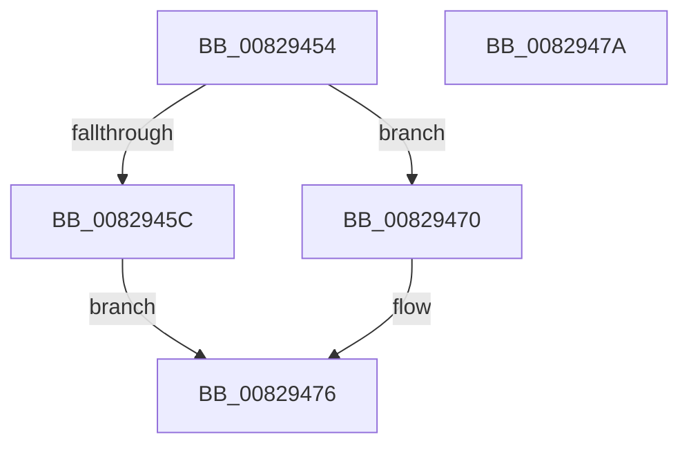

# PnpCtxSetNtPlugPlayRoutine

- RVA: `0x00829454`–`0x0082947B` (길이 `39` bytes)
- VA: `0x0000000140829454`
- 실행 섹션: `PAGE`
- PDB 이름 있음: `예`; PDB Function 태그: `아니요`
- unwind 정보 RVA: `0x000DB714`
- 디코드: `11`개 명령, `39/39` bytes 표시
- 미해석 바이트: `0` (있으면 어셈블리에 `.byte`로 보존)

> 이 문서는 커널 이미지의 기계어와 PDB 기호를 분석해 생성했습니다. 4번과 5번은 함수 원형과 자료형을 바이너리 사용 방식에서 추정한 C 해석이며 원본 소스 복구 결과는 아닙니다.

## 1. Dependencies

- 직접 호출 지점: **0**; 고유 호출 대상: **0**
- 직접 호출자로 확인된 함수: **1**
- RIP 상대 이미지 참조: **1**

### Outgoing calls
- 직접 디코드된 call 명령이 없습니다.

### Direct callers
- [PiPnpRtlInit](../73/PiPnpRtlInit_function_007300A4.md) at `0x00730193`
- [PiPnpRtlInit](../73/PiPnpRtlInit_function_007300A4.md) at `0x007301AE`
- [PiPnpRtlInit](../73/PiPnpRtlInit_function_007300A4.md) at `0x007301C9`
- [PiPnpRtlInit](../73/PiPnpRtlInit_function_007300A4.md) at `0x007301E0`
- [PiPnpRtlInit](../73/PiPnpRtlInit_function_007300A4.md) at `0x007301F7`

### Static image references
- `0x0082945C` → RVA `0x00E66398` (`.data`; read)

## 2. Other-region calls and transfers

- 다른 실행 섹션으로 향하는 call: **0**
- 별도 외부 분기/꼬리 이동을 확인하지 못했습니다.

## 3. Assembly (complete function range)

```asm
00829454  45 33 C9                        xor r9d, r9d
00829457  83 FA 06                        cmp edx, 6
0082945A  7D 14                           jge 0x140829470
0082945C  48 8B 05 35 CF 63 00            mov rax, qword ptr [rip + 0x63cf35]
00829463  48 63 CA                        movsxd rcx, edx
00829466  4C 87 84 C8 F8 00 00 00         xchg qword ptr [rax + rcx*8 + 0xf8], r8
0082946E  EB 06                           jmp 0x140829476
00829470  41 B9 0D 00 00 C0               mov r9d, 0xc000000d
00829476  41 8B C1                        mov eax, r9d
00829479  C3                              ret
0082947A  CC                              int3
```

## 4. C-style interpretation (structured pseudocode)

```c
__int64 __fastcall PnpCtxSetNtPlugPlayRoutine(__int64 a1, int a2, __int64 a3, int a4)
{
    a4 = 0;
    if (a2 >= 6) goto loc_00829470;
    goto loc_00829476;
loc_00829470:
loc_00829476:
    return (unsigned int)((unsigned int)((unsigned int)(0xC000000DULL)));
}
```

## 5. (Beta) C Style

```c
int64_t PnpCtxSetNtPlugPlayRoutine(int64_t Arg1, int32_t Arg2, int64_t Arg3, int32_t Arg4)
{
    Arg4 = 0;
    if (Arg2 >= 6) goto loc_00829470;
    goto loc_00829476;
loc_00829470:
loc_00829476:
    return (uint32_t)((uint32_t)((uint32_t)(0xC000000DULL)));
}
```

## 6. Execution-region graph

[열기: 2D/3D 그래프와 함수 탐색 컨트롤 패널](../../../control-panel.html?section=page&rva=0x00829454&view=graph)

- 2D 그래프는 위에서 아래로 흐르고, 3D 그래프는 빈 공간을 드래그해 회전합니다. Shift+드래그는 이동, 휠은 확대·축소, 함수 노드 선택은 대상 보고서 이동입니다.

### Static fallback


