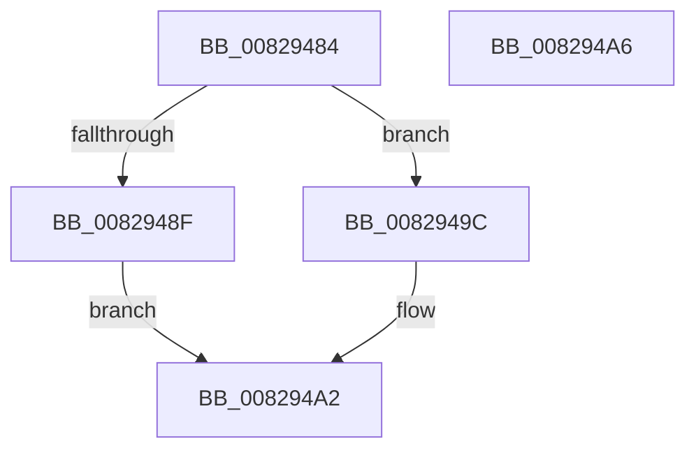

# PnpCtxSetObjectContext

- RVA: `0x00829484`–`0x008294A7` (길이 `35` bytes)
- VA: `0x0000000140829484`
- 실행 섹션: `PAGE`
- PDB 이름 있음: `예`; PDB Function 태그: `아니요`
- unwind 정보 RVA: `0x000DB714`
- 디코드: `11`개 명령, `35/35` bytes 표시
- 미해석 바이트: `0` (있으면 어셈블리에 `.byte`로 보존)

> 이 문서는 커널 이미지의 기계어와 PDB 기호를 분석해 생성했습니다. 4번과 5번은 함수 원형과 자료형을 바이너리 사용 방식에서 추정한 C 해석이며 원본 소스 복구 결과는 아닙니다.

## 1. Dependencies

- 직접 호출 지점: **0**; 고유 호출 대상: **0**
- 직접 호출자로 확인된 함수: **1**
- RIP 상대 이미지 참조: **0**

### Outgoing calls
- 직접 디코드된 call 명령이 없습니다.

### Direct callers
- [DrvDbOpenContext](../83/DrvDbOpenContext_function_00834F8C.md) at `0x008350BC`

### Static image references
- 디코드된 RIP-relative 메모리 참조가 없습니다.

## 2. Other-region calls and transfers

- 다른 실행 섹션으로 향하는 call: **0**
- 별도 외부 분기/꼬리 이동을 확인하지 못했습니다.

## 3. Assembly (complete function range)

```asm
00829484  45 33 C9                        xor r9d, r9d
00829487  8D 42 FF                        lea eax, [rdx - 1]
0082948A  83 F8 0A                        cmp eax, 0xa
0082948D  77 0D                           ja 0x14082949c
0082948F  48 63 C2                        movsxd rax, edx
00829492  4C 87 84 C1 88 01 00 00         xchg qword ptr [rcx + rax*8 + 0x188], r8
0082949A  EB 06                           jmp 0x1408294a2
0082949C  41 B9 0D 00 00 C0               mov r9d, 0xc000000d
008294A2  41 8B C1                        mov eax, r9d
008294A5  C3                              ret
008294A6  CC                              int3
```

## 4. C-style interpretation (structured pseudocode)

```c
__int64 __fastcall PnpCtxSetObjectContext(__int64 a1, __int64 a2, __int64 a3, int a4)
{
    a4 = 0;
    if (((unsigned int)(a2 - 1)) > 10) goto loc_0082949C;
    goto loc_008294A2;
loc_0082949C:
loc_008294A2:
    return (unsigned int)((unsigned int)((unsigned int)(0xC000000DULL)));
}
```

## 5. (Beta) C Style

```c
int64_t PnpCtxSetObjectContext(void *Arg1, void *Arg2, int64_t Arg3, int32_t Arg4)
{
    uint8_t *arg1 = (uint8_t *)Arg1;
    uint8_t *arg2 = (uint8_t *)Arg2;

    Arg4 = 0;
    if (((uint32_t)(Arg2 - 1)) > 10) goto loc_0082949C;
    goto loc_008294A2;
loc_0082949C:
loc_008294A2:
    return (uint32_t)((uint32_t)((uint32_t)(0xC000000DULL)));
}
```

### 관측된 메모리 오프셋

구조체 형식이 확인되지 않은 접근은 인자 기준의 오프셋으로만 기록했습니다.

| 기준 인자 | 오프셋 표현 | 폭 (bit) | 접근 |
|---|---:|---:|---|
| `Arg1` | `+ 0x188 + rax*8` | `64` | `R/W` |
| `Arg2` | `- 0x1` | `32` | `R` |

## 6. Execution-region graph

[열기: 2D/3D 그래프와 함수 탐색 컨트롤 패널](../../../control-panel.html?section=page&rva=0x00829484&view=graph)

- 2D 그래프는 위에서 아래로 흐르고, 3D 그래프는 빈 공간을 드래그해 회전합니다. Shift+드래그는 이동, 휠은 확대·축소, 함수 노드 선택은 대상 보고서 이동입니다.

### Static fallback


