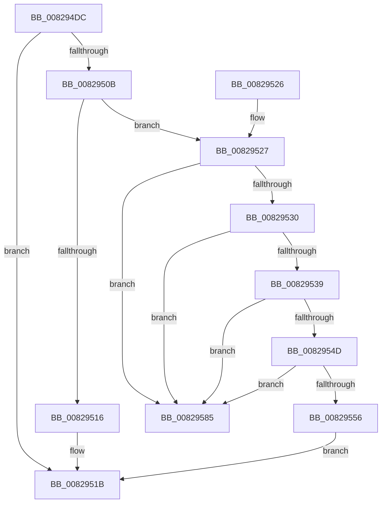

# PnpCtxUnregisterMachineNode

- RVA: `0x008294DC`–`0x0082958C` (길이 `176` bytes)
- VA: `0x00000001408294DC`
- 실행 섹션: `PAGE`
- PDB 이름 있음: `예`; PDB Function 태그: `아니요`
- unwind 정보 RVA: `0x000DA7DC`
- 디코드: `52`개 명령, `176/176` bytes 표시
- 미해석 바이트: `0` (있으면 어셈블리에 `.byte`로 보존)

> 이 문서는 커널 이미지의 기계어와 PDB 기호를 분석해 생성했습니다. 4번과 5번은 함수 원형과 자료형을 바이너리 사용 방식에서 추정한 C 해석이며 원본 소스 복구 결과는 아닙니다.

## 1. Dependencies

- 직접 호출 지점: **3**; 고유 호출 대상: **3**
- 직접 호출자로 확인된 함수: **1**
- RIP 상대 이미지 참조: **1**

### Outgoing calls
- `0x00829502` → [PnpCtxFindNode](PnpCtxFindNode_function_00828E50.md) (function, `0x00828E50`)
- `0x00829569` → [memset](../../text/6C/memset_function_006C6C40.md) (function, `0x006C6C40`)
- `0x0082957E` → [PnpCtxDestroyNode](PnpCtxDestroyNode_function_00828D50.md) (function, `0x00828D50`)

### Direct callers
- [PiDrvDbUnregisterNode](../74/PiDrvDbUnregisterNode_function_00743EF8.md) at `0x00743FDF`

### Static image references
- `0x008294EC` → RVA `0x00E66398` (`.data`; read)

## 2. Other-region calls and transfers

- 다른 실행 섹션으로 향하는 call: **1**
  - `0x00829569` → [memset](../../text/6C/memset_function_006C6C40.md) (`PAGE` → `.text`)
- 별도 외부 분기/꼬리 이동을 확인하지 못했습니다.

## 3. Assembly (complete function range)

```asm
008294DC  48 8B C4                        mov rax, rsp
008294DF  48 89 58 10                     mov qword ptr [rax + 0x10], rbx
008294E3  48 89 48 08                     mov qword ptr [rax + 8], rcx
008294E7  57                              push rdi
008294E8  48 83 EC 20                     sub rsp, 0x20
008294EC  48 8B 3D A5 CE 63 00            mov rdi, qword ptr [rip + 0x63cea5]
008294F3  4C 8D 48 08                     lea r9, [rax + 8]
008294F7  48 83 60 08 00                  and qword ptr [rax + 8], 0
008294FC  48 8B CF                        mov rcx, rdi
008294FF  45 33 C0                        xor r8d, r8d
00829502  E8 49 F9 FF FF                  call 0x140828e50
00829507  85 C0                           test eax, eax
00829509  78 10                           js 0x14082951b
0082950B  48 8B 5C 24 30                  mov rbx, qword ptr [rsp + 0x30]
00829510  48 3B 5F 58                     cmp rbx, qword ptr [rdi + 0x58]
00829514  75 11                           jne 0x140829527
00829516  B8 BB 00 00 C0                  mov eax, 0xc00000bb
0082951B  48 8B 5C 24 38                  mov rbx, qword ptr [rsp + 0x38]
00829520  48 83 C4 20                     add rsp, 0x20
00829524  5F                              pop rdi
00829525  C3                              ret
00829526  CC                              int3
00829527  48 8B 0B                        mov rcx, qword ptr [rbx]
0082952A  48 39 59 08                     cmp qword ptr [rcx + 8], rbx
0082952E  75 55                           jne 0x140829585
00829530  48 8B 43 08                     mov rax, qword ptr [rbx + 8]
00829534  48 39 18                        cmp qword ptr [rax], rbx
00829537  75 4C                           jne 0x140829585
00829539  48 89 08                        mov qword ptr [rax], rcx
0082953C  48 89 41 08                     mov qword ptr [rcx + 8], rax
00829540  48 8D 43 10                     lea rax, [rbx + 0x10]
00829544  48 8B 10                        mov rdx, qword ptr [rax]
00829547  48 39 42 08                     cmp qword ptr [rdx + 8], rax
0082954B  75 38                           jne 0x140829585
0082954D  48 8B 48 08                     mov rcx, qword ptr [rax + 8]
00829551  48 39 01                        cmp qword ptr [rcx], rax
00829554  75 2F                           jne 0x140829585
00829556  48 89 11                        mov qword ptr [rcx], rdx
00829559  41 B8 80 00 00 00               mov r8d, 0x80
0082955F  48 89 4A 08                     mov qword ptr [rdx + 8], rcx
00829563  48 8D 4F 60                     lea rcx, [rdi + 0x60]
00829567  33 D2                           xor edx, edx
00829569  E8 D2 D6 E9 FF                  call 0x1406c6c40
0082956E  48 8D 47 38                     lea rax, [rdi + 0x38]
00829572  48 8B CB                        mov rcx, rbx
00829575  48 39 00                        cmp qword ptr [rax], rax
00829578  0F 95 C0                        setne al
0082957B  88 47 04                        mov byte ptr [rdi + 4], al
0082957E  E8 CD F7 FF FF                  call 0x140828d50
00829583  EB 96                           jmp 0x14082951b
00829585  B9 03 00 00 00                  mov ecx, 3
0082958A  CD 29                           int 0x29
```

## 4. C-style interpretation (structured pseudocode)

```c
__int64 __fastcall PnpCtxUnregisterMachineNode(__int64 a1, __int64 a2, int a3)
{
    __int64 result;
    __int64 v_rsp;
    unsigned __int64 v_stack_p10;
    unsigned __int64 v_stack_p8;

    *(unsigned __int64 *)(v_rsp + 16) = v_rbx;
    *(unsigned __int64 *)(v_rsp + 8) = a1;
    v_rsp = (v_rsp) - (32);
    a3 = 0;
    result = PnpCtxFindNode(*(unsigned __int64 *)(v_rip + 6540965), a2, a3, v_rsp + 8);
    if (sign_flag) goto loc_0082951B;
    if (v_stack_p8 != (*(unsigned __int64 *)(*(unsigned __int64 *)(v_rip + 6540965) + 88))) goto loc_00829527;
loc_0082951B:
    v_rsp = (v_rsp) + (32);
    return (unsigned int)(0xC00000BBULL);
loc_00829527:
    if ((*(unsigned __int64 *)(*(unsigned __int64 *)(v_stack_p10) + 8)) != v_stack_p10) goto loc_00829585;
    if ((*(unsigned __int64 *)(*(unsigned __int64 *)(v_stack_p10 + 8))) != v_stack_p10) goto loc_00829585;
    *(unsigned __int64 *)(*(unsigned __int64 *)(v_stack_p10 + 8)) = *(unsigned __int64 *)(v_stack_p10);
    *(unsigned __int64 *)(*(unsigned __int64 *)(v_stack_p10) + 8) = *(unsigned __int64 *)(v_stack_p10 + 8);
    if ((*(unsigned __int64 *)(*(unsigned __int64 *)(v_stack_p10 + 16) + 8)) != (v_stack_p10 + 16)) goto loc_00829585;
    if ((*(unsigned __int64 *)(*(unsigned __int64 *)(v_stack_p10 + 16 + 8))) != (v_stack_p10 + 16)) goto loc_00829585;
    *(unsigned __int64 *)(*(unsigned __int64 *)(v_stack_p10 + 16 + 8)) = *(unsigned __int64 *)(v_stack_p10 + 16);
    *(unsigned __int64 *)(*(unsigned __int64 *)(v_stack_p10 + 16) + 8) = *(unsigned __int64 *)(v_stack_p10 + 16 + 8);
    a2 = 0;
    result = memset(*(unsigned __int64 *)(v_rip + 6540965) + 96, a2, 128, v_rsp + 8);
    result = ((*(unsigned __int64 *)(*(unsigned __int64 *)(v_rip + 6540965) + 56)) != (*(unsigned __int64 *)(v_rip + 6540965) + 56)) ? 1 : 0;
    *(unsigned __int8 *)(*(unsigned __int64 *)(v_rip + 6540965) + 4) = (unsigned __int8)(result);
    result = PnpCtxDestroyNode(v_stack_p10, a2, 128, v_rsp + 8);
    goto loc_0082951B;
loc_00829585:
    return result;
}
```

## 5. (Beta) C Style

```c
int64_t PnpCtxUnregisterMachineNode(int64_t Arg1, int64_t Arg2, int32_t Arg3)
{
    int64_t result;
    int64_t local_rsp;
    uint64_t v_stack_p10;
    uint64_t v_stack_p8;

    *(uint64_t *)(local_rsp + 0x10) = local_rbx;
    *(uint64_t *)(local_rsp + 0x8) = Arg1;
    local_rsp = (local_rsp) - (32);
    Arg3 = 0;
    result = PnpCtxFindNode(*(uint64_t *)(v_rip + 0x63CEA5), Arg2, Arg3, local_rsp + 8);
    if (sign_flag) goto loc_0082951B;
    if (v_stack_p8 != (*(uint64_t *)(*(uint64_t *)(v_rip + 0x63CEA5) + 0x58))) goto loc_00829527;
loc_0082951B:
    local_rsp = (local_rsp) + (32);
    return (uint32_t)(0xC00000BBULL);
loc_00829527:
    if ((*(uint64_t *)(*(uint64_t *)(v_stack_p10) + 0x8)) != v_stack_p10) goto loc_00829585;
    if ((*(uint64_t *)(*(uint64_t *)(v_stack_p10 + 0x8))) != v_stack_p10) goto loc_00829585;
    *(uint64_t *)(*(uint64_t *)(v_stack_p10 + 0x8)) = *(uint64_t *)(v_stack_p10);
    *(uint64_t *)(*(uint64_t *)(v_stack_p10) + 0x8) = *(uint64_t *)(v_stack_p10 + 0x8);
    if ((*(uint64_t *)(*(uint64_t *)(v_stack_p10 + 0x10) + 0x8)) != (v_stack_p10 + 16)) goto loc_00829585;
    if ((*(uint64_t *)(*(uint64_t *)(v_stack_p10 + 0x10 + 0x8))) != (v_stack_p10 + 16)) goto loc_00829585;
    *(uint64_t *)(*(uint64_t *)(v_stack_p10 + 0x10 + 0x8)) = *(uint64_t *)(v_stack_p10 + 0x10);
    *(uint64_t *)(*(uint64_t *)(v_stack_p10 + 0x10) + 0x8) = *(uint64_t *)(v_stack_p10 + 0x10 + 0x8);
    Arg2 = 0;
    result = memset(*(uint64_t *)(v_rip + 0x63CEA5) + 96, Arg2, 128, local_rsp + 8);
    result = ((*(uint64_t *)(*(uint64_t *)(v_rip + 0x63CEA5) + 0x38)) != (*(uint64_t *)(v_rip + 0x63CEA5) + 56)) ? 1 : 0;
    *(uint8_t *)(*(uint64_t *)(v_rip + 0x63CEA5) + 0x4) = (uint8_t)(result);
    result = PnpCtxDestroyNode(v_stack_p10, Arg2, 128, local_rsp + 8);
    goto loc_0082951B;
loc_00829585:
    return result;
}
```

## 6. Execution-region graph

[열기: 2D/3D 그래프와 함수 탐색 컨트롤 패널](../../../control-panel.html?section=page&rva=0x008294DC&view=graph)

- 2D 그래프는 위에서 아래로 흐르고, 3D 그래프는 빈 공간을 드래그해 회전합니다. Shift+드래그는 이동, 휠은 확대·축소, 함수 노드 선택은 대상 보고서 이동입니다.

### Static fallback


