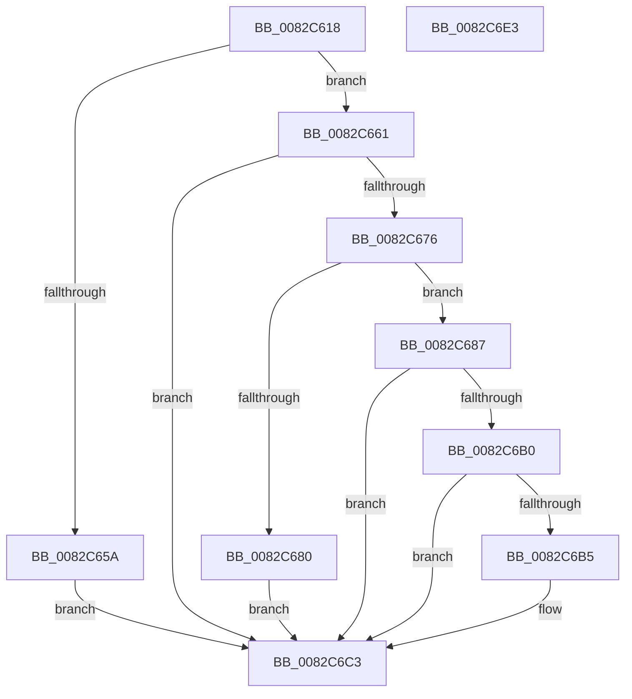

# PnpDeleteObjectDispatch

- RVA: `0x0082C618`–`0x0082C6E4` (길이 `204` bytes)
- VA: `0x000000014082C618`
- 실행 섹션: `PAGE`
- PDB 이름 있음: `예`; PDB Function 태그: `아니요`
- unwind 정보 RVA: `0x00068E0C`
- 디코드: `59`개 명령, `204/204` bytes 표시
- 미해석 바이트: `0` (있으면 어셈블리에 `.byte`로 보존)

> 이 문서는 커널 이미지의 기계어와 PDB 기호를 분석해 생성했습니다. 4번과 5번은 함수 원형과 자료형을 바이너리 사용 방식에서 추정한 C 해석이며 원본 소스 복구 결과는 아닙니다.

## 1. Dependencies

- 직접 호출 지점: **4**; 고유 호출 대상: **4**
- 직접 호출자로 확인된 함수: **1**
- RIP 상대 이미지 참조: **0**

### Outgoing calls
- `0x0082C64F` → [memset](../../text/6C/memset_function_006C6C40.md) (function, `0x006C6C40`)
- `0x0082C66B` → [PnpCtxGetObjectDispatchCallback](../A0/PnpCtxGetObjectDispatchCallback_function_00A044EC.md) (function, `0x00A044EC`)
- `0x0082C6A5` → [guard_dispatch_icall](../../text/6B/guard_dispatch_icall_function_006BAAD0.md) (function, `0x006BAAD0`)
- `0x0082C6BE` → [PnpObjectRaiseDeleteEvent](PnpObjectRaiseDeleteEvent_function_0082DCFC.md) (function, `0x0082DCFC`)

### Direct callers
- [PnpDeleteObject](PnpDeleteObject_function_0082C4F4.md) at `0x0082C57C`

### Static image references
- 디코드된 RIP-relative 메모리 참조가 없습니다.

## 2. Other-region calls and transfers

- 다른 실행 섹션으로 향하는 call: **2**
  - `0x0082C64F` → [memset](../../text/6C/memset_function_006C6C40.md) (`PAGE` → `.text`)
  - `0x0082C6A5` → [guard_dispatch_icall](../../text/6B/guard_dispatch_icall_function_006BAAD0.md) (`PAGE` → `.text`)
- 별도 외부 분기/꼬리 이동을 확인하지 못했습니다.

## 3. Assembly (complete function range)

```asm
0082C618  48 8B C4                        mov rax, rsp
0082C61B  48 89 58 08                     mov qword ptr [rax + 8], rbx
0082C61F  48 89 68 10                     mov qword ptr [rax + 0x10], rbp
0082C623  48 89 70 18                     mov qword ptr [rax + 0x18], rsi
0082C627  48 89 78 20                     mov qword ptr [rax + 0x20], rdi
0082C62B  41 56                           push r14
0082C62D  48 81 EC 80 00 00 00            sub rsp, 0x80
0082C634  48 83 60 A8 00                  and qword ptr [rax - 0x58], 0
0082C639  48 8B EA                        mov rbp, rdx
0082C63C  33 D2                           xor edx, edx
0082C63E  41 8B F8                        mov edi, r8d
0082C641  48 8B F1                        mov rsi, rcx
0082C644  45 8B F1                        mov r14d, r9d
0082C647  48 8D 48 B8                     lea rcx, [rax - 0x48]
0082C64B  44 8D 42 40                     lea r8d, [rdx + 0x40]
0082C64F  E8 EC A5 E9 FF                  call 0x1406c6c40
0082C654  66 45 85 F6                     test r14w, r14w
0082C658  74 07                           je 0x14082c661
0082C65A  BB 0D 00 00 C0                  mov ebx, 0xc000000d
0082C65F  EB 62                           jmp 0x14082c6c3
0082C661  4C 8D 44 24 30                  lea r8, [rsp + 0x30]
0082C666  8B D7                           mov edx, edi
0082C668  48 8B CE                        mov rcx, rsi
0082C66B  E8 7C 7E 1D 00                  call 0x140a044ec
0082C670  8B D8                           mov ebx, eax
0082C672  85 C0                           test eax, eax
0082C674  78 4D                           js 0x14082c6c3
0082C676  48 8B 44 24 30                  mov rax, qword ptr [rsp + 0x30]
0082C67B  48 85 C0                        test rax, rax
0082C67E  75 07                           jne 0x14082c687
0082C680  BB 02 00 00 C0                  mov ebx, 0xc0000002
0082C685  EB 3C                           jmp 0x14082c6c3
0082C687  48 8D 4C 24 40                  lea rcx, [rsp + 0x40]
0082C68C  44 89 74 24 40                  mov dword ptr [rsp + 0x40], r14d
0082C691  48 89 4C 24 20                  mov qword ptr [rsp + 0x20], rcx
0082C696  41 B9 04 00 00 00               mov r9d, 4
0082C69C  48 8B CE                        mov rcx, rsi
0082C69F  44 8B C7                        mov r8d, edi
0082C6A2  48 8B D5                        mov rdx, rbp
0082C6A5  E8 26 E4 E8 FF                  call 0x1406baad0
0082C6AA  8B D8                           mov ebx, eax
0082C6AC  85 C0                           test eax, eax
0082C6AE  78 13                           js 0x14082c6c3
0082C6B0  83 FF 07                        cmp edi, 7
0082C6B3  7C 0E                           jl 0x14082c6c3
0082C6B5  44 8B C7                        mov r8d, edi
0082C6B8  48 8B D5                        mov rdx, rbp
0082C6BB  48 8B CE                        mov rcx, rsi
0082C6BE  E8 39 16 00 00                  call 0x14082dcfc
0082C6C3  4C 8D 9C 24 80 00 00 00         lea r11, [rsp + 0x80]
0082C6CB  8B C3                           mov eax, ebx
0082C6CD  49 8B 5B 10                     mov rbx, qword ptr [r11 + 0x10]
0082C6D1  49 8B 6B 18                     mov rbp, qword ptr [r11 + 0x18]
0082C6D5  49 8B 73 20                     mov rsi, qword ptr [r11 + 0x20]
0082C6D9  49 8B 7B 28                     mov rdi, qword ptr [r11 + 0x28]
0082C6DD  49 8B E3                        mov rsp, r11
0082C6E0  41 5E                           pop r14
0082C6E2  C3                              ret
0082C6E3  CC                              int3
```

## 4. C-style interpretation (structured pseudocode)

```c
__int64 __fastcall PnpDeleteObjectDispatch(__int64 a1, __int64 a2, int a3, int a4)
{
    __int64 result;
    __int64 v_rsp;
    unsigned __int64 v_stack_m48;
    unsigned __int64 v_stack_m58;
    unsigned __int64 v_stack_m68;
    unsigned __int64 v_stack_m8;

    *(unsigned __int64 *)(v_rsp + 8) = v_rbx;
    *(unsigned __int64 *)(v_rsp + 16) = v_rbp;
    *(unsigned __int64 *)(v_rsp + 24) = v_rsi;
    *(unsigned __int64 *)(v_rsp + 32) = v_rdi;
    v_rsp = (v_rsp) - (128);
    a2 = 0;
    result = memset(v_rsp - 72, a2, a2 + 64, a4);
    if ((unsigned __int16)((unsigned int)(a4)) == 0) goto loc_0082C661;
    goto loc_0082C6C3;
loc_0082C661:
    result = PnpCtxGetObjectDispatchCallback(a1, (unsigned int)((unsigned int)((unsigned int)(a3))), v_stack_m58, a4);
    if (sign_flag) goto loc_0082C6C3;
    if (v_stack_m58 != 0) goto loc_0082C687;
    goto loc_0082C6C3;
loc_0082C687:
    v_stack_m48 = (unsigned int)((unsigned int)(a4));
    v_stack_m68 = v_stack_m48;
    result = guard_dispatch_icall(a1, 0, (unsigned int)((unsigned int)((unsigned int)(a3))), 4);
    if (sign_flag) goto loc_0082C6C3;
    if (((unsigned int)((unsigned int)(a3))) >= 7) {
        a3 = (unsigned int)((unsigned int)(a3));
        a2 = 0;
        a1 = a1;
        result = PnpObjectRaiseDeleteEvent(a1, a2, a3, 4);
    }
    return (unsigned int)((unsigned int)((unsigned int)((unsigned int)(result))));
}
```

## 5. (Beta) C Style

```c
int64_t PnpDeleteObjectDispatch(int64_t Arg1, int64_t Arg2, int32_t Arg3, int32_t Arg4)
{
    int64_t result;
    int64_t local_rsp;
    uint64_t v_stack_m48;
    uint64_t v_stack_m58;
    uint64_t v_stack_m68;
    uint64_t v_stack_m8;

    *(uint64_t *)(local_rsp + 0x8) = local_rbx;
    *(uint64_t *)(local_rsp + 0x10) = local_rbp;
    *(uint64_t *)(local_rsp + 0x18) = local_rsi;
    *(uint64_t *)(local_rsp + 0x20) = local_rdi;
    local_rsp = (local_rsp) - (128);
    Arg2 = 0;
    result = memset(local_rsp - 72, Arg2, Arg2 + 64, Arg4);
    if ((uint16_t)((uint32_t)(Arg4)) == 0) goto loc_0082C661;
    goto loc_0082C6C3;
loc_0082C661:
    result = PnpCtxGetObjectDispatchCallback(Arg1, (uint32_t)((uint32_t)((uint32_t)(Arg3))), v_stack_m58, Arg4);
    if (sign_flag) goto loc_0082C6C3;
    if (v_stack_m58 != 0) goto loc_0082C687;
    goto loc_0082C6C3;
loc_0082C687:
    v_stack_m48 = (uint32_t)((uint32_t)(Arg4));
    v_stack_m68 = v_stack_m48;
    result = guard_dispatch_icall(Arg1, 0, (uint32_t)((uint32_t)((uint32_t)(Arg3))), 4);
    if (sign_flag) goto loc_0082C6C3;
    if (((uint32_t)((uint32_t)(Arg3))) >= 7) {
        Arg3 = (uint32_t)((uint32_t)(Arg3));
        Arg2 = 0;
        Arg1 = Arg1;
        result = PnpObjectRaiseDeleteEvent(Arg1, Arg2, Arg3, 4);
    }
    return (uint32_t)((uint32_t)((uint32_t)((uint32_t)(result))));
}
```

## 6. Execution-region graph

[열기: 2D/3D 그래프와 함수 탐색 컨트롤 패널](../../../control-panel.html?section=page&rva=0x0082C618&view=graph)

- 2D 그래프는 위에서 아래로 흐르고, 3D 그래프는 빈 공간을 드래그해 회전합니다. Shift+드래그는 이동, 휠은 확대·축소, 함수 노드 선택은 대상 보고서 이동입니다.

### Static fallback


