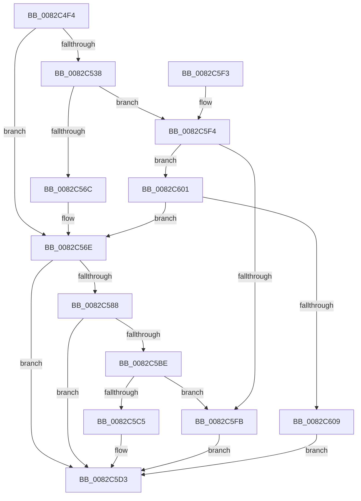

# PnpDeleteObject

- RVA: `0x0082C4F4`–`0x0082C610` (길이 `284` bytes)
- VA: `0x000000014082C4F4`
- 실행 섹션: `PAGE`
- PDB 이름 있음: `예`; PDB Function 태그: `아니요`
- unwind 정보 RVA: `0x000DA968`
- 디코드: `75`개 명령, `284/284` bytes 표시
- 미해석 바이트: `0` (있으면 어셈블리에 `.byte`로 보존)

> 이 문서는 커널 이미지의 기계어와 PDB 기호를 분석해 생성했습니다. 4번과 5번은 함수 원형과 자료형을 바이너리 사용 방식에서 추정한 C 해석이며 원본 소스 복구 결과는 아닙니다.

## 1. Dependencies

- 직접 호출 지점: **4**; 고유 호출 대상: **3**
- 직접 호출자로 확인된 함수: **1**
- RIP 상대 이미지 참조: **1**

### Outgoing calls
- `0x0082C527` → [memset](../../text/6C/memset_function_006C6C40.md) (function, `0x006C6C40`)
- `0x0082C55C` → [guard_dispatch_icall](../../text/6B/guard_dispatch_icall_function_006BAAD0.md) (function, `0x006BAAD0`)
- `0x0082C57C` → [PnpDeleteObjectDispatch](PnpDeleteObjectDispatch_function_0082C618.md) (function, `0x0082C618`)
- `0x0082C5B0` → [guard_dispatch_icall](../../text/6B/guard_dispatch_icall_function_006BAAD0.md) (function, `0x006BAAD0`)

### Direct callers
- [PiCMDeleteObject](../AD/PiCMDeleteObject_function_00AD9FE4.md) at `0x00ADA131`

### Static image references
- `0x0082C510` → RVA `0x00E66398` (`.data`; read)

## 2. Other-region calls and transfers

- 다른 실행 섹션으로 향하는 call: **3**
  - `0x0082C527` → [memset](../../text/6C/memset_function_006C6C40.md) (`PAGE` → `.text`)
  - `0x0082C55C` → [guard_dispatch_icall](../../text/6B/guard_dispatch_icall_function_006BAAD0.md) (`PAGE` → `.text`)
  - `0x0082C5B0` → [guard_dispatch_icall](../../text/6B/guard_dispatch_icall_function_006BAAD0.md) (`PAGE` → `.text`)
- 별도 외부 분기/꼬리 이동을 확인하지 못했습니다.

## 3. Assembly (complete function range)

```asm
0082C4F4  48 8B C4                        mov rax, rsp
0082C4F7  48 89 58 08                     mov qword ptr [rax + 8], rbx
0082C4FB  48 89 68 10                     mov qword ptr [rax + 0x10], rbp
0082C4FF  48 89 70 18                     mov qword ptr [rax + 0x18], rsi
0082C503  48 89 78 20                     mov qword ptr [rax + 0x20], rdi
0082C507  41 56                           push r14
0082C509  48 81 EC 90 00 00 00            sub rsp, 0x90
0082C510  48 8B 35 81 9E 63 00            mov rsi, qword ptr [rip + 0x639e81]
0082C517  48 8D 48 A8                     lea rcx, [rax - 0x58]
0082C51B  4C 8B F2                        mov r14, rdx
0082C51E  41 8B E8                        mov ebp, r8d
0082C521  33 D2                           xor edx, edx
0082C523  44 8D 42 50                     lea r8d, [rdx + 0x50]
0082C527  E8 14 A7 E9 FF                  call 0x1406c6c40
0082C52C  48 8B BE E8 01 00 00            mov rdi, qword ptr [rsi + 0x1e8]
0082C533  48 85 FF                        test rdi, rdi
0082C536  74 36                           je 0x14082c56e
0082C538  48 8D 44 24 40                  lea rax, [rsp + 0x40]
0082C53D  41 B9 04 00 00 00               mov r9d, 4
0082C543  48 89 44 24 28                  mov qword ptr [rsp + 0x28], rax
0082C548  44 8B C5                        mov r8d, ebp
0082C54B  48 8B C7                        mov rax, rdi
0082C54E  C7 44 24 20 01 00 00 00         mov dword ptr [rsp + 0x20], 1
0082C556  49 8B D6                        mov rdx, r14
0082C559  48 8B CE                        mov rcx, rsi
0082C55C  E8 6F E5 E8 FF                  call 0x1406baad0
0082C561  3D 02 00 00 C0                  cmp eax, 0xc0000002
0082C566  0F 85 88 00 00 00               jne 0x14082c5f4
0082C56C  33 FF                           xor edi, edi
0082C56E  44 8B 4C 24 50                  mov r9d, dword ptr [rsp + 0x50]
0082C573  44 8B C5                        mov r8d, ebp
0082C576  49 8B D6                        mov rdx, r14
0082C579  48 8B CE                        mov rcx, rsi
0082C57C  E8 97 00 00 00                  call 0x14082c618
0082C581  8B D8                           mov ebx, eax
0082C583  48 85 FF                        test rdi, rdi
0082C586  74 4B                           je 0x14082c5d3
0082C588  89 44 24 40                     mov dword ptr [rsp + 0x40], eax
0082C58C  41 B9 04 00 00 00               mov r9d, 4
0082C592  48 8D 44 24 40                  lea rax, [rsp + 0x40]
0082C597  44 8B C5                        mov r8d, ebp
0082C59A  48 89 44 24 28                  mov qword ptr [rsp + 0x28], rax
0082C59F  49 8B D6                        mov rdx, r14
0082C5A2  48 8B C7                        mov rax, rdi
0082C5A5  C7 44 24 20 02 00 00 00         mov dword ptr [rsp + 0x20], 2
0082C5AD  48 8B CE                        mov rcx, rsi
0082C5B0  E8 1B E5 E8 FF                  call 0x1406baad0
0082C5B5  8B C8                           mov ecx, eax
0082C5B7  3D 02 00 00 C0                  cmp eax, 0xc0000002
0082C5BC  74 15                           je 0x14082c5d3
0082C5BE  3D 20 01 00 C0                  cmp eax, 0xc0000120
0082C5C3  74 36                           je 0x14082c5fb
0082C5C5  8B C3                           mov eax, ebx
0082C5C7  85 C9                           test ecx, ecx
0082C5C9  BB E5 00 00 C0                  mov ebx, 0xc00000e5
0082C5CE  0F 45 C3                        cmovne eax, ebx
0082C5D1  8B D8                           mov ebx, eax
0082C5D3  4C 8D 9C 24 90 00 00 00         lea r11, [rsp + 0x90]
0082C5DB  8B C3                           mov eax, ebx
0082C5DD  49 8B 5B 10                     mov rbx, qword ptr [r11 + 0x10]
0082C5E1  49 8B 6B 18                     mov rbp, qword ptr [r11 + 0x18]
0082C5E5  49 8B 73 20                     mov rsi, qword ptr [r11 + 0x20]
0082C5E9  49 8B 7B 28                     mov rdi, qword ptr [r11 + 0x28]
0082C5ED  49 8B E3                        mov rsp, r11
0082C5F0  41 5E                           pop r14
0082C5F2  C3                              ret
0082C5F3  CC                              int3
0082C5F4  3D 20 01 00 C0                  cmp eax, 0xc0000120
0082C5F9  75 06                           jne 0x14082c601
0082C5FB  8B 5C 24 40                     mov ebx, dword ptr [rsp + 0x40]
0082C5FF  EB D2                           jmp 0x14082c5d3
0082C601  85 C0                           test eax, eax
0082C603  0F 84 65 FF FF FF               je 0x14082c56e
0082C609  BB E5 00 00 C0                  mov ebx, 0xc00000e5
0082C60E  EB C3                           jmp 0x14082c5d3
```

## 4. C-style interpretation (structured pseudocode)

```c
__int64 __fastcall PnpDeleteObject(__int64 a1, __int64 a2, int a3)
{
    __int64 result;
    __int64 v_rdi;
    __int64 v_rsp;
    unsigned int v_stack_m48;
    unsigned int v_stack_m50;
    unsigned __int64 v_stack_m58;
    unsigned __int64 v_stack_m70;
    unsigned int v_stack_m78;
    unsigned __int64 v_stack_m8;

    *(unsigned __int64 *)(v_rsp + 8) = v_rbx;
    *(unsigned __int64 *)(v_rsp + 16) = v_rbp;
    *(unsigned __int64 *)(v_rsp + 24) = v_rsi;
    *(unsigned __int64 *)(v_rsp + 32) = v_rdi;
    v_rsp = (v_rsp) - (144);
    a2 = 0;
    result = memset(v_rsp - 88, a2, a2 + 80, a4);
    if (*(unsigned __int64 *)(*(unsigned __int64 *)(v_rip + 6528641) + 488) == 0) goto loc_0082C56E;
    v_stack_m70 = v_stack_m58;
    v_stack_m78 = 1;
    result = guard_dispatch_icall(*(unsigned __int64 *)(v_rip + 6528641), 0, (unsigned int)((unsigned int)((unsigned int)(a3))), 4);
    if (((unsigned int)(result)) != 0xC0000002ULL) goto loc_0082C5F4;
    v_rdi = 0;
loc_0082C56E:
    result = PnpDeleteObjectDispatch(*(unsigned __int64 *)(v_rip + 6528641), 0, (unsigned int)((unsigned int)((unsigned int)(a3))), (unsigned int)(v_stack_m48));
    if (0 == 0) goto loc_0082C5D3;
    v_stack_m58 = (unsigned int)(result);
    v_stack_m70 = v_stack_m58;
    v_stack_m78 = 2;
    result = guard_dispatch_icall(*(unsigned __int64 *)(v_rip + 6528641), 0, (unsigned int)((unsigned int)((unsigned int)(a3))), 4);
    if (((unsigned int)(result)) == 0xC0000002ULL) goto loc_0082C5D3;
    if (((unsigned int)(result)) == 0xC0000120ULL) goto loc_0082C5FB;
    result = (unsigned int)((unsigned int)((unsigned int)((unsigned int)(result))));
    if ((unsigned int)((unsigned int)((unsigned int)(result))) != 0) { result = (unsigned int)((unsigned int)(0xC00000E5ULL)); }
loc_0082C5D3:
    return (unsigned int)((unsigned int)((unsigned int)((unsigned int)(result))));
loc_0082C5F4:
    if (((unsigned int)((unsigned int)((unsigned int)((unsigned int)((unsigned int)(result)))))) != 0xC0000120ULL) goto loc_0082C601;
loc_0082C5FB:
    goto loc_0082C5D3;
loc_0082C601:
    if ((unsigned int)((unsigned int)((unsigned int)((unsigned int)((unsigned int)(result))))) == 0) goto loc_0082C56E;
    goto loc_0082C5D3;
}
```

## 5. (Beta) C Style

```c
int64_t PnpDeleteObject(int64_t Arg1, int64_t Arg2, int32_t Arg3)
{
    int64_t result;
    int64_t local_rdi;
    int64_t local_rsp;
    uint32_t v_stack_m48;
    uint32_t v_stack_m50;
    uint64_t v_stack_m58;
    uint64_t v_stack_m70;
    uint32_t v_stack_m78;
    uint64_t v_stack_m8;

    *(uint64_t *)(local_rsp + 0x8) = local_rbx;
    *(uint64_t *)(local_rsp + 0x10) = local_rbp;
    *(uint64_t *)(local_rsp + 0x18) = local_rsi;
    *(uint64_t *)(local_rsp + 0x20) = local_rdi;
    local_rsp = (local_rsp) - (144);
    Arg2 = 0;
    result = memset(local_rsp - 88, Arg2, Arg2 + 80, a4);
    if (*(uint64_t *)(*(uint64_t *)(v_rip + 0x639E81) + 0x1E8) == 0) goto loc_0082C56E;
    v_stack_m70 = v_stack_m58;
    v_stack_m78 = 1;
    result = guard_dispatch_icall(*(uint64_t *)(v_rip + 0x639E81), 0, (uint32_t)((uint32_t)((uint32_t)(Arg3))), 4);
    if (((uint32_t)(result)) != 0xC0000002ULL) goto loc_0082C5F4;
    local_rdi = 0;
loc_0082C56E:
    result = PnpDeleteObjectDispatch(*(uint64_t *)(v_rip + 0x639E81), 0, (uint32_t)((uint32_t)((uint32_t)(Arg3))), (uint32_t)(v_stack_m48));
    if (0 == 0) goto loc_0082C5D3;
    v_stack_m58 = (uint32_t)(result);
    v_stack_m70 = v_stack_m58;
    v_stack_m78 = 2;
    result = guard_dispatch_icall(*(uint64_t *)(v_rip + 0x639E81), 0, (uint32_t)((uint32_t)((uint32_t)(Arg3))), 4);
    if (((uint32_t)(result)) == 0xC0000002ULL) goto loc_0082C5D3;
    if (((uint32_t)(result)) == 0xC0000120ULL) goto loc_0082C5FB;
    result = (uint32_t)((uint32_t)((uint32_t)((uint32_t)(result))));
    if ((uint32_t)((uint32_t)((uint32_t)(result))) != 0) { result = (uint32_t)((uint32_t)(0xC00000E5ULL)); }
loc_0082C5D3:
    return (uint32_t)((uint32_t)((uint32_t)((uint32_t)(result))));
loc_0082C5F4:
    if (((uint32_t)((uint32_t)((uint32_t)((uint32_t)((uint32_t)(result)))))) != 0xC0000120ULL) goto loc_0082C601;
loc_0082C5FB:
    goto loc_0082C5D3;
loc_0082C601:
    if ((uint32_t)((uint32_t)((uint32_t)((uint32_t)((uint32_t)(result))))) == 0) goto loc_0082C56E;
    goto loc_0082C5D3;
}
```

## 6. Execution-region graph

[열기: 2D/3D 그래프와 함수 탐색 컨트롤 패널](../../../control-panel.html?section=page&rva=0x0082C4F4&view=graph)

- 2D 그래프는 위에서 아래로 흐르고, 3D 그래프는 빈 공간을 드래그해 회전합니다. Shift+드래그는 이동, 휠은 확대·축소, 함수 노드 선택은 대상 보고서 이동입니다.

### Static fallback


