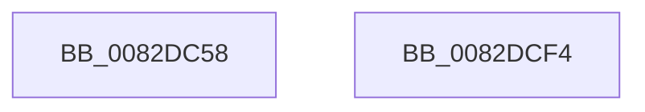

# PnpInterfaceClassRaisePropertyChangeEventWorker

- RVA: `0x0082DC58`–`0x0082DCF5` (길이 `157` bytes)
- VA: `0x000000014082DC58`
- 실행 섹션: `PAGE`
- PDB 이름 있음: `예`; PDB Function 태그: `아니요`
- unwind 정보 RVA: `0x000BE9D0`
- 디코드: `38`개 명령, `157/157` bytes 표시
- 미해석 바이트: `0` (있으면 어셈블리에 `.byte`로 보존)

> 이 문서는 커널 이미지의 기계어와 PDB 기호를 분석해 생성했습니다. 4번과 5번은 함수 원형과 자료형을 바이너리 사용 방식에서 추정한 C 해석이며 원본 소스 복구 결과는 아닙니다.

## 1. Dependencies

- 직접 호출 지점: **2**; 고유 호출 대상: **2**
- 직접 호출자로 확인된 함수: **1**
- RIP 상대 이미지 참조: **1**

### Outgoing calls
- `0x0082DCA2` → [guard_dispatch_icall](../../text/6B/guard_dispatch_icall_function_006BAAD0.md) (function, `0x006BAAD0`)
- `0x0082DCD9` → [PnpNotifyDerivedKeys](../A2/PnpNotifyDerivedKeys_function_00A211A4.md) (function, `0x00A211A4`)

### Direct callers
- [PnpObjectRaisePropertyChangeEvent](../8F/PnpObjectRaisePropertyChangeEvent_function_008F7E94.md) at `0x008F7F9D`

### Static image references
- `0x0082DCB9` → RVA `0x0000C440` (`.rdata`; read)

## 2. Other-region calls and transfers

- 다른 실행 섹션으로 향하는 call: **1**
  - `0x0082DCA2` → [guard_dispatch_icall](../../text/6B/guard_dispatch_icall_function_006BAAD0.md) (`PAGE` → `.text`)
- 별도 외부 분기/꼬리 이동을 확인하지 못했습니다.

## 3. Assembly (complete function range)

```asm
0082DC58  4C 8B DC                        mov r11, rsp
0082DC5B  49 89 5B 08                     mov qword ptr [r11 + 8], rbx
0082DC5F  49 89 6B 10                     mov qword ptr [r11 + 0x10], rbp
0082DC63  49 89 73 18                     mov qword ptr [r11 + 0x18], rsi
0082DC67  57                              push rdi
0082DC68  48 83 EC 60                     sub rsp, 0x60
0082DC6C  48 8B 9C 24 98 00 00 00         mov rbx, qword ptr [rsp + 0x98]
0082DC74  49 8D 43 D8                     lea rax, [r11 - 0x28]
0082DC78  48 8B BC 24 90 00 00 00         mov rdi, qword ptr [rsp + 0x90]
0082DC80  48 8B F2                        mov rsi, rdx
0082DC83  4D 89 4B E0                     mov qword ptr [r11 - 0x20], r9
0082DC87  48 8B E9                        mov rbp, rcx
0082DC8A  41 B9 04 00 00 00               mov r9d, 4
0082DC90  49 89 43 B8                     mov qword ptr [r11 - 0x48], rax
0082DC94  4D 89 43 D8                     mov qword ptr [r11 - 0x28], r8
0082DC98  48 8B C3                        mov rax, rbx
0082DC9B  45 8B C1                        mov r8d, r9d
0082DC9E  49 89 7B E8                     mov qword ptr [r11 - 0x18], rdi
0082DCA2  E8 29 CE E8 FF                  call 0x1406baad0
0082DCA7  48 89 5C 24 38                  mov qword ptr [rsp + 0x38], rbx
0082DCAC  48 8D 44 24 40                  lea rax, [rsp + 0x40]
0082DCB1  48 89 44 24 30                  mov qword ptr [rsp + 0x30], rax
0082DCB6  4C 8B CF                        mov r9, rdi
0082DCB9  48 8D 05 80 E7 7D FF            lea rax, [rip - 0x821880]
0082DCC0  C7 44 24 28 01 00 00 00         mov dword ptr [rsp + 0x28], 1
0082DCC8  41 B8 04 00 00 00               mov r8d, 4
0082DCCE  48 89 44 24 20                  mov qword ptr [rsp + 0x20], rax
0082DCD3  48 8B D6                        mov rdx, rsi
0082DCD6  48 8B CD                        mov rcx, rbp
0082DCD9  E8 C6 34 1F 00                  call 0x140a211a4
0082DCDE  4C 8D 5C 24 60                  lea r11, [rsp + 0x60]
0082DCE3  49 8B 5B 10                     mov rbx, qword ptr [r11 + 0x10]
0082DCE7  49 8B 6B 18                     mov rbp, qword ptr [r11 + 0x18]
0082DCEB  49 8B 73 20                     mov rsi, qword ptr [r11 + 0x20]
0082DCEF  49 8B E3                        mov rsp, r11
0082DCF2  5F                              pop rdi
0082DCF3  C3                              ret
0082DCF4  CC                              int3
```

## 4. C-style interpretation (structured pseudocode)

```c
__int64 __fastcall PnpInterfaceClassRaisePropertyChangeEventWorker(__int64 a1, __int64 a2, __int64 a3, __int64 a4, __int64 a5, __int64 a6)
{
    __int64 result;
    __int64 v_rsp;
    unsigned __int64 v_stack_m28;
    unsigned __int64 v_stack_m30;
    unsigned __int64 v_stack_m38;
    unsigned int v_stack_m40;
    unsigned __int64 v_stack_m48;
    unsigned __int64 v_stack_m8;

    *(unsigned __int64 *)(v_rsp + 8) = v_rbx;
    *(unsigned __int64 *)(v_rsp + 16) = v_rbp;
    *(unsigned __int64 *)(v_rsp + 24) = v_rsi;
    v_rsp = (v_rsp) - (96);
    *(unsigned __int64 *)(v_rsp - 32) = a4;
    *(unsigned __int64 *)(v_rsp - 72) = v_rsp - 40;
    *(unsigned __int64 *)(v_rsp - 40) = a3;
    *(unsigned __int64 *)(v_rsp - 24) = a5;
    result = guard_dispatch_icall(a1, a2, 4, 4);
    v_stack_m30 = a6;
    v_stack_m38 = v_stack_m28;
    v_stack_m40 = 1;
    v_stack_m48 = v_rip - 8525952;
    result = PnpNotifyDerivedKeys(a1, a2, 4, a5);
    return result;
}
```

## 5. (Beta) C Style

```c
int64_t PnpInterfaceClassRaisePropertyChangeEventWorker(int64_t Arg1, int64_t Arg2, int64_t Arg3, int64_t Arg4, int64_t Arg5, int64_t Arg6)
{
    int64_t result;
    int64_t local_rsp;
    uint64_t v_stack_m28;
    uint64_t v_stack_m30;
    uint64_t v_stack_m38;
    uint32_t v_stack_m40;
    uint64_t v_stack_m48;
    uint64_t v_stack_m8;

    *(uint64_t *)(local_rsp + 0x8) = local_rbx;
    *(uint64_t *)(local_rsp + 0x10) = local_rbp;
    *(uint64_t *)(local_rsp + 0x18) = local_rsi;
    local_rsp = (local_rsp) - (96);
    *(uint64_t *)(local_rsp - 0x20) = Arg4;
    *(uint64_t *)(local_rsp - 0x48) = local_rsp - 40;
    *(uint64_t *)(local_rsp - 0x28) = Arg3;
    *(uint64_t *)(local_rsp - 0x18) = Arg5;
    result = guard_dispatch_icall(Arg1, Arg2, 4, 4);
    v_stack_m30 = Arg6;
    v_stack_m38 = v_stack_m28;
    v_stack_m40 = 1;
    v_stack_m48 = v_rip - 8525952;
    result = PnpNotifyDerivedKeys(Arg1, Arg2, 4, Arg5);
    return result;
}
```

## 6. Execution-region graph

[열기: 2D/3D 그래프와 함수 탐색 컨트롤 패널](../../../control-panel.html?section=page&rva=0x0082DC58&view=graph)

- 2D 그래프는 위에서 아래로 흐르고, 3D 그래프는 빈 공간을 드래그해 회전합니다. Shift+드래그는 이동, 휠은 확대·축소, 함수 노드 선택은 대상 보고서 이동입니다.

### Static fallback


