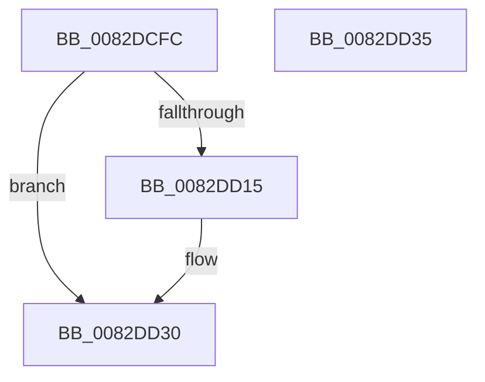

# PnpObjectRaiseDeleteEvent

- RVA: `0x0082DCFC`–`0x0082DD36` (길이 `58` bytes)
- VA: `0x000000014082DCFC`
- 실행 섹션: `PAGE`
- PDB 이름 있음: `예`; PDB Function 태그: `아니요`
- unwind 정보 RVA: `0x0006C2A4`
- 디코드: `14`개 명령, `58/58` bytes 표시
- 미해석 바이트: `0` (있으면 어셈블리에 `.byte`로 보존)

> 이 문서는 커널 이미지의 기계어와 PDB 기호를 분석해 생성했습니다. 4번과 5번은 함수 원형과 자료형을 바이너리 사용 방식에서 추정한 C 해석이며 원본 소스 복구 결과는 아닙니다.

## 1. Dependencies

- 직접 호출 지점: **1**; 고유 호출 대상: **1**
- 직접 호출자로 확인된 함수: **2**
- RIP 상대 이미지 참조: **0**

### Outgoing calls
- `0x0082DD2B` → [guard_dispatch_icall](../../text/6B/guard_dispatch_icall_function_006BAAD0.md) (function, `0x006BAAD0`)

### Direct callers
- [PnpDeleteObjectDispatch](PnpDeleteObjectDispatch_function_0082C618.md) at `0x0082C6BE`
- [CmRaiseDeleteEvent](CmRaiseDeleteEvent_function_0082DBE0.md) at `0x0082DC0C`

### Static image references
- 디코드된 RIP-relative 메모리 참조가 없습니다.

## 2. Other-region calls and transfers

- 다른 실행 섹션으로 향하는 call: **1**
  - `0x0082DD2B` → [guard_dispatch_icall](../../text/6B/guard_dispatch_icall_function_006BAAD0.md) (`PAGE` → `.text`)
- 별도 외부 분기/꼬리 이동을 확인하지 못했습니다.

## 3. Assembly (complete function range)

```asm
0082DCFC  48 83 EC 58                     sub rsp, 0x58
0082DD00  48 8B 81 F0 01 00 00            mov rax, qword ptr [rcx + 0x1f0]
0082DD07  0F 57 C0                        xorps xmm0, xmm0
0082DD0A  F3 0F 7F 44 24 38               movdqu xmmword ptr [rsp + 0x38], xmm0
0082DD10  48 85 C0                        test rax, rax
0082DD13  74 1B                           je 0x14082dd30
0082DD15  48 83 64 24 30 00               and qword ptr [rsp + 0x30], 0
0082DD1B  4C 8D 4C 24 30                  lea r9, [rsp + 0x30]
0082DD20  4C 89 4C 24 20                  mov qword ptr [rsp + 0x20], r9
0082DD25  41 B9 03 00 00 00               mov r9d, 3
0082DD2B  E8 A0 CD E8 FF                  call 0x1406baad0
0082DD30  48 83 C4 58                     add rsp, 0x58
0082DD34  C3                              ret
0082DD35  CC                              int3
```

## 4. C-style interpretation (structured pseudocode)

```c
__int64 __fastcall PnpObjectRaiseDeleteEvent(__int64 a1)
{
    __int64 result;
    __int64 v_rsp;
    unsigned __int64 v_stack_m20;
    unsigned __int64 v_stack_m28;
    unsigned __int64 v_stack_m38;

    v_rsp = (v_rsp) - (88);
    v_stack_m20 = v_xmm0;
    result = *(unsigned __int64 *)(a1 + 496);
    if (*(unsigned __int64 *)(a1 + 496) != 0) {
        a4 = v_stack_m28;
        v_stack_m38 = a4;
        a4 = 3;
        result = guard_dispatch_icall(a1, a2, a3, a4);
    }
    v_rsp = (v_rsp) + (88);
    return result;
}
```

## 5. (Beta) C Style

```c
int64_t PnpObjectRaiseDeleteEvent(void *Arg1)
{
    uint8_t *arg1 = (uint8_t *)Arg1;

    int64_t result;
    int64_t local_rsp;
    uint64_t v_stack_m20;
    uint64_t v_stack_m28;
    uint64_t v_stack_m38;

    local_rsp = (local_rsp) - (88);
    v_stack_m20 = v_xmm0;
    result = *(uint64_t *)(arg1 + 0x1F0);
    if (*(uint64_t *)(arg1 + 0x1F0) != 0) {
        a4 = v_stack_m28;
        v_stack_m38 = a4;
        a4 = 3;
        result = guard_dispatch_icall(Arg1, a2, a3, a4);
    }
    local_rsp = (local_rsp) + (88);
    return result;
}
```

### 관측된 메모리 오프셋

구조체 형식이 확인되지 않은 접근은 인자 기준의 오프셋으로만 기록했습니다.

| 기준 인자 | 오프셋 표현 | 폭 (bit) | 접근 |
|---|---:|---:|---|
| `Arg1` | `+ 0x1F0` | `64` | `R` |

## 6. Execution-region graph

[열기: 2D/3D 그래프와 함수 탐색 컨트롤 패널](../../../control-panel.html?section=page&rva=0x0082DCFC&view=graph)

- 2D 그래프는 위에서 아래로 흐르고, 3D 그래프는 빈 공간을 드래그해 회전합니다. Shift+드래그는 이동, 휠은 확대·축소, 함수 노드 선택은 대상 보고서 이동입니다.

### Static fallback


