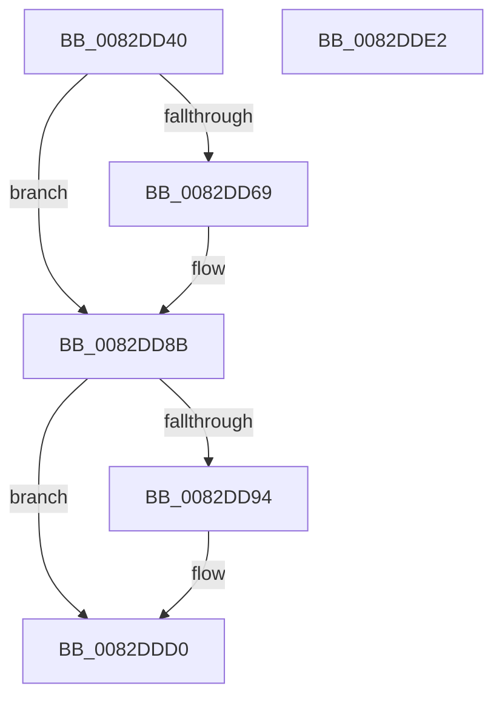

# PnpUpdateInterfacesCallback

- RVA: `0x0082DD40`–`0x0082DDE3` (길이 `163` bytes)
- VA: `0x000000014082DD40`
- 실행 섹션: `PAGE`
- PDB 이름 있음: `예`; PDB Function 태그: `아니요`
- unwind 정보 RVA: `0x0007AFEC`
- 디코드: `44`개 명령, `163/163` bytes 표시
- 미해석 바이트: `0` (있으면 어셈블리에 `.byte`로 보존)

> 이 문서는 커널 이미지의 기계어와 PDB 기호를 분석해 생성했습니다. 4번과 5번은 함수 원형과 자료형을 바이너리 사용 방식에서 추정한 C 해석이며 원본 소스 복구 결과는 아닙니다.

## 1. Dependencies

- 직접 호출 지점: **2**; 고유 호출 대상: **2**
- 직접 호출자로 확인된 함수: **0**
- RIP 상대 이미지 참조: **0**

### Outgoing calls
- `0x0082DD86` → [guard_dispatch_icall](../../text/6B/guard_dispatch_icall_function_006BAAD0.md) (function, `0x006BAAD0`)
- `0x0082DDCB` → [PnpNotifyDerivedKeys](../A2/PnpNotifyDerivedKeys_function_00A211A4.md) (function, `0x00A211A4`)

### Direct callers
- 이 함수 시작 RVA로 연결되는 직접 call은 확인되지 않았습니다. 간접 호출은 완전히 역산할 수 없습니다.

### Static image references
- 디코드된 RIP-relative 메모리 참조가 없습니다.

## 2. Other-region calls and transfers

- 다른 실행 섹션으로 향하는 call: **1**
  - `0x0082DD86` → [guard_dispatch_icall](../../text/6B/guard_dispatch_icall_function_006BAAD0.md) (`PAGE` → `.text`)
- 별도 외부 분기/꼬리 이동을 확인하지 못했습니다.

## 3. Assembly (complete function range)

```asm
0082DD40  4C 8B DC                        mov r11, rsp
0082DD43  49 89 5B 08                     mov qword ptr [r11 + 8], rbx
0082DD47  49 89 73 10                     mov qword ptr [r11 + 0x10], rsi
0082DD4B  57                              push rdi
0082DD4C  48 83 EC 60                     sub rsp, 0x60
0082DD50  41 80 79 1C 00                  cmp byte ptr [r9 + 0x1c], 0
0082DD55  0F 57 C0                        xorps xmm0, xmm0
0082DD58  F3 0F 7F 44 24 48               movdqu xmmword ptr [rsp + 0x48], xmm0
0082DD5E  49 8B D9                        mov rbx, r9
0082DD61  48 8B FA                        mov rdi, rdx
0082DD64  48 8B F1                        mov rsi, rcx
0082DD67  74 22                           je 0x14082dd8b
0082DD69  49 8B 01                        mov rax, qword ptr [r9]
0082DD6C  49 8D 4B D8                     lea rcx, [r11 - 0x28]
0082DD70  49 83 63 D8 00                  and qword ptr [r11 - 0x28], 0
0082DD75  41 B9 05 00 00 00               mov r9d, 5
0082DD7B  49 89 4B B8                     mov qword ptr [r11 - 0x48], rcx
0082DD7F  48 8B CE                        mov rcx, rsi
0082DD82  45 8D 41 FE                     lea r8d, [r9 - 2]
0082DD86  E8 45 CD E8 FF                  call 0x1406baad0
0082DD8B  4C 8B 4B 08                     mov r9, qword ptr [rbx + 8]
0082DD8F  4D 85 C9                        test r9, r9
0082DD92  74 3C                           je 0x14082ddd0
0082DD94  48 8B 03                        mov rax, qword ptr [rbx]
0082DD97  0F 57 C0                        xorps xmm0, xmm0
0082DD9A  48 89 44 24 38                  mov qword ptr [rsp + 0x38], rax
0082DD9F  41 B8 03 00 00 00               mov r8d, 3
0082DDA5  48 8D 44 24 40                  lea rax, [rsp + 0x40]
0082DDAA  48 8B D7                        mov rdx, rdi
0082DDAD  48 89 44 24 30                  mov qword ptr [rsp + 0x30], rax
0082DDB2  48 8B CE                        mov rcx, rsi
0082DDB5  8B 43 18                        mov eax, dword ptr [rbx + 0x18]
0082DDB8  89 44 24 28                     mov dword ptr [rsp + 0x28], eax
0082DDBC  48 8B 43 10                     mov rax, qword ptr [rbx + 0x10]
0082DDC0  48 89 44 24 20                  mov qword ptr [rsp + 0x20], rax
0082DDC5  F3 0F 7F 44 24 40               movdqu xmmword ptr [rsp + 0x40], xmm0
0082DDCB  E8 D4 33 1F 00                  call 0x140a211a4
0082DDD0  48 8B 5C 24 70                  mov rbx, qword ptr [rsp + 0x70]
0082DDD5  32 C0                           xor al, al
0082DDD7  48 8B 74 24 78                  mov rsi, qword ptr [rsp + 0x78]
0082DDDC  48 83 C4 60                     add rsp, 0x60
0082DDE0  5F                              pop rdi
0082DDE1  C3                              ret
0082DDE2  CC                              int3
```

## 4. C-style interpretation (structured pseudocode)

```c
__int64 __fastcall PnpUpdateInterfacesCallback(__int64 a1, __int64 a2, __int64 a3, __int64 a4)
{
    __int64 result;
    __int64 v_rsp;
    unsigned __int64 v_stack_m20;
    unsigned __int64 v_stack_m28;
    unsigned __int64 v_stack_m30;
    unsigned __int64 v_stack_m38;
    unsigned int v_stack_m40;
    unsigned __int64 v_stack_m48;
    unsigned __int64 v_stack_p10;
    unsigned __int64 v_stack_p8;

    *(unsigned __int64 *)(v_rsp + 8) = v_rbx;
    *(unsigned __int64 *)(v_rsp + 16) = v_rsi;
    v_rsp = (v_rsp) - (96);
    v_stack_m20 = v_xmm0;
    if ((*(unsigned __int8 *)(a4 + 28)) != 0) {
        result = *(unsigned __int64 *)(a4);
        a1 = v_rsp - 40;
        a4 = 5;
        *(unsigned __int64 *)(v_rsp - 72) = a1;
        a1 = a1;
        a3 = a4 - 2;
        result = guard_dispatch_icall(a1, a2, a3, a4);
    }
    if (*(unsigned __int64 *)(a4 + 8) != 0) {
        result = *(unsigned __int64 *)(a4);
        v_stack_m30 = result;
        a3 = 3;
        result = v_stack_m28;
        a2 = a2;
        v_stack_m38 = result;
        a1 = a1;
        result = *(unsigned int *)(a4 + 24);
        v_stack_m40 = (unsigned int)(result);
        result = *(unsigned __int64 *)(a4 + 16);
        v_stack_m48 = result;
        v_stack_m28 = v_xmm0;
        result = PnpNotifyDerivedKeys(a1, a2, a3, *(unsigned __int64 *)(a4 + 8));
    }
    result = 0;
    v_rsp = (v_rsp) + (96);
    return result;
}
```

## 5. (Beta) C Style

```c
int64_t PnpUpdateInterfacesCallback(int64_t Arg1, int64_t Arg2, int64_t Arg3, void *Arg4)
{
    uint8_t *arg4 = (uint8_t *)Arg4;

    int64_t result;
    int64_t local_rsp;
    uint64_t v_stack_m20;
    uint64_t v_stack_m28;
    uint64_t v_stack_m30;
    uint64_t v_stack_m38;
    uint32_t v_stack_m40;
    uint64_t v_stack_m48;
    uint64_t v_stack_p10;
    uint64_t v_stack_p8;

    *(uint64_t *)(local_rsp + 0x8) = local_rbx;
    *(uint64_t *)(local_rsp + 0x10) = local_rsi;
    local_rsp = (local_rsp) - (96);
    v_stack_m20 = v_xmm0;
    if ((*(uint8_t *)(arg4 + 0x1C)) != 0) {
        result = *(uint64_t *)(arg4);
        Arg1 = local_rsp - 40;
        Arg4 = 5;
        *(uint64_t *)(local_rsp - 0x48) = Arg1;
        Arg1 = Arg1;
        Arg3 = Arg4 - 2;
        result = guard_dispatch_icall(Arg1, Arg2, Arg3, Arg4);
    }
    if (*(uint64_t *)(arg4 + 0x8) != 0) {
        result = *(uint64_t *)(arg4);
        v_stack_m30 = result;
        Arg3 = 3;
        result = v_stack_m28;
        Arg2 = Arg2;
        v_stack_m38 = result;
        Arg1 = Arg1;
        result = *(uint32_t *)(arg4 + 0x18);
        v_stack_m40 = (uint32_t)(result);
        result = *(uint64_t *)(arg4 + 0x10);
        v_stack_m48 = result;
        v_stack_m28 = v_xmm0;
        result = PnpNotifyDerivedKeys(Arg1, Arg2, Arg3, *(uint64_t *)(arg4 + 0x8));
    }
    result = 0;
    local_rsp = (local_rsp) + (96);
    return result;
}
```

### 관측된 메모리 오프셋

구조체 형식이 확인되지 않은 접근은 인자 기준의 오프셋으로만 기록했습니다.

| 기준 인자 | 오프셋 표현 | 폭 (bit) | 접근 |
|---|---:|---:|---|
| `Arg4` | `+ 0x0` | `64` | `R` |
| `Arg4` | `+ 0x8` | `64` | `R` |
| `Arg4` | `+ 0x10` | `64` | `R` |
| `Arg4` | `+ 0x18` | `32` | `R` |
| `Arg4` | `+ 0x1C` | `8` | `R` |

## 6. Execution-region graph

[열기: 2D/3D 그래프와 함수 탐색 컨트롤 패널](../../../control-panel.html?section=page&rva=0x0082DD40&view=graph)

- 2D 그래프는 위에서 아래로 흐르고, 3D 그래프는 빈 공간을 드래그해 회전합니다. Shift+드래그는 이동, 휠은 확대·축소, 함수 노드 선택은 대상 보고서 이동입니다.

### Static fallback


