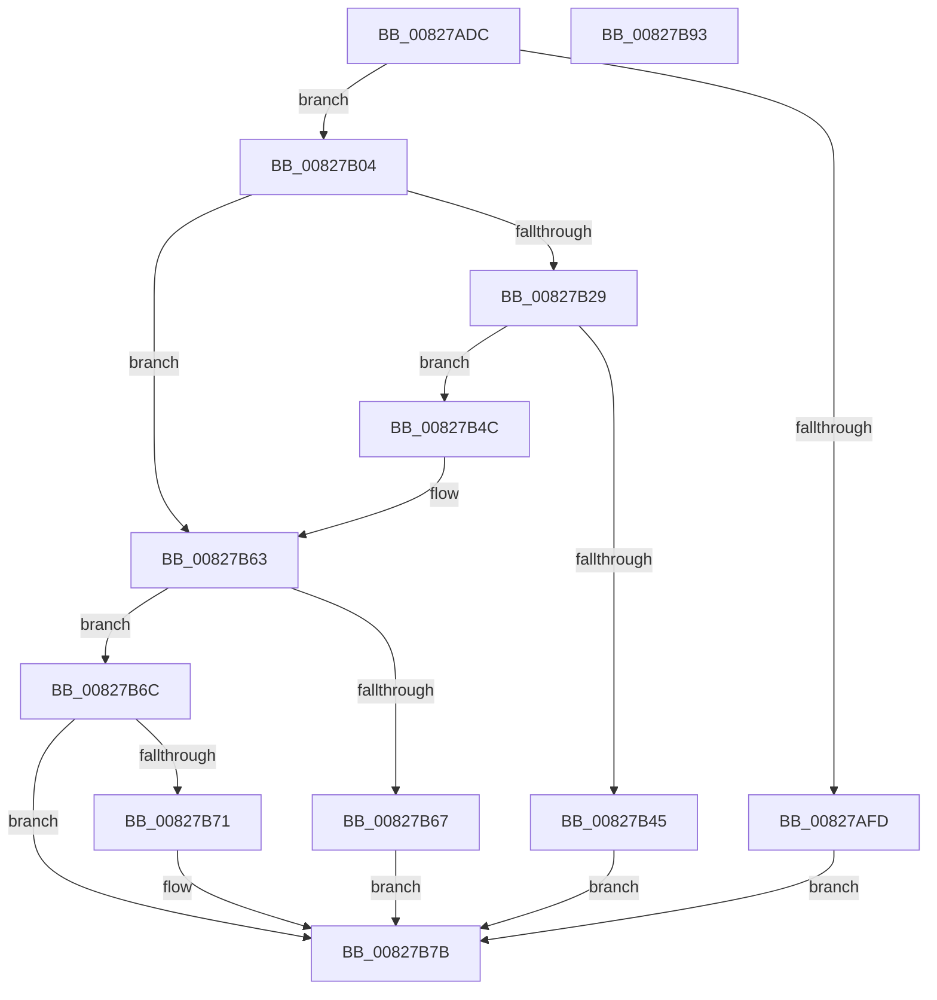

# SiBootEntryGetNtFilePath

- RVA: `0x00827ADC`–`0x00827B94` (길이 `184` bytes)
- VA: `0x0000000140827ADC`
- 실행 섹션: `PAGE`
- PDB 이름 있음: `예`; PDB Function 태그: `아니요`
- unwind 정보 RVA: `0x000A85B0`
- 디코드: `54`개 명령, `184/184` bytes 표시
- 미해석 바이트: `0` (있으면 어셈블리에 `.byte`로 보존)

> 이 문서는 커널 이미지의 기계어와 PDB 기호를 분석해 생성했습니다. 4번과 5번은 함수 원형과 자료형을 바이너리 사용 방식에서 추정한 C 해석이며 원본 소스 복구 결과는 아닙니다.

## 1. Dependencies

- 직접 호출 지점: **4**; 고유 호출 대상: **3**
- 직접 호출자로 확인된 함수: **1**
- RIP 상대 이미지 참조: **0**

### Outgoing calls
- `0x00827B1B` → [ZwTranslateFilePath](../../text/6B/ZwTranslateFilePath_function_006B0BD0.md) (function, `0x006B0BD0`)
- `0x00827B38` → [ExAllocatePool2](../../poolcode/B8/ExAllocatePool2_function_00B820F0.md) (function, `0x00B820F0`)
- `0x00827B5C` → [ZwTranslateFilePath](../../text/6B/ZwTranslateFilePath_function_006B0BD0.md) (function, `0x006B0BD0`)
- `0x00827B76` → [ExFreePoolWithTag](../../poolcode/B8/ExFreePoolWithTag_function_00B82870.md) (function, `0x00B82870`)

### Direct callers
- [SiGetEspFromFirmware](SiGetEspFromFirmware_function_008280C0.md) at `0x00828225`
- [SiGetEspFromFirmware](SiGetEspFromFirmware_function_008280C0.md) at `0x008282FA`

### Static image references
- 디코드된 RIP-relative 메모리 참조가 없습니다.

## 2. Other-region calls and transfers

- 다른 실행 섹션으로 향하는 call: **4**
  - `0x00827B1B` → [ZwTranslateFilePath](../../text/6B/ZwTranslateFilePath_function_006B0BD0.md) (`PAGE` → `.text`)
  - `0x00827B38` → [ExAllocatePool2](../../poolcode/B8/ExAllocatePool2_function_00B820F0.md) (`PAGE` → `POOLCODE`)
  - `0x00827B5C` → [ZwTranslateFilePath](../../text/6B/ZwTranslateFilePath_function_006B0BD0.md) (`PAGE` → `.text`)
  - `0x00827B76` → [ExFreePoolWithTag](../../poolcode/B8/ExFreePoolWithTag_function_00B82870.md) (`PAGE` → `POOLCODE`)
- 별도 외부 분기/꼬리 이동을 확인하지 못했습니다.

## 3. Assembly (complete function range)

```asm
00827ADC  48 89 5C 24 10                  mov qword ptr [rsp + 0x10], rbx
00827AE1  48 89 74 24 18                  mov qword ptr [rsp + 0x18], rsi
00827AE6  48 89 7C 24 20                  mov qword ptr [rsp + 0x20], rdi
00827AEB  41 56                           push r14
00827AED  48 83 EC 20                     sub rsp, 0x20
00827AF1  8B 41 14                        mov eax, dword ptr [rcx + 0x14]
00827AF4  33 FF                           xor edi, edi
00827AF6  4C 8B F2                        mov r14, rdx
00827AF9  85 C0                           test eax, eax
00827AFB  75 07                           jne 0x140827b04
00827AFD  BB 25 02 00 C0                  mov ebx, 0xc0000225
00827B02  EB 77                           jmp 0x140827b7b
00827B04  21 7C 24 30                     and dword ptr [rsp + 0x30], edi
00827B08  48 8D 34 01                     lea rsi, [rcx + rax]
00827B0C  45 33 C0                        xor r8d, r8d
00827B0F  4C 8D 4C 24 30                  lea r9, [rsp + 0x30]
00827B14  48 8B CE                        mov rcx, rsi
00827B17  41 8D 50 03                     lea edx, [r8 + 3]
00827B1B  E8 B0 90 E8 FF                  call 0x1406b0bd0
00827B20  8B D8                           mov ebx, eax
00827B22  3D 23 00 00 C0                  cmp eax, 0xc0000023
00827B27  75 3A                           jne 0x140827b63
00827B29  8B 54 24 30                     mov edx, dword ptr [rsp + 0x30]
00827B2D  B9 00 01 00 00                  mov ecx, 0x100
00827B32  41 B8 53 59 50 4B               mov r8d, 0x4b505953
00827B38  E8 B3 A5 35 00                  call 0x140b820f0
00827B3D  48 8B F8                        mov rdi, rax
00827B40  48 85 C0                        test rax, rax
00827B43  75 07                           jne 0x140827b4c
00827B45  BB 17 00 00 C0                  mov ebx, 0xc0000017
00827B4A  EB 2F                           jmp 0x140827b7b
00827B4C  4C 8D 4C 24 30                  lea r9, [rsp + 0x30]
00827B51  4C 8B C0                        mov r8, rax
00827B54  BA 03 00 00 00                  mov edx, 3
00827B59  48 8B CE                        mov rcx, rsi
00827B5C  E8 6F 90 E8 FF                  call 0x1406b0bd0
00827B61  8B D8                           mov ebx, eax
00827B63  85 DB                           test ebx, ebx
00827B65  78 05                           js 0x140827b6c
00827B67  49 89 3E                        mov qword ptr [r14], rdi
00827B6A  EB 0F                           jmp 0x140827b7b
00827B6C  48 85 FF                        test rdi, rdi
00827B6F  74 0A                           je 0x140827b7b
00827B71  33 D2                           xor edx, edx
00827B73  48 8B CF                        mov rcx, rdi
00827B76  E8 F5 AC 35 00                  call 0x140b82870
00827B7B  48 8B 74 24 40                  mov rsi, qword ptr [rsp + 0x40]
00827B80  8B C3                           mov eax, ebx
00827B82  48 8B 5C 24 38                  mov rbx, qword ptr [rsp + 0x38]
00827B87  48 8B 7C 24 48                  mov rdi, qword ptr [rsp + 0x48]
00827B8C  48 83 C4 20                     add rsp, 0x20
00827B90  41 5E                           pop r14
00827B92  C3                              ret
00827B93  CC                              int3
```

## 4. C-style interpretation (structured pseudocode)

```c
__int64 __fastcall SiBootEntryGetNtFilePath(__int64 a1, __int64 a2, int a3)
{
    __int64 result;
    __int64 v_rdi;
    __int64 v_rsp;
    unsigned __int64 v_stack_p10;
    unsigned __int64 v_stack_p18;
    unsigned __int64 v_stack_p20;
    unsigned int v_stack_p8;

    v_stack_p10 = v_rbx;
    v_stack_p18 = v_rsi;
    v_stack_p20 = v_rdi;
    v_rsp = (v_rsp) - (32);
    v_rdi = 0;
    if ((unsigned int)((unsigned int)(*(unsigned int *)(a1 + 20))) != 0) goto loc_00827B04;
    goto loc_00827B7B;
loc_00827B04:
    a3 = 0;
    result = ZwTranslateFilePath(a1 + (unsigned int)(*(unsigned int *)(a1 + 20)) * 1, a3 + 3, a3, v_stack_p8);
    if (((unsigned int)(result)) != 0xC0000023ULL) goto loc_00827B63;
    result = ExAllocatePool2(256, (unsigned int)(v_stack_p8), (unsigned int)(0x4B505953ULL), v_stack_p8);
    if (result != 0) goto loc_00827B4C;
    goto loc_00827B7B;
loc_00827B4C:
    result = ZwTranslateFilePath(a1 + (unsigned int)(*(unsigned int *)(a1 + 20)) * 1, 3, result, v_stack_p8);
loc_00827B63:
    if (sign_flag) goto loc_00827B6C;
    *(unsigned __int64 *)(a2) = result;
    goto loc_00827B7B;
loc_00827B6C:
    if (result != 0) {
        a2 = 0;
        a1 = result;
        result = ExFreePoolWithTag(a1, a2, result, v_stack_p8);
    }
    v_rsp = (v_rsp) + (32);
    return (unsigned int)((unsigned int)((unsigned int)((unsigned int)(result))));
}
```

## 5. (Beta) C Style

```c
int64_t SiBootEntryGetNtFilePath(void *Arg1, void *Arg2, int32_t Arg3)
{
    uint8_t *arg1 = (uint8_t *)Arg1;
    uint8_t *arg2 = (uint8_t *)Arg2;

    int64_t result;
    int64_t local_rdi;
    int64_t local_rsp;
    uint64_t v_stack_p10;
    uint64_t v_stack_p18;
    uint64_t v_stack_p20;
    uint32_t v_stack_p8;

    v_stack_p10 = local_rbx;
    v_stack_p18 = local_rsi;
    v_stack_p20 = local_rdi;
    local_rsp = (local_rsp) - (32);
    local_rdi = 0;
    if ((uint32_t)((uint32_t)(*(uint32_t *)(arg1 + 0x14))) != 0) goto loc_00827B04;
    goto loc_00827B7B;
loc_00827B04:
    Arg3 = 0;
    result = ZwTranslateFilePath(Arg1 + (uint32_t)(*(uint32_t *)(arg1 + 0x14)) * 1, Arg3 + 3, Arg3, v_stack_p8);
    if (((uint32_t)(result)) != 0xC0000023ULL) goto loc_00827B63;
    result = ExAllocatePool2(256, (uint32_t)(v_stack_p8), (uint32_t)(0x4B505953ULL), v_stack_p8);
    if (result != 0) goto loc_00827B4C;
    goto loc_00827B7B;
loc_00827B4C:
    result = ZwTranslateFilePath(Arg1 + (uint32_t)(*(uint32_t *)(arg1 + 0x14)) * 1, 3, result, v_stack_p8);
loc_00827B63:
    if (sign_flag) goto loc_00827B6C;
    *(uint64_t *)(arg2) = result;
    goto loc_00827B7B;
loc_00827B6C:
    if (result != 0) {
        Arg2 = 0;
        Arg1 = result;
        result = ExFreePoolWithTag(Arg1, Arg2, result, v_stack_p8);
    }
    local_rsp = (local_rsp) + (32);
    return (uint32_t)((uint32_t)((uint32_t)((uint32_t)(result))));
}
```

### 관측된 메모리 오프셋

구조체 형식이 확인되지 않은 접근은 인자 기준의 오프셋으로만 기록했습니다.

| 기준 인자 | 오프셋 표현 | 폭 (bit) | 접근 |
|---|---:|---:|---|
| `Arg1` | `+ 0x0 + rax*1` | `64` | `R` |
| `Arg1` | `+ 0x14` | `32` | `R` |
| `Arg2` | `+ 0x0` | `64` | `W` |

## 6. Execution-region graph

[열기: 2D/3D 그래프와 함수 탐색 컨트롤 패널](../../../control-panel.html?section=page&rva=0x00827ADC&view=graph)

- 2D 그래프는 위에서 아래로 흐르고, 3D 그래프는 빈 공간을 드래그해 회전합니다. Shift+드래그는 이동, 휠은 확대·축소, 함수 노드 선택은 대상 보고서 이동입니다.

### Static fallback


