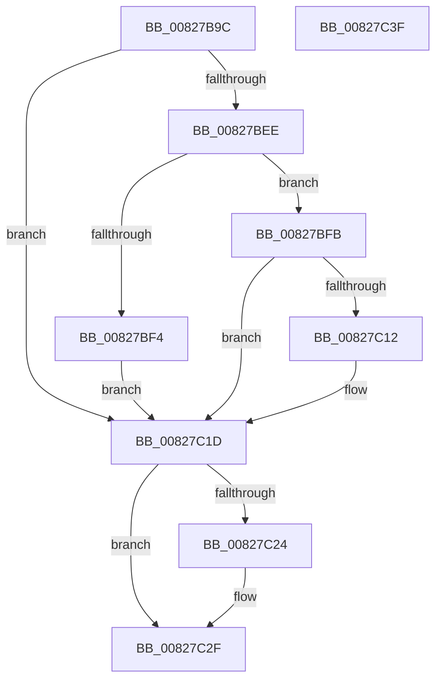

# SiDisambiguateSystemDevice

- RVA: `0x00827B9C`–`0x00827C40` (길이 `164` bytes)
- VA: `0x0000000140827B9C`
- 실행 섹션: `PAGE`
- PDB 이름 있음: `예`; PDB Function 태그: `아니요`
- unwind 정보 RVA: `0x000CE0DC`
- 디코드: `50`개 명령, `164/164` bytes 표시
- 미해석 바이트: `0` (있으면 어셈블리에 `.byte`로 보존)

> 이 문서는 커널 이미지의 기계어와 PDB 기호를 분석해 생성했습니다. 4번과 5번은 함수 원형과 자료형을 바이너리 사용 방식에서 추정한 C 해석이며 원본 소스 복구 결과는 아닙니다.

## 1. Dependencies

- 직접 호출 지점: **3**; 고유 호출 대상: **3**
- 직접 호출자로 확인된 함수: **1**
- RIP 상대 이미지 참조: **2**

### Outgoing calls
- `0x00827BE3` → [SiGetRegistryValue](../A3/SiGetRegistryValue_function_00A37D8C.md) (function, `0x00A37D8C`)
- `0x00827C07` → [SiGetDeviceNumberInformation](SiGetDeviceNumberInformation_function_00827858.md) (function, `0x00827858`)
- `0x00827C2A` → [ExFreePoolWithTag](../../poolcode/B8/ExFreePoolWithTag_function_00B82870.md) (function, `0x00B82870`)

### Direct callers
- [SiGetEfiSystemDevice](SiGetEfiSystemDevice_function_00827C68.md) at `0x00827D3D`

### Static image references
- `0x00827BB8` → RVA `0x00B0CF90` (` ?? ::NNGAKEGL::`string'`; read)
- `0x00827BCB` → RVA `0x00B0D010` (` ?? ::NNGAKEGL::`string'`; read)

## 2. Other-region calls and transfers

- 다른 실행 섹션으로 향하는 call: **1**
  - `0x00827C2A` → [ExFreePoolWithTag](../../poolcode/B8/ExFreePoolWithTag_function_00B82870.md) (`PAGE` → `POOLCODE`)
- 별도 외부 분기/꼬리 이동을 확인하지 못했습니다.

## 3. Assembly (complete function range)

```asm
00827B9C  48 89 5C 24 08                  mov qword ptr [rsp + 8], rbx
00827BA1  55                              push rbp
00827BA2  56                              push rsi
00827BA3  41 56                           push r14
00827BA5  48 8B EC                        mov rbp, rsp
00827BA8  48 83 EC 40                     sub rsp, 0x40
00827BAC  83 65 38 00                     and dword ptr [rbp + 0x38], 0
00827BB0  48 8D 45 30                     lea rax, [rbp + 0x30]
00827BB4  83 65 F0 00                     and dword ptr [rbp - 0x10], 0
00827BB8  4C 8D 05 D1 53 2E 00            lea r8, [rip + 0x2e53d1]
00827BBF  83 65 30 00                     and dword ptr [rbp + 0x30], 0
00827BC3  48 8B F2                        mov rsi, rdx
00827BC6  48 83 65 F8 00                  and qword ptr [rbp - 8], 0
00827BCB  48 8D 15 3E 54 2E 00            lea rdx, [rip + 0x2e543e]
00827BD2  48 89 44 24 28                  mov qword ptr [rsp + 0x28], rax
00827BD7  4C 8B F1                        mov r14, rcx
00827BDA  48 8D 45 F8                     lea rax, [rbp - 8]
00827BDE  48 89 44 24 20                  mov qword ptr [rsp + 0x20], rax
00827BE3  E8 A4 01 21 00                  call 0x140a37d8c
00827BE8  8B D8                           mov ebx, eax
00827BEA  85 C0                           test eax, eax
00827BEC  78 2F                           js 0x140827c1d
00827BEE  83 7D 30 04                     cmp dword ptr [rbp + 0x30], 4
00827BF2  73 07                           jae 0x140827bfb
00827BF4  BB 01 00 00 C0                  mov ebx, 0xc0000001
00827BF9  EB 22                           jmp 0x140827c1d
00827BFB  48 8B 4D F8                     mov rcx, qword ptr [rbp - 8]
00827BFF  4C 8D 45 F0                     lea r8, [rbp - 0x10]
00827C03  48 8D 55 38                     lea rdx, [rbp + 0x38]
00827C07  E8 4C FC FF FF                  call 0x140827858
00827C0C  8B D8                           mov ebx, eax
00827C0E  85 C0                           test eax, eax
00827C10  78 0B                           js 0x140827c1d
00827C12  8B 45 38                        mov eax, dword ptr [rbp + 0x38]
00827C15  41 89 06                        mov dword ptr [r14], eax
00827C18  8B 45 F0                        mov eax, dword ptr [rbp - 0x10]
00827C1B  89 06                           mov dword ptr [rsi], eax
00827C1D  48 83 7D F8 00                  cmp qword ptr [rbp - 8], 0
00827C22  74 0B                           je 0x140827c2f
00827C24  48 8B 4D F8                     mov rcx, qword ptr [rbp - 8]
00827C28  33 D2                           xor edx, edx
00827C2A  E8 41 AC 35 00                  call 0x140b82870
00827C2F  8B C3                           mov eax, ebx
00827C31  48 8B 5C 24 60                  mov rbx, qword ptr [rsp + 0x60]
00827C36  48 83 C4 40                     add rsp, 0x40
00827C3A  41 5E                           pop r14
00827C3C  5E                              pop rsi
00827C3D  5D                              pop rbp
00827C3E  C3                              ret
00827C3F  CC                              int3
```

## 4. C-style interpretation (structured pseudocode)

```c
__int64 __fastcall SiDisambiguateSystemDevice(__int64 a1, __int64 a2)
{
    __int64 result;
    __int64 v_rsp;
    unsigned __int64 v_stack_m20;
    unsigned int v_stack_m28;
    unsigned __int64 v_stack_m30;
    unsigned __int64 v_stack_m38;
    unsigned __int64 v_stack_p18;
    unsigned int v_stack_p20;
    unsigned __int64 v_stack_p8;

    v_stack_p8 = v_rbx;
    v_rsp = (v_rsp) - (64);
    v_stack_m30 = v_stack_p18;
    v_stack_m38 = v_stack_m20;
    result = SiGetRegistryValue(a1, v_rip + 3036222, v_rip + 3036113, a4);
    if (sign_flag) goto loc_00827C1D;
    if (v_stack_p18 >= 4) goto loc_00827BFB;
    goto loc_00827C1D;
loc_00827BFB:
    result = SiGetDeviceNumberInformation(v_stack_m20, v_stack_p20, v_stack_m28, a4);
    if (!(sign_flag)) {
        result = v_stack_p20;
        *(unsigned int *)(a1) = (unsigned int)(result);
        result = v_stack_m28;
        *(unsigned int *)(a2) = (unsigned int)(result);
    }
    if (v_stack_m20 != 0) {
        a1 = v_stack_m20;
        a2 = 0;
        result = ExFreePoolWithTag(a1, a2, v_stack_m28, a4);
    }
    v_rsp = (v_rsp) + (64);
    return (unsigned int)((unsigned int)((unsigned int)((unsigned int)(result))));
}
```

## 5. (Beta) C Style

```c
int64_t SiDisambiguateSystemDevice(void *Arg1, void *Arg2)
{
    uint8_t *arg1 = (uint8_t *)Arg1;
    uint8_t *arg2 = (uint8_t *)Arg2;

    int64_t result;
    int64_t local_rsp;
    uint64_t v_stack_m20;
    uint32_t v_stack_m28;
    uint64_t v_stack_m30;
    uint64_t v_stack_m38;
    uint64_t v_stack_p18;
    uint32_t v_stack_p20;
    uint64_t v_stack_p8;

    v_stack_p8 = local_rbx;
    local_rsp = (local_rsp) - (64);
    v_stack_m30 = v_stack_p18;
    v_stack_m38 = v_stack_m20;
    result = SiGetRegistryValue(Arg1, v_rip + 3036222, v_rip + 3036113, a4);
    if (sign_flag) goto loc_00827C1D;
    if (v_stack_p18 >= 4) goto loc_00827BFB;
    goto loc_00827C1D;
loc_00827BFB:
    result = SiGetDeviceNumberInformation(v_stack_m20, v_stack_p20, v_stack_m28, a4);
    if (!(sign_flag)) {
        result = v_stack_p20;
        *(uint32_t *)(arg1) = (uint32_t)(result);
        result = v_stack_m28;
        *(uint32_t *)(arg2) = (uint32_t)(result);
    }
    if (v_stack_m20 != 0) {
        Arg1 = v_stack_m20;
        Arg2 = 0;
        result = ExFreePoolWithTag(Arg1, Arg2, v_stack_m28, a4);
    }
    local_rsp = (local_rsp) + (64);
    return (uint32_t)((uint32_t)((uint32_t)((uint32_t)(result))));
}
```

### 관측된 메모리 오프셋

구조체 형식이 확인되지 않은 접근은 인자 기준의 오프셋으로만 기록했습니다.

| 기준 인자 | 오프셋 표현 | 폭 (bit) | 접근 |
|---|---:|---:|---|
| `Arg1` | `+ 0x0` | `32` | `W` |
| `Arg2` | `+ 0x0` | `32` | `W` |

## 6. Execution-region graph

[열기: 2D/3D 그래프와 함수 탐색 컨트롤 패널](../../../control-panel.html?section=page&rva=0x00827B9C&view=graph)

- 2D 그래프는 위에서 아래로 흐르고, 3D 그래프는 빈 공간을 드래그해 회전합니다. Shift+드래그는 이동, 휠은 확대·축소, 함수 노드 선택은 대상 보고서 이동입니다.

### Static fallback


