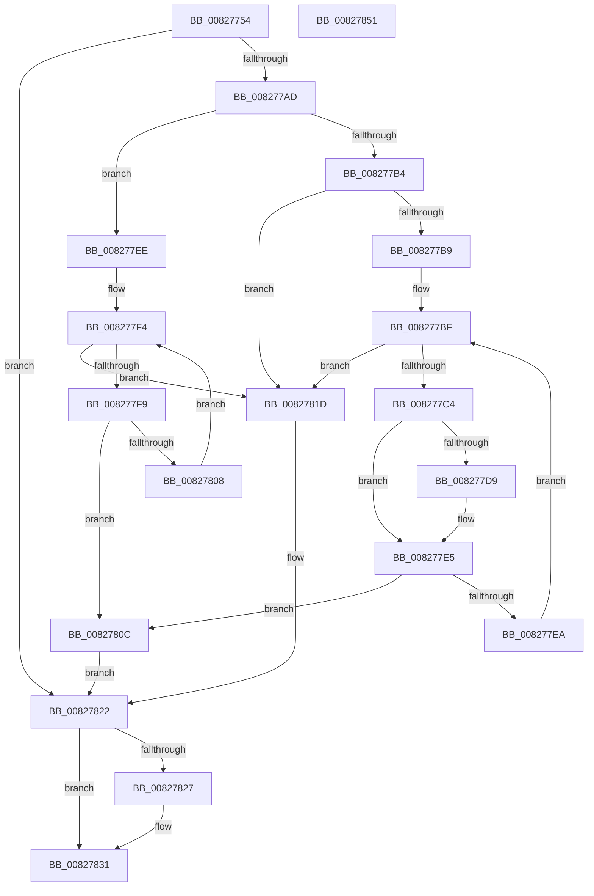

# SiFindSystemPartition

- RVA: `0x00827754`–`0x00827852` (길이 `254` bytes)
- VA: `0x0000000140827754`
- 실행 섹션: `PAGE`
- PDB 이름 있음: `예`; PDB Function 태그: `아니요`
- unwind 정보 RVA: `0x000DA6E0`
- 디코드: `70`개 명령, `254/254` bytes 표시
- 미해석 바이트: `0` (있으면 어셈블리에 `.byte`로 보존)

> 이 문서는 커널 이미지의 기계어와 PDB 기호를 분석해 생성했습니다. 4번과 5번은 함수 원형과 자료형을 바이너리 사용 방식에서 추정한 C 해석이며 원본 소스 복구 결과는 아닙니다.

## 1. Dependencies

- 직접 호출 지점: **4**; 고유 호출 대상: **4**
- 직접 호출자로 확인된 함수: **1**
- RIP 상대 이미지 참조: **4**

### Outgoing calls
- `0x0082778E` → [swprintf_s](../../text/50/swprintf_s_function_00504B20.md) (function, `0x00504B20`)
- `0x0082779D` → [SiGetDriveLayoutInformation](SiGetDriveLayoutInformation_function_00827934.md) (function, `0x00827934`)
- `0x0082782C` → [ExFreePoolWithTag](../../poolcode/B8/ExFreePoolWithTag_function_00B82870.md) (function, `0x00B82870`)
- `0x0082783B` → [_security_check_cookie](../../text/6A/_security_check_cookie_function_006AC640.md) (function, `0x006AC640`)

### Direct callers
- [SyspartGetPhysicalPartitions](SyspartGetPhysicalPartitions_function_008275F8.md) at `0x00827672`

### Static image references
- `0x00827761` → RVA `0x00E0A740` (`.data`; read)
- `0x00827774` → RVA `0x00B0CF60` (` ?? ::NNGAKEGL::`string'`; read)
- `0x008277D0` → RVA `0x0001ABB0` (`.rdata`; read)
- `0x008277DE` → RVA `0x0001ABB8` (`.rdata`; read)

## 2. Other-region calls and transfers

- 다른 실행 섹션으로 향하는 call: **3**
  - `0x0082778E` → [swprintf_s](../../text/50/swprintf_s_function_00504B20.md) (`PAGE` → `.text`)
  - `0x0082782C` → [ExFreePoolWithTag](../../poolcode/B8/ExFreePoolWithTag_function_00B82870.md) (`PAGE` → `POOLCODE`)
  - `0x0082783B` → [_security_check_cookie](../../text/6A/_security_check_cookie_function_006AC640.md) (`PAGE` → `.text`)
- 별도 외부 분기/꼬리 이동을 확인하지 못했습니다.

## 3. Assembly (complete function range)

```asm
00827754  48 89 5C 24 10                  mov qword ptr [rsp + 0x10], rbx
00827759  57                              push rdi
0082775A  48 81 EC 80 00 00 00            sub rsp, 0x80
00827761  48 8B 05 D8 2F 5E 00            mov rax, qword ptr [rip + 0x5e2fd8]
00827768  48 33 C4                        xor rax, rsp
0082776B  48 89 44 24 70                  mov qword ptr [rsp + 0x70], rax
00827770  44 8B 49 04                     mov r9d, dword ptr [rcx + 4]
00827774  4C 8D 05 E5 57 2E 00            lea r8, [rip + 0x2e57e5]
0082777B  48 83 64 24 20 00               and qword ptr [rsp + 0x20], 0
00827781  48 8B F9                        mov rdi, rcx
00827784  48 8D 4C 24 30                  lea rcx, [rsp + 0x30]
00827789  BA 20 00 00 00                  mov edx, 0x20
0082778E  E8 8D D3 CD FF                  call 0x140504b20
00827793  48 8D 54 24 20                  lea rdx, [rsp + 0x20]
00827798  48 8D 4C 24 30                  lea rcx, [rsp + 0x30]
0082779D  E8 92 01 00 00                  call 0x140827934
008277A2  4C 8B 44 24 20                  mov r8, qword ptr [rsp + 0x20]
008277A7  8B D8                           mov ebx, eax
008277A9  85 C0                           test eax, eax
008277AB  78 75                           js 0x140827822
008277AD  41 8B 10                        mov edx, dword ptr [r8]
008277B0  85 D2                           test edx, edx
008277B2  74 3A                           je 0x1408277ee
008277B4  83 FA 01                        cmp edx, 1
008277B7  75 64                           jne 0x14082781d
008277B9  45 8B 48 04                     mov r9d, dword ptr [r8 + 4]
008277BD  33 D2                           xor edx, edx
008277BF  41 3B D1                        cmp edx, r9d
008277C2  73 59                           jae 0x14082781d
008277C4  48 8D 0C D2                     lea rcx, [rdx + rdx*8]
008277C8  48 03 C9                        add rcx, rcx
008277CB  49 8B 44 C8 50                  mov rax, qword ptr [r8 + rcx*8 + 0x50]
008277D0  48 2B 05 D9 33 7F FF            sub rax, qword ptr [rip - 0x80cc27]
008277D7  75 0C                           jne 0x1408277e5
008277D9  49 8B 44 C8 58                  mov rax, qword ptr [r8 + rcx*8 + 0x58]
008277DE  48 2B 05 D3 33 7F FF            sub rax, qword ptr [rip - 0x80cc2d]
008277E5  48 85 C0                        test rax, rax
008277E8  74 22                           je 0x14082780c
008277EA  FF C2                           inc edx
008277EC  EB D1                           jmp 0x1408277bf
008277EE  45 8B 48 04                     mov r9d, dword ptr [r8 + 4]
008277F2  33 D2                           xor edx, edx
008277F4  41 3B D1                        cmp edx, r9d
008277F7  73 24                           jae 0x14082781d
008277F9  48 8D 0C D2                     lea rcx, [rdx + rdx*8]
008277FD  48 03 C9                        add rcx, rcx
00827800  41 80 7C C8 51 00               cmp byte ptr [r8 + rcx*8 + 0x51], 0
00827806  75 04                           jne 0x14082780c
00827808  FF C2                           inc edx
0082780A  EB E8                           jmp 0x1408277f4
0082780C  48 8D 04 D2                     lea rax, [rdx + rdx*8]
00827810  48 03 C0                        add rax, rax
00827813  41 8B 44 C0 48                  mov eax, dword ptr [r8 + rax*8 + 0x48]
00827818  89 47 08                        mov dword ptr [rdi + 8], eax
0082781B  EB 05                           jmp 0x140827822
0082781D  BB 25 02 00 C0                  mov ebx, 0xc0000225
00827822  4D 85 C0                        test r8, r8
00827825  74 0A                           je 0x140827831
00827827  33 D2                           xor edx, edx
00827829  49 8B C8                        mov rcx, r8
0082782C  E8 3F B0 35 00                  call 0x140b82870
00827831  8B C3                           mov eax, ebx
00827833  48 8B 4C 24 70                  mov rcx, qword ptr [rsp + 0x70]
00827838  48 33 CC                        xor rcx, rsp
0082783B  E8 00 4E E8 FF                  call 0x1406ac640
00827840  48 8B 9C 24 98 00 00 00         mov rbx, qword ptr [rsp + 0x98]
00827848  48 81 C4 80 00 00 00            add rsp, 0x80
0082784F  5F                              pop rdi
00827850  C3                              ret
00827851  CC                              int3
```

## 4. C-style interpretation (structured pseudocode)

```c
__int64 __fastcall SiFindSystemPartition(__int64 a1)
{
    __int64 result;
    __int64 v_rsp;
    unsigned __int64 v_stack_m18;
    unsigned __int64 v_stack_m58;
    unsigned __int64 v_stack_m68;
    unsigned __int64 v_stack_p10;

    v_stack_p10 = v_rbx;
    v_rsp = (v_rsp) - (128);
    result = (*(unsigned __int64 *)(v_rip + 6172632)) ^ (v_rsp);
    v_stack_m18 = result;
    result = swprintf_s(v_stack_m58, 32, v_rip + 3037157, (unsigned int)(*(unsigned int *)(a1 + 4)));
    result = SiGetDriveLayoutInformation(v_stack_m58, v_stack_m68, v_rip + 3037157, (unsigned int)(*(unsigned int *)(a1 + 4)));
    if (sign_flag) goto loc_00827822;
    if ((unsigned int)((unsigned int)(*(unsigned int *)(v_stack_m68))) == 0) goto loc_008277EE;
    if (((unsigned int)((unsigned int)(*(unsigned int *)(v_stack_m68)))) != 1) goto loc_0082781D;
    a2 = 0;
loc_008277BF:
    if (0 >= ((unsigned int)((unsigned int)(*(unsigned int *)(v_stack_m68 + 4))))) goto loc_0082781D;
    a1 = (a2 + a2 * 8) + (a2 + a2 * 8);
    result = (*(unsigned __int64 *)(v_stack_m68 + a1 * 8 + 80)) - (*(unsigned __int64 *)(v_rip - 8440871));
    if (!(condition_is_not_equal)) {
        result = *(unsigned __int64 *)(v_stack_m68 + a1 * 8 + 88);
        result = (result) - (*(unsigned __int64 *)(v_rip - 8440877));
    }
    if (result == 0) goto loc_0082780C;
    a2 = (unsigned int)((a2) + 1);
    goto loc_008277BF;
loc_008277EE:
    a2 = 0;
loc_008277F4:
    if (0 >= ((unsigned int)((unsigned int)(*(unsigned int *)(v_stack_m68 + 4))))) goto loc_0082781D;
    a1 = (a2 + a2 * 8) + (a2 + a2 * 8);
    if ((*(unsigned __int8 *)(v_stack_m68 + a1 * 8 + 81)) != 0) goto loc_0082780C;
    a2 = (unsigned int)((a2) + 1);
    goto loc_008277F4;
loc_0082780C:
    result = (a2 + a2 * 8) + (a2 + a2 * 8);
    *(unsigned int *)(a1 + 8) = (unsigned int)((unsigned int)(*(unsigned int *)(v_stack_m68 + result * 8 + 72)));
    goto loc_00827822;
loc_0082781D:
loc_00827822:
    result = (unsigned int)(*(unsigned int *)(v_stack_m68 + result * 8 + 72));
    if (v_stack_m68 != 0) {
        a2 = 0;
        a1 = v_stack_m68;
        result = ExFreePoolWithTag(a1, a2, v_stack_m68, (unsigned int)(*(unsigned int *)(v_stack_m68 + 4)));
    }
    a1 = (v_stack_m18) ^ (v_rsp);
    result = _security_check_cookie(a1, a2, v_stack_m68, (unsigned int)(*(unsigned int *)(v_stack_m68 + 4)));
    v_rsp = (v_rsp) + (128);
    return result;
}
```

## 5. (Beta) C Style

```c
int64_t SiFindSystemPartition(void *Arg1)
{
    uint8_t *arg1 = (uint8_t *)Arg1;

    int64_t result;
    int64_t local_rsp;
    uint64_t v_stack_m18;
    uint64_t v_stack_m58;
    uint64_t v_stack_m68;
    uint64_t v_stack_p10;

    v_stack_p10 = local_rbx;
    local_rsp = (local_rsp) - (128);
    result = (*(uint64_t *)(v_rip + 0x5E2FD8)) ^ (local_rsp);
    v_stack_m18 = result;
    result = swprintf_s(v_stack_m58, 32, v_rip + 3037157, (uint32_t)(*(uint32_t *)(arg1 + 0x4)));
    result = SiGetDriveLayoutInformation(v_stack_m58, v_stack_m68, v_rip + 3037157, (uint32_t)(*(uint32_t *)(arg1 + 0x4)));
    if (sign_flag) goto loc_00827822;
    if ((uint32_t)((uint32_t)(*(uint32_t *)(v_stack_m68))) == 0) goto loc_008277EE;
    if (((uint32_t)((uint32_t)(*(uint32_t *)(v_stack_m68)))) != 1) goto loc_0082781D;
    a2 = 0;
loc_008277BF:
    if (0 >= ((uint32_t)((uint32_t)(*(uint32_t *)(v_stack_m68 + 0x4))))) goto loc_0082781D;
    Arg1 = (a2 + a2 * 8) + (a2 + a2 * 8);
    result = (*(uint64_t *)(v_stack_m68 + arg1 * 8 + 0x50)) - (*(uint64_t *)(v_rip - 0x80CC27));
    if (!(condition_is_not_equal)) {
        result = *(uint64_t *)(v_stack_m68 + arg1 * 8 + 0x58);
        result = (result) - (*(uint64_t *)(v_rip - 0x80CC2D));
    }
    if (result == 0) goto loc_0082780C;
    a2 = (uint32_t)((a2) + 1);
    goto loc_008277BF;
loc_008277EE:
    a2 = 0;
loc_008277F4:
    if (0 >= ((uint32_t)((uint32_t)(*(uint32_t *)(v_stack_m68 + 0x4))))) goto loc_0082781D;
    Arg1 = (a2 + a2 * 8) + (a2 + a2 * 8);
    if ((*(uint8_t *)(v_stack_m68 + arg1 * 8 + 0x51)) != 0) goto loc_0082780C;
    a2 = (uint32_t)((a2) + 1);
    goto loc_008277F4;
loc_0082780C:
    result = (a2 + a2 * 8) + (a2 + a2 * 8);
    *(uint32_t *)(arg1 + 0x8) = (uint32_t)((uint32_t)(*(uint32_t *)(v_stack_m68 + result * 8 + 0x48)));
    goto loc_00827822;
loc_0082781D:
loc_00827822:
    result = (uint32_t)(*(uint32_t *)(v_stack_m68 + result * 8 + 0x48));
    if (v_stack_m68 != 0) {
        a2 = 0;
        Arg1 = v_stack_m68;
        result = ExFreePoolWithTag(Arg1, a2, v_stack_m68, (uint32_t)(*(uint32_t *)(v_stack_m68 + 0x4)));
    }
    Arg1 = (v_stack_m18) ^ (local_rsp);
    result = _security_check_cookie(Arg1, a2, v_stack_m68, (uint32_t)(*(uint32_t *)(v_stack_m68 + 0x4)));
    local_rsp = (local_rsp) + (128);
    return result;
}
```

### 관측된 메모리 오프셋

구조체 형식이 확인되지 않은 접근은 인자 기준의 오프셋으로만 기록했습니다.

| 기준 인자 | 오프셋 표현 | 폭 (bit) | 접근 |
|---|---:|---:|---|
| `Arg1` | `+ 0x4` | `32` | `R` |
| `Arg1` | `+ 0x8` | `32` | `W` |

## 6. Execution-region graph

[열기: 2D/3D 그래프와 함수 탐색 컨트롤 패널](../../../control-panel.html?section=page&rva=0x00827754&view=graph)

- 2D 그래프는 위에서 아래로 흐르고, 3D 그래프는 빈 공간을 드래그해 회전합니다. Shift+드래그는 이동, 휠은 확대·축소, 함수 노드 선택은 대상 보고서 이동입니다.

### Static fallback


