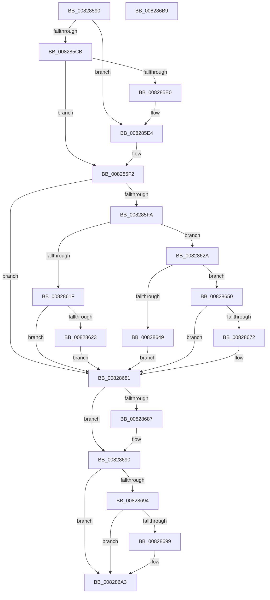

# SiGetBiosSystemDisk

- RVA: `0x00828590`–`0x008286BA` (길이 `298` bytes)
- VA: `0x0000000140828590`
- 실행 섹션: `PAGE`
- PDB 이름 있음: `예`; PDB Function 태그: `아니요`
- unwind 정보 RVA: `0x000DA760`
- 디코드: `87`개 명령, `298/298` bytes 표시
- 미해석 바이트: `0` (있으면 어셈블리에 `.byte`로 보존)

> 이 문서는 커널 이미지의 기계어와 PDB 기호를 분석해 생성했습니다. 4번과 5번은 함수 원형과 자료형을 바이너리 사용 방식에서 추정한 C 해석이며 원본 소스 복구 결과는 아닙니다.

## 1. Dependencies

- 직접 호출 지점: **9**; 고유 호출 대상: **7**
- 직접 호출자로 확인된 함수: **2**
- RIP 상대 이미지 참조: **2**

### Outgoing calls
- `0x008285BE` → [SiIsWinPeHardDiskZeroUfdBoot](SiIsWinPeHardDiskZeroUfdBoot_function_00828808.md) (function, `0x00828808`)
- `0x008285D2` → [SiOpenArcNameObject](SiOpenArcNameObject_function_00828958.md) (function, `0x00828958`)
- `0x008285EB` → [SiOpenArcNameObject](SiOpenArcNameObject_function_00828958.md) (function, `0x00828958`)
- `0x00828600` → [RtlInitUnicodeString](../../text/42/RtlInitUnicodeString_function_0042A780.md) (function, `0x0042A780`)
- `0x00828611` → [ZwQuerySymbolicLinkObject](../../text/6A/ZwQuerySymbolicLinkObject_function_006AFE50.md) (function, `0x006AFE50`)
- `0x0082863C` → [ExAllocatePool2](../../poolcode/B8/ExAllocatePool2_function_00B820F0.md) (function, `0x00B820F0`)
- `0x00828667` → [ZwQuerySymbolicLinkObject](../../text/6A/ZwQuerySymbolicLinkObject_function_006AFE50.md) (function, `0x006AFE50`)
- `0x0082868B` → [ZwClose](../../text/6A/ZwClose_function_006AD2B0.md) (function, `0x006AD2B0`)
- `0x0082869E` → [ExFreePoolWithTag](../../poolcode/B8/ExFreePoolWithTag_function_00B82870.md) (function, `0x00B82870`)

### Direct callers
- [SiGetBiosSystemPartition](SiGetBiosSystemPartition_function_008286C0.md) at `0x008286E7`
- [sub_00B3A076](../B3/Unknown_function_00B3A076.md) at `0x00B3A085`

### Static image references
- `0x008285CB` → RVA `0x00B0D080` (` ?? ::NNGAKEGL::`string'`; read)
- `0x008285E4` → RVA `0x00B0D0D0` (` ?? ::NNGAKEGL::`string'`; read)

## 2. Other-region calls and transfers

- 다른 실행 섹션으로 향하는 call: **6**
  - `0x00828600` → [RtlInitUnicodeString](../../text/42/RtlInitUnicodeString_function_0042A780.md) (`PAGE` → `.text`)
  - `0x00828611` → [ZwQuerySymbolicLinkObject](../../text/6A/ZwQuerySymbolicLinkObject_function_006AFE50.md) (`PAGE` → `.text`)
  - `0x0082863C` → [ExAllocatePool2](../../poolcode/B8/ExAllocatePool2_function_00B820F0.md) (`PAGE` → `POOLCODE`)
  - `0x00828667` → [ZwQuerySymbolicLinkObject](../../text/6A/ZwQuerySymbolicLinkObject_function_006AFE50.md) (`PAGE` → `.text`)
  - `0x0082868B` → [ZwClose](../../text/6A/ZwClose_function_006AD2B0.md) (`PAGE` → `.text`)
  - `0x0082869E` → [ExFreePoolWithTag](../../poolcode/B8/ExFreePoolWithTag_function_00B82870.md) (`PAGE` → `POOLCODE`)
- 별도 외부 분기/꼬리 이동을 확인하지 못했습니다.

## 3. Assembly (complete function range)

```asm
00828590  48 89 5C 24 08                  mov qword ptr [rsp + 8], rbx
00828595  48 89 7C 24 20                  mov qword ptr [rsp + 0x20], rdi
0082859A  55                              push rbp
0082859B  41 56                           push r14
0082859D  41 57                           push r15
0082859F  48 8B EC                        mov rbp, rsp
008285A2  48 83 EC 30                     sub rsp, 0x30
008285A6  45 33 FF                        xor r15d, r15d
008285A9  0F 57 C0                        xorps xmm0, xmm0
008285AC  44 89 7D 28                     mov dword ptr [rbp + 0x28], r15d
008285B0  41 8B FF                        mov edi, r15d
008285B3  0F 11 45 F0                     movups xmmword ptr [rbp - 0x10], xmm0
008285B7  4C 89 7D 30                     mov qword ptr [rbp + 0x30], r15
008285BB  4C 8B F1                        mov r14, rcx
008285BE  E8 45 02 00 00                  call 0x140828808
008285C3  48 8D 55 30                     lea rdx, [rbp + 0x30]
008285C7  84 C0                           test al, al
008285C9  74 19                           je 0x1408285e4
008285CB  48 8D 0D AE 4A 2E 00            lea rcx, [rip + 0x2e4aae]
008285D2  E8 81 03 00 00                  call 0x140828958
008285D7  8B D8                           mov ebx, eax
008285D9  3D 52 04 00 C0                  cmp eax, 0xc0000452
008285DE  75 12                           jne 0x1408285f2
008285E0  48 8D 55 30                     lea rdx, [rbp + 0x30]
008285E4  48 8D 0D E5 4A 2E 00            lea rcx, [rip + 0x2e4ae5]
008285EB  E8 68 03 00 00                  call 0x140828958
008285F0  8B D8                           mov ebx, eax
008285F2  85 DB                           test ebx, ebx
008285F4  0F 88 87 00 00 00               js 0x140828681
008285FA  33 D2                           xor edx, edx
008285FC  48 8D 4D F0                     lea rcx, [rbp - 0x10]
00828600  E8 7B 21 C0 FF                  call 0x14042a780
00828605  48 8B 4D 30                     mov rcx, qword ptr [rbp + 0x30]
00828609  4C 8D 45 28                     lea r8, [rbp + 0x28]
0082860D  48 8D 55 F0                     lea rdx, [rbp - 0x10]
00828611  E8 3A 78 E8 FF                  call 0x1406afe50
00828616  8B D8                           mov ebx, eax
00828618  3D 23 00 00 C0                  cmp eax, 0xc0000023
0082861D  74 0B                           je 0x14082862a
0082861F  85 C0                           test eax, eax
00828621  78 5E                           js 0x140828681
00828623  BB 01 00 00 C0                  mov ebx, 0xc0000001
00828628  EB 57                           jmp 0x140828681
0082862A  8B 55 28                        mov edx, dword ptr [rbp + 0x28]
0082862D  B9 00 01 00 00                  mov ecx, 0x100
00828632  48 83 C2 02                     add rdx, 2
00828636  41 B8 53 59 50 4B               mov r8d, 0x4b505953
0082863C  E8 AF 9A 35 00                  call 0x140b820f0
00828641  48 8B F8                        mov rdi, rax
00828644  48 85 C0                        test rax, rax
00828647  75 07                           jne 0x140828650
00828649  BB 9A 00 00 C0                  mov ebx, 0xc000009a
0082864E  EB 31                           jmp 0x140828681
00828650  0F B7 45 28                     movzx eax, word ptr [rbp + 0x28]
00828654  48 8D 55 F0                     lea rdx, [rbp - 0x10]
00828658  48 8B 4D 30                     mov rcx, qword ptr [rbp + 0x30]
0082865C  45 33 C0                        xor r8d, r8d
0082865F  66 89 45 F2                     mov word ptr [rbp - 0xe], ax
00828663  48 89 7D F8                     mov qword ptr [rbp - 8], rdi
00828667  E8 E4 77 E8 FF                  call 0x1406afe50
0082866C  8B D8                           mov ebx, eax
0082866E  85 C0                           test eax, eax
00828670  78 0F                           js 0x140828681
00828672  0F B7 45 F0                     movzx eax, word ptr [rbp - 0x10]
00828676  48 D1 E8                        shr rax, 1
00828679  66 44 89 3C 47                  mov word ptr [rdi + rax*2], r15w
0082867E  49 89 3E                        mov qword ptr [r14], rdi
00828681  4C 39 7D 30                     cmp qword ptr [rbp + 0x30], r15
00828685  74 09                           je 0x140828690
00828687  48 8B 4D 30                     mov rcx, qword ptr [rbp + 0x30]
0082868B  E8 20 4C E8 FF                  call 0x1406ad2b0
00828690  85 DB                           test ebx, ebx
00828692  79 0F                           jns 0x1408286a3
00828694  48 85 FF                        test rdi, rdi
00828697  74 0A                           je 0x1408286a3
00828699  33 D2                           xor edx, edx
0082869B  48 8B CF                        mov rcx, rdi
0082869E  E8 CD A1 35 00                  call 0x140b82870
008286A3  48 8B 7C 24 68                  mov rdi, qword ptr [rsp + 0x68]
008286A8  8B C3                           mov eax, ebx
008286AA  48 8B 5C 24 50                  mov rbx, qword ptr [rsp + 0x50]
008286AF  48 83 C4 30                     add rsp, 0x30
008286B3  41 5F                           pop r15
008286B5  41 5E                           pop r14
008286B7  5D                              pop rbp
008286B8  C3                              ret
008286B9  CC                              int3
```

## 4. C-style interpretation (structured pseudocode)

```c
__int64 __fastcall SiGetBiosSystemDisk(__int64 a1)
{
    __int64 result;
    __int64 v_r15;
    __int64 v_rsp;
    unsigned __int64 v_stack_m20;
    unsigned __int16 v_stack_m26;
    unsigned __int64 v_stack_m28;
    unsigned int v_stack_p10;
    unsigned __int64 v_stack_p18;
    unsigned __int64 v_stack_p20;
    unsigned __int64 v_stack_p8;

    v_stack_p8 = v_rbx;
    v_stack_p20 = v_rdi;
    v_rsp = (v_rsp) - (48);
    v_r15 = 0;
    v_stack_p10 = 0;
    v_stack_m28 = v_xmm0;
    v_stack_p18 = 0;
    result = SiIsWinPeHardDiskZeroUfdBoot(a1, a2, a3, a4);
    if ((unsigned __int8)(result) == 0) goto loc_008285E4;
    result = SiOpenArcNameObject(v_rip + 3033774, v_stack_p18, a3, a4);
    if (((unsigned int)(result)) != 0xC0000452ULL) goto loc_008285F2;
loc_008285E4:
    result = SiOpenArcNameObject(v_rip + 3033829, v_stack_p18, a3, a4);
loc_008285F2:
    if (sign_flag) goto loc_00828681;
    a2 = 0;
    result = RtlInitUnicodeString(v_stack_m28, a2, a3, a4);
    result = ZwQuerySymbolicLinkObject(v_stack_p18, v_stack_m28, v_stack_p10, a4);
    if (((unsigned int)(result)) == 0xC0000023ULL) goto loc_0082862A;
    if (sign_flag) goto loc_00828681;
    goto loc_00828681;
loc_0082862A:
    a2 = ((unsigned int)(v_stack_p10)) + (2);
    result = ExAllocatePool2(256, a2, (unsigned int)(0x4B505953ULL), a4);
    if (result != 0) goto loc_00828650;
    goto loc_00828681;
loc_00828650:
    a3 = 0;
    v_stack_m26 = (unsigned __int16)(v_stack_p10);
    v_stack_m20 = result;
    result = ZwQuerySymbolicLinkObject(v_stack_p18, v_stack_m28, a3, a4);
    if (!(sign_flag)) {
        result = v_stack_m28;
        result = (result) >> (1);
        *(unsigned __int16 *)(result + result * 2) = 0;
        *(unsigned __int64 *)(a1) = result;
    }
    if (v_stack_p18 != 0) {
        a1 = v_stack_p18;
        result = ZwClose(a1, v_stack_m28, a3, a4);
    }
    if (!sign_flag) goto loc_008286A3;
    if (result != 0) {
        a2 = 0;
        a1 = result;
        result = ExFreePoolWithTag(a1, a2, a3, a4);
    }
    v_rsp = (v_rsp) + (48);
    return (unsigned int)((unsigned int)((unsigned int)((unsigned int)(result))));
}
```

## 5. (Beta) C Style

```c
int64_t SiGetBiosSystemDisk(void *Arg1)
{
    uint8_t *arg1 = (uint8_t *)Arg1;

    int64_t result;
    int64_t local_r15;
    int64_t local_rsp;
    uint64_t v_stack_m20;
    uint16_t v_stack_m26;
    uint64_t v_stack_m28;
    uint32_t v_stack_p10;
    uint64_t v_stack_p18;
    uint64_t v_stack_p20;
    uint64_t v_stack_p8;

    v_stack_p8 = local_rbx;
    v_stack_p20 = local_rdi;
    local_rsp = (local_rsp) - (48);
    local_r15 = 0;
    v_stack_p10 = 0;
    v_stack_m28 = v_xmm0;
    v_stack_p18 = 0;
    result = SiIsWinPeHardDiskZeroUfdBoot(Arg1, a2, a3, a4);
    if ((uint8_t)(result) == 0) goto loc_008285E4;
    result = SiOpenArcNameObject(v_rip + 3033774, v_stack_p18, a3, a4);
    if (((uint32_t)(result)) != 0xC0000452ULL) goto loc_008285F2;
loc_008285E4:
    result = SiOpenArcNameObject(v_rip + 3033829, v_stack_p18, a3, a4);
loc_008285F2:
    if (sign_flag) goto loc_00828681;
    a2 = 0;
    result = RtlInitUnicodeString(v_stack_m28, a2, a3, a4);
    result = ZwQuerySymbolicLinkObject(v_stack_p18, v_stack_m28, v_stack_p10, a4);
    if (((uint32_t)(result)) == 0xC0000023ULL) goto loc_0082862A;
    if (sign_flag) goto loc_00828681;
    goto loc_00828681;
loc_0082862A:
    a2 = ((uint32_t)(v_stack_p10)) + (2);
    result = ExAllocatePool2(256, a2, (uint32_t)(0x4B505953ULL), a4);
    if (result != 0) goto loc_00828650;
    goto loc_00828681;
loc_00828650:
    a3 = 0;
    v_stack_m26 = (uint16_t)(v_stack_p10);
    v_stack_m20 = result;
    result = ZwQuerySymbolicLinkObject(v_stack_p18, v_stack_m28, a3, a4);
    if (!(sign_flag)) {
        result = v_stack_m28;
        result = (result) >> (1);
        *(uint16_t *)(result + result * 2) = 0;
        *(uint64_t *)(arg1) = result;
    }
    if (v_stack_p18 != 0) {
        Arg1 = v_stack_p18;
        result = ZwClose(Arg1, v_stack_m28, a3, a4);
    }
    if (!sign_flag) goto loc_008286A3;
    if (result != 0) {
        a2 = 0;
        Arg1 = result;
        result = ExFreePoolWithTag(Arg1, a2, a3, a4);
    }
    local_rsp = (local_rsp) + (48);
    return (uint32_t)((uint32_t)((uint32_t)((uint32_t)(result))));
}
```

### 관측된 메모리 오프셋

구조체 형식이 확인되지 않은 접근은 인자 기준의 오프셋으로만 기록했습니다.

| 기준 인자 | 오프셋 표현 | 폭 (bit) | 접근 |
|---|---:|---:|---|
| `Arg1` | `+ 0x0` | `64` | `W` |

## 6. Execution-region graph

[열기: 2D/3D 그래프와 함수 탐색 컨트롤 패널](../../../control-panel.html?section=page&rva=0x00828590&view=graph)

- 2D 그래프는 위에서 아래로 흐르고, 3D 그래프는 빈 공간을 드래그해 회전합니다. Shift+드래그는 이동, 휠은 확대·축소, 함수 노드 선택은 대상 보고서 이동입니다.

### Static fallback


