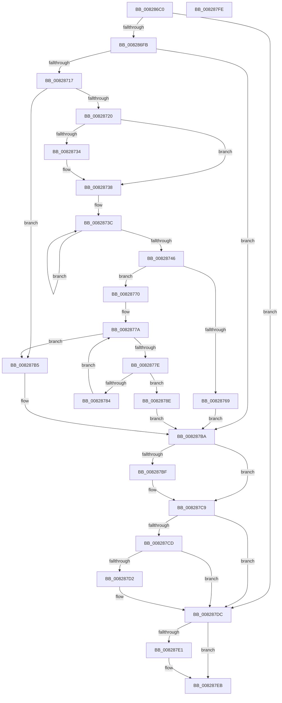

# SiGetBiosSystemPartition

- RVA: `0x008286C0`–`0x008287FF` (길이 `319` bytes)
- VA: `0x00000001408286C0`
- 실행 섹션: `PAGE`
- PDB 이름 있음: `예`; PDB Function 태그: `아니요`
- unwind 정보 RVA: `0x000BF2D4`
- 디코드: `98`개 명령, `319/319` bytes 표시
- 미해석 바이트: `0` (있으면 어셈블리에 `.byte`로 보존)

> 이 문서는 커널 이미지의 기계어와 PDB 기호를 분석해 생성했습니다. 4번과 5번은 함수 원형과 자료형을 바이너리 사용 방식에서 추정한 C 해석이며 원본 소스 복구 결과는 아닙니다.

## 1. Dependencies

- 직접 호출 지점: **8**; 고유 호출 대상: **6**
- 직접 호출자로 확인된 함수: **1**
- RIP 상대 이미지 참조: **2**

### Outgoing calls
- `0x008286E7` → [SiGetBiosSystemDisk](SiGetBiosSystemDisk_function_00828590.md) (function, `0x00828590`)
- `0x00828703` → [SiGetDriveLayoutInformation](SiGetDriveLayoutInformation_function_00827934.md) (function, `0x00827934`)
- `0x0082872A` → [wcsstr](../../text/50/wcsstr_function_00501F80.md) (function, `0x00501F80`)
- `0x0082875C` → [ExAllocatePool2](../../poolcode/B8/ExAllocatePool2_function_00B820F0.md) (function, `0x00B820F0`)
- `0x008287A8` → [swprintf_s](../../text/50/swprintf_s_function_00504B20.md) (function, `0x00504B20`)
- `0x008287C4` → [ExFreePoolWithTag](../../poolcode/B8/ExFreePoolWithTag_function_00B82870.md) (function, `0x00B82870`)
- `0x008287D7` → [ExFreePoolWithTag](../../poolcode/B8/ExFreePoolWithTag_function_00B82870.md) (function, `0x00B82870`)
- `0x008287E6` → [ExFreePoolWithTag](../../poolcode/B8/ExFreePoolWithTag_function_00B82870.md) (function, `0x00B82870`)

### Direct callers
- [sub_00B3A106](../B3/Unknown_function_00B3A106.md) at `0x00B3A118`

### Static image references
- `0x00828720` → RVA `0x00B0D120` (` ?? ::NNGAKEGL::`string'`; read)
- `0x00828791` → RVA `0x00B0D140` (` ?? ::NNGAKEGL::`string'`; read)

## 2. Other-region calls and transfers

- 다른 실행 섹션으로 향하는 call: **6**
  - `0x0082872A` → [wcsstr](../../text/50/wcsstr_function_00501F80.md) (`PAGE` → `.text`)
  - `0x0082875C` → [ExAllocatePool2](../../poolcode/B8/ExAllocatePool2_function_00B820F0.md) (`PAGE` → `POOLCODE`)
  - `0x008287A8` → [swprintf_s](../../text/50/swprintf_s_function_00504B20.md) (`PAGE` → `.text`)
  - `0x008287C4` → [ExFreePoolWithTag](../../poolcode/B8/ExFreePoolWithTag_function_00B82870.md) (`PAGE` → `POOLCODE`)
  - `0x008287D7` → [ExFreePoolWithTag](../../poolcode/B8/ExFreePoolWithTag_function_00B82870.md) (`PAGE` → `POOLCODE`)
  - `0x008287E6` → [ExFreePoolWithTag](../../poolcode/B8/ExFreePoolWithTag_function_00B82870.md) (`PAGE` → `POOLCODE`)
- 별도 외부 분기/꼬리 이동을 확인하지 못했습니다.

## 3. Assembly (complete function range)

```asm
008286C0  48 8B C4                        mov rax, rsp
008286C3  48 89 58 08                     mov qword ptr [rax + 8], rbx
008286C7  55                              push rbp
008286C8  56                              push rsi
008286C9  57                              push rdi
008286CA  41 56                           push r14
008286CC  41 57                           push r15
008286CE  48 83 EC 30                     sub rsp, 0x30
008286D2  45 33 FF                        xor r15d, r15d
008286D5  4C 8B F1                        mov r14, rcx
008286D8  48 8D 48 10                     lea rcx, [rax + 0x10]
008286DC  4C 89 78 18                     mov qword ptr [rax + 0x18], r15
008286E0  41 8B EF                        mov ebp, r15d
008286E3  4C 89 78 10                     mov qword ptr [rax + 0x10], r15
008286E7  E8 A4 FE FF FF                  call 0x140828590
008286EC  48 8B 7C 24 68                  mov rdi, qword ptr [rsp + 0x68]
008286F1  8B D8                           mov ebx, eax
008286F3  85 C0                           test eax, eax
008286F5  0F 88 E1 00 00 00               js 0x1408287dc
008286FB  48 8D 54 24 70                  lea rdx, [rsp + 0x70]
00828700  48 8B CF                        mov rcx, rdi
00828703  E8 2C F2 FF FF                  call 0x140827934
00828708  48 8B 74 24 70                  mov rsi, qword ptr [rsp + 0x70]
0082870D  8B D8                           mov ebx, eax
0082870F  85 C0                           test eax, eax
00828711  0F 88 A3 00 00 00               js 0x1408287ba
00828717  44 39 3E                        cmp dword ptr [rsi], r15d
0082871A  0F 85 95 00 00 00               jne 0x1408287b5
00828720  48 8D 15 F9 49 2E 00            lea rdx, [rip + 0x2e49f9]
00828727  48 8B CF                        mov rcx, rdi
0082872A  E8 51 98 CD FF                  call 0x140501f80
0082872F  48 85 C0                        test rax, rax
00828732  74 04                           je 0x140828738
00828734  66 44 89 38                     mov word ptr [rax], r15w
00828738  48 83 C8 FF                     or rax, 0xffffffffffffffff
0082873C  48 FF C0                        inc rax
0082873F  66 44 39 3C 47                  cmp word ptr [rdi + rax*2], r15w
00828744  75 F6                           jne 0x14082873c
00828746  8D 04 45 2A 00 00 00            lea eax, [rax*2 + 0x2a]
0082874D  41 B8 53 59 50 4B               mov r8d, 0x4b505953
00828753  8B D0                           mov edx, eax
00828755  B9 00 01 00 00                  mov ecx, 0x100
0082875A  8B D8                           mov ebx, eax
0082875C  E8 8F 99 35 00                  call 0x140b820f0
00828761  48 8B E8                        mov rbp, rax
00828764  48 85 C0                        test rax, rax
00828767  75 07                           jne 0x140828770
00828769  BB 9A 00 00 C0                  mov ebx, 0xc000009a
0082876E  EB 4A                           jmp 0x1408287ba
00828770  8B 56 04                        mov edx, dword ptr [rsi + 4]
00828773  48 8D 46 30                     lea rax, [rsi + 0x30]
00828777  41 8B CF                        mov ecx, r15d
0082877A  3B CA                           cmp ecx, edx
0082877C  73 37                           jae 0x1408287b5
0082877E  44 38 78 21                     cmp byte ptr [rax + 0x21], r15b
00828782  75 0A                           jne 0x14082878e
00828784  FF C1                           inc ecx
00828786  48 05 90 00 00 00               add rax, 0x90
0082878C  EB EC                           jmp 0x14082877a
0082878E  8B 40 18                        mov eax, dword ptr [rax + 0x18]
00828791  4C 8D 05 A8 49 2E 00            lea r8, [rip + 0x2e49a8]
00828798  48 D1 EB                        shr rbx, 1
0082879B  4C 8B CF                        mov r9, rdi
0082879E  48 8B D3                        mov rdx, rbx
008287A1  89 44 24 20                     mov dword ptr [rsp + 0x20], eax
008287A5  48 8B CD                        mov rcx, rbp
008287A8  E8 73 C3 CD FF                  call 0x140504b20
008287AD  49 89 2E                        mov qword ptr [r14], rbp
008287B0  41 8B DF                        mov ebx, r15d
008287B3  EB 05                           jmp 0x1408287ba
008287B5  BB 52 04 00 C0                  mov ebx, 0xc0000452
008287BA  48 85 F6                        test rsi, rsi
008287BD  74 0A                           je 0x1408287c9
008287BF  33 D2                           xor edx, edx
008287C1  48 8B CE                        mov rcx, rsi
008287C4  E8 A7 A0 35 00                  call 0x140b82870
008287C9  85 DB                           test ebx, ebx
008287CB  79 0F                           jns 0x1408287dc
008287CD  48 85 ED                        test rbp, rbp
008287D0  74 0A                           je 0x1408287dc
008287D2  33 D2                           xor edx, edx
008287D4  48 8B CD                        mov rcx, rbp
008287D7  E8 94 A0 35 00                  call 0x140b82870
008287DC  48 85 FF                        test rdi, rdi
008287DF  74 0A                           je 0x1408287eb
008287E1  33 D2                           xor edx, edx
008287E3  48 8B CF                        mov rcx, rdi
008287E6  E8 85 A0 35 00                  call 0x140b82870
008287EB  8B C3                           mov eax, ebx
008287ED  48 8B 5C 24 60                  mov rbx, qword ptr [rsp + 0x60]
008287F2  48 83 C4 30                     add rsp, 0x30
008287F6  41 5F                           pop r15
008287F8  41 5E                           pop r14
008287FA  5F                              pop rdi
008287FB  5E                              pop rsi
008287FC  5D                              pop rbp
008287FD  C3                              ret
008287FE  CC                              int3
```

## 4. C-style interpretation (structured pseudocode)

```c
__int64 __fastcall SiGetBiosSystemPartition(__int64 a1)
{
    __int64 result;
    __int64 v_r15;
    __int64 v_rbx;
    __int64 v_rsp;
    unsigned int v_stack_m38;
    unsigned __int64 v_stack_p10;
    unsigned __int64 v_stack_p18;
    unsigned __int64 v_stack_p8;

    *(unsigned __int64 *)(v_rsp + 8) = v_rbx;
    v_rsp = (v_rsp) - (48);
    v_r15 = 0;
    *(unsigned __int64 *)(v_rsp + 24) = 0;
    *(unsigned __int64 *)(v_rsp + 16) = 0;
    result = SiGetBiosSystemDisk(v_rsp + 16, a2, a3, a4);
    if (sign_flag) goto loc_008287DC;
    result = SiGetDriveLayoutInformation(v_stack_p10, v_stack_p18, a3, a4);
    if (sign_flag) goto loc_008287BA;
    if ((*(unsigned int *)(v_stack_p18)) != 0) goto loc_008287B5;
    result = wcsstr(v_stack_p10, v_rip + 3033593, a3, a4);
    if (result != 0) {
        *(unsigned __int16 *)(result) = 0;
    }
    result = (result) | (-1);
loc_0082873C:
    result = (result) + 1;
    if ((*(unsigned __int16 *)(v_stack_p10 + result * 2)) != 0) goto loc_0082873C;
    result = ExAllocatePool2(256, (unsigned int)((unsigned int)(result * 2 + 42)), (unsigned int)(0x4B505953ULL), a4);
    if (result != 0) goto loc_00828770;
    goto loc_008287BA;
loc_00828770:
loc_0082877A:
    if (0 >= ((unsigned int)((unsigned int)(*(unsigned int *)(v_stack_p18 + 4))))) goto loc_008287B5;
    if ((*(unsigned __int8 *)(v_stack_p18 + 48 + 33)) != 0) goto loc_0082878E;
    a1 = (unsigned int)((0) + 1);
    result = (v_stack_p18 + 48) + (144);
    goto loc_0082877A;
loc_0082878E:
    v_rbx = ((unsigned int)(0xC000009AULL)) >> (1);
    v_stack_m38 = (unsigned int)((unsigned int)(*(unsigned int *)(result + 24)));
    result = swprintf_s(result, v_rbx, v_rip + 3033512, v_stack_p10);
    *(unsigned __int64 *)(a1) = result;
    goto loc_008287BA;
loc_008287B5:
loc_008287BA:
    if (v_stack_p18 != 0) {
        a2 = 0;
        a1 = v_stack_p18;
        result = ExFreePoolWithTag(a1, a2, v_rip + 3033512, v_stack_p10);
    }
    if (!sign_flag) goto loc_008287DC;
    if (result != 0) {
        a2 = 0;
        a1 = result;
        result = ExFreePoolWithTag(a1, a2, v_rip + 3033512, v_stack_p10);
    }
    if (v_stack_p10 != 0) {
        a2 = 0;
        a1 = v_stack_p10;
        result = ExFreePoolWithTag(a1, a2, v_rip + 3033512, v_stack_p10);
    }
    v_rsp = (v_rsp) + (48);
    return (unsigned int)((unsigned int)((unsigned int)(0xC0000452ULL)));
}
```

## 5. (Beta) C Style

```c
int64_t SiGetBiosSystemPartition(void *Arg1)
{
    uint8_t *arg1 = (uint8_t *)Arg1;

    int64_t result;
    int64_t local_r15;
    int64_t local_rbx;
    int64_t local_rsp;
    uint32_t v_stack_m38;
    uint64_t v_stack_p10;
    uint64_t v_stack_p18;
    uint64_t v_stack_p8;

    *(uint64_t *)(local_rsp + 0x8) = local_rbx;
    local_rsp = (local_rsp) - (48);
    local_r15 = 0;
    *(uint64_t *)(local_rsp + 0x18) = 0;
    *(uint64_t *)(local_rsp + 0x10) = 0;
    result = SiGetBiosSystemDisk(local_rsp + 16, a2, a3, a4);
    if (sign_flag) goto loc_008287DC;
    result = SiGetDriveLayoutInformation(v_stack_p10, v_stack_p18, a3, a4);
    if (sign_flag) goto loc_008287BA;
    if ((*(uint32_t *)(v_stack_p18)) != 0) goto loc_008287B5;
    result = wcsstr(v_stack_p10, v_rip + 3033593, a3, a4);
    if (result != 0) {
        *(uint16_t *)(result) = 0;
    }
    result = (result) | (-1);
loc_0082873C:
    result = (result) + 1;
    if ((*(uint16_t *)(v_stack_p10 + result * 2)) != 0) goto loc_0082873C;
    result = ExAllocatePool2(256, (uint32_t)((uint32_t)(result * 2 + 42)), (uint32_t)(0x4B505953ULL), a4);
    if (result != 0) goto loc_00828770;
    goto loc_008287BA;
loc_00828770:
loc_0082877A:
    if (0 >= ((uint32_t)((uint32_t)(*(uint32_t *)(v_stack_p18 + 0x4))))) goto loc_008287B5;
    if ((*(uint8_t *)(v_stack_p18 + 0x30 + 0x21)) != 0) goto loc_0082878E;
    Arg1 = (uint32_t)((0) + 1);
    result = (v_stack_p18 + 48) + (144);
    goto loc_0082877A;
loc_0082878E:
    local_rbx = ((uint32_t)(0xC000009AULL)) >> (1);
    v_stack_m38 = (uint32_t)((uint32_t)(*(uint32_t *)(result + 0x18)));
    result = swprintf_s(result, local_rbx, v_rip + 3033512, v_stack_p10);
    *(uint64_t *)(arg1) = result;
    goto loc_008287BA;
loc_008287B5:
loc_008287BA:
    if (v_stack_p18 != 0) {
        a2 = 0;
        Arg1 = v_stack_p18;
        result = ExFreePoolWithTag(Arg1, a2, v_rip + 3033512, v_stack_p10);
    }
    if (!sign_flag) goto loc_008287DC;
    if (result != 0) {
        a2 = 0;
        Arg1 = result;
        result = ExFreePoolWithTag(Arg1, a2, v_rip + 3033512, v_stack_p10);
    }
    if (v_stack_p10 != 0) {
        a2 = 0;
        Arg1 = v_stack_p10;
        result = ExFreePoolWithTag(Arg1, a2, v_rip + 3033512, v_stack_p10);
    }
    local_rsp = (local_rsp) + (48);
    return (uint32_t)((uint32_t)((uint32_t)(0xC0000452ULL)));
}
```

### 관측된 메모리 오프셋

구조체 형식이 확인되지 않은 접근은 인자 기준의 오프셋으로만 기록했습니다.

| 기준 인자 | 오프셋 표현 | 폭 (bit) | 접근 |
|---|---:|---:|---|
| `Arg1` | `+ 0x0` | `64` | `W` |

## 6. Execution-region graph

[열기: 2D/3D 그래프와 함수 탐색 컨트롤 패널](../../../control-panel.html?section=page&rva=0x008286C0&view=graph)

- 2D 그래프는 위에서 아래로 흐르고, 3D 그래프는 빈 공간을 드래그해 회전합니다. Shift+드래그는 이동, 휠은 확대·축소, 함수 노드 선택은 대상 보고서 이동입니다.

### Static fallback


