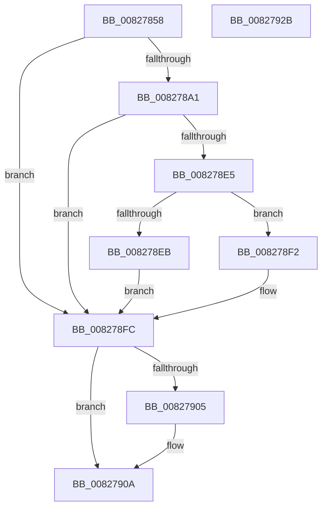

# SiGetDeviceNumberInformation

- RVA: `0x00827858`–`0x0082792C` (길이 `212` bytes)
- VA: `0x0000000140827858`
- 실행 섹션: `PAGE`
- PDB 이름 있음: `예`; PDB Function 태그: `아니요`
- unwind 정보 RVA: `0x000DA6C4`
- 디코드: `61`개 명령, `212/212` bytes 표시
- 미해석 바이트: `0` (있으면 어셈블리에 `.byte`로 보존)

> 이 문서는 커널 이미지의 기계어와 PDB 기호를 분석해 생성했습니다. 4번과 5번은 함수 원형과 자료형을 바이너리 사용 방식에서 추정한 C 해석이며 원본 소스 복구 결과는 아닙니다.

## 1. Dependencies

- 직접 호출 지점: **4**; 고유 호출 대상: **4**
- 직접 호출자로 확인된 함수: **2**
- RIP 상대 이미지 참조: **1**

### Outgoing calls
- `0x00827896` → [SiOpenDevice](../A6/SiOpenDevice_function_00A68B48.md) (function, `0x00A68B48`)
- `0x008278DA` → [ZwDeviceIoControlFile](../../text/6A/ZwDeviceIoControlFile_function_006AD1B0.md) (function, `0x006AD1B0`)
- `0x00827905` → [ZwClose](../../text/6A/ZwClose_function_006AD2B0.md) (function, `0x006AD2B0`)
- `0x00827913` → [_security_check_cookie](../../text/6A/_security_check_cookie_function_006AC640.md) (function, `0x006AC640`)

### Direct callers
- [SiDisambiguateSystemDevice](SiDisambiguateSystemDevice_function_00827B9C.md) at `0x00827C07`
- [SiGetEspFromFirmware](SiGetEspFromFirmware_function_008280C0.md) at `0x008283A8`

### Static image references
- `0x0082786A` → RVA `0x00E0A740` (`.data`; read)

## 2. Other-region calls and transfers

- 다른 실행 섹션으로 향하는 call: **3**
  - `0x008278DA` → [ZwDeviceIoControlFile](../../text/6A/ZwDeviceIoControlFile_function_006AD1B0.md) (`PAGE` → `.text`)
  - `0x00827905` → [ZwClose](../../text/6A/ZwClose_function_006AD2B0.md) (`PAGE` → `.text`)
  - `0x00827913` → [_security_check_cookie](../../text/6A/_security_check_cookie_function_006AC640.md) (`PAGE` → `.text`)
- 별도 외부 분기/꼬리 이동을 확인하지 못했습니다.

## 3. Assembly (complete function range)

```asm
00827858  48 89 5C 24 20                  mov qword ptr [rsp + 0x20], rbx
0082785D  55                              push rbp
0082785E  56                              push rsi
0082785F  57                              push rdi
00827860  48 8B EC                        mov rbp, rsp
00827863  48 81 EC 80 00 00 00            sub rsp, 0x80
0082786A  48 8B 05 CF 2E 5E 00            mov rax, qword ptr [rip + 0x5e2ecf]
00827871  48 33 C4                        xor rax, rsp
00827874  48 89 45 F8                     mov qword ptr [rbp - 8], rax
00827878  33 C0                           xor eax, eax
0082787A  48 8B FA                        mov rdi, rdx
0082787D  48 21 45 D0                     and qword ptr [rbp - 0x30], rax
00827881  48 8D 55 D0                     lea rdx, [rbp - 0x30]
00827885  0F 57 C0                        xorps xmm0, xmm0
00827888  48 89 45 E8                     mov qword ptr [rbp - 0x18], rax
0082788C  0F 11 45 D8                     movups xmmword ptr [rbp - 0x28], xmm0
00827890  89 45 F0                        mov dword ptr [rbp - 0x10], eax
00827893  49 8B F0                        mov rsi, r8
00827896  E8 AD 12 24 00                  call 0x140a68b48
0082789B  8B D8                           mov ebx, eax
0082789D  85 C0                           test eax, eax
0082789F  78 5B                           js 0x1408278fc
008278A1  48 8B 4D D0                     mov rcx, qword ptr [rbp - 0x30]
008278A5  48 8D 45 E8                     lea rax, [rbp - 0x18]
008278A9  C7 44 24 48 0C 00 00 00         mov dword ptr [rsp + 0x48], 0xc
008278B1  45 33 C9                        xor r9d, r9d
008278B4  48 89 44 24 40                  mov qword ptr [rsp + 0x40], rax
008278B9  45 33 C0                        xor r8d, r8d
008278BC  83 64 24 38 00                  and dword ptr [rsp + 0x38], 0
008278C1  48 8D 45 D8                     lea rax, [rbp - 0x28]
008278C5  48 83 64 24 30 00               and qword ptr [rsp + 0x30], 0
008278CB  33 D2                           xor edx, edx
008278CD  C7 44 24 28 80 10 2D 00         mov dword ptr [rsp + 0x28], 0x2d1080
008278D5  48 89 44 24 20                  mov qword ptr [rsp + 0x20], rax
008278DA  E8 D1 58 E8 FF                  call 0x1406ad1b0
008278DF  8B D8                           mov ebx, eax
008278E1  85 C0                           test eax, eax
008278E3  78 17                           js 0x1408278fc
008278E5  83 7D E8 07                     cmp dword ptr [rbp - 0x18], 7
008278E9  74 07                           je 0x1408278f2
008278EB  BB BB 00 00 C0                  mov ebx, 0xc00000bb
008278F0  EB 0A                           jmp 0x1408278fc
008278F2  8B 45 EC                        mov eax, dword ptr [rbp - 0x14]
008278F5  89 07                           mov dword ptr [rdi], eax
008278F7  8B 45 F0                        mov eax, dword ptr [rbp - 0x10]
008278FA  89 06                           mov dword ptr [rsi], eax
008278FC  48 8B 4D D0                     mov rcx, qword ptr [rbp - 0x30]
00827900  48 85 C9                        test rcx, rcx
00827903  74 05                           je 0x14082790a
00827905  E8 A6 59 E8 FF                  call 0x1406ad2b0
0082790A  8B C3                           mov eax, ebx
0082790C  48 8B 4D F8                     mov rcx, qword ptr [rbp - 8]
00827910  48 33 CC                        xor rcx, rsp
00827913  E8 28 4D E8 FF                  call 0x1406ac640
00827918  48 8B 9C 24 B8 00 00 00         mov rbx, qword ptr [rsp + 0xb8]
00827920  48 81 C4 80 00 00 00            add rsp, 0x80
00827927  5F                              pop rdi
00827928  5E                              pop rsi
00827929  5D                              pop rbp
0082792A  C3                              ret
0082792B  CC                              int3
```

## 4. C-style interpretation (structured pseudocode)

```c
__int64 __fastcall SiGetDeviceNumberInformation(__int64 a1, __int64 a2, __int64 a3, int a4)
{
    __int64 result;
    __int64 v_rsp;
    unsigned __int64 v_stack_m20;
    unsigned int v_stack_m28;
    unsigned int v_stack_m2C;
    unsigned __int64 v_stack_m30;
    unsigned __int64 v_stack_m40;
    unsigned __int64 v_stack_m48;
    unsigned int v_stack_m50;
    unsigned __int64 v_stack_m58;
    unsigned int v_stack_m60;
    unsigned __int64 v_stack_m68;
    unsigned int v_stack_m70;
    unsigned __int64 v_stack_m78;
    unsigned __int64 v_stack_p20;

    v_stack_p20 = v_rbx;
    v_rsp = (v_rsp) - (128);
    result = (*(unsigned __int64 *)(v_rip + 6172367)) ^ (v_rsp);
    v_stack_m20 = result;
    result = 0;
    v_stack_m30 = 0;
    v_stack_m40 = v_xmm0;
    v_stack_m28 = 0;
    result = SiOpenDevice(a1, v_stack_m48, a3, a4);
    if (sign_flag) goto loc_008278FC;
    v_stack_m50 = 12;
    a4 = 0;
    v_stack_m58 = v_stack_m30;
    a3 = 0;
    a2 = 0;
    v_stack_m70 = 0x2D1080ULL;
    v_stack_m78 = v_stack_m40;
    result = ZwDeviceIoControlFile(v_stack_m48, a2, a3, a4);
    if (sign_flag) goto loc_008278FC;
    if (v_stack_m30 == 7) goto loc_008278F2;
    goto loc_008278FC;
loc_008278F2:
    *(unsigned int *)(a2) = (unsigned int)((unsigned int)(v_stack_m2C));
    *(unsigned int *)(a3) = (unsigned int)((unsigned int)(v_stack_m28));
loc_008278FC:
    result = (unsigned int)(v_stack_m28);
    if (v_stack_m48 != 0) {
        result = ZwClose(v_stack_m48, a2, a3, a4);
    }
    a1 = (v_stack_m20) ^ (v_rsp);
    result = _security_check_cookie(a1, a2, a3, a4);
    v_rsp = (v_rsp) + (128);
    return result;
}
```

## 5. (Beta) C Style

```c
int64_t SiGetDeviceNumberInformation(int64_t Arg1, void *Arg2, void *Arg3, int32_t Arg4)
{
    uint8_t *arg2 = (uint8_t *)Arg2;
    uint8_t *arg3 = (uint8_t *)Arg3;

    int64_t result;
    int64_t local_rsp;
    uint64_t v_stack_m20;
    uint32_t v_stack_m28;
    uint32_t v_stack_m2C;
    uint64_t v_stack_m30;
    uint64_t v_stack_m40;
    uint64_t v_stack_m48;
    uint32_t v_stack_m50;
    uint64_t v_stack_m58;
    uint32_t v_stack_m60;
    uint64_t v_stack_m68;
    uint32_t v_stack_m70;
    uint64_t v_stack_m78;
    uint64_t v_stack_p20;

    v_stack_p20 = local_rbx;
    local_rsp = (local_rsp) - (128);
    result = (*(uint64_t *)(v_rip + 0x5E2ECF)) ^ (local_rsp);
    v_stack_m20 = result;
    result = 0;
    v_stack_m30 = 0;
    v_stack_m40 = v_xmm0;
    v_stack_m28 = 0;
    result = SiOpenDevice(Arg1, v_stack_m48, Arg3, Arg4);
    if (sign_flag) goto loc_008278FC;
    v_stack_m50 = 12;
    Arg4 = 0;
    v_stack_m58 = v_stack_m30;
    Arg3 = 0;
    Arg2 = 0;
    v_stack_m70 = 0x2D1080ULL;
    v_stack_m78 = v_stack_m40;
    result = ZwDeviceIoControlFile(v_stack_m48, Arg2, Arg3, Arg4);
    if (sign_flag) goto loc_008278FC;
    if (v_stack_m30 == 7) goto loc_008278F2;
    goto loc_008278FC;
loc_008278F2:
    *(uint32_t *)(arg2) = (uint32_t)((uint32_t)(v_stack_m2C));
    *(uint32_t *)(arg3) = (uint32_t)((uint32_t)(v_stack_m28));
loc_008278FC:
    result = (uint32_t)(v_stack_m28);
    if (v_stack_m48 != 0) {
        result = ZwClose(v_stack_m48, Arg2, Arg3, Arg4);
    }
    Arg1 = (v_stack_m20) ^ (local_rsp);
    result = _security_check_cookie(Arg1, Arg2, Arg3, Arg4);
    local_rsp = (local_rsp) + (128);
    return result;
}
```

### 관측된 메모리 오프셋

구조체 형식이 확인되지 않은 접근은 인자 기준의 오프셋으로만 기록했습니다.

| 기준 인자 | 오프셋 표현 | 폭 (bit) | 접근 |
|---|---:|---:|---|
| `Arg2` | `+ 0x0` | `32` | `W` |
| `Arg3` | `+ 0x0` | `32` | `W` |

## 6. Execution-region graph

[열기: 2D/3D 그래프와 함수 탐색 컨트롤 패널](../../../control-panel.html?section=page&rva=0x00827858&view=graph)

- 2D 그래프는 위에서 아래로 흐르고, 3D 그래프는 빈 공간을 드래그해 회전합니다. Shift+드래그는 이동, 휠은 확대·축소, 함수 노드 선택은 대상 보고서 이동입니다.

### Static fallback


