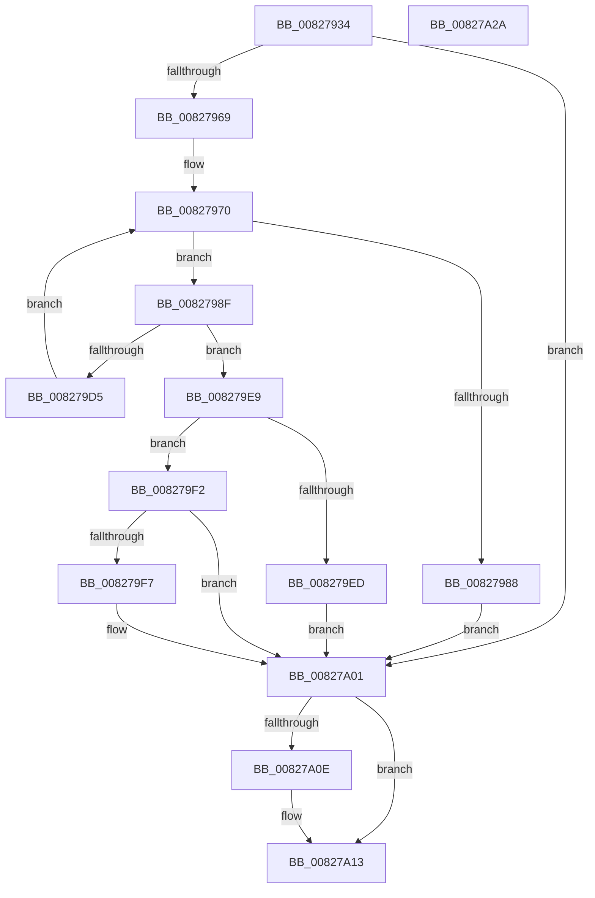

# SiGetDriveLayoutInformation

- RVA: `0x00827934`–`0x00827A2B` (길이 `247` bytes)
- VA: `0x0000000140827934`
- 실행 섹션: `PAGE`
- PDB 이름 있음: `예`; PDB Function 태그: `아니요`
- unwind 정보 RVA: `0x000D0810`
- 디코드: `71`개 명령, `247/247` bytes 표시
- 미해석 바이트: `0` (있으면 어셈블리에 `.byte`로 보존)

> 이 문서는 커널 이미지의 기계어와 PDB 기호를 분석해 생성했습니다. 4번과 5번은 함수 원형과 자료형을 바이너리 사용 방식에서 추정한 C 해석이며 원본 소스 복구 결과는 아닙니다.

## 1. Dependencies

- 직접 호출 지점: **6**; 고유 호출 대상: **5**
- 직접 호출자로 확인된 함수: **3**
- RIP 상대 이미지 참조: **0**

### Outgoing calls
- `0x0082795A` → [SiOpenDevice](../A6/SiOpenDevice_function_00A68B48.md) (function, `0x00A68B48`)
- `0x0082797B` → [ExAllocatePool2](../../poolcode/B8/ExAllocatePool2_function_00B820F0.md) (function, `0x00B820F0`)
- `0x008279C5` → [ZwDeviceIoControlFile](../../text/6A/ZwDeviceIoControlFile_function_006AD1B0.md) (function, `0x006AD1B0`)
- `0x008279DA` → [ExFreePoolWithTag](../../poolcode/B8/ExFreePoolWithTag_function_00B82870.md) (function, `0x00B82870`)
- `0x008279FC` → [ExFreePoolWithTag](../../poolcode/B8/ExFreePoolWithTag_function_00B82870.md) (function, `0x00B82870`)
- `0x00827A0E` → [ZwClose](../../text/6A/ZwClose_function_006AD2B0.md) (function, `0x006AD2B0`)

### Direct callers
- [SiFindSystemPartition](SiFindSystemPartition_function_00827754.md) at `0x0082779D`
- [SiGetEfiSystemDevice](SiGetEfiSystemDevice_function_00827C68.md) at `0x00827F20`
- [SiGetBiosSystemPartition](SiGetBiosSystemPartition_function_008286C0.md) at `0x00828703`

### Static image references
- 디코드된 RIP-relative 메모리 참조가 없습니다.

## 2. Other-region calls and transfers

- 다른 실행 섹션으로 향하는 call: **5**
  - `0x0082797B` → [ExAllocatePool2](../../poolcode/B8/ExAllocatePool2_function_00B820F0.md) (`PAGE` → `POOLCODE`)
  - `0x008279C5` → [ZwDeviceIoControlFile](../../text/6A/ZwDeviceIoControlFile_function_006AD1B0.md) (`PAGE` → `.text`)
  - `0x008279DA` → [ExFreePoolWithTag](../../poolcode/B8/ExFreePoolWithTag_function_00B82870.md) (`PAGE` → `POOLCODE`)
  - `0x008279FC` → [ExFreePoolWithTag](../../poolcode/B8/ExFreePoolWithTag_function_00B82870.md) (`PAGE` → `POOLCODE`)
  - `0x00827A0E` → [ZwClose](../../text/6A/ZwClose_function_006AD2B0.md) (`PAGE` → `.text`)
- 별도 외부 분기/꼬리 이동을 확인하지 못했습니다.

## 3. Assembly (complete function range)

```asm
00827934  48 8B C4                        mov rax, rsp
00827937  48 89 58 08                     mov qword ptr [rax + 8], rbx
0082793B  48 89 68 10                     mov qword ptr [rax + 0x10], rbp
0082793F  56                              push rsi
00827940  57                              push rdi
00827941  41 56                           push r14
00827943  48 83 EC 60                     sub rsp, 0x60
00827947  48 83 60 18 00                  and qword ptr [rax + 0x18], 0
0082794C  4C 8B F2                        mov r14, rdx
0082794F  0F 57 C0                        xorps xmm0, xmm0
00827952  48 8D 50 18                     lea rdx, [rax + 0x18]
00827956  0F 11 40 D8                     movups xmmword ptr [rax - 0x28], xmm0
0082795A  E8 E9 11 24 00                  call 0x140a68b48
0082795F  8B D8                           mov ebx, eax
00827961  85 C0                           test eax, eax
00827963  0F 88 98 00 00 00               js 0x140827a01
00827969  BE 30 48 00 00                  mov esi, 0x4830
0082796E  8B D6                           mov edx, esi
00827970  B9 00 01 00 00                  mov ecx, 0x100
00827975  41 B8 53 59 50 4B               mov r8d, 0x4b505953
0082797B  E8 70 A7 35 00                  call 0x140b820f0
00827980  48 8B F8                        mov rdi, rax
00827983  48 85 C0                        test rax, rax
00827986  75 07                           jne 0x14082798f
00827988  BB 9A 00 00 C0                  mov ebx, 0xc000009a
0082798D  EB 72                           jmp 0x140827a01
0082798F  48 8B 8C 24 90 00 00 00         mov rcx, qword ptr [rsp + 0x90]
00827997  48 8D 44 24 50                  lea rax, [rsp + 0x50]
0082799C  89 74 24 48                     mov dword ptr [rsp + 0x48], esi
008279A0  45 33 C9                        xor r9d, r9d
008279A3  48 89 7C 24 40                  mov qword ptr [rsp + 0x40], rdi
008279A8  45 33 C0                        xor r8d, r8d
008279AB  83 64 24 38 00                  and dword ptr [rsp + 0x38], 0
008279B0  33 D2                           xor edx, edx
008279B2  48 83 64 24 30 00               and qword ptr [rsp + 0x30], 0
008279B8  C7 44 24 28 50 00 07 00         mov dword ptr [rsp + 0x28], 0x70050
008279C0  48 89 44 24 20                  mov qword ptr [rsp + 0x20], rax
008279C5  E8 E6 57 E8 FF                  call 0x1406ad1b0
008279CA  8B D8                           mov ebx, eax
008279CC  8B E8                           mov ebp, eax
008279CE  3D 23 00 00 C0                  cmp eax, 0xc0000023
008279D3  75 14                           jne 0x1408279e9
008279D5  33 D2                           xor edx, edx
008279D7  48 8B CF                        mov rcx, rdi
008279DA  E8 91 AE 35 00                  call 0x140b82870
008279DF  81 C6 00 24 00 00               add esi, 0x2400
008279E5  8B D6                           mov edx, esi
008279E7  EB 87                           jmp 0x140827970
008279E9  85 C0                           test eax, eax
008279EB  78 05                           js 0x1408279f2
008279ED  49 89 3E                        mov qword ptr [r14], rdi
008279F0  EB 0F                           jmp 0x140827a01
008279F2  48 85 FF                        test rdi, rdi
008279F5  74 0A                           je 0x140827a01
008279F7  33 D2                           xor edx, edx
008279F9  48 8B CF                        mov rcx, rdi
008279FC  E8 6F AE 35 00                  call 0x140b82870
00827A01  48 8B 8C 24 90 00 00 00         mov rcx, qword ptr [rsp + 0x90]
00827A09  48 85 C9                        test rcx, rcx
00827A0C  74 05                           je 0x140827a13
00827A0E  E8 9D 58 E8 FF                  call 0x1406ad2b0
00827A13  4C 8D 5C 24 60                  lea r11, [rsp + 0x60]
00827A18  8B C3                           mov eax, ebx
00827A1A  49 8B 5B 20                     mov rbx, qword ptr [r11 + 0x20]
00827A1E  49 8B 6B 28                     mov rbp, qword ptr [r11 + 0x28]
00827A22  49 8B E3                        mov rsp, r11
00827A25  41 5E                           pop r14
00827A27  5F                              pop rdi
00827A28  5E                              pop rsi
00827A29  C3                              ret
00827A2A  CC                              int3
```

## 4. C-style interpretation (structured pseudocode)

```c
__int64 __fastcall SiGetDriveLayoutInformation(__int64 a1, __int64 a2, __int64 a3, int a4)
{
    __int64 result;
    __int64 v_rsi;
    __int64 v_rsp;
    unsigned __int64 v_stack_m18;
    unsigned __int64 v_stack_m28;
    unsigned int v_stack_m30;
    unsigned __int64 v_stack_m38;
    unsigned int v_stack_m40;
    unsigned __int64 v_stack_m48;
    unsigned int v_stack_m50;
    unsigned __int64 v_stack_m58;
    unsigned __int64 v_stack_p18;

    *(unsigned __int64 *)(v_rsp + 8) = v_rbx;
    *(unsigned __int64 *)(v_rsp + 16) = v_rbp;
    v_rsp = (v_rsp) - (96);
    *(unsigned __int64 *)(v_rsp - 40) = v_xmm0;
    result = SiOpenDevice(a1, v_rsp + 24, a3, a4);
    if (sign_flag) goto loc_00827A01;
loc_00827970:
    result = ExAllocatePool2(256, (unsigned int)((unsigned int)((unsigned int)(0x4830ULL))), (unsigned int)(0x4B505953ULL), a4);
    if (result != 0) goto loc_0082798F;
    goto loc_00827A01;
loc_0082798F:
    v_stack_m30 = (unsigned int)((unsigned int)(0x4830ULL));
    a4 = 0;
    v_stack_m38 = result;
    a3 = 0;
    a2 = 0;
    v_stack_m50 = 0x70050ULL;
    v_stack_m58 = v_stack_m28;
    result = ZwDeviceIoControlFile(v_stack_p18, a2, a3, a4);
    if (((unsigned int)(result)) != 0xC0000023ULL) goto loc_008279E9;
    a2 = 0;
    result = ExFreePoolWithTag(result, a2, a3, a4);
    v_rsi = (unsigned int)(((unsigned int)(0x4830ULL)) + (0x2400ULL));
    goto loc_00827970;
loc_008279E9:
    if (sign_flag) goto loc_008279F2;
    *(unsigned __int64 *)(a2) = result;
    goto loc_00827A01;
loc_008279F2:
    if (result != 0) {
        a2 = 0;
        a1 = result;
        result = ExFreePoolWithTag(a1, a2, a3, a4);
    }
    if (v_stack_p18 != 0) {
        result = ZwClose(v_stack_p18, a2, a3, a4);
    }
    return (unsigned int)((unsigned int)((unsigned int)((unsigned int)(result))));
}
```

## 5. (Beta) C Style

```c
int64_t SiGetDriveLayoutInformation(int64_t Arg1, void *Arg2, int64_t Arg3, int32_t Arg4)
{
    uint8_t *arg2 = (uint8_t *)Arg2;

    int64_t result;
    int64_t local_rsi;
    int64_t local_rsp;
    uint64_t v_stack_m18;
    uint64_t v_stack_m28;
    uint32_t v_stack_m30;
    uint64_t v_stack_m38;
    uint32_t v_stack_m40;
    uint64_t v_stack_m48;
    uint32_t v_stack_m50;
    uint64_t v_stack_m58;
    uint64_t v_stack_p18;

    *(uint64_t *)(local_rsp + 0x8) = local_rbx;
    *(uint64_t *)(local_rsp + 0x10) = local_rbp;
    local_rsp = (local_rsp) - (96);
    *(uint64_t *)(local_rsp - 0x28) = v_xmm0;
    result = SiOpenDevice(Arg1, local_rsp + 24, Arg3, Arg4);
    if (sign_flag) goto loc_00827A01;
loc_00827970:
    result = ExAllocatePool2(256, (uint32_t)((uint32_t)((uint32_t)(0x4830ULL))), (uint32_t)(0x4B505953ULL), Arg4);
    if (result != 0) goto loc_0082798F;
    goto loc_00827A01;
loc_0082798F:
    v_stack_m30 = (uint32_t)((uint32_t)(0x4830ULL));
    Arg4 = 0;
    v_stack_m38 = result;
    Arg3 = 0;
    Arg2 = 0;
    v_stack_m50 = 0x70050ULL;
    v_stack_m58 = v_stack_m28;
    result = ZwDeviceIoControlFile(v_stack_p18, Arg2, Arg3, Arg4);
    if (((uint32_t)(result)) != 0xC0000023ULL) goto loc_008279E9;
    Arg2 = 0;
    result = ExFreePoolWithTag(result, Arg2, Arg3, Arg4);
    local_rsi = (uint32_t)(((uint32_t)(0x4830ULL)) + (0x2400ULL));
    goto loc_00827970;
loc_008279E9:
    if (sign_flag) goto loc_008279F2;
    *(uint64_t *)(arg2) = result;
    goto loc_00827A01;
loc_008279F2:
    if (result != 0) {
        Arg2 = 0;
        Arg1 = result;
        result = ExFreePoolWithTag(Arg1, Arg2, Arg3, Arg4);
    }
    if (v_stack_p18 != 0) {
        result = ZwClose(v_stack_p18, Arg2, Arg3, Arg4);
    }
    return (uint32_t)((uint32_t)((uint32_t)((uint32_t)(result))));
}
```

### 관측된 메모리 오프셋

구조체 형식이 확인되지 않은 접근은 인자 기준의 오프셋으로만 기록했습니다.

| 기준 인자 | 오프셋 표현 | 폭 (bit) | 접근 |
|---|---:|---:|---|
| `Arg2` | `+ 0x0` | `64` | `W` |

## 6. Execution-region graph

[열기: 2D/3D 그래프와 함수 탐색 컨트롤 패널](../../../control-panel.html?section=page&rva=0x00827934&view=graph)

- 2D 그래프는 위에서 아래로 흐르고, 3D 그래프는 빈 공간을 드래그해 회전합니다. Shift+드래그는 이동, 휠은 확대·축소, 함수 노드 선택은 대상 보고서 이동입니다.

### Static fallback


