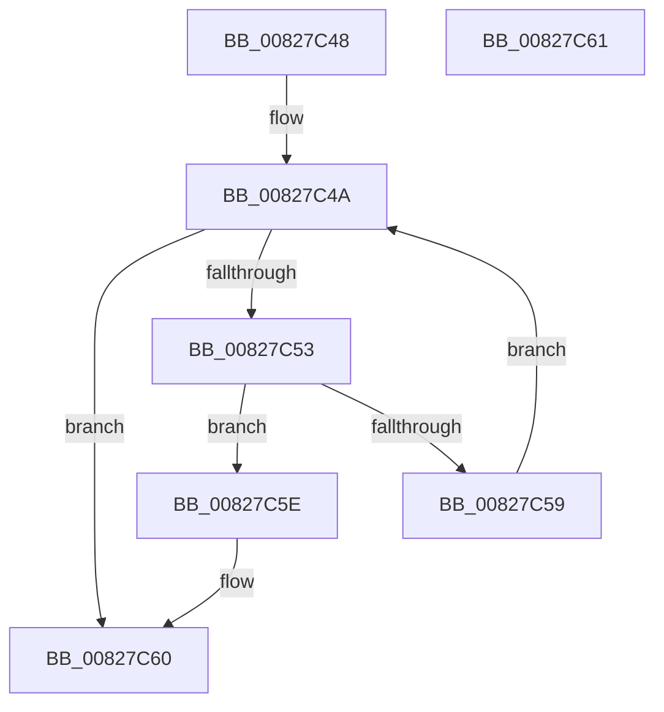

# SiGetEfiBootEntryById

- RVA: `0x00827C48`–`0x00827C62` (길이 `26` bytes)
- VA: `0x0000000140827C48`
- 실행 섹션: `PAGE`
- PDB 이름 있음: `예`; PDB Function 태그: `아니요`
- unwind 정보 RVA: `0x000DB714`
- 디코드: `12`개 명령, `26/26` bytes 표시
- 미해석 바이트: `0` (있으면 어셈블리에 `.byte`로 보존)

> 이 문서는 커널 이미지의 기계어와 PDB 기호를 분석해 생성했습니다. 4번과 5번은 함수 원형과 자료형을 바이너리 사용 방식에서 추정한 C 해석이며 원본 소스 복구 결과는 아닙니다.

## 1. Dependencies

- 직접 호출 지점: **0**; 고유 호출 대상: **0**
- 직접 호출자로 확인된 함수: **1**
- RIP 상대 이미지 참조: **0**

### Outgoing calls
- 직접 디코드된 call 명령이 없습니다.

### Direct callers
- [SiGetEspFromFirmware](SiGetEspFromFirmware_function_008280C0.md) at `0x00828211`
- [SiGetEspFromFirmware](SiGetEspFromFirmware_function_008280C0.md) at `0x008282E6`

### Static image references
- 디코드된 RIP-relative 메모리 참조가 없습니다.

## 2. Other-region calls and transfers

- 다른 실행 섹션으로 향하는 call: **0**
- 별도 외부 분기/꼬리 이동을 확인하지 못했습니다.

## 3. Assembly (complete function range)

```asm
00827C48  66 90                           nop
00827C4A  48 8D 41 04                     lea rax, [rcx + 4]
00827C4E  39 50 08                        cmp dword ptr [rax + 8], edx
00827C51  74 0D                           je 0x140827c60
00827C53  8B 01                           mov eax, dword ptr [rcx]
00827C55  85 C0                           test eax, eax
00827C57  74 05                           je 0x140827c5e
00827C59  48 03 C8                        add rcx, rax
00827C5C  EB EC                           jmp 0x140827c4a
00827C5E  33 C0                           xor eax, eax
00827C60  C3                              ret
00827C61  CC                              int3
```

## 4. C-style interpretation (structured pseudocode)

```c
__int64 __fastcall SiGetEfiBootEntryById(__int64 a1, int a2)
{
    __int64 result;

loc_00827C4A:
    if ((*(unsigned int *)(a1 + 4 + 8)) == a2) goto loc_00827C60;
    if ((unsigned int)((unsigned int)(*(unsigned int *)(a1))) == 0) goto loc_00827C5E;
    a1 = (a1) + ((unsigned int)(*(unsigned int *)(a1)));
    goto loc_00827C4A;
loc_00827C5E:
    result = 0;
loc_00827C60:
    return result;
}
```

## 5. (Beta) C Style

```c
int64_t SiGetEfiBootEntryById(void *Arg1, int32_t Arg2)
{
    uint8_t *arg1 = (uint8_t *)Arg1;

    int64_t result;

loc_00827C4A:
    if ((*(uint32_t *)(arg1 + 0x4 + 0x8)) == Arg2) goto loc_00827C60;
    if ((uint32_t)((uint32_t)(*(uint32_t *)(arg1))) == 0) goto loc_00827C5E;
    Arg1 = (Arg1) + ((uint32_t)(*(uint32_t *)(arg1)));
    goto loc_00827C4A;
loc_00827C5E:
    result = 0;
loc_00827C60:
    return result;
}
```

### 관측된 메모리 오프셋

구조체 형식이 확인되지 않은 접근은 인자 기준의 오프셋으로만 기록했습니다.

| 기준 인자 | 오프셋 표현 | 폭 (bit) | 접근 |
|---|---:|---:|---|
| `Arg1` | `+ 0x0` | `32` | `R` |
| `Arg1` | `+ 0x4` | `64` | `R` |
| `Arg1` | `+ 0x8` | `32` | `R` |

## 6. Execution-region graph

[열기: 2D/3D 그래프와 함수 탐색 컨트롤 패널](../../../control-panel.html?section=page&rva=0x00827C48&view=graph)

- 2D 그래프는 위에서 아래로 흐르고, 3D 그래프는 빈 공간을 드래그해 회전합니다. Shift+드래그는 이동, 휠은 확대·축소, 함수 노드 선택은 대상 보고서 이동입니다.

### Static fallback


