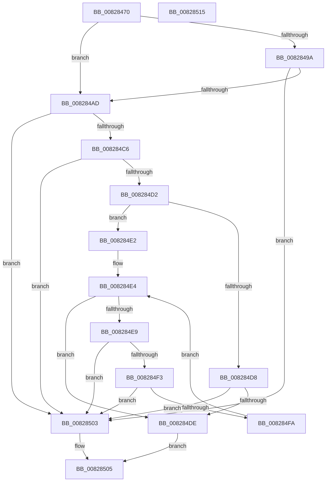

# SiIsValidDiskDevice

- RVA: `0x00828470`–`0x00828516` (길이 `166` bytes)
- VA: `0x0000000140828470`
- 실행 섹션: `PAGE`
- PDB 이름 있음: `예`; PDB Function 태그: `아니요`
- unwind 정보 RVA: `0x00060BC4`
- 디코드: `52`개 명령, `166/166` bytes 표시
- 미해석 바이트: `0` (있으면 어셈블리에 `.byte`로 보존)

> 이 문서는 커널 이미지의 기계어와 PDB 기호를 분석해 생성했습니다. 4번과 5번은 함수 원형과 자료형을 바이너리 사용 방식에서 추정한 C 해석이며 원본 소스 복구 결과는 아닙니다.

## 1. Dependencies

- 직접 호출 지점: **3**; 고유 호출 대상: **2**
- 직접 호출자로 확인된 함수: **1**
- RIP 상대 이미지 참조: **3**

### Outgoing calls
- `0x0082848F` → [wcsicmp](../../text/50/wcsicmp_function_00500080.md) (function, `0x00500080`)
- `0x008284A4` → [wcsicmp](../../text/50/wcsicmp_function_00500080.md) (function, `0x00500080`)
- `0x008284BD` → [wcsnicmp](../../text/50/wcsnicmp_function_005001C0.md) (function, `0x005001C0`)

### Direct callers
- [SiGetEfiSystemDevice](SiGetEfiSystemDevice_function_00827C68.md) at `0x00827E37`

### Static image references
- `0x00828488` → RVA `0x00B0BDA0` (` ?? ::NNGAKEGL::`string'`; read)
- `0x0082849A` → RVA `0x00B06100` (` ?? ::NNGAKEGL::`string'`; read)
- `0x008284B3` → RVA `0x00B0BDC0` (` ?? ::NNGAKEGL::`string'`; read)

## 2. Other-region calls and transfers

- 다른 실행 섹션으로 향하는 call: **3**
  - `0x0082848F` → [wcsicmp](../../text/50/wcsicmp_function_00500080.md) (`PAGE` → `.text`)
  - `0x008284A4` → [wcsicmp](../../text/50/wcsicmp_function_00500080.md) (`PAGE` → `.text`)
  - `0x008284BD` → [wcsnicmp](../../text/50/wcsnicmp_function_005001C0.md) (`PAGE` → `.text`)
- 별도 외부 분기/꼬리 이동을 확인하지 못했습니다.

## 3. Assembly (complete function range)

```asm
00828470  48 89 5C 24 08                  mov qword ptr [rsp + 8], rbx
00828475  48 89 74 24 10                  mov qword ptr [rsp + 0x10], rsi
0082847A  57                              push rdi
0082847B  48 83 EC 20                     sub rsp, 0x20
0082847F  48 8B FA                        mov rdi, rdx
00828482  48 8B D9                        mov rbx, rcx
00828485  48 8B CF                        mov rcx, rdi
00828488  48 8D 15 11 39 2E 00            lea rdx, [rip + 0x2e3911]
0082848F  E8 EC 7B CD FF                  call 0x140500080
00828494  33 F6                           xor esi, esi
00828496  85 C0                           test eax, eax
00828498  74 13                           je 0x1408284ad
0082849A  48 8D 15 5F DC 2D 00            lea rdx, [rip + 0x2ddc5f]
008284A1  48 8B CF                        mov rcx, rdi
008284A4  E8 D7 7B CD FF                  call 0x140500080
008284A9  85 C0                           test eax, eax
008284AB  75 56                           jne 0x140828503
008284AD  41 B8 08 00 00 00               mov r8d, 8
008284B3  48 8D 15 06 39 2E 00            lea rdx, [rip + 0x2e3906]
008284BA  48 8B CB                        mov rcx, rbx
008284BD  E8 FE 7C CD FF                  call 0x1405001c0
008284C2  85 C0                           test eax, eax
008284C4  75 3D                           jne 0x140828503
008284C6  48 8D 4B 10                     lea rcx, [rbx + 0x10]
008284CA  0F B7 01                        movzx eax, word ptr [rcx]
008284CD  66 85 C0                        test ax, ax
008284D0  74 31                           je 0x140828503
008284D2  66 83 F8 30                     cmp ax, 0x30
008284D6  75 0A                           jne 0x1408284e2
008284D8  66 39 71 02                     cmp word ptr [rcx + 2], si
008284DC  75 25                           jne 0x140828503
008284DE  B0 01                           mov al, 1
008284E0  EB 23                           jmp 0x140828505
008284E2  8B D6                           mov edx, esi
008284E4  66 85 C0                        test ax, ax
008284E7  74 F5                           je 0x1408284de
008284E9  66 83 E8 30                     sub ax, 0x30
008284ED  66 83 F8 09                     cmp ax, 9
008284F1  77 10                           ja 0x140828503
008284F3  FF C2                           inc edx
008284F5  83 FA 0A                        cmp edx, 0xa
008284F8  77 09                           ja 0x140828503
008284FA  48 83 C1 02                     add rcx, 2
008284FE  0F B7 01                        movzx eax, word ptr [rcx]
00828501  EB E1                           jmp 0x1408284e4
00828503  32 C0                           xor al, al
00828505  48 8B 5C 24 30                  mov rbx, qword ptr [rsp + 0x30]
0082850A  48 8B 74 24 38                  mov rsi, qword ptr [rsp + 0x38]
0082850F  48 83 C4 20                     add rsp, 0x20
00828513  5F                              pop rdi
00828514  C3                              ret
00828515  CC                              int3
```

## 4. C-style interpretation (structured pseudocode)

```c
__int64 __fastcall SiIsValidDiskDevice(__int64 a1, __int64 a2)
{
    __int64 result;
    __int64 v_rsi;
    __int64 v_rsp;
    unsigned __int64 v_stack_p10;
    unsigned __int64 v_stack_p8;

    v_stack_p8 = v_rbx;
    v_stack_p10 = v_rsi;
    v_rsp = (v_rsp) - (32);
    result = wcsicmp(a2, v_rip + 3029265, a3, a4);
    v_rsi = 0;
    if ((unsigned int)(result) == 0) goto loc_008284AD;
    result = wcsicmp(a2, v_rip + 3005535, a3, a4);
    if ((unsigned int)(result) != 0) goto loc_00828503;
loc_008284AD:
    result = wcsnicmp(a1, v_rip + 3029254, 8, a4);
    if ((unsigned int)(result) != 0) goto loc_00828503;
    if ((unsigned __int16)(*(unsigned __int16 *)(a1 + 16)) == 0) goto loc_00828503;
    if (((unsigned __int16)(*(unsigned __int16 *)(a1 + 16))) != 48) goto loc_008284E2;
    if ((*(unsigned __int16 *)(a1 + 16 + 2)) != 0) goto loc_00828503;
loc_008284DE:
    goto loc_00828505;
loc_008284E2:
loc_008284E4:
    if (1 == 0) goto loc_008284DE;
    result = (unsigned __int16)((1) - (48));
    if (((unsigned __int16)(result)) > 9) goto loc_00828503;
    a2 = (unsigned int)((0) + 1);
    if (((unsigned int)(a2)) > 10) goto loc_00828503;
    a1 = (a1 + 16) + (2);
    goto loc_008284E4;
loc_00828503:
    result = 0;
loc_00828505:
    v_rsp = (v_rsp) + (32);
    return result;
}
```

## 5. (Beta) C Style

```c
int64_t SiIsValidDiskDevice(void *Arg1, int64_t Arg2)
{
    uint8_t *arg1 = (uint8_t *)Arg1;

    int64_t result;
    int64_t local_rsi;
    int64_t local_rsp;
    uint64_t v_stack_p10;
    uint64_t v_stack_p8;

    v_stack_p8 = local_rbx;
    v_stack_p10 = local_rsi;
    local_rsp = (local_rsp) - (32);
    result = wcsicmp(Arg2, v_rip + 3029265, a3, a4);
    local_rsi = 0;
    if ((uint32_t)(result) == 0) goto loc_008284AD;
    result = wcsicmp(Arg2, v_rip + 3005535, a3, a4);
    if ((uint32_t)(result) != 0) goto loc_00828503;
loc_008284AD:
    result = wcsnicmp(Arg1, v_rip + 3029254, 8, a4);
    if ((uint32_t)(result) != 0) goto loc_00828503;
    if ((uint16_t)(*(uint16_t *)(arg1 + 0x10)) == 0) goto loc_00828503;
    if (((uint16_t)(*(uint16_t *)(arg1 + 0x10))) != 48) goto loc_008284E2;
    if ((*(uint16_t *)(arg1 + 0x10 + 0x2)) != 0) goto loc_00828503;
loc_008284DE:
    goto loc_00828505;
loc_008284E2:
loc_008284E4:
    if (1 == 0) goto loc_008284DE;
    result = (uint16_t)((1) - (48));
    if (((uint16_t)(result)) > 9) goto loc_00828503;
    Arg2 = (uint32_t)((0) + 1);
    if (((uint32_t)(Arg2)) > 10) goto loc_00828503;
    Arg1 = (Arg1 + 16) + (2);
    goto loc_008284E4;
loc_00828503:
    result = 0;
loc_00828505:
    local_rsp = (local_rsp) + (32);
    return result;
}
```

### 관측된 메모리 오프셋

구조체 형식이 확인되지 않은 접근은 인자 기준의 오프셋으로만 기록했습니다.

| 기준 인자 | 오프셋 표현 | 폭 (bit) | 접근 |
|---|---:|---:|---|
| `Arg1` | `+ 0x0` | `16` | `R` |
| `Arg1` | `+ 0x2` | `16` | `R` |
| `Arg1` | `+ 0x10` | `64` | `R` |

## 6. Execution-region graph

[열기: 2D/3D 그래프와 함수 탐색 컨트롤 패널](../../../control-panel.html?section=page&rva=0x00828470&view=graph)

- 2D 그래프는 위에서 아래로 흐르고, 3D 그래프는 빈 공간을 드래그해 회전합니다. Shift+드래그는 이동, 휠은 확대·축소, 함수 노드 선택은 대상 보고서 이동입니다.

### Static fallback


