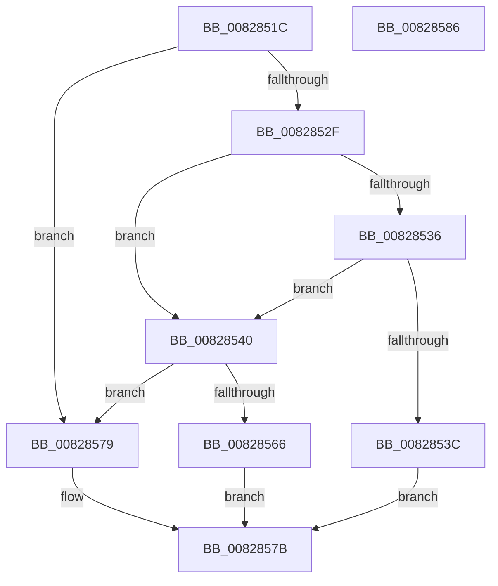

# SiIsValidWindowsBootEntry

- RVA: `0x0082851C`–`0x00828587` (길이 `107` bytes)
- VA: `0x000000014082851C`
- 실행 섹션: `PAGE`
- PDB 이름 있음: `예`; PDB Function 태그: `아니요`
- unwind 정보 RVA: `0x0005CAAC`
- 디코드: `35`개 명령, `107/107` bytes 표시
- 미해석 바이트: `0` (있으면 어셈블리에 `.byte`로 보존)

> 이 문서는 커널 이미지의 기계어와 PDB 기호를 분석해 생성했습니다. 4번과 5번은 함수 원형과 자료형을 바이너리 사용 방식에서 추정한 C 해석이며 원본 소스 복구 결과는 아닙니다.

## 1. Dependencies

- 직접 호출 지점: **2**; 고유 호출 대상: **2**
- 직접 호출자로 확인된 함수: **1**
- RIP 상대 이미지 참조: **1**

### Outgoing calls
- `0x0082854A` → [wcsnlen](../../text/50/wcsnlen_function_00501D60.md) (function, `0x00501D60`)
- `0x0082856D` → [wcsicmp](../../text/50/wcsicmp_function_00500080.md) (function, `0x00500080`)

### Direct callers
- [SiGetEspFromFirmware](SiGetEspFromFirmware_function_008280C0.md) at `0x0082823A`
- [SiGetEspFromFirmware](SiGetEspFromFirmware_function_008280C0.md) at `0x0082830D`

### Static image references
- `0x00828566` → RVA `0x00B0D030` (` ?? ::NNGAKEGL::`string'`; read)

## 2. Other-region calls and transfers

- 다른 실행 섹션으로 향하는 call: **2**
  - `0x0082854A` → [wcsnlen](../../text/50/wcsnlen_function_00501D60.md) (`PAGE` → `.text`)
  - `0x0082856D` → [wcsicmp](../../text/50/wcsicmp_function_00500080.md) (`PAGE` → `.text`)
- 별도 외부 분기/꼬리 이동을 확인하지 못했습니다.

## 3. Assembly (complete function range)

```asm
0082851C  48 89 5C 24 08                  mov qword ptr [rsp + 8], rbx
00828521  57                              push rdi
00828522  48 83 EC 20                     sub rsp, 0x20
00828526  83 79 14 00                     cmp dword ptr [rcx + 0x14], 0
0082852A  48 8B FA                        mov rdi, rdx
0082852D  74 4A                           je 0x140828579
0082852F  8B 41 0C                        mov eax, dword ptr [rcx + 0xc]
00828532  A8 04                           test al, 4
00828534  74 0A                           je 0x140828540
00828536  83 79 18 18                     cmp dword ptr [rcx + 0x18], 0x18
0082853A  72 04                           jb 0x140828540
0082853C  B0 01                           mov al, 1
0082853E  EB 3B                           jmp 0x14082857b
00828540  8B 52 04                        mov edx, dword ptr [rdx + 4]
00828543  48 8D 4F 0C                     lea rcx, [rdi + 0xc]
00828547  48 D1 EA                        shr rdx, 1
0082854A  E8 11 98 CD FF                  call 0x140501d60
0082854F  8B 57 04                        mov edx, dword ptr [rdi + 4]
00828552  48 8D 4F 0E                     lea rcx, [rdi + 0xe]
00828556  48 83 C2 0C                     add rdx, 0xc
0082855A  48 03 D7                        add rdx, rdi
0082855D  48 8D 0C 41                     lea rcx, [rcx + rax*2]
00828561  48 3B CA                        cmp rcx, rdx
00828564  73 13                           jae 0x140828579
00828566  48 8D 15 C3 4A 2E 00            lea rdx, [rip + 0x2e4ac3]
0082856D  E8 0E 7B CD FF                  call 0x140500080
00828572  85 C0                           test eax, eax
00828574  0F 94 C0                        sete al
00828577  EB 02                           jmp 0x14082857b
00828579  32 C0                           xor al, al
0082857B  48 8B 5C 24 30                  mov rbx, qword ptr [rsp + 0x30]
00828580  48 83 C4 20                     add rsp, 0x20
00828584  5F                              pop rdi
00828585  C3                              ret
00828586  CC                              int3
```

## 4. C-style interpretation (structured pseudocode)

```c
__int64 __fastcall SiIsValidWindowsBootEntry(__int64 a1, __int64 a2)
{
    __int64 result;
    __int64 v_rsp;
    unsigned __int64 v_stack_p8;

    v_stack_p8 = v_rbx;
    v_rsp = (v_rsp) - (32);
    if ((*(unsigned int *)(a1 + 20)) == 0) goto loc_00828579;
    if ((((unsigned __int8)((unsigned int)(*(unsigned int *)(a1 + 12)))) & (4)) == 0) goto loc_00828540;
    if ((*(unsigned int *)(a1 + 24)) < 24) goto loc_00828540;
    goto loc_0082857B;
loc_00828540:
    a2 = ((unsigned int)(*(unsigned int *)(a2 + 4))) >> (1);
    result = wcsnlen(a2 + 12, a2, a3, a4);
    a2 = ((unsigned int)(*(unsigned int *)(a2 + 4))) + (12);
    a2 = (a2) + (a2);
    if ((a2 + 14 + result * 2) >= a2) goto loc_00828579;
    result = wcsicmp(a2 + 14 + result * 2, v_rip + 3033795, a3, a4);
    result = ((unsigned int)(result) == 0) ? 1 : 0;
    goto loc_0082857B;
loc_00828579:
    result = 0;
loc_0082857B:
    v_rsp = (v_rsp) + (32);
    return result;
}
```

## 5. (Beta) C Style

```c
int64_t SiIsValidWindowsBootEntry(void *Arg1, void *Arg2)
{
    uint8_t *arg1 = (uint8_t *)Arg1;
    uint8_t *arg2 = (uint8_t *)Arg2;

    int64_t result;
    int64_t local_rsp;
    uint64_t v_stack_p8;

    v_stack_p8 = local_rbx;
    local_rsp = (local_rsp) - (32);
    if ((*(uint32_t *)(arg1 + 0x14)) == 0) goto loc_00828579;
    if ((((uint8_t)((uint32_t)(*(uint32_t *)(arg1 + 0xC)))) & (4)) == 0) goto loc_00828540;
    if ((*(uint32_t *)(arg1 + 0x18)) < 24) goto loc_00828540;
    goto loc_0082857B;
loc_00828540:
    Arg2 = ((uint32_t)(*(uint32_t *)(arg2 + 0x4))) >> (1);
    result = wcsnlen(Arg2 + 12, Arg2, a3, a4);
    Arg2 = ((uint32_t)(*(uint32_t *)(arg2 + 0x4))) + (12);
    Arg2 = (Arg2) + (Arg2);
    if ((Arg2 + 14 + result * 2) >= Arg2) goto loc_00828579;
    result = wcsicmp(Arg2 + 14 + result * 2, v_rip + 3033795, a3, a4);
    result = ((uint32_t)(result) == 0) ? 1 : 0;
    goto loc_0082857B;
loc_00828579:
    result = 0;
loc_0082857B:
    local_rsp = (local_rsp) + (32);
    return result;
}
```

### 관측된 메모리 오프셋

구조체 형식이 확인되지 않은 접근은 인자 기준의 오프셋으로만 기록했습니다.

| 기준 인자 | 오프셋 표현 | 폭 (bit) | 접근 |
|---|---:|---:|---|
| `Arg1` | `+ 0xC` | `32` | `R` |
| `Arg1` | `+ 0x14` | `32` | `R` |
| `Arg1` | `+ 0x18` | `32` | `R` |
| `Arg2` | `+ 0x0 + rax*2` | `64` | `R` |
| `Arg2` | `+ 0x4` | `32` | `R` |
| `Arg2` | `+ 0xC` | `64` | `R` |
| `Arg2` | `+ 0xE` | `64` | `R` |

## 6. Execution-region graph

[열기: 2D/3D 그래프와 함수 탐색 컨트롤 패널](../../../control-panel.html?section=page&rva=0x0082851C&view=graph)

- 2D 그래프는 위에서 아래로 흐르고, 3D 그래프는 빈 공간을 드래그해 회전합니다. Shift+드래그는 이동, 휠은 확대·축소, 함수 노드 선택은 대상 보고서 이동입니다.

### Static fallback


