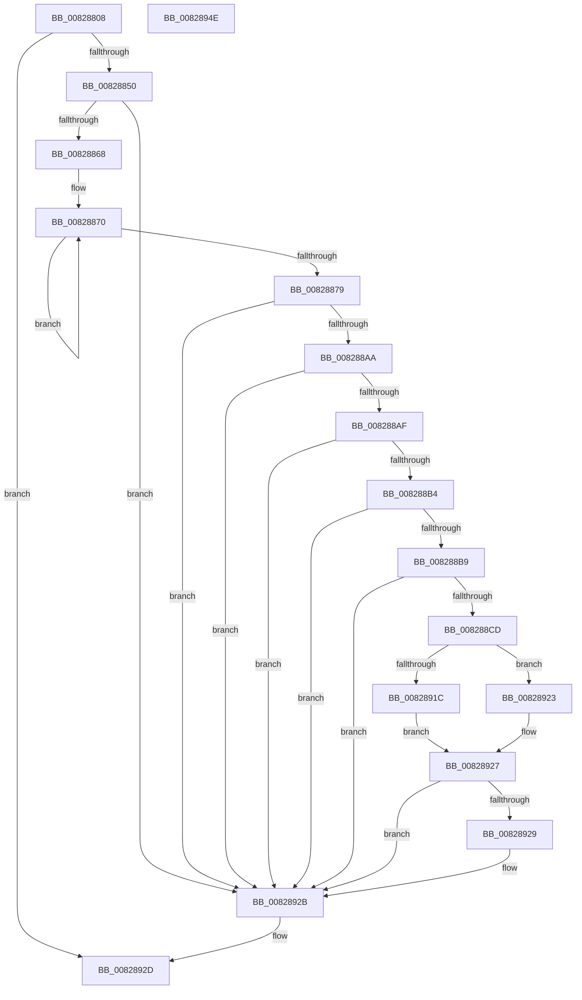

# SiIsWinPeHardDiskZeroUfdBoot

- RVA: `0x00828808`–`0x0082894F` (길이 `327` bytes)
- VA: `0x0000000140828808`
- 실행 섹션: `PAGE`
- PDB 이름 있음: `예`; PDB Function 태그: `아니요`
- unwind 정보 RVA: `0x000DA740`
- 디코드: `86`개 명령, `327/327` bytes 표시
- 미해석 바이트: `0` (있으면 어셈블리에 `.byte`로 보존)

> 이 문서는 커널 이미지의 기계어와 PDB 기호를 분석해 생성했습니다. 4번과 5번은 함수 원형과 자료형을 바이너리 사용 방식에서 추정한 C 해석이며 원본 소스 복구 결과는 아닙니다.

## 1. Dependencies

- 직접 호출 지점: **7**; 고유 호출 대상: **7**
- 직접 호출자로 확인된 함수: **1**
- RIP 상대 이미지 참조: **4**

### Outgoing calls
- `0x00828843` → [SiIsWinPEBoot](../A3/SiIsWinPEBoot_function_00A37880.md) (function, `0x00A37880`)
- `0x0082885B` → [SiGetBootDeviceNameFromRegistry](../A3/SiGetBootDeviceNameFromRegistry_function_00A37B68.md) (function, `0x00A37B68`)
- `0x0082889C` → [snwscanf_s](../../text/50/snwscanf_s_function_00505520.md) (function, `0x00505520`)
- `0x008288C4` → [SiTranslateSymbolicLink](../A3/SiTranslateSymbolicLink_function_00A37BE4.md) (function, `0x00A37BE4`)
- `0x008288D2` → [ExFreePoolWithTag](../../poolcode/B8/ExFreePoolWithTag_function_00B82870.md) (function, `0x00B82870`)
- `0x00828913` → [SiIssueSynchronousIoctl](SiIssueSynchronousIoctl_function_00827A34.md) (function, `0x00827A34`)
- `0x00828934` → [_security_check_cookie](../../text/6A/_security_check_cookie_function_006AC640.md) (function, `0x006AC640`)

### Direct callers
- [SiGetBiosSystemDisk](SiGetBiosSystemDisk_function_00828590.md) at `0x008285BE`

### Static image references
- `0x0082881F` → RVA `0x00E0A740` (`.data`; read)
- `0x00828854` → RVA `0x00B0CE90` (` ?? ::NNGAKEGL::`string'`; read)
- `0x00828890` → RVA `0x00B0D160` (` ?? ::NNGAKEGL::`string'`; read)
- `0x008288BD` → RVA `0x00B0D0D0` (` ?? ::NNGAKEGL::`string'`; read)

## 2. Other-region calls and transfers

- 다른 실행 섹션으로 향하는 call: **3**
  - `0x0082889C` → [snwscanf_s](../../text/50/snwscanf_s_function_00505520.md) (`PAGE` → `.text`)
  - `0x008288D2` → [ExFreePoolWithTag](../../poolcode/B8/ExFreePoolWithTag_function_00B82870.md) (`PAGE` → `POOLCODE`)
  - `0x00828934` → [_security_check_cookie](../../text/6A/_security_check_cookie_function_006AC640.md) (`PAGE` → `.text`)
- 별도 외부 분기/꼬리 이동을 확인하지 못했습니다.

## 3. Assembly (complete function range)

```asm
00828808  48 89 5C 24 08                  mov qword ptr [rsp + 8], rbx
0082880D  48 89 7C 24 10                  mov qword ptr [rsp + 0x10], rdi
00828812  55                              push rbp
00828813  48 8D 6C 24 A9                  lea rbp, [rsp - 0x57]
00828818  48 81 EC 90 00 00 00            sub rsp, 0x90
0082881F  48 8B 05 1A 1F 5E 00            mov rax, qword ptr [rip + 0x5e1f1a]
00828826  48 33 C4                        xor rax, rsp
00828829  48 89 45 4F                     mov qword ptr [rbp + 0x4f], rax
0082882D  33 DB                           xor ebx, ebx
0082882F  48 89 5D 07                     mov qword ptr [rbp + 7], rbx
00828833  48 89 5D 0F                     mov qword ptr [rbp + 0xf], rbx
00828837  89 5D FB                        mov dword ptr [rbp - 5], ebx
0082883A  89 5D F7                        mov dword ptr [rbp - 9], ebx
0082883D  89 5D 1F                        mov dword ptr [rbp + 0x1f], ebx
00828840  89 5D FF                        mov dword ptr [rbp - 1], ebx
00828843  E8 38 F0 20 00                  call 0x140a37880
00828848  84 C0                           test al, al
0082884A  0F 84 DD 00 00 00               je 0x14082892d
00828850  48 8D 55 07                     lea rdx, [rbp + 7]
00828854  48 8D 0D 35 46 2E 00            lea rcx, [rip + 0x2e4635]
0082885B  E8 08 F3 20 00                  call 0x140a37b68
00828860  85 C0                           test eax, eax
00828862  0F 88 C3 00 00 00               js 0x14082892b
00828868  48 8B 7D 07                     mov rdi, qword ptr [rbp + 7]
0082886C  48 83 CA FF                     or rdx, 0xffffffffffffffff
00828870  48 FF C2                        inc rdx
00828873  66 39 1C 57                     cmp word ptr [rdi + rdx*2], bx
00828877  75 F7                           jne 0x140828870
00828879  48 8D 45 FF                     lea rax, [rbp - 1]
0082887D  48 FF C2                        inc rdx
00828880  48 89 44 24 28                  mov qword ptr [rsp + 0x28], rax
00828885  4C 8D 4D F7                     lea r9, [rbp - 9]
00828889  48 8D 45 FB                     lea rax, [rbp - 5]
0082888D  48 8B CF                        mov rcx, rdi
00828890  4C 8D 05 C9 48 2E 00            lea r8, [rip + 0x2e48c9]
00828897  48 89 44 24 20                  mov qword ptr [rsp + 0x20], rax
0082889C  E8 7F CC CD FF                  call 0x140505520
008288A1  83 F8 03                        cmp eax, 3
008288A4  0F 85 81 00 00 00               jne 0x14082892b
008288AA  39 5D F7                        cmp dword ptr [rbp - 9], ebx
008288AD  75 7C                           jne 0x14082892b
008288AF  39 5D FB                        cmp dword ptr [rbp - 5], ebx
008288B2  75 77                           jne 0x14082892b
008288B4  39 5D FF                        cmp dword ptr [rbp - 1], ebx
008288B7  75 72                           jne 0x14082892b
008288B9  48 8D 55 0F                     lea rdx, [rbp + 0xf]
008288BD  48 8D 0D 0C 48 2E 00            lea rcx, [rip + 0x2e480c]
008288C4  E8 1B F3 20 00                  call 0x140a37be4
008288C9  85 C0                           test eax, eax
008288CB  78 5E                           js 0x14082892b
008288CD  33 D2                           xor edx, edx
008288CF  48 8B CF                        mov rcx, rdi
008288D2  E8 99 9F 35 00                  call 0x140b82870
008288D7  48 8B 4D 0F                     mov rcx, qword ptr [rbp + 0xf]
008288DB  4C 8D 45 17                     lea r8, [rbp + 0x17]
008288DF  33 C0                           xor eax, eax
008288E1  C7 44 24 28 28 00 00 00         mov dword ptr [rsp + 0x28], 0x28
008288E9  0F 57 C0                        xorps xmm0, xmm0
008288EC  48 89 45 47                     mov qword ptr [rbp + 0x47], rax
008288F0  48 8D 45 27                     lea rax, [rbp + 0x27]
008288F4  48 89 5D 1B                     mov qword ptr [rbp + 0x1b], rbx
008288F8  41 B9 0C 00 00 00               mov r9d, 0xc
008288FE  48 89 44 24 20                  mov qword ptr [rsp + 0x20], rax
00828903  BA 00 14 2D 00                  mov edx, 0x2d1400
00828908  89 5D 17                        mov dword ptr [rbp + 0x17], ebx
0082890B  0F 11 45 27                     movups xmmword ptr [rbp + 0x27], xmm0
0082890F  0F 11 45 37                     movups xmmword ptr [rbp + 0x37], xmm0
00828913  E8 1C F1 FF FF                  call 0x140827a34
00828918  85 C0                           test eax, eax
0082891A  79 07                           jns 0x140828923
0082891C  3D 3A 00 00 C0                  cmp eax, 0xc000003a
00828921  EB 04                           jmp 0x140828927
00828923  83 7D 43 07                     cmp dword ptr [rbp + 0x43], 7
00828927  75 02                           jne 0x14082892b
00828929  B3 01                           mov bl, 1
0082892B  8A C3                           mov al, bl
0082892D  48 8B 4D 4F                     mov rcx, qword ptr [rbp + 0x4f]
00828931  48 33 CC                        xor rcx, rsp
00828934  E8 07 3D E8 FF                  call 0x1406ac640
00828939  4C 8D 9C 24 90 00 00 00         lea r11, [rsp + 0x90]
00828941  49 8B 5B 10                     mov rbx, qword ptr [r11 + 0x10]
00828945  49 8B 7B 18                     mov rdi, qword ptr [r11 + 0x18]
00828949  49 8B E3                        mov rsp, r11
0082894C  5D                              pop rbp
0082894D  C3                              ret
0082894E  CC                              int3
```

## 4. C-style interpretation (structured pseudocode)

```c
__int64 __fastcall SiIsWinPeHardDiskZeroUfdBoot(void)
{
    __int64 result;
    __int64 v_rbx;
    __int64 v_rsp;
    unsigned __int64 v_stack_m10;
    unsigned __int64 v_stack_m18;
    unsigned int v_stack_m1C;
    unsigned __int64 v_stack_m28;
    unsigned __int64 v_stack_m38;
    unsigned int v_stack_m40;
    unsigned __int64 v_stack_m44;
    unsigned __int64 v_stack_m48;
    unsigned __int64 v_stack_m50;
    unsigned __int64 v_stack_m58;
    unsigned __int64 v_stack_m5F;
    unsigned int v_stack_m60;
    unsigned int v_stack_m64;
    unsigned int v_stack_m68;
    unsigned __int64 v_stack_m70;
    unsigned __int64 v_stack_m78;
    unsigned __int64 v_stack_m8;
    unsigned __int64 v_stack_p10;
    unsigned __int64 v_stack_p8;

    v_stack_p8 = v_rbx;
    v_stack_p10 = v_rdi;
    v_rsp = (v_rsp) - (144);
    result = (*(unsigned __int64 *)(v_rip + 6168346)) ^ (v_rsp);
    v_stack_m10 = result;
    v_rbx = 0;
    v_stack_m58 = 0;
    v_stack_m50 = 0;
    v_stack_m64 = 0;
    v_stack_m68 = 0;
    v_stack_m40 = 0;
    v_stack_m60 = 0;
    result = SiIsWinPEBoot(a1, a2, a3, a4);
    if ((unsigned __int8)(result) == 0) goto loc_0082892D;
    result = SiGetBootDeviceNameFromRegistry(v_rip + 3032629, v_stack_m58, a3, a4);
    if (sign_flag) goto loc_0082892B;
    a2 = (v_stack_m58) | (-1);
loc_00828870:
    a2 = (a2) + 1;
    if ((*(unsigned __int16 *)(v_stack_m58 + a2 * 2)) != 0) goto loc_00828870;
    a2 = (a2) + 1;
    v_stack_m70 = v_stack_m60;
    v_stack_m78 = v_stack_m64;
    result = snwscanf_s(v_stack_m58, a2, v_rip + 3033289, v_stack_m68);
    if (((unsigned int)(result)) != 3) goto loc_0082892B;
    if (v_stack_m68 != 0) goto loc_0082892B;
    if (v_stack_m64 != 0) goto loc_0082892B;
    if (v_stack_m60 != 0) goto loc_0082892B;
    result = SiTranslateSymbolicLink(v_rip + 3033100, v_stack_m50, v_rip + 3033289, v_stack_m68);
    if (sign_flag) goto loc_0082892B;
    a2 = 0;
    result = ExFreePoolWithTag(v_stack_m58, a2, v_rip + 3033289, v_stack_m68);
    result = 0;
    v_stack_m70 = 40;
    v_stack_m18 = 0;
    v_stack_m44 = 0;
    v_stack_m78 = v_stack_m38;
    v_stack_m48 = 0;
    v_stack_m38 = v_xmm0;
    v_stack_m28 = v_xmm0;
    result = SiIssueSynchronousIoctl(v_stack_m50, (unsigned int)(0x2D1400ULL), v_stack_m48, 12);
    if (!sign_flag) goto loc_00828923;
    goto loc_00828927;
loc_00828923:
loc_00828927:
    if (v_stack_m1C == 7) {
        v_rbx = 1;
    }
loc_0082892D:
    a1 = (v_stack_m10) ^ (v_rsp);
    result = _security_check_cookie(a1, (unsigned int)(0x2D1400ULL), v_stack_m48, 12);
    return result;
}
```

## 5. (Beta) C Style

```c
void SiIsWinPeHardDiskZeroUfdBoot(void)
{
    int64_t result;
    int64_t local_rbx;
    int64_t local_rsp;
    uint64_t v_stack_m10;
    uint64_t v_stack_m18;
    uint32_t v_stack_m1C;
    uint64_t v_stack_m28;
    uint64_t v_stack_m38;
    uint32_t v_stack_m40;
    uint64_t v_stack_m44;
    uint64_t v_stack_m48;
    uint64_t v_stack_m50;
    uint64_t v_stack_m58;
    uint64_t v_stack_m5F;
    uint32_t v_stack_m60;
    uint32_t v_stack_m64;
    uint32_t v_stack_m68;
    uint64_t v_stack_m70;
    uint64_t v_stack_m78;
    uint64_t v_stack_m8;
    uint64_t v_stack_p10;
    uint64_t v_stack_p8;

    v_stack_p8 = local_rbx;
    v_stack_p10 = local_rdi;
    local_rsp = (local_rsp) - (144);
    result = (*(uint64_t *)(v_rip + 0x5E1F1A)) ^ (local_rsp);
    v_stack_m10 = result;
    local_rbx = 0;
    v_stack_m58 = 0;
    v_stack_m50 = 0;
    v_stack_m64 = 0;
    v_stack_m68 = 0;
    v_stack_m40 = 0;
    v_stack_m60 = 0;
    result = SiIsWinPEBoot(a1, a2, a3, a4);
    if ((uint8_t)(result) == 0) goto loc_0082892D;
    result = SiGetBootDeviceNameFromRegistry(v_rip + 3032629, v_stack_m58, a3, a4);
    if (sign_flag) goto loc_0082892B;
    a2 = (v_stack_m58) | (-1);
loc_00828870:
    a2 = (a2) + 1;
    if ((*(uint16_t *)(v_stack_m58 + a2 * 2)) != 0) goto loc_00828870;
    a2 = (a2) + 1;
    v_stack_m70 = v_stack_m60;
    v_stack_m78 = v_stack_m64;
    result = snwscanf_s(v_stack_m58, a2, v_rip + 3033289, v_stack_m68);
    if (((uint32_t)(result)) != 3) goto loc_0082892B;
    if (v_stack_m68 != 0) goto loc_0082892B;
    if (v_stack_m64 != 0) goto loc_0082892B;
    if (v_stack_m60 != 0) goto loc_0082892B;
    result = SiTranslateSymbolicLink(v_rip + 3033100, v_stack_m50, v_rip + 3033289, v_stack_m68);
    if (sign_flag) goto loc_0082892B;
    a2 = 0;
    result = ExFreePoolWithTag(v_stack_m58, a2, v_rip + 3033289, v_stack_m68);
    result = 0;
    v_stack_m70 = 40;
    v_stack_m18 = 0;
    v_stack_m44 = 0;
    v_stack_m78 = v_stack_m38;
    v_stack_m48 = 0;
    v_stack_m38 = v_xmm0;
    v_stack_m28 = v_xmm0;
    result = SiIssueSynchronousIoctl(v_stack_m50, (uint32_t)(0x2D1400ULL), v_stack_m48, 12);
    if (!sign_flag) goto loc_00828923;
    goto loc_00828927;
loc_00828923:
loc_00828927:
    if (v_stack_m1C == 7) {
        local_rbx = 1;
    }
loc_0082892D:
    a1 = (v_stack_m10) ^ (local_rsp);
    result = _security_check_cookie(a1, (uint32_t)(0x2D1400ULL), v_stack_m48, 12);
    return result;
}
```

## 6. Execution-region graph

[열기: 2D/3D 그래프와 함수 탐색 컨트롤 패널](../../../control-panel.html?section=page&rva=0x00828808&view=graph)

- 2D 그래프는 위에서 아래로 흐르고, 3D 그래프는 빈 공간을 드래그해 회전합니다. Shift+드래그는 이동, 휠은 확대·축소, 함수 노드 선택은 대상 보고서 이동입니다.

### Static fallback


