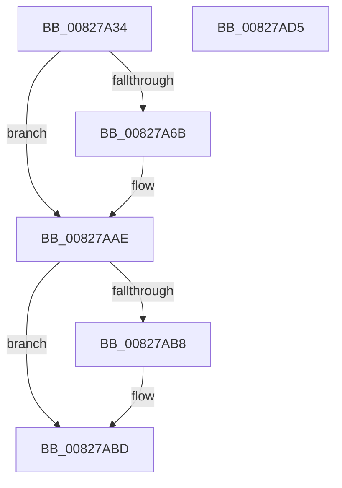

# SiIssueSynchronousIoctl

- RVA: `0x00827A34`–`0x00827AD6` (길이 `162` bytes)
- VA: `0x0000000140827A34`
- 실행 섹션: `PAGE`
- PDB 이름 있음: `예`; PDB Function 태그: `아니요`
- unwind 정보 RVA: `0x000A8970`
- 디코드: `45`개 명령, `162/162` bytes 표시
- 미해석 바이트: `0` (있으면 어셈블리에 `.byte`로 보존)

> 이 문서는 커널 이미지의 기계어와 PDB 기호를 분석해 생성했습니다. 4번과 5번은 함수 원형과 자료형을 바이너리 사용 방식에서 추정한 C 해석이며 원본 소스 복구 결과는 아닙니다.

## 1. Dependencies

- 직접 호출 지점: **3**; 고유 호출 대상: **3**
- 직접 호출자로 확인된 함수: **3**
- RIP 상대 이미지 참조: **0**

### Outgoing calls
- `0x00827A60` → [SiOpenDevice](../A6/SiOpenDevice_function_00A68B48.md) (function, `0x00A68B48`)
- `0x00827AA7` → [ZwDeviceIoControlFile](../../text/6A/ZwDeviceIoControlFile_function_006AD1B0.md) (function, `0x006AD1B0`)
- `0x00827AB8` → [ZwClose](../../text/6A/ZwClose_function_006AD2B0.md) (function, `0x006AD2B0`)

### Direct callers
- [sub_006F7DA2](../../text/6F/Unknown_function_006F7DA2.md) at `0x006F7DE0`
- [SiGetEfiSystemDevice](SiGetEfiSystemDevice_function_00827C68.md) at `0x00827E8F`
- [SiGetEfiSystemDevice](SiGetEfiSystemDevice_function_00827C68.md) at `0x00827EE2`
- [SiIsWinPeHardDiskZeroUfdBoot](SiIsWinPeHardDiskZeroUfdBoot_function_00828808.md) at `0x00828913`

### Static image references
- 디코드된 RIP-relative 메모리 참조가 없습니다.

## 2. Other-region calls and transfers

- 다른 실행 섹션으로 향하는 call: **2**
  - `0x00827AA7` → [ZwDeviceIoControlFile](../../text/6A/ZwDeviceIoControlFile_function_006AD1B0.md) (`PAGE` → `.text`)
  - `0x00827AB8` → [ZwClose](../../text/6A/ZwClose_function_006AD2B0.md) (`PAGE` → `.text`)
- 별도 외부 분기/꼬리 이동을 확인하지 못했습니다.

## 3. Assembly (complete function range)

```asm
00827A34  48 8B C4                        mov rax, rsp
00827A37  48 89 58 08                     mov qword ptr [rax + 8], rbx
00827A3B  48 89 68 10                     mov qword ptr [rax + 0x10], rbp
00827A3F  48 89 70 18                     mov qword ptr [rax + 0x18], rsi
00827A43  57                              push rdi
00827A44  48 83 EC 70                     sub rsp, 0x70
00827A48  48 83 60 D8 00                  and qword ptr [rax - 0x28], 0
00827A4D  8B EA                           mov ebp, edx
00827A4F  0F 57 C0                        xorps xmm0, xmm0
00827A52  48 8D 50 D8                     lea rdx, [rax - 0x28]
00827A56  0F 11 40 E0                     movups xmmword ptr [rax - 0x20], xmm0
00827A5A  41 8B F9                        mov edi, r9d
00827A5D  49 8B F0                        mov rsi, r8
00827A60  E8 E3 10 24 00                  call 0x140a68b48
00827A65  8B D8                           mov ebx, eax
00827A67  85 C0                           test eax, eax
00827A69  78 43                           js 0x140827aae
00827A6B  8B 84 24 A8 00 00 00            mov eax, dword ptr [rsp + 0xa8]
00827A72  45 33 C9                        xor r9d, r9d
00827A75  48 8B 4C 24 50                  mov rcx, qword ptr [rsp + 0x50]
00827A7A  45 33 C0                        xor r8d, r8d
00827A7D  89 44 24 48                     mov dword ptr [rsp + 0x48], eax
00827A81  33 D2                           xor edx, edx
00827A83  48 8B 84 24 A0 00 00 00         mov rax, qword ptr [rsp + 0xa0]
00827A8B  48 89 44 24 40                  mov qword ptr [rsp + 0x40], rax
00827A90  48 8D 44 24 58                  lea rax, [rsp + 0x58]
00827A95  89 7C 24 38                     mov dword ptr [rsp + 0x38], edi
00827A99  48 89 74 24 30                  mov qword ptr [rsp + 0x30], rsi
00827A9E  89 6C 24 28                     mov dword ptr [rsp + 0x28], ebp
00827AA2  48 89 44 24 20                  mov qword ptr [rsp + 0x20], rax
00827AA7  E8 04 57 E8 FF                  call 0x1406ad1b0
00827AAC  8B D8                           mov ebx, eax
00827AAE  48 8B 4C 24 50                  mov rcx, qword ptr [rsp + 0x50]
00827AB3  48 85 C9                        test rcx, rcx
00827AB6  74 05                           je 0x140827abd
00827AB8  E8 F3 57 E8 FF                  call 0x1406ad2b0
00827ABD  4C 8D 5C 24 70                  lea r11, [rsp + 0x70]
00827AC2  8B C3                           mov eax, ebx
00827AC4  49 8B 5B 10                     mov rbx, qword ptr [r11 + 0x10]
00827AC8  49 8B 6B 18                     mov rbp, qword ptr [r11 + 0x18]
00827ACC  49 8B 73 20                     mov rsi, qword ptr [r11 + 0x20]
00827AD0  49 8B E3                        mov rsp, r11
00827AD3  5F                              pop rdi
00827AD4  C3                              ret
00827AD5  CC                              int3
```

## 4. C-style interpretation (structured pseudocode)

```c
__int64 __fastcall SiIssueSynchronousIoctl(__int64 a1, int a2, __int64 a3, int a4, __int64 a5, unsigned int a6)
{
    __int64 result;
    __int64 v_rbx;
    __int64 v_rsp;
    unsigned __int64 v_stack_m20;
    unsigned __int64 v_stack_m28;
    unsigned int v_stack_m30;
    unsigned __int64 v_stack_m38;
    unsigned int v_stack_m40;
    unsigned __int64 v_stack_m48;
    unsigned int v_stack_m50;
    unsigned __int64 v_stack_m58;
    unsigned __int64 v_stack_m8;

    *(unsigned __int64 *)(v_rsp + 8) = v_rbx;
    *(unsigned __int64 *)(v_rsp + 16) = v_rbp;
    *(unsigned __int64 *)(v_rsp + 24) = v_rsi;
    v_rsp = (v_rsp) - (112);
    *(unsigned __int64 *)(v_rsp - 32) = v_xmm0;
    result = SiOpenDevice(a1, v_rsp - 40, a3, a4);
    v_rbx = (unsigned int)((unsigned int)(result));
    if (!(sign_flag)) {
        result = a6;
        a4 = 0;
        a1 = v_stack_m28;
        a3 = 0;
        v_stack_m30 = (unsigned int)(result);
        a2 = 0;
        result = a5;
        v_stack_m38 = result;
        result = v_stack_m20;
        v_stack_m40 = (unsigned int)((unsigned int)(a4));
        v_stack_m48 = 0;
        v_stack_m50 = (unsigned int)((unsigned int)(a2));
        v_stack_m58 = result;
        result = ZwDeviceIoControlFile(a1, a2, a3, a4);
        v_rbx = (unsigned int)(result);
    }
    if (v_stack_m28 != 0) {
        result = ZwClose(v_stack_m28, a2, a3, a4);
    }
    return (unsigned int)((unsigned int)(v_rbx));
}
```

## 5. (Beta) C Style

```c
int64_t SiIssueSynchronousIoctl(int64_t Arg1, int32_t Arg2, int64_t Arg3, int32_t Arg4, int64_t Arg5, uint32_t Arg6)
{
    int64_t result;
    int64_t local_rbx;
    int64_t local_rsp;
    uint64_t v_stack_m20;
    uint64_t v_stack_m28;
    uint32_t v_stack_m30;
    uint64_t v_stack_m38;
    uint32_t v_stack_m40;
    uint64_t v_stack_m48;
    uint32_t v_stack_m50;
    uint64_t v_stack_m58;
    uint64_t v_stack_m8;

    *(uint64_t *)(local_rsp + 0x8) = local_rbx;
    *(uint64_t *)(local_rsp + 0x10) = local_rbp;
    *(uint64_t *)(local_rsp + 0x18) = local_rsi;
    local_rsp = (local_rsp) - (112);
    *(uint64_t *)(local_rsp - 0x20) = v_xmm0;
    result = SiOpenDevice(Arg1, local_rsp - 40, Arg3, Arg4);
    local_rbx = (uint32_t)((uint32_t)(result));
    if (!(sign_flag)) {
        result = Arg6;
        Arg4 = 0;
        Arg1 = v_stack_m28;
        Arg3 = 0;
        v_stack_m30 = (uint32_t)(result);
        Arg2 = 0;
        result = Arg5;
        v_stack_m38 = result;
        result = v_stack_m20;
        v_stack_m40 = (uint32_t)((uint32_t)(Arg4));
        v_stack_m48 = 0;
        v_stack_m50 = (uint32_t)((uint32_t)(Arg2));
        v_stack_m58 = result;
        result = ZwDeviceIoControlFile(Arg1, Arg2, Arg3, Arg4);
        local_rbx = (uint32_t)(result);
    }
    if (v_stack_m28 != 0) {
        result = ZwClose(v_stack_m28, Arg2, Arg3, Arg4);
    }
    return (uint32_t)((uint32_t)(local_rbx));
}
```

## 6. Execution-region graph

[열기: 2D/3D 그래프와 함수 탐색 컨트롤 패널](../../../control-panel.html?section=page&rva=0x00827A34&view=graph)

- 2D 그래프는 위에서 아래로 흐르고, 3D 그래프는 빈 공간을 드래그해 회전합니다. Shift+드래그는 이동, 휠은 확대·축소, 함수 노드 선택은 대상 보고서 이동입니다.

### Static fallback


