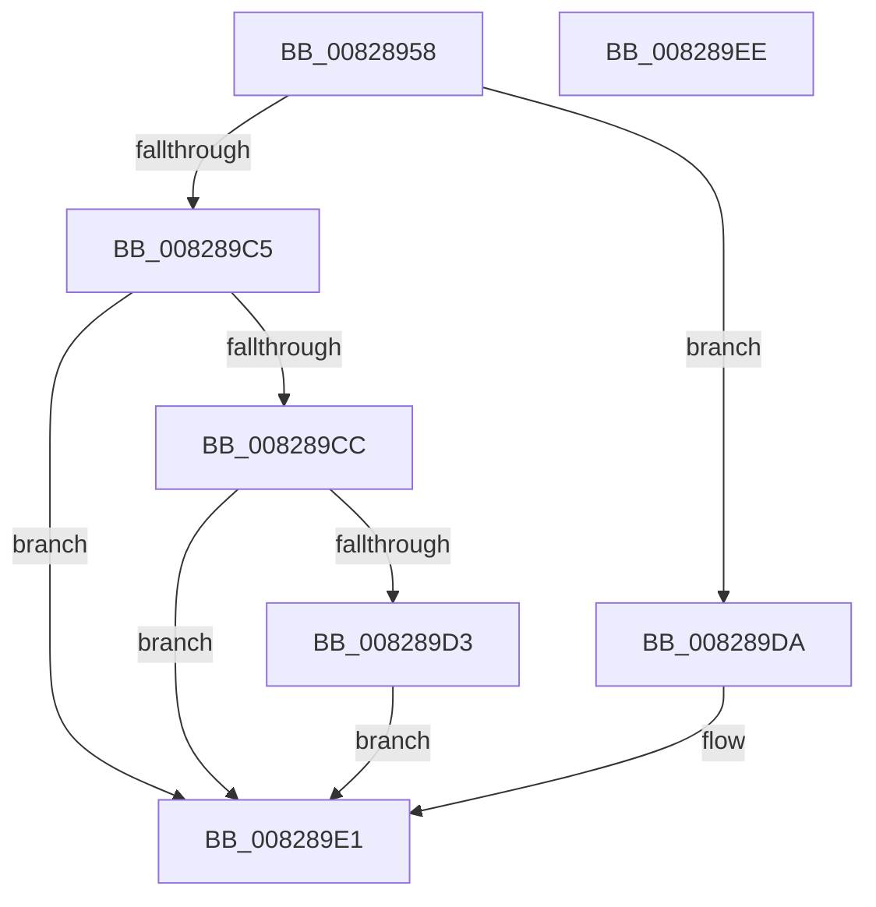

# SiOpenArcNameObject

- RVA: `0x00828958`–`0x008289EF` (길이 `151` bytes)
- VA: `0x0000000140828958`
- 실행 섹션: `PAGE`
- PDB 이름 있음: `예`; PDB Function 태그: `아니요`
- unwind 정보 RVA: `0x0009EAB4`
- 디코드: `43`개 명령, `151/151` bytes 표시
- 미해석 바이트: `0` (있으면 어셈블리에 `.byte`로 보존)

> 이 문서는 커널 이미지의 기계어와 PDB 기호를 분석해 생성했습니다. 4번과 5번은 함수 원형과 자료형을 바이너리 사용 방식에서 추정한 C 해석이며 원본 소스 복구 결과는 아닙니다.

## 1. Dependencies

- 직접 호출 지점: **2**; 고유 호출 대상: **2**
- 직접 호출자로 확인된 함수: **1**
- RIP 상대 이미지 참조: **0**

### Outgoing calls
- `0x00828985` → [RtlInitUnicodeString](../../text/42/RtlInitUnicodeString_function_0042A780.md) (function, `0x0042A780`)
- `0x008289BA` → [ZwOpenSymbolicLinkObject](../../text/6A/ZwOpenSymbolicLinkObject_function_006AF7F0.md) (function, `0x006AF7F0`)

### Direct callers
- [SiGetBiosSystemDisk](SiGetBiosSystemDisk_function_00828590.md) at `0x008285D2`
- [SiGetBiosSystemDisk](SiGetBiosSystemDisk_function_00828590.md) at `0x008285EB`

### Static image references
- 디코드된 RIP-relative 메모리 참조가 없습니다.

## 2. Other-region calls and transfers

- 다른 실행 섹션으로 향하는 call: **2**
  - `0x00828985` → [RtlInitUnicodeString](../../text/42/RtlInitUnicodeString_function_0042A780.md) (`PAGE` → `.text`)
  - `0x008289BA` → [ZwOpenSymbolicLinkObject](../../text/6A/ZwOpenSymbolicLinkObject_function_006AF7F0.md) (`PAGE` → `.text`)
- 별도 외부 분기/꼬리 이동을 확인하지 못했습니다.

## 3. Assembly (complete function range)

```asm
00828958  48 89 5C 24 08                  mov qword ptr [rsp + 8], rbx
0082895D  55                              push rbp
0082895E  48 8B EC                        mov rbp, rsp
00828961  48 83 EC 60                     sub rsp, 0x60
00828965  33 C0                           xor eax, eax
00828967  48 8B DA                        mov rbx, rdx
0082896A  21 45 EC                        and dword ptr [rbp - 0x14], eax
0082896D  48 8B D1                        mov rdx, rcx
00828970  48 21 45 20                     and qword ptr [rbp + 0x20], rax
00828974  48 8D 4D C0                     lea rcx, [rbp - 0x40]
00828978  0F 57 C0                        xorps xmm0, xmm0
0082897B  89 45 D4                        mov dword ptr [rbp - 0x2c], eax
0082897E  21 45 D4                        and dword ptr [rbp - 0x2c], eax
00828981  0F 11 45 C0                     movups xmmword ptr [rbp - 0x40], xmm0
00828985  E8 F6 1D C0 FF                  call 0x14042a780
0082898A  48 83 65 D8 00                  and qword ptr [rbp - 0x28], 0
0082898F  48 8D 45 C0                     lea rax, [rbp - 0x40]
00828993  0F 57 C0                        xorps xmm0, xmm0
00828996  48 89 45 E0                     mov qword ptr [rbp - 0x20], rax
0082899A  4C 8D 45 D0                     lea r8, [rbp - 0x30]
0082899E  C7 45 D0 30 00 00 00            mov dword ptr [rbp - 0x30], 0x30
008289A5  BA 01 00 02 00                  mov edx, 0x20001
008289AA  C7 45 E8 40 02 00 00            mov dword ptr [rbp - 0x18], 0x240
008289B1  48 8D 4D 20                     lea rcx, [rbp + 0x20]
008289B5  F3 0F 7F 45 F0                  movdqu xmmword ptr [rbp - 0x10], xmm0
008289BA  E8 31 6E E8 FF                  call 0x1406af7f0
008289BF  8B C8                           mov ecx, eax
008289C1  85 C0                           test eax, eax
008289C3  79 15                           jns 0x1408289da
008289C5  3D 17 00 00 C0                  cmp eax, 0xc0000017
008289CA  74 15                           je 0x1408289e1
008289CC  3D 9A 00 00 C0                  cmp eax, 0xc000009a
008289D1  74 0E                           je 0x1408289e1
008289D3  B9 52 04 00 C0                  mov ecx, 0xc0000452
008289D8  EB 07                           jmp 0x1408289e1
008289DA  48 8B 45 20                     mov rax, qword ptr [rbp + 0x20]
008289DE  48 89 03                        mov qword ptr [rbx], rax
008289E1  48 8B 5C 24 70                  mov rbx, qword ptr [rsp + 0x70]
008289E6  8B C1                           mov eax, ecx
008289E8  48 83 C4 60                     add rsp, 0x60
008289EC  5D                              pop rbp
008289ED  C3                              ret
008289EE  CC                              int3
```

## 4. C-style interpretation (structured pseudocode)

```c
__int64 __fastcall SiOpenArcNameObject(__int64 a1, __int64 a2)
{
    __int64 result;
    __int64 v_rsp;
    unsigned __int64 v_stack_m18;
    unsigned int v_stack_m1C;
    unsigned int v_stack_m20;
    unsigned __int64 v_stack_m28;
    unsigned __int64 v_stack_m30;
    unsigned int v_stack_m34;
    unsigned __int64 v_stack_m38;
    unsigned __int64 v_stack_m48;
    unsigned __int64 v_stack_p18;
    unsigned __int64 v_stack_p8;

    v_stack_p8 = v_rbx;
    v_rsp = (v_rsp) - (96);
    result = 0;
    v_stack_m34 = 0;
    v_stack_m48 = v_xmm0;
    result = RtlInitUnicodeString(v_stack_m48, a1, a3, a4);
    v_stack_m28 = v_stack_m48;
    v_stack_m38 = 48;
    v_stack_m20 = 576;
    v_stack_m18 = v_xmm0;
    result = ZwOpenSymbolicLinkObject(v_stack_p18, (unsigned int)(0x20001ULL), v_stack_m38, a4);
    if (!sign_flag) goto loc_008289DA;
    if (((unsigned int)(result)) == 0xC0000017ULL) goto loc_008289E1;
    if (((unsigned int)(result)) == 0xC000009AULL) goto loc_008289E1;
    goto loc_008289E1;
loc_008289DA:
    *(unsigned __int64 *)(a2) = v_stack_p18;
loc_008289E1:
    v_rsp = (v_rsp) + (96);
    return (unsigned int)((unsigned int)((unsigned int)(0xC0000452ULL)));
}
```

## 5. (Beta) C Style

```c
int64_t SiOpenArcNameObject(int64_t Arg1, void *Arg2)
{
    uint8_t *arg2 = (uint8_t *)Arg2;

    int64_t result;
    int64_t local_rsp;
    uint64_t v_stack_m18;
    uint32_t v_stack_m1C;
    uint32_t v_stack_m20;
    uint64_t v_stack_m28;
    uint64_t v_stack_m30;
    uint32_t v_stack_m34;
    uint64_t v_stack_m38;
    uint64_t v_stack_m48;
    uint64_t v_stack_p18;
    uint64_t v_stack_p8;

    v_stack_p8 = local_rbx;
    local_rsp = (local_rsp) - (96);
    result = 0;
    v_stack_m34 = 0;
    v_stack_m48 = v_xmm0;
    result = RtlInitUnicodeString(v_stack_m48, Arg1, a3, a4);
    v_stack_m28 = v_stack_m48;
    v_stack_m38 = 48;
    v_stack_m20 = 576;
    v_stack_m18 = v_xmm0;
    result = ZwOpenSymbolicLinkObject(v_stack_p18, (uint32_t)(0x20001ULL), v_stack_m38, a4);
    if (!sign_flag) goto loc_008289DA;
    if (((uint32_t)(result)) == 0xC0000017ULL) goto loc_008289E1;
    if (((uint32_t)(result)) == 0xC000009AULL) goto loc_008289E1;
    goto loc_008289E1;
loc_008289DA:
    *(uint64_t *)(arg2) = v_stack_p18;
loc_008289E1:
    local_rsp = (local_rsp) + (96);
    return (uint32_t)((uint32_t)((uint32_t)(0xC0000452ULL)));
}
```

### 관측된 메모리 오프셋

구조체 형식이 확인되지 않은 접근은 인자 기준의 오프셋으로만 기록했습니다.

| 기준 인자 | 오프셋 표현 | 폭 (bit) | 접근 |
|---|---:|---:|---|
| `Arg2` | `+ 0x0` | `64` | `W` |

## 6. Execution-region graph

[열기: 2D/3D 그래프와 함수 탐색 컨트롤 패널](../../../control-panel.html?section=page&rva=0x00828958&view=graph)

- 2D 그래프는 위에서 아래로 흐르고, 3D 그래프는 빈 공간을 드래그해 회전합니다. Shift+드래그는 이동, 휠은 확대·축소, 함수 노드 선택은 대상 보고서 이동입니다.

### Static fallback


