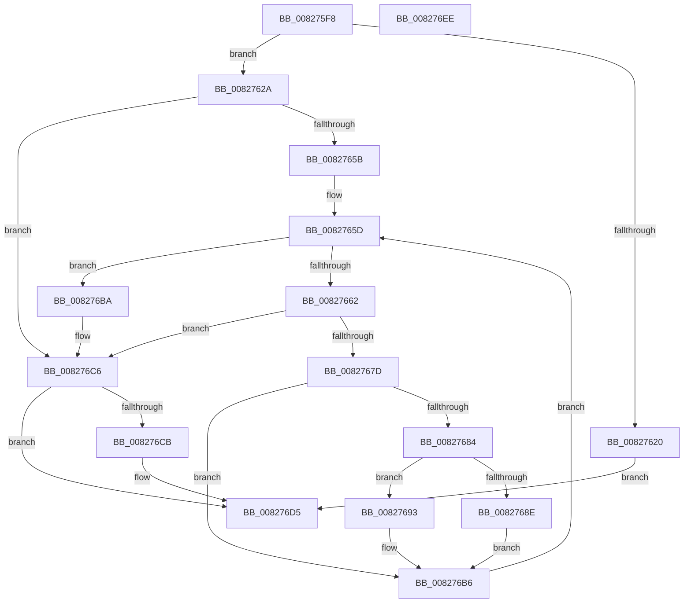

# SyspartGetPhysicalPartitions

- RVA: `0x008275F8`–`0x008276EF` (길이 `247` bytes)
- VA: `0x00000001408275F8`
- 실행 섹션: `PAGE`
- PDB 이름 있음: `예`; PDB Function 태그: `아니요`
- unwind 정보 RVA: `0x0008DF5C`
- 디코드: `76`개 명령, `247/247` bytes 표시
- 미해석 바이트: `0` (있으면 어셈블리에 `.byte`로 보존)

> 이 문서는 커널 이미지의 기계어와 PDB 기호를 분석해 생성했습니다. 4번과 5번은 함수 원형과 자료형을 바이너리 사용 방식에서 추정한 C 해석이며 원본 소스 복구 결과는 아닙니다.

## 1. Dependencies

- 직접 호출 지점: **3**; 고유 호출 대상: **3**
- 직접 호출자로 확인된 함수: **1**
- RIP 상대 이미지 참조: **0**

### Outgoing calls
- `0x0082764B` → [SiQueryProperty](../A6/SiQueryProperty_function_00A6896C.md) (function, `0x00A6896C`)
- `0x00827672` → [SiFindSystemPartition](SiFindSystemPartition_function_00827754.md) (function, `0x00827754`)
- `0x008276D0` → [ExFreePoolWithTag](../../poolcode/B8/ExFreePoolWithTag_function_00B82870.md) (function, `0x00B82870`)

### Direct callers
- [BiSpacesUpdatePhysicalDevicePath](../../text/69/BiSpacesUpdatePhysicalDevicePath_function_0069E6F8.md) at `0x0069E821`

### Static image references
- 디코드된 RIP-relative 메모리 참조가 없습니다.

## 2. Other-region calls and transfers

- 다른 실행 섹션으로 향하는 call: **1**
  - `0x008276D0` → [ExFreePoolWithTag](../../poolcode/B8/ExFreePoolWithTag_function_00B82870.md) (`PAGE` → `POOLCODE`)
- 별도 외부 분기/꼬리 이동을 확인하지 못했습니다.

## 3. Assembly (complete function range)

```asm
008275F8  48 89 5C 24 08                  mov qword ptr [rsp + 8], rbx
008275FD  48 89 6C 24 10                  mov qword ptr [rsp + 0x10], rbp
00827602  56                              push rsi
00827603  57                              push rdi
00827604  41 54                           push r12
00827606  41 56                           push r14
00827608  41 57                           push r15
0082760A  48 83 EC 20                     sub rsp, 0x20
0082760E  48 83 64 24 68 00               and qword ptr [rsp + 0x68], 0
00827614  45 8B F0                        mov r14d, r8d
00827617  48 8B FA                        mov rdi, rdx
0082761A  41 83 F8 0C                     cmp r8d, 0xc
0082761E  73 0A                           jae 0x14082762a
00827620  BB 23 00 00 C0                  mov ebx, 0xc0000023
00827625  E9 AB 00 00 00                  jmp 0x1408276d5
0082762A  83 62 08 00                     and dword ptr [rdx + 8], 0
0082762E  4C 8D 4C 24 68                  lea r9, [rsp + 0x68]
00827633  41 B8 18 00 00 00               mov r8d, 0x18
00827639  C7 42 04 0C 00 00 00            mov dword ptr [rdx + 4], 0xc
00827640  44 89 02                        mov dword ptr [rdx], r8d
00827643  45 8D 66 F4                     lea r12d, [r14 - 0xc]
00827647  41 8D 50 FD                     lea edx, [r8 - 3]
0082764B  E8 1C 13 24 00                  call 0x140a6896c
00827650  48 8B 74 24 68                  mov rsi, qword ptr [rsp + 0x68]
00827655  8B D8                           mov ebx, eax
00827657  85 C0                           test eax, eax
00827659  78 6B                           js 0x1408276c6
0082765B  33 ED                           xor ebp, ebp
0082765D  3B 6E 08                        cmp ebp, dword ptr [rsi + 8]
00827660  73 58                           jae 0x1408276ba
00827662  8B C5                           mov eax, ebp
00827664  48 FF C0                        inc rax
00827667  48 8D 04 40                     lea rax, [rax + rax*2]
0082766B  4C 8D 3C 86                     lea r15, [rsi + rax*4]
0082766F  49 8B CF                        mov rcx, r15
00827672  E8 DD 00 00 00                  call 0x140827754
00827677  8B D8                           mov ebx, eax
00827679  85 C0                           test eax, eax
0082767B  78 49                           js 0x1408276c6
0082767D  41 83 7F 08 FF                  cmp dword ptr [r15 + 8], -1
00827682  74 32                           je 0x1408276b6
00827684  83 47 04 0C                     add dword ptr [rdi + 4], 0xc
00827688  41 83 FC 0C                     cmp r12d, 0xc
0082768C  73 05                           jae 0x140827693
0082768E  45 33 E4                        xor r12d, r12d
00827691  EB 23                           jmp 0x1408276b6
00827693  8B 47 08                        mov eax, dword ptr [rdi + 8]
00827696  F2 41 0F 10 07                  movsd xmm0, qword ptr [r15]
0082769B  48 FF C0                        inc rax
0082769E  48 8D 0C 40                     lea rcx, [rax + rax*2]
008276A2  F2 0F 11 04 8F                  movsd qword ptr [rdi + rcx*4], xmm0
008276A7  41 8B 47 08                     mov eax, dword ptr [r15 + 8]
008276AB  89 44 8F 08                     mov dword ptr [rdi + rcx*4 + 8], eax
008276AF  FF 47 08                        inc dword ptr [rdi + 8]
008276B2  41 83 C4 F4                     add r12d, -0xc
008276B6  FF C5                           inc ebp
008276B8  EB A3                           jmp 0x14082765d
008276BA  44 3B 77 04                     cmp r14d, dword ptr [rdi + 4]
008276BE  B8 05 00 00 80                  mov eax, 0x80000005
008276C3  0F 42 D8                        cmovb ebx, eax
008276C6  48 85 F6                        test rsi, rsi
008276C9  74 0A                           je 0x1408276d5
008276CB  33 D2                           xor edx, edx
008276CD  48 8B CE                        mov rcx, rsi
008276D0  E8 9B B1 35 00                  call 0x140b82870
008276D5  48 8B 6C 24 58                  mov rbp, qword ptr [rsp + 0x58]
008276DA  8B C3                           mov eax, ebx
008276DC  48 8B 5C 24 50                  mov rbx, qword ptr [rsp + 0x50]
008276E1  48 83 C4 20                     add rsp, 0x20
008276E5  41 5F                           pop r15
008276E7  41 5E                           pop r14
008276E9  41 5C                           pop r12
008276EB  5F                              pop rdi
008276EC  5E                              pop rsi
008276ED  C3                              ret
008276EE  CC                              int3
```

## 4. C-style interpretation (structured pseudocode)

```c
__int64 __fastcall SyspartGetPhysicalPartitions(__int64 a1, __int64 a2, int a3)
{
    __int64 result;
    __int64 v_r12;
    __int64 v_rbp;
    __int64 v_rbx;
    __int64 v_rsp;
    unsigned __int64 v_stack_p10;
    unsigned __int64 v_stack_p20;
    unsigned __int64 v_stack_p8;

    v_stack_p8 = v_rbx;
    v_stack_p10 = v_rbp;
    v_rsp = (v_rsp) - (32);
    if (a3 >= 12) goto loc_0082762A;
    goto loc_008276D5;
loc_0082762A:
    *(unsigned int *)(a2 + 4) = 12;
    *(unsigned int *)(a2) = 24;
    result = SiQueryProperty(a1, 24 - 3, 24, v_stack_p20);
    if (sign_flag) goto loc_008276C6;
    v_rbp = 0;
loc_0082765D:
    if (0 >= (*(unsigned int *)(v_stack_p20 + 8))) goto loc_008276BA;
    result = (0) + 1;
    result = SiFindSystemPartition(v_stack_p20 + result + result * 2 * 4, 24 - 3, 24, v_stack_p20);
    if (sign_flag) goto loc_008276C6;
    if ((*(unsigned int *)(v_stack_p20 + result + result * 2 * 4 + 8)) == -1) goto loc_008276B6;
    if (((unsigned int)((unsigned int)(a3) - 12)) >= 12) goto loc_00827693;
    v_r12 = 0;
    goto loc_008276B6;
loc_00827693:
    result = ((unsigned int)(*(unsigned int *)(a2 + 8))) + 1;
    *(unsigned __int64 *)(a2 + result + result * 2 * 4) = v_xmm0;
    *(unsigned int *)(a2 + result + result * 2 * 4 + 8) = (unsigned int)((unsigned int)(*(unsigned int *)(v_stack_p20 + result + result * 2 * 4 + 8)));
    v_r12 = (unsigned int)((v_r12) + (-12));
loc_008276B6:
    v_rbp = (unsigned int)((v_rbp) + 1);
    goto loc_0082765D;
loc_008276BA:
    v_rbx = (unsigned int)((unsigned int)(result));
    if (((unsigned int)((unsigned int)(a3))) < (*(unsigned int *)(a2 + 4))) { v_rbx = (unsigned int)((unsigned int)(0x80000005ULL)); }
loc_008276C6:
    result = (unsigned int)(0x80000005ULL);
    if (v_stack_p20 != 0) {
        a2 = 0;
        a1 = v_stack_p20;
        result = ExFreePoolWithTag(a1, a2, 24, v_stack_p20);
    }
    v_rsp = (v_rsp) + (32);
    return (unsigned int)((unsigned int)(v_rbx));
}
```

## 5. (Beta) C Style

```c
int64_t SyspartGetPhysicalPartitions(int64_t Arg1, void *Arg2, void *Arg3)
{
    uint8_t *arg2 = (uint8_t *)Arg2;
    uint8_t *arg3 = (uint8_t *)Arg3;

    int64_t result;
    int64_t local_r12;
    int64_t local_rbp;
    int64_t local_rbx;
    int64_t local_rsp;
    uint64_t v_stack_p10;
    uint64_t v_stack_p20;
    uint64_t v_stack_p8;

    v_stack_p8 = local_rbx;
    v_stack_p10 = local_rbp;
    local_rsp = (local_rsp) - (32);
    if (Arg3 >= 12) goto loc_0082762A;
    goto loc_008276D5;
loc_0082762A:
    *(uint32_t *)(arg2 + 0x4) = 12;
    *(uint32_t *)(arg2) = 24;
    result = SiQueryProperty(Arg1, 24 - 3, 24, v_stack_p20);
    if (sign_flag) goto loc_008276C6;
    local_rbp = 0;
loc_0082765D:
    if (0 >= (*(uint32_t *)(v_stack_p20 + 0x8))) goto loc_008276BA;
    result = (0) + 1;
    result = SiFindSystemPartition(v_stack_p20 + result + result * 2 * 4, 24 - 3, 24, v_stack_p20);
    if (sign_flag) goto loc_008276C6;
    if ((*(uint32_t *)(v_stack_p20 + result + result * 2 * 4 + 0x8)) == -1) goto loc_008276B6;
    if (((uint32_t)((uint32_t)(Arg3) - 12)) >= 12) goto loc_00827693;
    local_r12 = 0;
    goto loc_008276B6;
loc_00827693:
    result = ((uint32_t)(*(uint32_t *)(arg2 + 0x8))) + 1;
    *(uint64_t *)(arg2 + result + result * 2 * 4) = v_xmm0;
    *(uint32_t *)(arg2 + result + result * 2 * 4 + 0x8) = (uint32_t)((uint32_t)(*(uint32_t *)(v_stack_p20 + result + result * 2 * 4 + 0x8)));
    local_r12 = (uint32_t)((local_r12) + (-12));
loc_008276B6:
    local_rbp = (uint32_t)((local_rbp) + 1);
    goto loc_0082765D;
loc_008276BA:
    local_rbx = (uint32_t)((uint32_t)(result));
    if (((uint32_t)((uint32_t)(Arg3))) < (*(uint32_t *)(arg2 + 0x4))) { local_rbx = (uint32_t)((uint32_t)(0x80000005ULL)); }
loc_008276C6:
    result = (uint32_t)(0x80000005ULL);
    if (v_stack_p20 != 0) {
        Arg2 = 0;
        Arg1 = v_stack_p20;
        result = ExFreePoolWithTag(Arg1, Arg2, 24, v_stack_p20);
    }
    local_rsp = (local_rsp) + (32);
    return (uint32_t)((uint32_t)(local_rbx));
}
```

### 관측된 메모리 오프셋

구조체 형식이 확인되지 않은 접근은 인자 기준의 오프셋으로만 기록했습니다.

| 기준 인자 | 오프셋 표현 | 폭 (bit) | 접근 |
|---|---:|---:|---|
| `Arg2` | `+ 0x0` | `32` | `W` |
| `Arg2` | `+ 0x0 + rcx*4` | `64` | `W` |
| `Arg2` | `+ 0x4` | `32` | `R` |
| `Arg2` | `+ 0x4` | `32` | `R/W` |
| `Arg2` | `+ 0x4` | `32` | `W` |
| `Arg2` | `+ 0x8` | `32` | `R` |
| `Arg2` | `+ 0x8` | `32` | `R/W` |
| `Arg2` | `+ 0x8 + rcx*4` | `32` | `W` |
| `Arg3` | `- 0xC` | `32` | `R` |

## 6. Execution-region graph

[열기: 2D/3D 그래프와 함수 탐색 컨트롤 패널](../../../control-panel.html?section=page&rva=0x008275F8&view=graph)

- 2D 그래프는 위에서 아래로 흐르고, 3D 그래프는 빈 공간을 드래그해 회전합니다. Shift+드래그는 이동, 휠은 확대·축소, 함수 노드 선택은 대상 보고서 이동입니다.

### Static fallback


