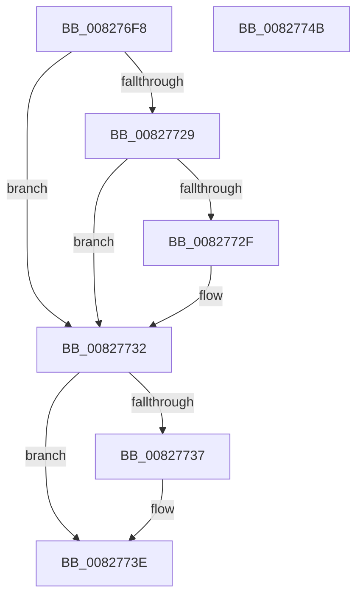

# SyspartIsSpace

- RVA: `0x008276F8`–`0x0082774C` (길이 `84` bytes)
- VA: `0x00000001408276F8`
- 실행 섹션: `PAGE`
- PDB 이름 있음: `예`; PDB Function 태그: `아니요`
- unwind 정보 RVA: `0x0005CAAC`
- 디코드: `27`개 명령, `84/84` bytes 표시
- 미해석 바이트: `0` (있으면 어셈블리에 `.byte`로 보존)

> 이 문서는 커널 이미지의 기계어와 PDB 기호를 분석해 생성했습니다. 4번과 5번은 함수 원형과 자료형을 바이너리 사용 방식에서 추정한 C 해석이며 원본 소스 복구 결과는 아닙니다.

## 1. Dependencies

- 직접 호출 지점: **2**; 고유 호출 대상: **2**
- 직접 호출자로 확인된 함수: **2**
- RIP 상대 이미지 참조: **0**

### Outgoing calls
- `0x00827719` → [SiQueryProperty](../A6/SiQueryProperty_function_00A6896C.md) (function, `0x00A6896C`)
- `0x00827739` → [ExFreePoolWithTag](../../poolcode/B8/ExFreePoolWithTag_function_00B82870.md) (function, `0x00B82870`)

### Direct callers
- [BiMapEfiDeviceForSpaces](../../text/4C/BiMapEfiDeviceForSpaces_function_004C06F4.md) at `0x004C0798`
- [BiSpacesUpdatePhysicalDevicePath](../../text/69/BiSpacesUpdatePhysicalDevicePath_function_0069E6F8.md) at `0x0069E758`

### Static image references
- 디코드된 RIP-relative 메모리 참조가 없습니다.

## 2. Other-region calls and transfers

- 다른 실행 섹션으로 향하는 call: **1**
  - `0x00827739` → [ExFreePoolWithTag](../../poolcode/B8/ExFreePoolWithTag_function_00B82870.md) (`PAGE` → `POOLCODE`)
- 별도 외부 분기/꼬리 이동을 확인하지 못했습니다.

## 3. Assembly (complete function range)

```asm
008276F8  48 89 5C 24 08                  mov qword ptr [rsp + 8], rbx
008276FD  57                              push rdi
008276FE  48 83 EC 20                     sub rsp, 0x20
00827702  48 83 64 24 38 00               and qword ptr [rsp + 0x38], 0
00827708  4C 8D 4C 24 38                  lea r9, [rsp + 0x38]
0082770D  48 8B FA                        mov rdi, rdx
00827710  C6 02 00                        mov byte ptr [rdx], 0
00827713  33 D2                           xor edx, edx
00827715  44 8D 42 08                     lea r8d, [rdx + 8]
00827719  E8 4E 12 24 00                  call 0x140a6896c
0082771E  48 8B 4C 24 38                  mov rcx, qword ptr [rsp + 0x38]
00827723  8B D8                           mov ebx, eax
00827725  85 C0                           test eax, eax
00827727  78 09                           js 0x140827732
00827729  83 79 1C 10                     cmp dword ptr [rcx + 0x1c], 0x10
0082772D  75 03                           jne 0x140827732
0082772F  C6 07 01                        mov byte ptr [rdi], 1
00827732  48 85 C9                        test rcx, rcx
00827735  74 07                           je 0x14082773e
00827737  33 D2                           xor edx, edx
00827739  E8 32 B1 35 00                  call 0x140b82870
0082773E  8B C3                           mov eax, ebx
00827740  48 8B 5C 24 30                  mov rbx, qword ptr [rsp + 0x30]
00827745  48 83 C4 20                     add rsp, 0x20
00827749  5F                              pop rdi
0082774A  C3                              ret
0082774B  CC                              int3
```

## 4. C-style interpretation (structured pseudocode)

```c
__int64 __fastcall SyspartIsSpace(__int64 a1, __int64 a2)
{
    __int64 result;
    __int64 v_rsp;
    unsigned __int64 v_stack_p10;
    unsigned __int64 v_stack_p8;

    v_stack_p8 = v_rbx;
    v_rsp = (v_rsp) - (32);
    *(unsigned __int8 *)(a2) = 0;
    a2 = 0;
    result = SiQueryProperty(a1, a2, a2 + 8, v_stack_p10);
    if (sign_flag) goto loc_00827732;
    if ((*(unsigned int *)(v_stack_p10 + 28)) == 16) {
        *(unsigned __int8 *)(a2) = 1;
    }
    if (v_stack_p10 != 0) {
        a2 = 0;
        result = ExFreePoolWithTag(v_stack_p10, a2, a2 + 8, v_stack_p10);
    }
    v_rsp = (v_rsp) + (32);
    return (unsigned int)((unsigned int)((unsigned int)((unsigned int)(result))));
}
```

## 5. (Beta) C Style

```c
int64_t SyspartIsSpace(int64_t Arg1, void *Arg2)
{
    uint8_t *arg2 = (uint8_t *)Arg2;

    int64_t result;
    int64_t local_rsp;
    uint64_t v_stack_p10;
    uint64_t v_stack_p8;

    v_stack_p8 = local_rbx;
    local_rsp = (local_rsp) - (32);
    *(uint8_t *)(arg2) = 0;
    Arg2 = 0;
    result = SiQueryProperty(Arg1, Arg2, Arg2 + 8, v_stack_p10);
    if (sign_flag) goto loc_00827732;
    if ((*(uint32_t *)(v_stack_p10 + 0x1C)) == 16) {
        *(uint8_t *)(arg2) = 1;
    }
    if (v_stack_p10 != 0) {
        Arg2 = 0;
        result = ExFreePoolWithTag(v_stack_p10, Arg2, Arg2 + 8, v_stack_p10);
    }
    local_rsp = (local_rsp) + (32);
    return (uint32_t)((uint32_t)((uint32_t)((uint32_t)(result))));
}
```

### 관측된 메모리 오프셋

구조체 형식이 확인되지 않은 접근은 인자 기준의 오프셋으로만 기록했습니다.

| 기준 인자 | 오프셋 표현 | 폭 (bit) | 접근 |
|---|---:|---:|---|
| `Arg2` | `+ 0x0` | `8` | `W` |

## 6. Execution-region graph

[열기: 2D/3D 그래프와 함수 탐색 컨트롤 패널](../../../control-panel.html?section=page&rva=0x008276F8&view=graph)

- 2D 그래프는 위에서 아래로 흐르고, 3D 그래프는 빈 공간을 드래그해 회전합니다. Shift+드래그는 이동, 휠은 확대·축소, 함수 노드 선택은 대상 보고서 이동입니다.

### Static fallback


