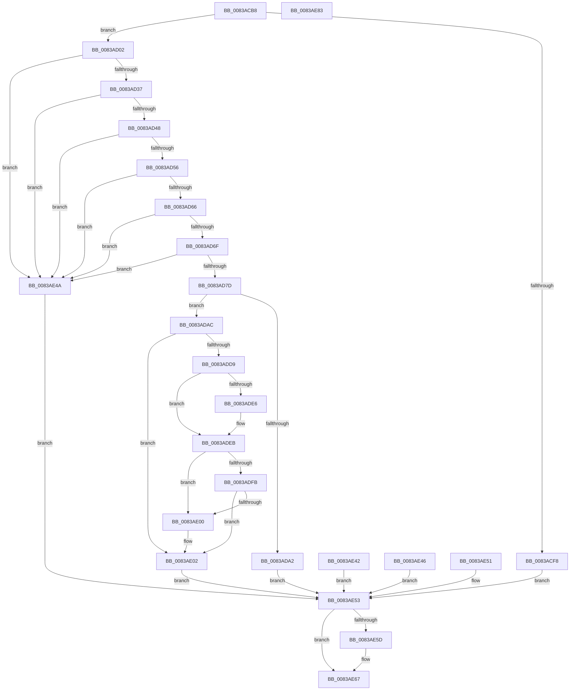

# AhcCacheQueryHwId

- RVA: `0x0083ACB8`–`0x0083AE84` (길이 `460` bytes)
- VA: `0x000000014083ACB8`
- 실행 섹션: `PAGE`
- PDB 이름 있음: `예`; PDB Function 태그: `아니요`
- unwind 정보 RVA: `0x000DB0E8`
- 디코드: `114`개 명령, `460/460` bytes 표시
- 미해석 바이트: `0` (있으면 어셈블리에 `.byte`로 보존)

> 이 문서는 커널 이미지의 기계어와 PDB 기호를 분석해 생성했습니다. 4번과 5번은 함수 원형과 자료형을 바이너리 사용 방식에서 추정한 C 해석이며 원본 소스 복구 결과는 아닙니다.

## 1. Dependencies

- 직접 호출 지점: **9**; 고유 호출 대상: **8**
- 직접 호출자로 확인된 함수: **1**
- RIP 상대 이미지 참조: **0**

### Outgoing calls
- `0x0083ACE2` → [memset](../../text/6C/memset_function_006C6C40.md) (function, `0x006C6C40`)
- `0x0083ACEF` → [ExGetPreviousMode](../../text/44/ExGetPreviousMode_function_0044C3A0.md) (function, `0x0044C3A0`)
- `0x0083AD1E` → [RtlCopyVolatileMemory](../../text/6B/RtlCopyVolatileMemory_function_006BC9D0.md) (function, `0x006BC9D0`)
- `0x0083AD90` → [ExAllocatePool2](../../poolcode/B8/ExAllocatePool2_function_00B820F0.md) (function, `0x00B820F0`)
- `0x0083ADC9` → [memset](../../text/6C/memset_function_006C6C40.md) (function, `0x006C6C40`)
- `0x0083ADE6` → [ExRaiseDatatypeMisalignment](../89/ExRaiseDatatypeMisalignment_function_00899FD0.md) (function, `0x00899FD0`)
- `0x0083AE0F` → [RtlCopyUnicodeString](../../text/3F/RtlCopyUnicodeString_function_003FEF30.md) (function, `0x003FEF30`)
- `0x0083AE1A` → [KseLookupHardwareId](../74/KseLookupHardwareId_function_0074A62C.md) (function, `0x0074A62C`)
- `0x0083AE62` → [ExFreePoolWithTag](../../poolcode/B8/ExFreePoolWithTag_function_00B82870.md) (function, `0x00B82870`)

### Direct callers
- [NtApphelpCacheControl](../95/NtApphelpCacheControl_function_00953050.md) at `0x009531BF`

### Static image references
- 디코드된 RIP-relative 메모리 참조가 없습니다.

## 2. Other-region calls and transfers

- 다른 실행 섹션으로 향하는 call: **7**
  - `0x0083ACE2` → [memset](../../text/6C/memset_function_006C6C40.md) (`PAGE` → `.text`)
  - `0x0083ACEF` → [ExGetPreviousMode](../../text/44/ExGetPreviousMode_function_0044C3A0.md) (`PAGE` → `.text`)
  - `0x0083AD1E` → [RtlCopyVolatileMemory](../../text/6B/RtlCopyVolatileMemory_function_006BC9D0.md) (`PAGE` → `.text`)
  - `0x0083AD90` → [ExAllocatePool2](../../poolcode/B8/ExAllocatePool2_function_00B820F0.md) (`PAGE` → `POOLCODE`)
  - `0x0083ADC9` → [memset](../../text/6C/memset_function_006C6C40.md) (`PAGE` → `.text`)
  - `0x0083AE0F` → [RtlCopyUnicodeString](../../text/3F/RtlCopyUnicodeString_function_003FEF30.md) (`PAGE` → `.text`)
  - `0x0083AE62` → [ExFreePoolWithTag](../../poolcode/B8/ExFreePoolWithTag_function_00B82870.md) (`PAGE` → `POOLCODE`)
- 별도 외부 분기/꼬리 이동을 확인하지 못했습니다.

## 3. Assembly (complete function range)

```asm
0083ACB8  48 89 5C 24 08                  mov qword ptr [rsp + 8], rbx
0083ACBD  48 89 74 24 18                  mov qword ptr [rsp + 0x18], rsi
0083ACC2  48 89 7C 24 20                  mov qword ptr [rsp + 0x20], rdi
0083ACC7  41 56                           push r14
0083ACC9  48 81 EC C0 01 00 00            sub rsp, 0x1c0
0083ACD0  48 8B F9                        mov rdi, rcx
0083ACD3  BB 88 01 00 00                  mov ebx, 0x188
0083ACD8  44 8B C3                        mov r8d, ebx
0083ACDB  33 D2                           xor edx, edx
0083ACDD  48 8D 4C 24 30                  lea rcx, [rsp + 0x30]
0083ACE2  E8 59 BF E8 FF                  call 0x1406c6c40
0083ACE7  0F 57 C0                        xorps xmm0, xmm0
0083ACEA  0F 11 44 24 20                  movups xmmword ptr [rsp + 0x20], xmm0
0083ACEF  E8 AC 16 C1 FF                  call 0x14044c3a0
0083ACF4  3C 01                           cmp al, 1
0083ACF6  74 0A                           je 0x14083ad02
0083ACF8  BF 02 00 00 C0                  mov edi, 0xc0000002
0083ACFD  E9 51 01 00 00                  jmp 0x14083ae53
0083AD02  48 BE 00 00 FF FF FF 7F 00 00   movabs rsi, 0x7fffffff0000
0083AD0C  48 8B D6                        mov rdx, rsi
0083AD0F  48 3B FE                        cmp rdi, rsi
0083AD12  48 0F 42 D7                     cmovb rdx, rdi
0083AD16  4C 8B C3                        mov r8, rbx
0083AD19  48 8D 4C 24 30                  lea rcx, [rsp + 0x30]
0083AD1E  E8 AD 1C E8 FF                  call 0x1406bc9d0
0083AD23  90                              nop
0083AD24  48 8B 94 24 7A 01 00 00         mov rdx, qword ptr [rsp + 0x17a]
0083AD2C  33 DB                           xor ebx, ebx
0083AD2E  66 85 D2                        test dx, dx
0083AD31  0F 84 13 01 00 00               je 0x14083ae4a
0083AD37  0F B7 8C 24 78 01 00 00         movzx ecx, word ptr [rsp + 0x178]
0083AD3F  66 85 C9                        test cx, cx
0083AD42  0F 84 02 01 00 00               je 0x14083ae4a
0083AD48  48 39 9C 24 80 01 00 00         cmp qword ptr [rsp + 0x180], rbx
0083AD50  0F 84 F4 00 00 00               je 0x14083ae4a
0083AD56  0F B7 C1                        movzx eax, cx
0083AD59  66 0B C2                        or ax, dx
0083AD5C  66 0F A3 D8                     bt ax, bx
0083AD60  0F 82 E4 00 00 00               jb 0x14083ae4a
0083AD66  66 3B CA                        cmp cx, dx
0083AD69  0F 87 DB 00 00 00               ja 0x14083ae4a
0083AD6F  B8 FC FF 00 00                  mov eax, 0xfffc
0083AD74  66 3B C8                        cmp cx, ax
0083AD77  0F 87 CD 00 00 00               ja 0x14083ae4a
0083AD7D  44 8D 73 02                     lea r14d, [rbx + 2]
0083AD81  49 8D 14 0E                     lea rdx, [r14 + rcx]
0083AD85  B9 00 01 00 00                  mov ecx, 0x100
0083AD8A  41 B8 61 70 63 6F               mov r8d, 0x6f637061
0083AD90  E8 5B 73 34 00                  call 0x140b820f0
0083AD95  48 8B C8                        mov rcx, rax
0083AD98  48 89 44 24 28                  mov qword ptr [rsp + 0x28], rax
0083AD9D  48 85 C0                        test rax, rax
0083ADA0  75 0A                           jne 0x14083adac
0083ADA2  BF 9A 00 00 C0                  mov edi, 0xc000009a
0083ADA7  E9 A7 00 00 00                  jmp 0x14083ae53
0083ADAC  0F B7 84 24 78 01 00 00         movzx eax, word ptr [rsp + 0x178]
0083ADB4  66 41 03 C6                     add ax, r14w
0083ADB8  44 0F B7 C0                     movzx r8d, ax
0083ADBC  66 44 89 44 24 22               mov word ptr [rsp + 0x22], r8w
0083ADC2  66 89 5C 24 20                  mov word ptr [rsp + 0x20], bx
0083ADC7  33 D2                           xor edx, edx
0083ADC9  E8 72 BE E8 FF                  call 0x1406c6c40
0083ADCE  90                              nop
0083ADCF  66 39 9C 24 7A 01 00 00         cmp word ptr [rsp + 0x17a], bx
0083ADD7  74 29                           je 0x14083ae02
0083ADD9  48 8B 8C 24 80 01 00 00         mov rcx, qword ptr [rsp + 0x180]
0083ADE1  F6 C1 01                        test cl, 1
0083ADE4  74 05                           je 0x14083adeb
0083ADE6  E8 E5 F1 05 00                  call 0x140899fd0
0083ADEB  0F B7 94 24 7A 01 00 00         movzx edx, word ptr [rsp + 0x17a]
0083ADF3  48 03 D1                        add rdx, rcx
0083ADF6  48 3B D6                        cmp rdx, rsi
0083ADF9  77 05                           ja 0x14083ae00
0083ADFB  48 3B D1                        cmp rdx, rcx
0083ADFE  73 02                           jae 0x14083ae02
0083AE00  8A 06                           mov al, byte ptr [rsi]
0083AE02  48 8D 94 24 78 01 00 00         lea rdx, [rsp + 0x178]
0083AE0A  48 8D 4C 24 20                  lea rcx, [rsp + 0x20]
0083AE0F  E8 1C 41 BC FF                  call 0x1403fef30
0083AE14  90                              nop
0083AE15  48 8B 4C 24 28                  mov rcx, qword ptr [rsp + 0x28]
0083AE1A  E8 0D F8 F0 FF                  call 0x14074a62c
0083AE1F  90                              nop
0083AE20  8B CB                           mov ecx, ebx
0083AE22  85 C0                           test eax, eax
0083AE24  0F 94 C1                        sete cl
0083AE27  89 8C 24 D8 01 00 00            mov dword ptr [rsp + 0x1d8], ecx
0083AE2E  48 8D 87 40 01 00 00            lea rax, [rdi + 0x140]
0083AE35  48 3B C6                        cmp rax, rsi
0083AE38  48 0F 43 C6                     cmovae rax, rsi
0083AE3C  88 08                           mov byte ptr [rax], cl
0083AE3E  8B FB                           mov edi, ebx
0083AE40  EB 11                           jmp 0x14083ae53
0083AE42  8B F8                           mov edi, eax
0083AE44  EB 0D                           jmp 0x14083ae53
0083AE46  8B F8                           mov edi, eax
0083AE48  EB 09                           jmp 0x14083ae53
0083AE4A  BF 0D 00 00 C0                  mov edi, 0xc000000d
0083AE4F  EB 02                           jmp 0x14083ae53
0083AE51  8B F8                           mov edi, eax
0083AE53  48 8B 4C 24 28                  mov rcx, qword ptr [rsp + 0x28]
0083AE58  48 85 C9                        test rcx, rcx
0083AE5B  74 0A                           je 0x14083ae67
0083AE5D  BA 61 70 63 6F                  mov edx, 0x6f637061
0083AE62  E8 09 7A 34 00                  call 0x140b82870
0083AE67  8B C7                           mov eax, edi
0083AE69  4C 8D 9C 24 C0 01 00 00         lea r11, [rsp + 0x1c0]
0083AE71  49 8B 5B 10                     mov rbx, qword ptr [r11 + 0x10]
0083AE75  49 8B 73 20                     mov rsi, qword ptr [r11 + 0x20]
0083AE79  49 8B 7B 28                     mov rdi, qword ptr [r11 + 0x28]
0083AE7D  49 8B E3                        mov rsp, r11
0083AE80  41 5E                           pop r14
0083AE82  C3                              ret
0083AE83  CC                              int3
```

## 4. C-style interpretation (structured pseudocode)

```c
__int64 __fastcall AhcCacheQueryHwId(__int64 a1, int a2)
{
    __int64 result;
    __int64 v_rbx;
    __int64 v_rsp;
    unsigned __int64 v_stack_m198;
    unsigned __int64 v_stack_m1A0;
    unsigned __int16 v_stack_m1A6;
    unsigned __int64 v_stack_m1A8;
    unsigned __int64 v_stack_m48;
    unsigned __int64 v_stack_m4E;
    unsigned __int16 v_stack_m50;
    unsigned __int64 v_stack_m8;
    unsigned int v_stack_p10;
    unsigned __int64 v_stack_p18;
    unsigned __int64 v_stack_p20;
    unsigned __int64 v_stack_p8;

    v_stack_p8 = v_rbx;
    v_stack_p18 = v_rsi;
    v_stack_p20 = v_rdi;
    v_rsp = (v_rsp) - (448);
    a2 = 0;
    result = memset(v_stack_m198, a2, 392, a4);
    v_stack_m1A8 = v_xmm0;
    result = ExGetPreviousMode(v_stack_m198, a2, 392, a4);
    if (((unsigned __int8)(result)) == 1) goto loc_0083AD02;
    goto loc_0083AE53;
loc_0083AD02:
    a2 = v_rsi;
    if (((unsigned int)(0xC0000002ULL)) < v_rsi) { a2 = (unsigned int)(0xC0000002ULL); }
    result = RtlCopyVolatileMemory(v_stack_m198, a2, 392, a4);
    v_rbx = 0;
    if ((unsigned __int16)(v_stack_m4E) == 0) goto loc_0083AE4A;
    if ((unsigned __int16)(v_stack_m50) == 0) goto loc_0083AE4A;
    if (v_stack_m48 == 0) goto loc_0083AE4A;
    result = (unsigned __int16)(((unsigned __int16)(v_stack_m50)) | ((unsigned __int16)(v_stack_m4E)));
    if (condition_is_below) goto loc_0083AE4A;
    if (((unsigned __int16)(v_stack_m50)) > ((unsigned __int16)(v_stack_m4E))) goto loc_0083AE4A;
    if (((unsigned __int16)(v_stack_m50)) > ((unsigned __int16)((unsigned int)(0xFFFCULL)))) goto loc_0083AE4A;
    result = ExAllocatePool2(256, v_rbx + 2 + v_stack_m50 * 1, (unsigned int)(0x6F637061ULL), a4);
    v_stack_m1A0 = result;
    if (result != 0) goto loc_0083ADAC;
    goto loc_0083AE53;
loc_0083ADAC:
    result = (unsigned __int16)((v_stack_m50) + ((unsigned __int16)(v_rbx + 2)));
    v_stack_m1A6 = (unsigned __int16)((unsigned __int16)(result));
    v_stack_m1A8 = 0;
    a2 = 0;
    result = memset(result, a2, (unsigned __int16)(result), a4);
    if (v_stack_m4E == 0) goto loc_0083AE02;
    if ((((unsigned __int8)(v_stack_m48)) & (1)) != 0) {
        result = ExRaiseDatatypeMisalignment(v_stack_m48, a2, (unsigned __int16)(result), a4);
    }
    a2 = (v_stack_m4E) + (v_stack_m48);
    if (a2 > v_rsi) goto loc_0083AE00;
    if (a2 < v_stack_m48) {
        result = *(unsigned __int8 *)(v_rsi);
    }
    result = RtlCopyUnicodeString(v_stack_m1A8, v_stack_m50, (unsigned __int16)(result), a4);
    result = KseLookupHardwareId(v_stack_m1A0, v_stack_m50, (unsigned __int16)(result), a4);
    a1 = ((unsigned int)(result) == 0) ? 1 : 0;
    v_stack_p10 = (unsigned int)(a1);
    result = (unsigned int)(0xC000009AULL) + 320;
    if (((unsigned int)(0xC000009AULL) + 320) >= v_rsi) { result = v_rsi; }
    *(unsigned __int8 *)(result) = (unsigned __int8)(a1);
    goto loc_0083AE53;
loc_0083AE4A:
    goto loc_0083AE53;
loc_0083AE53:
    if (v_stack_m1A0 != 0) {
        a2 = 0x6F637061ULL;
        result = ExFreePoolWithTag(v_stack_m1A0, a2, (unsigned __int16)(result), a4);
    }
    return (unsigned int)((unsigned int)((unsigned int)(0xC000000DULL)));
}
```

## 5. (Beta) C Style

```c
int64_t AhcCacheQueryHwId(int64_t Arg1, int32_t Arg2)
{
    int64_t result;
    int64_t local_rbx;
    int64_t local_rsp;
    uint64_t v_stack_m198;
    uint64_t v_stack_m1A0;
    uint16_t v_stack_m1A6;
    uint64_t v_stack_m1A8;
    uint64_t v_stack_m48;
    uint64_t v_stack_m4E;
    uint16_t v_stack_m50;
    uint64_t v_stack_m8;
    uint32_t v_stack_p10;
    uint64_t v_stack_p18;
    uint64_t v_stack_p20;
    uint64_t v_stack_p8;

    v_stack_p8 = local_rbx;
    v_stack_p18 = local_rsi;
    v_stack_p20 = local_rdi;
    local_rsp = (local_rsp) - (448);
    Arg2 = 0;
    result = memset(v_stack_m198, Arg2, 392, a4);
    v_stack_m1A8 = v_xmm0;
    result = ExGetPreviousMode(v_stack_m198, Arg2, 392, a4);
    if (((uint8_t)(result)) == 1) goto loc_0083AD02;
    goto loc_0083AE53;
loc_0083AD02:
    Arg2 = local_rsi;
    if (((uint32_t)(0xC0000002ULL)) < local_rsi) { Arg2 = (uint32_t)(0xC0000002ULL); }
    result = RtlCopyVolatileMemory(v_stack_m198, Arg2, 392, a4);
    local_rbx = 0;
    if ((uint16_t)(v_stack_m4E) == 0) goto loc_0083AE4A;
    if ((uint16_t)(v_stack_m50) == 0) goto loc_0083AE4A;
    if (v_stack_m48 == 0) goto loc_0083AE4A;
    result = (uint16_t)(((uint16_t)(v_stack_m50)) | ((uint16_t)(v_stack_m4E)));
    if (condition_is_below) goto loc_0083AE4A;
    if (((uint16_t)(v_stack_m50)) > ((uint16_t)(v_stack_m4E))) goto loc_0083AE4A;
    if (((uint16_t)(v_stack_m50)) > ((uint16_t)((uint32_t)(0xFFFCULL)))) goto loc_0083AE4A;
    result = ExAllocatePool2(256, local_rbx + 2 + v_stack_m50 * 1, (uint32_t)(0x6F637061ULL), a4);
    v_stack_m1A0 = result;
    if (result != 0) goto loc_0083ADAC;
    goto loc_0083AE53;
loc_0083ADAC:
    result = (uint16_t)((v_stack_m50) + ((uint16_t)(local_rbx + 2)));
    v_stack_m1A6 = (uint16_t)((uint16_t)(result));
    v_stack_m1A8 = 0;
    Arg2 = 0;
    result = memset(result, Arg2, (uint16_t)(result), a4);
    if (v_stack_m4E == 0) goto loc_0083AE02;
    if ((((uint8_t)(v_stack_m48)) & (1)) != 0) {
        result = ExRaiseDatatypeMisalignment(v_stack_m48, Arg2, (uint16_t)(result), a4);
    }
    Arg2 = (v_stack_m4E) + (v_stack_m48);
    if (Arg2 > local_rsi) goto loc_0083AE00;
    if (Arg2 < v_stack_m48) {
        result = *(uint8_t *)(local_rsi);
    }
    result = RtlCopyUnicodeString(v_stack_m1A8, v_stack_m50, (uint16_t)(result), a4);
    result = KseLookupHardwareId(v_stack_m1A0, v_stack_m50, (uint16_t)(result), a4);
    Arg1 = ((uint32_t)(result) == 0) ? 1 : 0;
    v_stack_p10 = (uint32_t)(Arg1);
    result = (uint32_t)(0xC000009AULL) + 320;
    if (((uint32_t)(0xC000009AULL) + 320) >= local_rsi) { result = local_rsi; }
    *(uint8_t *)(result) = (uint8_t)(Arg1);
    goto loc_0083AE53;
loc_0083AE4A:
    goto loc_0083AE53;
loc_0083AE53:
    if (v_stack_m1A0 != 0) {
        Arg2 = 0x6F637061ULL;
        result = ExFreePoolWithTag(v_stack_m1A0, Arg2, (uint16_t)(result), a4);
    }
    return (uint32_t)((uint32_t)((uint32_t)(0xC000000DULL)));
}
```

## 6. Execution-region graph

[열기: 2D/3D 그래프와 함수 탐색 컨트롤 패널](../../../control-panel.html?section=page&rva=0x0083ACB8&view=graph)

- 2D 그래프는 위에서 아래로 흐르고, 3D 그래프는 빈 공간을 드래그해 회전합니다. Shift+드래그는 이동, 휠은 확대·축소, 함수 노드 선택은 대상 보고서 이동입니다.

### Static fallback


