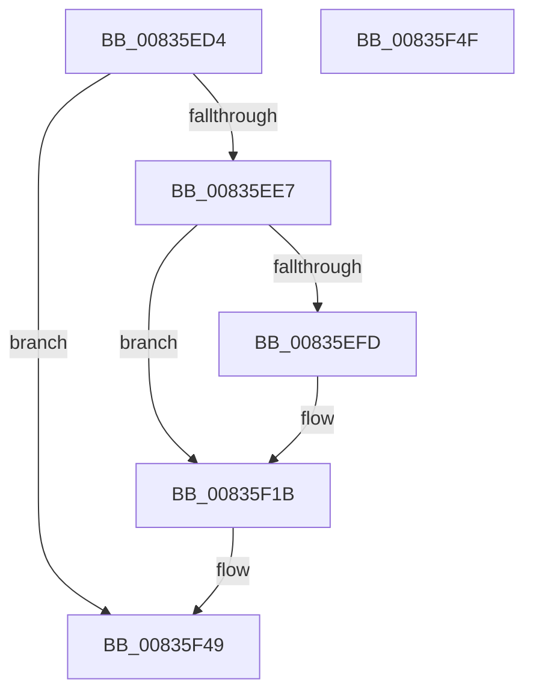

# CancelTimerCallbacksAndDeleteTimer

- RVA: `0x00835ED4`–`0x00835F50` (길이 `124` bytes)
- VA: `0x0000000140835ED4`
- 실행 섹션: `PAGE`
- PDB 이름 있음: `예`; PDB Function 태그: `예`
- unwind 정보 RVA: `0x00071A74`
- 디코드: `31`개 명령, `124/124` bytes 표시
- 미해석 바이트: `0` (있으면 어셈블리에 `.byte`로 보존)

> 이 문서는 커널 이미지의 기계어와 PDB 기호를 분석해 생성했습니다. 4번과 5번은 함수 원형과 자료형을 바이너리 사용 방식에서 추정한 C 해석이며 원본 소스 복구 결과는 아닙니다.

## 1. Dependencies

- 직접 호출 지점: **2**; 고유 호출 대상: **2**
- 직접 호출자로 확인된 함수: **1**
- RIP 상대 이미지 참조: **0**

### Outgoing calls
- `0x00835F16` → [KeWaitForSingleObject](../../text/20/KeWaitForSingleObject_function_0020E6B0.md) (function, `0x0020E6B0`)
- `0x00835F3C` → [ExDeleteTimer](../../text/39/ExDeleteTimer_function_0039F2E0.md) (function, `0x0039F2E0`)

### Direct callers
- [DestroyAggregateSession](DestroyAggregateSession_function_00836138.md) at `0x00836145`

### Static image references
- 디코드된 RIP-relative 메모리 참조가 없습니다.

## 2. Other-region calls and transfers

- 다른 실행 섹션으로 향하는 call: **2**
  - `0x00835F16` → [KeWaitForSingleObject](../../text/20/KeWaitForSingleObject_function_0020E6B0.md) (`PAGE` → `.text`)
  - `0x00835F3C` → [ExDeleteTimer](../../text/39/ExDeleteTimer_function_0039F2E0.md) (`PAGE` → `.text`)
- 별도 외부 분기/꼬리 이동을 확인하지 못했습니다.

## 3. Assembly (complete function range)

```asm
00835ED4  40 53                           push rbx
00835ED6  48 83 EC 50                     sub rsp, 0x50
00835EDA  48 83 B9 68 01 00 00 00         cmp qword ptr [rcx + 0x168], 0
00835EE2  48 8B D9                        mov rbx, rcx
00835EE5  74 62                           je 0x140835f49
00835EE7  48 8B 81 08 01 00 00            mov rax, qword ptr [rcx + 0x108]
00835EEE  BA 02 00 00 00                  mov edx, 2
00835EF3  66 87 50 38                     xchg word ptr [rax + 0x38], dx
00835EF7  66 83 FA 01                     cmp dx, 1
00835EFB  75 1E                           jne 0x140835f1b
00835EFD  48 8B 89 08 01 00 00            mov rcx, qword ptr [rcx + 0x108]
00835F04  45 33 C9                        xor r9d, r9d
00835F07  48 83 64 24 20 00               and qword ptr [rsp + 0x20], 0
00835F0D  48 83 C1 20                     add rcx, 0x20
00835F11  45 33 C0                        xor r8d, r8d
00835F14  33 D2                           xor edx, edx
00835F16  E8 95 87 9D FF                  call 0x14020e6b0
00835F1B  48 8B 8B 68 01 00 00            mov rcx, qword ptr [rbx + 0x168]
00835F22  4C 8D 4C 24 30                  lea r9, [rsp + 0x30]
00835F27  41 B0 01                        mov r8b, 1
00835F2A  0F 57 C0                        xorps xmm0, xmm0
00835F2D  33 C0                           xor eax, eax
00835F2F  41 8A D0                        mov dl, r8b
00835F32  0F 11 44 24 30                  movups xmmword ptr [rsp + 0x30], xmm0
00835F37  48 89 44 24 40                  mov qword ptr [rsp + 0x40], rax
00835F3C  E8 9F 93 B6 FF                  call 0x14039f2e0
00835F41  48 83 A3 68 01 00 00 00         and qword ptr [rbx + 0x168], 0
00835F49  48 83 C4 50                     add rsp, 0x50
00835F4D  5B                              pop rbx
00835F4E  C3                              ret
00835F4F  CC                              int3
```

## 4. C-style interpretation (structured pseudocode)

```c
__int64 __fastcall CancelTimerCallbacksAndDeleteTimer(__int64 a1, __int64 a2, int a3, int a4)
{
    __int64 result;
    __int64 v_rsp;
    unsigned __int64 v_stack_m18;
    unsigned __int64 v_stack_m28;
    unsigned __int64 v_stack_m38;

    v_rsp = (v_rsp) - (80);
    if ((*(unsigned __int64 *)(a1 + 360)) == 0) goto loc_00835F49;
    result = *(unsigned __int64 *)(a1 + 264);
    if (2 == 1) {
        a1 = *(unsigned __int64 *)(a1 + 264);
        a4 = 0;
        a1 = (a1) + (32);
        a3 = 0;
        a2 = 0;
        result = KeWaitForSingleObject(a1, a2, a3, a4);
    }
    result = 0;
    v_stack_m28 = v_xmm0;
    v_stack_m18 = 0;
    result = ExDeleteTimer(*(unsigned __int64 *)(a1 + 360), 1, 1, v_stack_m28);
loc_00835F49:
    v_rsp = (v_rsp) + (80);
    return result;
}
```

## 5. (Beta) C Style

```c
int64_t CancelTimerCallbacksAndDeleteTimer(void *Arg1, int64_t Arg2, int32_t Arg3, int32_t Arg4)
{
    uint8_t *arg1 = (uint8_t *)Arg1;

    int64_t result;
    int64_t local_rsp;
    uint64_t v_stack_m18;
    uint64_t v_stack_m28;
    uint64_t v_stack_m38;

    local_rsp = (local_rsp) - (80);
    if ((*(uint64_t *)(arg1 + 0x168)) == 0) goto loc_00835F49;
    result = *(uint64_t *)(arg1 + 0x108);
    if (2 == 1) {
        Arg1 = *(uint64_t *)(arg1 + 0x108);
        Arg4 = 0;
        Arg1 = (Arg1) + (32);
        Arg3 = 0;
        Arg2 = 0;
        result = KeWaitForSingleObject(Arg1, Arg2, Arg3, Arg4);
    }
    result = 0;
    v_stack_m28 = v_xmm0;
    v_stack_m18 = 0;
    result = ExDeleteTimer(*(uint64_t *)(arg1 + 0x168), 1, 1, v_stack_m28);
loc_00835F49:
    local_rsp = (local_rsp) + (80);
    return result;
}
```

### 관측된 메모리 오프셋

구조체 형식이 확인되지 않은 접근은 인자 기준의 오프셋으로만 기록했습니다.

| 기준 인자 | 오프셋 표현 | 폭 (bit) | 접근 |
|---|---:|---:|---|
| `Arg1` | `+ 0x108` | `64` | `R` |
| `Arg1` | `+ 0x168` | `64` | `R` |
| `Arg1` | `+ 0x168` | `64` | `R/W` |

## 6. Execution-region graph

[열기: 2D/3D 그래프와 함수 탐색 컨트롤 패널](../../../control-panel.html?section=page&rva=0x00835ED4&view=graph)

- 2D 그래프는 위에서 아래로 흐르고, 3D 그래프는 빈 공간을 드래그해 회전합니다. Shift+드래그는 이동, 휠은 확대·축소, 함수 노드 선택은 대상 보고서 이동입니다.

### Static fallback


