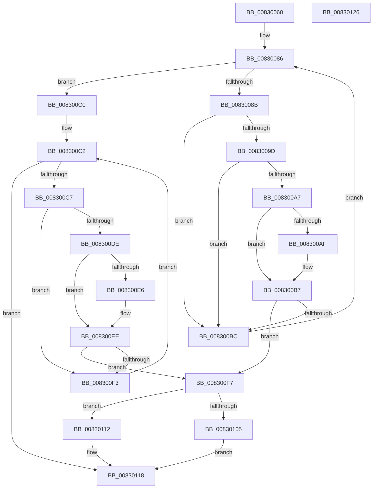

# CmGetDeviceInterfaceMappedPropertyLocales

- RVA: `0x00830060`–`0x00830127` (길이 `199` bytes)
- VA: `0x0000000140830060`
- 실행 섹션: `PAGE`
- PDB 이름 있음: `예`; PDB Function 태그: `아니요`
- unwind 정보 RVA: `0x000D30C4`
- 디코드: `59`개 명령, `199/199` bytes 표시
- 미해석 바이트: `0` (있으면 어셈블리에 `.byte`로 보존)

> 이 문서는 커널 이미지의 기계어와 PDB 기호를 분석해 생성했습니다. 4번과 5번은 함수 원형과 자료형을 바이너리 사용 방식에서 추정한 C 해석이며 원본 소스 복구 결과는 아닙니다.

## 1. Dependencies

- 직접 호출 지점: **0**; 고유 호출 대상: **0**
- 직접 호출자로 확인된 함수: **1**
- RIP 상대 이미지 참조: **1**

### Outgoing calls
- 직접 디코드된 call 명령이 없습니다.

### Direct callers
- [_PnpDispatchDeviceInterface](../8E/_PnpDispatchDeviceInterface_function_008E0DB0.md) at `0x008E1075`

### Static image references
- `0x0083006F` → RVA `0x00000000` (`image boundary/outside`; read)

## 2. Other-region calls and transfers

- 다른 실행 섹션으로 향하는 call: **0**
- 별도 외부 분기/꼬리 이동을 확인하지 못했습니다.

## 3. Assembly (complete function range)

```asm
00830060  48 89 5C 24 08                  mov qword ptr [rsp + 8], rbx
00830065  48 89 74 24 10                  mov qword ptr [rsp + 0x10], rsi
0083006A  4C 8B 5C 24 38                  mov r11, qword ptr [rsp + 0x38]
0083006F  48 8D 35 8A FF 7C FF            lea rsi, [rip - 0x830076]
00830076  33 DB                           xor ebx, ebx
00830078  4D 8B D1                        mov r10, r9
0083007B  41 B8 16 00 00 C0               mov r8d, 0xc0000016
00830081  8B D3                           mov edx, ebx
00830083  41 89 1B                        mov dword ptr [r11], ebx
00830086  83 FA 03                        cmp edx, 3
00830089  73 35                           jae 0x1408300c0
0083008B  8B C2                           mov eax, edx
0083008D  48 03 C0                        add rax, rax
00830090  4C 8B 8C C6 E0 B1 B4 00         mov r9, qword ptr [rsi + rax*8 + 0xb4b1e0]
00830098  4D 85 C9                        test r9, r9
0083009B  74 1F                           je 0x1408300bc
0083009D  41 8B 41 10                     mov eax, dword ptr [r9 + 0x10]
008300A1  41 39 42 10                     cmp dword ptr [r10 + 0x10], eax
008300A5  75 15                           jne 0x1408300bc
008300A7  49 8B 0A                        mov rcx, qword ptr [r10]
008300AA  49 2B 09                        sub rcx, qword ptr [r9]
008300AD  75 08                           jne 0x1408300b7
008300AF  49 8B 4A 08                     mov rcx, qword ptr [r10 + 8]
008300B3  49 2B 49 08                     sub rcx, qword ptr [r9 + 8]
008300B7  48 85 C9                        test rcx, rcx
008300BA  74 3B                           je 0x1408300f7
008300BC  FF C2                           inc edx
008300BE  EB C6                           jmp 0x140830086
008300C0  8B D3                           mov edx, ebx
008300C2  83 FA 04                        cmp edx, 4
008300C5  73 51                           jae 0x140830118
008300C7  8B C2                           mov eax, edx
008300C9  48 03 C0                        add rax, rax
008300CC  4C 8B 8C C6 00 BA B4 00         mov r9, qword ptr [rsi + rax*8 + 0xb4ba00]
008300D4  41 8B 41 10                     mov eax, dword ptr [r9 + 0x10]
008300D8  41 39 42 10                     cmp dword ptr [r10 + 0x10], eax
008300DC  75 15                           jne 0x1408300f3
008300DE  49 8B 0A                        mov rcx, qword ptr [r10]
008300E1  49 2B 09                        sub rcx, qword ptr [r9]
008300E4  75 08                           jne 0x1408300ee
008300E6  49 8B 4A 08                     mov rcx, qword ptr [r10 + 8]
008300EA  49 2B 49 08                     sub rcx, qword ptr [r9 + 8]
008300EE  48 85 C9                        test rcx, rcx
008300F1  74 04                           je 0x1408300f7
008300F3  FF C2                           inc edx
008300F5  EB CB                           jmp 0x1408300c2
008300F7  83 7C 24 30 01                  cmp dword ptr [rsp + 0x30], 1
008300FC  41 C7 03 01 00 00 00            mov dword ptr [r11], 1
00830103  72 0D                           jb 0x140830112
00830105  48 8B 44 24 28                  mov rax, qword ptr [rsp + 0x28]
0083010A  44 8B C3                        mov r8d, ebx
0083010D  66 89 18                        mov word ptr [rax], bx
00830110  EB 06                           jmp 0x140830118
00830112  41 B8 23 00 00 C0               mov r8d, 0xc0000023
00830118  48 8B 5C 24 08                  mov rbx, qword ptr [rsp + 8]
0083011D  41 8B C0                        mov eax, r8d
00830120  48 8B 74 24 10                  mov rsi, qword ptr [rsp + 0x10]
00830125  C3                              ret
00830126  CC                              int3
```

## 4. C-style interpretation (structured pseudocode)

```c
__int64 __fastcall CmGetDeviceInterfaceMappedPropertyLocales(__int64 a1, __int64 a2, __int64 a3, __int64 a4, __int64 a5, unsigned int a6, __int64 a7)
{
    __int64 result;
    __int64 v_rbx;
    unsigned __int64 v_stack_p10;
    unsigned __int64 v_stack_p8;

    v_stack_p8 = v_rbx;
    v_stack_p10 = v_rsi;
    v_rbx = 0;
    *(unsigned int *)(a7) = 0;
loc_00830086:
    if (0 >= 3) goto loc_008300C0;
    result = (0) + (0);
    if (*(unsigned __int64 *)(v_rip - 8585334 + result * 8 + 11842016) == 0) goto loc_008300BC;
    if ((*(unsigned int *)(a4 + 16)) != ((unsigned int)((unsigned int)(*(unsigned int *)(*(unsigned __int64 *)(v_rip - 8585334 + result * 8 + 11842016) + 16))))) goto loc_008300BC;
    a1 = (*(unsigned __int64 *)(a4)) - (*(unsigned __int64 *)(*(unsigned __int64 *)(v_rip - 8585334 + result * 8 + 11842016)));
    if (!(condition_is_not_equal)) {
        a1 = *(unsigned __int64 *)(a4 + 8);
        a1 = (a1) - (*(unsigned __int64 *)(*(unsigned __int64 *)(v_rip - 8585334 + result * 8 + 11842016) + 8));
    }
    if (a1 == 0) goto loc_008300F7;
loc_008300BC:
    a2 = (unsigned int)((0) + 1);
    goto loc_00830086;
loc_008300C0:
loc_008300C2:
    if (0 >= 4) goto loc_00830118;
    result = (0) + (0);
    if ((*(unsigned int *)(a4 + 16)) != ((unsigned int)((unsigned int)(*(unsigned int *)(*(unsigned __int64 *)(v_rip - 8585334 + result * 8 + 11844096) + 16))))) goto loc_008300F3;
    a1 = (*(unsigned __int64 *)(a4)) - (*(unsigned __int64 *)(*(unsigned __int64 *)(v_rip - 8585334 + result * 8 + 11844096)));
    if (!(condition_is_not_equal)) {
        a1 = *(unsigned __int64 *)(a4 + 8);
        a1 = (a1) - (*(unsigned __int64 *)(*(unsigned __int64 *)(v_rip - 8585334 + result * 8 + 11844096) + 8));
    }
    if (a1 == 0) goto loc_008300F7;
loc_008300F3:
    a2 = (unsigned int)((0) + 1);
    goto loc_008300C2;
loc_008300F7:
    *(unsigned int *)(a7) = 1;
    if (a6 < 1) goto loc_00830112;
    *(unsigned __int16 *)(a5) = 0;
    goto loc_00830118;
loc_00830112:
loc_00830118:
    return (unsigned int)((unsigned int)((unsigned int)(0xC0000023ULL)));
}
```

## 5. (Beta) C Style

```c
int64_t CmGetDeviceInterfaceMappedPropertyLocales(int64_t Arg1, int64_t Arg2, int64_t Arg3, void *Arg4, void *Arg5, uint32_t Arg6, void *Arg7)
{
    uint8_t *arg4 = (uint8_t *)Arg4;
    uint8_t *arg5 = (uint8_t *)Arg5;
    uint8_t *arg7 = (uint8_t *)Arg7;

    int64_t result;
    int64_t local_rbx;
    uint64_t v_stack_p10;
    uint64_t v_stack_p8;

    v_stack_p8 = local_rbx;
    v_stack_p10 = local_rsi;
    local_rbx = 0;
    *(uint32_t *)(arg7) = 0;
loc_00830086:
    if (0 >= 3) goto loc_008300C0;
    result = (0) + (0);
    if (*(uint64_t *)(v_rip - 0x830076 + result * 8 + 0xB4B1E0) == 0) goto loc_008300BC;
    if ((*(uint32_t *)(arg4 + 0x10)) != ((uint32_t)((uint32_t)(*(uint32_t *)(*(uint64_t *)(v_rip - 0x830076 + result * 8 + 0xB4B1E0) + 0x10))))) goto loc_008300BC;
    Arg1 = (*(uint64_t *)(arg4)) - (*(uint64_t *)(*(uint64_t *)(v_rip - 0x830076 + result * 8 + 0xB4B1E0)));
    if (!(condition_is_not_equal)) {
        Arg1 = *(uint64_t *)(arg4 + 0x8);
        Arg1 = (Arg1) - (*(uint64_t *)(*(uint64_t *)(v_rip - 0x830076 + result * 8 + 0xB4B1E0) + 0x8));
    }
    if (Arg1 == 0) goto loc_008300F7;
loc_008300BC:
    Arg2 = (uint32_t)((0) + 1);
    goto loc_00830086;
loc_008300C0:
loc_008300C2:
    if (0 >= 4) goto loc_00830118;
    result = (0) + (0);
    if ((*(uint32_t *)(arg4 + 0x10)) != ((uint32_t)((uint32_t)(*(uint32_t *)(*(uint64_t *)(v_rip - 0x830076 + result * 8 + 0xB4BA00) + 0x10))))) goto loc_008300F3;
    Arg1 = (*(uint64_t *)(arg4)) - (*(uint64_t *)(*(uint64_t *)(v_rip - 0x830076 + result * 8 + 0xB4BA00)));
    if (!(condition_is_not_equal)) {
        Arg1 = *(uint64_t *)(arg4 + 0x8);
        Arg1 = (Arg1) - (*(uint64_t *)(*(uint64_t *)(v_rip - 0x830076 + result * 8 + 0xB4BA00) + 0x8));
    }
    if (Arg1 == 0) goto loc_008300F7;
loc_008300F3:
    Arg2 = (uint32_t)((0) + 1);
    goto loc_008300C2;
loc_008300F7:
    *(uint32_t *)(arg7) = 1;
    if (Arg6 < 1) goto loc_00830112;
    *(uint16_t *)(arg5) = 0;
    goto loc_00830118;
loc_00830112:
loc_00830118:
    return (uint32_t)((uint32_t)((uint32_t)(0xC0000023ULL)));
}
```

### 관측된 메모리 오프셋

구조체 형식이 확인되지 않은 접근은 인자 기준의 오프셋으로만 기록했습니다.

| 기준 인자 | 오프셋 표현 | 폭 (bit) | 접근 |
|---|---:|---:|---|
| `Arg4` | `+ 0x0` | `64` | `R` |
| `Arg4` | `+ 0x8` | `64` | `R` |
| `Arg4` | `+ 0x10` | `32` | `R` |
| `Arg5` | `+ 0x0` | `16` | `W` |
| `Arg7` | `+ 0x0` | `32` | `W` |

## 6. Execution-region graph

[열기: 2D/3D 그래프와 함수 탐색 컨트롤 패널](../../../control-panel.html?section=page&rva=0x00830060&view=graph)

- 2D 그래프는 위에서 아래로 흐르고, 3D 그래프는 빈 공간을 드래그해 회전합니다. Shift+드래그는 이동, 휠은 확대·축소, 함수 노드 선택은 대상 보고서 이동입니다.

### Static fallback


