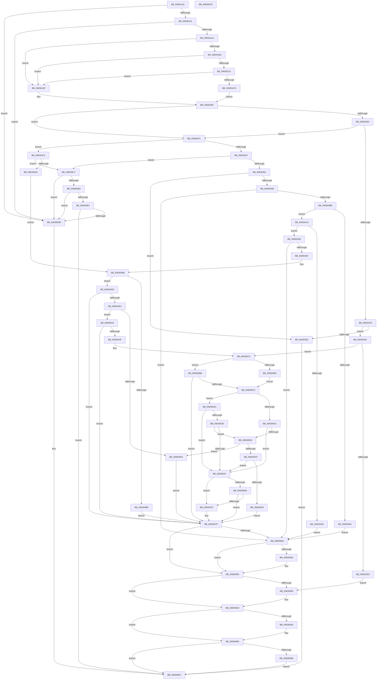

# CmGetInstallerClassCompoundFiltersWorker

- RVA: `0x00830130`–`0x008306FE` (길이 `1,486` bytes)
- VA: `0x0000000140830130`
- 실행 섹션: `PAGE`
- PDB 이름 있음: `예`; PDB Function 태그: `아니요`
- unwind 정보 RVA: `0x000DAA70`
- 디코드: `379`개 명령, `1,486/1,486` bytes 표시
- 미해석 바이트: `0` (있으면 어셈블리에 `.byte`로 보존)

> 이 문서는 커널 이미지의 기계어와 PDB 기호를 분석해 생성했습니다. 4번과 5번은 함수 원형과 자료형을 바이너리 사용 방식에서 추정한 C 해석이며 원본 소스 복구 결과는 아닙니다.

## 1. Dependencies

- 직접 호출 지점: **23**; 고유 호출 대상: **9**
- 직접 호출자로 확인된 함수: **1**
- RIP 상대 이미지 참조: **10**

### Outgoing calls
- `0x00830194` → [PnpCtxRegQueryInfoKey](../99/PnpCtxRegQueryInfoKey_function_009945FC.md) (function, `0x009945FC`)
- `0x00830253` → [PnpGetObjectProperty](../8E/PnpGetObjectProperty_function_008E2180.md) (function, `0x008E2180`)
- `0x00830285` → [ExAllocatePool2](../../poolcode/B8/ExAllocatePool2_function_00B820F0.md) (function, `0x00B820F0`)
- `0x008302DD` → [PnpGetObjectProperty](../8E/PnpGetObjectProperty_function_008E2180.md) (function, `0x008E2180`)
- `0x00830329` → [PnpGetObjectProperty](../8E/PnpGetObjectProperty_function_008E2180.md) (function, `0x008E2180`)
- `0x0083035A` → [ExAllocatePool2](../../poolcode/B8/ExAllocatePool2_function_00B820F0.md) (function, `0x00B820F0`)
- `0x008303AC` → [PnpGetObjectProperty](../8E/PnpGetObjectProperty_function_008E2180.md) (function, `0x008E2180`)
- `0x008303FE` → [PnpGetObjectProperty](../8E/PnpGetObjectProperty_function_008E2180.md) (function, `0x008E2180`)
- `0x0083041D` → [ExAllocatePool2](../../poolcode/B8/ExAllocatePool2_function_00B820F0.md) (function, `0x00B820F0`)
- `0x00830478` → [PnpGetObjectProperty](../8E/PnpGetObjectProperty_function_008E2180.md) (function, `0x008E2180`)
- `0x008304B0` → [CmGetDeclarativeFilterList](../82/CmGetDeclarativeFilterList_function_0082FE7C.md) (function, `0x0082FE7C`)
- `0x008304ED` → [ExAllocatePool2](../../poolcode/B8/ExAllocatePool2_function_00B820F0.md) (function, `0x00B820F0`)
- `0x00830530` → [CmGetDeclarativeFilterList](../82/CmGetDeclarativeFilterList_function_0082FE7C.md) (function, `0x0082FE7C`)
- `0x00830577` → [PnpSetObjectProperty](../8F/PnpSetObjectProperty_function_008F66E8.md) (function, `0x008F66E8`)
- `0x008305A7` → [_CmGetInstallerClassMappedPropertyFromRegProp](../9D/_CmGetInstallerClassMappedPropertyFromRegProp_function_009D3E34.md) (function, `0x009D3E34`)
- `0x008305C6` → [Feature_KernelPnP_FilterListMerging__private_IsEnabledDeviceUsageNoInline](../../text/6A/Feature_KernelPnP_FilterListMerging__private_IsEnabledDeviceUsageNoInline_function_006A2DE8.md) (function, `0x006A2DE8`)
- `0x008305DF` → [ExAllocatePool2](../../poolcode/B8/ExAllocatePool2_function_00B820F0.md) (function, `0x00B820F0`)
- `0x0083061D` → [_CmGetInstallerClassMappedPropertyFromRegProp](../9D/_CmGetInstallerClassMappedPropertyFromRegProp_function_009D3E34.md) (function, `0x009D3E34`)
- `0x0083065B` → [CmMergeFilterLists](../AF/CmMergeFilterLists_function_00AFA2CC.md) (function, `0x00AFA2CC`)
- `0x0083068F` → [ExFreePoolWithTag](../../poolcode/B8/ExFreePoolWithTag_function_00B82870.md) (function, `0x00B82870`)
- `0x0083069E` → [ExFreePoolWithTag](../../poolcode/B8/ExFreePoolWithTag_function_00B82870.md) (function, `0x00B82870`)
- `0x008306AD` → [ExFreePoolWithTag](../../poolcode/B8/ExFreePoolWithTag_function_00B82870.md) (function, `0x00B82870`)
- `0x008306C0` → [ExFreePoolWithTag](../../poolcode/B8/ExFreePoolWithTag_function_00B82870.md) (function, `0x00B82870`)

### Direct callers
- [sub_00B2F71C](../B2/Unknown_function_00B2F71C.md) at `0x00B2F760`

### Static image references
- `0x008301B7` → RVA `0x00014158` (`.rdata`; read)
- `0x008301C4` → RVA `0x00014160` (`.rdata`; read)
- `0x008301CD` → RVA `0x00022CB0` (`.rdata`; read)
- `0x008301D8` → RVA `0x000219C0` (`.rdata`; read)
- `0x008301DF` → RVA `0x00B0D960` (` ?? ::NNGAKEGL::`string'`; read)
- `0x008301E6` → RVA `0x00022960` (`.rdata`; read)
- `0x008301EF` → RVA `0x000220A8` (`.rdata`; read)
- `0x008301FA` → RVA `0x00021E30` (`.rdata`; read)
- `0x00830201` → RVA `0x00B0D970` (` ?? ::NNGAKEGL::`string'`; read)
- `0x00830208` → RVA `0x00021C10` (`.rdata`; read)

## 2. Other-region calls and transfers

- 다른 실행 섹션으로 향하는 call: **10**
  - `0x00830285` → [ExAllocatePool2](../../poolcode/B8/ExAllocatePool2_function_00B820F0.md) (`PAGE` → `POOLCODE`)
  - `0x0083035A` → [ExAllocatePool2](../../poolcode/B8/ExAllocatePool2_function_00B820F0.md) (`PAGE` → `POOLCODE`)
  - `0x0083041D` → [ExAllocatePool2](../../poolcode/B8/ExAllocatePool2_function_00B820F0.md) (`PAGE` → `POOLCODE`)
  - `0x008304ED` → [ExAllocatePool2](../../poolcode/B8/ExAllocatePool2_function_00B820F0.md) (`PAGE` → `POOLCODE`)
  - `0x008305C6` → [Feature_KernelPnP_FilterListMerging__private_IsEnabledDeviceUsageNoInline](../../text/6A/Feature_KernelPnP_FilterListMerging__private_IsEnabledDeviceUsageNoInline_function_006A2DE8.md) (`PAGE` → `.text`)
  - `0x008305DF` → [ExAllocatePool2](../../poolcode/B8/ExAllocatePool2_function_00B820F0.md) (`PAGE` → `POOLCODE`)
  - `0x0083068F` → [ExFreePoolWithTag](../../poolcode/B8/ExFreePoolWithTag_function_00B82870.md) (`PAGE` → `POOLCODE`)
  - `0x0083069E` → [ExFreePoolWithTag](../../poolcode/B8/ExFreePoolWithTag_function_00B82870.md) (`PAGE` → `POOLCODE`)
  - `0x008306AD` → [ExFreePoolWithTag](../../poolcode/B8/ExFreePoolWithTag_function_00B82870.md) (`PAGE` → `POOLCODE`)
  - `0x008306C0` → [ExFreePoolWithTag](../../poolcode/B8/ExFreePoolWithTag_function_00B82870.md) (`PAGE` → `POOLCODE`)
- 별도 외부 분기/꼬리 이동을 확인하지 못했습니다.

## 3. Assembly (complete function range)

```asm
00830130  48 8B C4                        mov rax, rsp
00830133  48 89 58 08                     mov qword ptr [rax + 8], rbx
00830137  4C 89 48 20                     mov qword ptr [rax + 0x20], r9
0083013B  4C 89 40 18                     mov qword ptr [rax + 0x18], r8
0083013F  48 89 50 10                     mov qword ptr [rax + 0x10], rdx
00830143  55                              push rbp
00830144  56                              push rsi
00830145  57                              push rdi
00830146  41 54                           push r12
00830148  41 55                           push r13
0083014A  41 56                           push r14
0083014C  41 57                           push r15
0083014E  48 8D 68 C1                     lea rbp, [rax - 0x3f]
00830152  48 81 EC 90 00 00 00            sub rsp, 0x90
00830159  33 DB                           xor ebx, ebx
0083015B  49 8B C1                        mov rax, r9
0083015E  48 89 5C 24 30                  mov qword ptr [rsp + 0x30], rbx
00830163  4D 8B E0                        mov r12, r8
00830166  4C 8B EA                        mov r13, rdx
00830169  48 89 5C 24 28                  mov qword ptr [rsp + 0x28], rbx
0083016E  45 33 C9                        xor r9d, r9d
00830171  48 89 5C 24 20                  mov qword ptr [rsp + 0x20], rbx
00830176  4C 8D 45 DF                     lea r8, [rbp - 0x21]
0083017A  89 5D DB                        mov dword ptr [rbp - 0x25], ebx
0083017D  48 8B D0                        mov rdx, rax
00830180  89 5D DF                        mov dword ptr [rbp - 0x21], ebx
00830183  4C 8B F9                        mov r15, rcx
00830186  89 5D D7                        mov dword ptr [rbp - 0x29], ebx
00830189  8B F3                           mov esi, ebx
0083018B  48 89 5D E7                     mov qword ptr [rbp - 0x19], rbx
0083018F  44 8B F3                        mov r14d, ebx
00830192  8B FB                           mov edi, ebx
00830194  E8 63 44 16 00                  call 0x1409945fc
00830199  85 C0                           test eax, eax
0083019B  0F 88 3A 05 00 00               js 0x1408306db
008301A1  39 5D DF                        cmp dword ptr [rbp - 0x21], ebx
008301A4  0F 84 31 05 00 00               je 0x1408306db
008301AA  48 8B 4D 67                     mov rcx, qword ptr [rbp + 0x67]
008301AE  83 79 10 14                     cmp dword ptr [rcx + 0x10], 0x14
008301B2  75 3B                           jne 0x1408301ef
008301B4  48 8B 01                        mov rax, qword ptr [rcx]
008301B7  48 3B 05 9A 3F 7E FF            cmp rax, qword ptr [rip - 0x81c066]
008301BE  75 2F                           jne 0x1408301ef
008301C0  48 8B 41 08                     mov rax, qword ptr [rcx + 8]
008301C4  48 3B 05 95 3F 7E FF            cmp rax, qword ptr [rip - 0x81c06b]
008301CB  75 22                           jne 0x1408301ef
008301CD  48 8D 05 DC 2A 7F FF            lea rax, [rip - 0x80d524]
008301D4  48 89 45 EF                     mov qword ptr [rbp - 0x11], rax
008301D8  48 8D 0D E1 17 7F FF            lea rcx, [rip - 0x80e81f]
008301DF  48 8D 05 7A D7 2D 00            lea rax, [rip + 0x2dd77a]
008301E6  48 8D 1D 73 27 7F FF            lea rbx, [rip - 0x80d88d]
008301ED  EB 20                           jmp 0x14083020f
008301EF  48 8D 05 B2 1E 7F FF            lea rax, [rip - 0x80e14e]
008301F6  48 89 45 EF                     mov qword ptr [rbp - 0x11], rax
008301FA  48 8D 0D 2F 1C 7F FF            lea rcx, [rip - 0x80e3d1]
00830201  48 8D 05 68 D7 2D 00            lea rax, [rip + 0x2dd768]
00830208  48 8D 1D 01 1A 7F FF            lea rbx, [rip - 0x80e5ff]
0083020F  33 D2                           xor edx, edx
00830211  48 89 45 DF                     mov qword ptr [rbp - 0x21], rax
00830215  89 54 24 50                     mov dword ptr [rsp + 0x50], edx
00830219  48 8D 45 D7                     lea rax, [rbp - 0x29]
0083021D  48 89 44 24 48                  mov qword ptr [rsp + 0x48], rax
00830222  4D 8B CC                        mov r9, r12
00830225  89 54 24 40                     mov dword ptr [rsp + 0x40], edx
00830229  48 8D 45 DB                     lea rax, [rbp - 0x25]
0083022D  48 89 54 24 38                  mov qword ptr [rsp + 0x38], rdx
00830232  44 8D 42 02                     lea r8d, [rdx + 2]
00830236  48 89 44 24 30                  mov qword ptr [rsp + 0x30], rax
0083023B  48 89 4C 24 28                  mov qword ptr [rsp + 0x28], rcx
00830240  48 89 54 24 20                  mov qword ptr [rsp + 0x20], rdx
00830245  49 8B D5                        mov rdx, r13
00830248  48 89 4D F7                     mov qword ptr [rbp - 9], rcx
0083024C  49 8B CF                        mov rcx, r15
0083024F  48 89 5D FF                     mov qword ptr [rbp - 1], rbx
00830253  E8 28 1F 0B 00                  call 0x1408e2180
00830258  3D 23 00 00 C0                  cmp eax, 0xc0000023
0083025D  0F 85 8E 00 00 00               jne 0x1408302f1
00830263  81 7D DB 12 20 00 00            cmp dword ptr [rbp - 0x25], 0x2012
0083026A  0F 85 81 00 00 00               jne 0x1408302f1
00830270  8B 55 D7                        mov edx, dword ptr [rbp - 0x29]
00830273  41 BC 50 4E 50 52               mov r12d, 0x52504e50
00830279  41 BD 00 01 00 00               mov r13d, 0x100
0083027F  45 8B C4                        mov r8d, r12d
00830282  41 8B CD                        mov ecx, r13d
00830285  E8 66 1E 35 00                  call 0x140b820f0
0083028A  48 8B F8                        mov rdi, rax
0083028D  48 85 C0                        test rax, rax
00830290  75 0A                           jne 0x14083029c
00830292  BB 17 00 00 C0                  mov ebx, 0xc0000017
00830297  E9 44 04 00 00                  jmp 0x1408306e0
0083029C  21 74 24 50                     and dword ptr [rsp + 0x50], esi
008302A0  48 8D 45 D7                     lea rax, [rbp - 0x29]
008302A4  4C 8B 4D 57                     mov r9, qword ptr [rbp + 0x57]
008302A8  41 B8 02 00 00 00               mov r8d, 2
008302AE  48 8B 55 4F                     mov rdx, qword ptr [rbp + 0x4f]
008302B2  49 8B CF                        mov rcx, r15
008302B5  48 89 44 24 48                  mov qword ptr [rsp + 0x48], rax
008302BA  8B 45 D7                        mov eax, dword ptr [rbp - 0x29]
008302BD  89 44 24 40                     mov dword ptr [rsp + 0x40], eax
008302C1  48 8D 45 DB                     lea rax, [rbp - 0x25]
008302C5  48 89 7C 24 38                  mov qword ptr [rsp + 0x38], rdi
008302CA  48 89 44 24 30                  mov qword ptr [rsp + 0x30], rax
008302CF  48 8B 45 F7                     mov rax, qword ptr [rbp - 9]
008302D3  48 89 44 24 28                  mov qword ptr [rsp + 0x28], rax
008302D8  48 21 74 24 20                  and qword ptr [rsp + 0x20], rsi
008302DD  E8 9E 1E 0B 00                  call 0x1408e2180
008302E2  8B D8                           mov ebx, eax
008302E4  85 C0                           test eax, eax
008302E6  0F 89 90 02 00 00               jns 0x14083057c
008302EC  E9 A8 03 00 00                  jmp 0x140830699
008302F1  89 74 24 50                     mov dword ptr [rsp + 0x50], esi
008302F5  48 8D 45 D7                     lea rax, [rbp - 0x29]
008302F9  48 89 44 24 48                  mov qword ptr [rsp + 0x48], rax
008302FE  4D 8B CC                        mov r9, r12
00830301  89 74 24 40                     mov dword ptr [rsp + 0x40], esi
00830305  48 8D 45 DB                     lea rax, [rbp - 0x25]
00830309  48 89 74 24 38                  mov qword ptr [rsp + 0x38], rsi
0083030E  41 B8 02 00 00 00               mov r8d, 2
00830314  48 89 44 24 30                  mov qword ptr [rsp + 0x30], rax
00830319  49 8B D5                        mov rdx, r13
0083031C  48 89 5C 24 28                  mov qword ptr [rsp + 0x28], rbx
00830321  49 8B CF                        mov rcx, r15
00830324  48 89 74 24 20                  mov qword ptr [rsp + 0x20], rsi
00830329  E8 52 1E 0B 00                  call 0x1408e2180
0083032E  8B D8                           mov ebx, eax
00830330  41 BC 50 4E 50 52               mov r12d, 0x52504e50
00830336  41 BD 00 01 00 00               mov r13d, 0x100
0083033C  3D 23 00 00 C0                  cmp eax, 0xc0000023
00830341  0F 85 7E 01 00 00               jne 0x1408304c5
00830347  83 7D DB 12                     cmp dword ptr [rbp - 0x25], 0x12
0083034B  0F 85 76 03 00 00               jne 0x1408306c7
00830351  8B 55 D7                        mov edx, dword ptr [rbp - 0x29]
00830354  45 8B C4                        mov r8d, r12d
00830357  41 8B CD                        mov ecx, r13d
0083035A  E8 91 1D 35 00                  call 0x140b820f0
0083035F  48 8B F0                        mov rsi, rax
00830362  48 85 C0                        test rax, rax
00830365  0F 84 27 FF FF FF               je 0x140830292
0083036B  21 7C 24 50                     and dword ptr [rsp + 0x50], edi
0083036F  48 8D 45 D7                     lea rax, [rbp - 0x29]
00830373  4C 8B 4D 57                     mov r9, qword ptr [rbp + 0x57]
00830377  41 B8 02 00 00 00               mov r8d, 2
0083037D  48 8B 55 4F                     mov rdx, qword ptr [rbp + 0x4f]
00830381  49 8B CF                        mov rcx, r15
00830384  48 89 44 24 48                  mov qword ptr [rsp + 0x48], rax
00830389  8B 45 D7                        mov eax, dword ptr [rbp - 0x29]
0083038C  89 44 24 40                     mov dword ptr [rsp + 0x40], eax
00830390  48 8D 45 DB                     lea rax, [rbp - 0x25]
00830394  48 89 74 24 38                  mov qword ptr [rsp + 0x38], rsi
00830399  48 89 44 24 30                  mov qword ptr [rsp + 0x30], rax
0083039E  48 8B 45 FF                     mov rax, qword ptr [rbp - 1]
008303A2  48 89 44 24 28                  mov qword ptr [rsp + 0x28], rax
008303A7  48 21 7C 24 20                  and qword ptr [rsp + 0x20], rdi
008303AC  E8 CF 1D 0B 00                  call 0x1408e2180
008303B1  8B D8                           mov ebx, eax
008303B3  85 C0                           test eax, eax
008303B5  0F 88 C9 02 00 00               js 0x140830684
008303BB  48 8B 55 4F                     mov rdx, qword ptr [rbp + 0x4f]
008303BF  48 8D 45 D7                     lea rax, [rbp - 0x29]
008303C3  33 DB                           xor ebx, ebx
008303C5  41 B8 02 00 00 00               mov r8d, 2
008303CB  89 5C 24 50                     mov dword ptr [rsp + 0x50], ebx
008303CF  49 8B CF                        mov rcx, r15
008303D2  48 89 44 24 48                  mov qword ptr [rsp + 0x48], rax
008303D7  48 8D 45 DB                     lea rax, [rbp - 0x25]
008303DB  89 5C 24 40                     mov dword ptr [rsp + 0x40], ebx
008303DF  48 89 5C 24 38                  mov qword ptr [rsp + 0x38], rbx
008303E4  48 89 44 24 30                  mov qword ptr [rsp + 0x30], rax
008303E9  48 8B 45 EF                     mov rax, qword ptr [rbp - 0x11]
008303ED  48 89 44 24 28                  mov qword ptr [rsp + 0x28], rax
008303F2  48 89 5C 24 20                  mov qword ptr [rsp + 0x20], rbx
008303F7  48 8B 5D 57                     mov rbx, qword ptr [rbp + 0x57]
008303FB  4C 8B CB                        mov r9, rbx
008303FE  E8 7D 1D 0B 00                  call 0x1408e2180
00830403  3D 23 00 00 C0                  cmp eax, 0xc0000023
00830408  74 0A                           je 0x140830414
0083040A  BB 25 02 00 C0                  mov ebx, 0xc0000225
0083040F  E9 70 02 00 00                  jmp 0x140830684
00830414  8B 55 D7                        mov edx, dword ptr [rbp - 0x29]
00830417  45 8B C4                        mov r8d, r12d
0083041A  49 8B CD                        mov rcx, r13
0083041D  E8 CE 1C 35 00                  call 0x140b820f0
00830422  48 89 45 E7                     mov qword ptr [rbp - 0x19], rax
00830426  48 8B C8                        mov rcx, rax
00830429  48 85 C0                        test rax, rax
0083042C  75 0A                           jne 0x140830438
0083042E  BB 17 00 00 C0                  mov ebx, 0xc0000017
00830433  E9 4C 02 00 00                  jmp 0x140830684
00830438  21 7C 24 50                     and dword ptr [rsp + 0x50], edi
0083043C  48 8D 45 D7                     lea rax, [rbp - 0x29]
00830440  48 8B 55 4F                     mov rdx, qword ptr [rbp + 0x4f]
00830444  4C 8B CB                        mov r9, rbx
00830447  48 89 44 24 48                  mov qword ptr [rsp + 0x48], rax
0083044C  41 B8 02 00 00 00               mov r8d, 2
00830452  8B 45 D7                        mov eax, dword ptr [rbp - 0x29]
00830455  89 44 24 40                     mov dword ptr [rsp + 0x40], eax
00830459  48 8D 45 DB                     lea rax, [rbp - 0x25]
0083045D  48 89 4C 24 38                  mov qword ptr [rsp + 0x38], rcx
00830462  49 8B CF                        mov rcx, r15
00830465  48 89 44 24 30                  mov qword ptr [rsp + 0x30], rax
0083046A  48 8B 45 EF                     mov rax, qword ptr [rbp - 0x11]
0083046E  48 89 44 24 28                  mov qword ptr [rsp + 0x28], rax
00830473  48 21 7C 24 20                  and qword ptr [rsp + 0x20], rdi
00830478  E8 03 1D 0B 00                  call 0x1408e2180
0083047D  8B D8                           mov ebx, eax
0083047F  85 C0                           test eax, eax
00830481  0F 88 FD 01 00 00               js 0x140830684
00830487  48 8B 45 DF                     mov rax, qword ptr [rbp - 0x21]
0083048B  4C 8B 45 E7                     mov r8, qword ptr [rbp - 0x19]
0083048F  48 8D 4D D7                     lea rcx, [rbp - 0x29]
00830493  48 8B 55 5F                     mov rdx, qword ptr [rbp + 0x5f]
00830497  4C 8B CE                        mov r9, rsi
0083049A  48 89 4C 24 38                  mov qword ptr [rsp + 0x38], rcx
0083049F  49 8B CF                        mov rcx, r15
008304A2  21 7C 24 30                     and dword ptr [rsp + 0x30], edi
008304A6  48 21 7C 24 28                  and qword ptr [rsp + 0x28], rdi
008304AB  48 89 44 24 20                  mov qword ptr [rsp + 0x20], rax
008304B0  E8 C7 F9 FF FF                  call 0x14082fe7c
008304B5  8B D8                           mov ebx, eax
008304B7  85 C0                           test eax, eax
008304B9  75 1E                           jne 0x1408304d9
008304BB  BB 3E 00 00 C0                  mov ebx, 0xc000003e
008304C0  E9 BA 01 00 00                  jmp 0x14083067f
008304C5  3D 25 02 00 C0                  cmp eax, 0xc0000225
008304CA  0F 85 F7 01 00 00               jne 0x1408306c7
008304D0  48 8B 45 DF                     mov rax, qword ptr [rbp - 0x21]
008304D4  48 8B F0                        mov rsi, rax
008304D7  EB B2                           jmp 0x14083048b
008304D9  3D 23 00 00 C0                  cmp eax, 0xc0000023
008304DE  0F 85 9B 01 00 00               jne 0x14083067f
008304E4  8B 55 D7                        mov edx, dword ptr [rbp - 0x29]
008304E7  45 8B C4                        mov r8d, r12d
008304EA  49 8B CD                        mov rcx, r13
008304ED  E8 FE 1B 35 00                  call 0x140b820f0
008304F2  48 8B F8                        mov rdi, rax
008304F5  48 85 C0                        test rax, rax
008304F8  75 0A                           jne 0x140830504
008304FA  BB 17 00 00 C0                  mov ebx, 0xc0000017
008304FF  E9 7B 01 00 00                  jmp 0x14083067f
00830504  4C 8B 45 E7                     mov r8, qword ptr [rbp - 0x19]
00830508  48 8D 45 D7                     lea rax, [rbp - 0x29]
0083050C  48 8B 55 5F                     mov rdx, qword ptr [rbp + 0x5f]
00830510  4C 8B CE                        mov r9, rsi
00830513  48 89 44 24 38                  mov qword ptr [rsp + 0x38], rax
00830518  49 8B CF                        mov rcx, r15
0083051B  8B 45 D7                        mov eax, dword ptr [rbp - 0x29]
0083051E  89 44 24 30                     mov dword ptr [rsp + 0x30], eax
00830522  48 8B 45 DF                     mov rax, qword ptr [rbp - 0x21]
00830526  48 89 7C 24 28                  mov qword ptr [rsp + 0x28], rdi
0083052B  48 89 44 24 20                  mov qword ptr [rsp + 0x20], rax
00830530  E8 47 F9 FF FF                  call 0x14082fe7c
00830535  8B D8                           mov ebx, eax
00830537  85 C0                           test eax, eax
00830539  0F 88 40 01 00 00               js 0x14083067f
0083053F  44 21 74 24 48                  and dword ptr [rsp + 0x48], r14d
00830544  41 B8 02 00 00 00               mov r8d, 2
0083054A  8B 45 D7                        mov eax, dword ptr [rbp - 0x29]
0083054D  49 8B CF                        mov rcx, r15
00830550  4C 8B 4D 57                     mov r9, qword ptr [rbp + 0x57]
00830554  48 8B 55 4F                     mov rdx, qword ptr [rbp + 0x4f]
00830558  89 44 24 40                     mov dword ptr [rsp + 0x40], eax
0083055C  48 8B 45 F7                     mov rax, qword ptr [rbp - 9]
00830560  48 89 7C 24 38                  mov qword ptr [rsp + 0x38], rdi
00830565  C7 44 24 30 12 20 00 00         mov dword ptr [rsp + 0x30], 0x2012
0083056D  48 89 44 24 28                  mov qword ptr [rsp + 0x28], rax
00830572  4C 21 74 24 20                  and qword ptr [rsp + 0x20], r14
00830577  E8 6C 61 0C 00                  call 0x1408f66e8
0083057C  4C 8B 4D 6F                     mov r9, qword ptr [rbp + 0x6f]
00830580  48 8D 45 D7                     lea rax, [rbp - 0x29]
00830584  4C 8B 45 57                     mov r8, qword ptr [rbp + 0x57]
00830588  49 8B CF                        mov rcx, r15
0083058B  48 8B 55 4F                     mov rdx, qword ptr [rbp + 0x4f]
0083058F  48 89 44 24 38                  mov qword ptr [rsp + 0x38], rax
00830594  48 8D 45 DB                     lea rax, [rbp - 0x25]
00830598  44 21 74 24 30                  and dword ptr [rsp + 0x30], r14d
0083059D  4C 21 74 24 28                  and qword ptr [rsp + 0x28], r14
008305A2  48 89 44 24 20                  mov qword ptr [rsp + 0x20], rax
008305A7  E8 88 38 1A 00                  call 0x1409d3e34
008305AC  8B D8                           mov ebx, eax
008305AE  3D 25 02 00 C0                  cmp eax, 0xc0000225
008305B3  75 06                           jne 0x1408305bb
008305B5  44 21 75 D7                     and dword ptr [rbp - 0x29], r14d
008305B9  EB 0B                           jmp 0x1408305c6
008305BB  3D 23 00 00 C0                  cmp eax, 0xc0000023
008305C0  0F 85 B9 00 00 00               jne 0x14083067f
008305C6  E8 1D 28 E7 FF                  call 0x1406a2de8
008305CB  85 C0                           test eax, eax
008305CD  8B 45 D7                        mov eax, dword ptr [rbp - 0x29]
008305D0  74 58                           je 0x14083062a
008305D2  85 C0                           test eax, eax
008305D4  74 61                           je 0x140830637
008305D6  45 8B C4                        mov r8d, r12d
008305D9  48 8B D0                        mov rdx, rax
008305DC  49 8B CD                        mov rcx, r13
008305DF  E8 0C 1B 35 00                  call 0x140b820f0
008305E4  4C 8B F0                        mov r14, rax
008305E7  48 85 C0                        test rax, rax
008305EA  0F 84 0A FF FF FF               je 0x1408304fa
008305F0  4C 8B 4D 6F                     mov r9, qword ptr [rbp + 0x6f]
008305F4  48 8D 45 D7                     lea rax, [rbp - 0x29]
008305F8  4C 8B 45 57                     mov r8, qword ptr [rbp + 0x57]
008305FC  49 8B CF                        mov rcx, r15
008305FF  48 8B 55 4F                     mov rdx, qword ptr [rbp + 0x4f]
00830603  48 89 44 24 38                  mov qword ptr [rsp + 0x38], rax
00830608  8B 45 D7                        mov eax, dword ptr [rbp - 0x29]
0083060B  89 44 24 30                     mov dword ptr [rsp + 0x30], eax
0083060F  48 8D 45 DB                     lea rax, [rbp - 0x25]
00830613  4C 89 74 24 28                  mov qword ptr [rsp + 0x28], r14
00830618  48 89 44 24 20                  mov qword ptr [rsp + 0x20], rax
0083061D  E8 12 38 1A 00                  call 0x1409d3e34
00830622  8B D8                           mov ebx, eax
00830624  85 C0                           test eax, eax
00830626  79 0F                           jns 0x140830637
00830628  EB 55                           jmp 0x14083067f
0083062A  85 C0                           test eax, eax
0083062C  74 09                           je 0x140830637
0083062E  44 39 B5 87 00 00 00            cmp dword ptr [rbp + 0x87], r14d
00830635  77 9F                           ja 0x1408305d6
00830637  48 8B 85 8F 00 00 00            mov rax, qword ptr [rbp + 0x8f]
0083063E  49 8B D6                        mov rdx, r14
00830641  4C 8B 4D 7F                     mov r9, qword ptr [rbp + 0x7f]
00830645  48 8B CF                        mov rcx, rdi
00830648  4C 8B 45 DF                     mov r8, qword ptr [rbp - 0x21]
0083064C  48 89 44 24 28                  mov qword ptr [rsp + 0x28], rax
00830651  8B 85 87 00 00 00               mov eax, dword ptr [rbp + 0x87]
00830657  89 44 24 20                     mov dword ptr [rsp + 0x20], eax
0083065B  E8 6C 9C 2C 00                  call 0x140afa2cc
00830660  B9 00 00 00 80                  mov ecx, 0x80000000
00830665  8B D8                           mov ebx, eax
00830667  03 C1                           add eax, ecx
00830669  85 C1                           test ecx, eax
0083066B  75 08                           jne 0x140830675
0083066D  81 FB 23 00 00 C0               cmp ebx, 0xc0000023
00830673  75 0A                           jne 0x14083067f
00830675  48 8B 45 77                     mov rax, qword ptr [rbp + 0x77]
00830679  C7 00 12 20 00 00               mov dword ptr [rax], 0x2012
0083067F  48 85 F6                        test rsi, rsi
00830682  74 10                           je 0x140830694
00830684  48 3B 75 DF                     cmp rsi, qword ptr [rbp - 0x21]
00830688  74 0A                           je 0x140830694
0083068A  33 D2                           xor edx, edx
0083068C  48 8B CE                        mov rcx, rsi
0083068F  E8 DC 21 35 00                  call 0x140b82870
00830694  48 85 FF                        test rdi, rdi
00830697  74 0A                           je 0x1408306a3
00830699  33 D2                           xor edx, edx
0083069B  48 8B CF                        mov rcx, rdi
0083069E  E8 CD 21 35 00                  call 0x140b82870
008306A3  4D 85 F6                        test r14, r14
008306A6  74 0A                           je 0x1408306b2
008306A8  33 D2                           xor edx, edx
008306AA  49 8B CE                        mov rcx, r14
008306AD  E8 BE 21 35 00                  call 0x140b82870
008306B2  48 8B 45 E7                     mov rax, qword ptr [rbp - 0x19]
008306B6  48 85 C0                        test rax, rax
008306B9  74 25                           je 0x1408306e0
008306BB  33 D2                           xor edx, edx
008306BD  48 8B C8                        mov rcx, rax
008306C0  E8 AB 21 35 00                  call 0x140b82870
008306C5  EB 19                           jmp 0x1408306e0
008306C7  81 7D DB 12 20 00 00            cmp dword ptr [rbp - 0x25], 0x2012
008306CE  75 0B                           jne 0x1408306db
008306D0  3D 0B 09 00 C0                  cmp eax, 0xc000090b
008306D5  74 04                           je 0x1408306db
008306D7  85 C0                           test eax, eax
008306D9  75 05                           jne 0x1408306e0
008306DB  BB 25 02 00 C0                  mov ebx, 0xc0000225
008306E0  8B C3                           mov eax, ebx
008306E2  48 8B 9C 24 D0 00 00 00         mov rbx, qword ptr [rsp + 0xd0]
008306EA  48 81 C4 90 00 00 00            add rsp, 0x90
008306F1  41 5F                           pop r15
008306F3  41 5E                           pop r14
008306F5  41 5D                           pop r13
008306F7  41 5C                           pop r12
008306F9  5F                              pop rdi
008306FA  5E                              pop rsi
008306FB  5D                              pop rbp
008306FC  C3                              ret
008306FD  CC                              int3
```

## 4. C-style interpretation (structured pseudocode)

```c
__int64 __fastcall CmGetInstallerClassCompoundFiltersWorker(__int64 a1, __int64 a2, __int64 a3, __int64 a4)
{
    __int64 result;
    __int64 v_rbx;
    __int64 v_rsp;
    unsigned int v_stack_m78;
    unsigned __int64 v_stack_m80;
    unsigned int v_stack_m88;
    unsigned __int64 v_stack_m90;
    unsigned __int64 v_stack_m98;
    unsigned __int64 v_stack_mA0;
    unsigned __int64 v_stack_mA8;
    unsigned __int64 v_stack_p8;

    *(unsigned __int64 *)(v_rsp + 8) = v_rbx;
    *(unsigned __int64 *)(v_rsp + 32) = a4;
    *(unsigned __int64 *)(v_rsp + 24) = a3;
    *(unsigned __int64 *)(v_rsp + 16) = a2;
    v_rsp = (v_rsp) - (144);
    v_rbx = 0;
    v_stack_m98 = 0;
    v_stack_mA0 = 0;
    a4 = 0;
    v_stack_mA8 = 0;
    *(unsigned int *)(v_rsp - 63 - 37) = 0;
    *(unsigned int *)(v_rsp - 63 - 33) = 0;
    *(unsigned int *)(v_rsp - 63 - 41) = 0;
    *(unsigned __int64 *)(v_rsp - 63 - 25) = 0;
    result = PnpCtxRegQueryInfoKey(a1, 0, v_rsp - 63 - 33, a4);
    if (sign_flag) goto loc_008306DB;
    if ((*(unsigned int *)(v_rsp - 63 - 33)) == 0) goto loc_008306DB;
    if ((*(unsigned int *)(*(unsigned __int64 *)(v_rsp - 63 + 103) + 16)) != 20) goto loc_008301EF;
    if ((*(unsigned __int64 *)(*(unsigned __int64 *)(v_rsp - 63 + 103))) != (*(unsigned __int64 *)(v_rip - 8503398))) goto loc_008301EF;
    if ((*(unsigned __int64 *)(*(unsigned __int64 *)(v_rsp - 63 + 103) + 8)) != (*(unsigned __int64 *)(v_rip - 8503403))) goto loc_008301EF;
    *(unsigned __int64 *)(v_rsp - 63 - 17) = v_rip - 8443172;
    goto loc_0083020F;
loc_008301EF:
    *(unsigned __int64 *)(v_rsp - 63 - 17) = v_rip - 8446286;
loc_0083020F:
    a2 = 0;
    *(unsigned __int64 *)(v_rsp - 63 - 33) = v_rip + 3004264;
    v_stack_m78 = 0;
    v_stack_m80 = v_rsp - 63 - 41;
    v_stack_m88 = 0;
    v_stack_m90 = 0;
    v_stack_m98 = v_rsp - 63 - 37;
    v_stack_mA0 = v_rip - 8446929;
    v_stack_mA8 = 0;
    *(unsigned __int64 *)(v_rsp - 63 - 9) = v_rip - 8446929;
    *(unsigned __int64 *)(v_rsp - 63 - 1) = v_rip - 8447487;
    result = PnpGetObjectProperty(a1, 0, a2 + 2, a3);
    if (((unsigned int)(result)) != 0xC0000023ULL) goto loc_008302F1;
    if ((*(unsigned int *)(v_rsp - 63 - 37)) != 0x2012ULL) goto loc_008302F1;
    result = ExAllocatePool2(256, (unsigned int)(*(unsigned int *)(v_rsp - 63 - 41)), (unsigned int)((unsigned int)((unsigned int)(0x52504E50ULL))), a3);
    if (result != 0) goto loc_0083029C;
loc_00830292:
    goto loc_008306E0;
loc_0083029C:
    v_stack_m80 = v_rsp - 63 - 41;
    v_stack_m88 = (unsigned int)((unsigned int)(*(unsigned int *)(v_rsp - 63 - 41)));
    v_stack_m90 = result;
    v_stack_m98 = v_rsp - 63 - 37;
    v_stack_mA0 = *(unsigned __int64 *)(v_rsp - 63 - 9);
    result = PnpGetObjectProperty(a1, *(unsigned __int64 *)(v_rsp - 63 + 79), 2, *(unsigned __int64 *)(v_rsp - 63 + 87));
    if (!sign_flag) goto loc_0083057C;
    goto loc_00830699;
loc_008302F1:
    v_stack_m78 = 0;
    v_stack_m80 = v_rsp - 63 - 41;
    v_stack_m88 = 0;
    v_stack_m90 = 0;
    v_stack_m98 = v_rsp - 63 - 37;
    v_stack_mA0 = (unsigned int)((unsigned int)(result));
    v_stack_mA8 = 0;
    result = PnpGetObjectProperty(a1, 256, 2, (unsigned int)(0x52504E50ULL));
    if (((unsigned int)(result)) != 0xC0000023ULL) goto loc_008304C5;
    if ((*(unsigned int *)(v_rsp - 63 - 37)) != 18) goto loc_008306C7;
    result = ExAllocatePool2(256, (unsigned int)(*(unsigned int *)(v_rsp - 63 - 41)), (unsigned int)((unsigned int)((unsigned int)(0x52504E50ULL))), (unsigned int)(0x52504E50ULL));
    if (result == 0) goto loc_00830292;
    v_stack_m80 = v_rsp - 63 - 41;
    v_stack_m88 = (unsigned int)((unsigned int)(*(unsigned int *)(v_rsp - 63 - 41)));
    v_stack_m90 = result;
    v_stack_m98 = v_rsp - 63 - 37;
    v_stack_mA0 = *(unsigned __int64 *)(v_rsp - 63 - 1);
    result = PnpGetObjectProperty(a1, *(unsigned __int64 *)(v_rsp - 63 + 79), 2, *(unsigned __int64 *)(v_rsp - 63 + 87));
    if (sign_flag) goto loc_00830684;
    v_rbx = 0;
    v_stack_m78 = 0;
    v_stack_m80 = v_rsp - 63 - 41;
    v_stack_m88 = 0;
    v_stack_m90 = 0;
    v_stack_m98 = v_rsp - 63 - 37;
    v_stack_mA0 = *(unsigned __int64 *)(v_rsp - 63 - 17);
    v_stack_mA8 = 0;
    result = PnpGetObjectProperty(a1, *(unsigned __int64 *)(v_rsp - 63 + 79), 2, *(unsigned __int64 *)(v_rsp - 63 + 87));
    if (((unsigned int)(result)) == 0xC0000023ULL) goto loc_00830414;
    goto loc_00830684;
loc_00830414:
    result = ExAllocatePool2(256, (unsigned int)(*(unsigned int *)(v_rsp - 63 - 41)), (unsigned int)((unsigned int)((unsigned int)(0x52504E50ULL))), *(unsigned __int64 *)(v_rsp - 63 + 87));
    *(unsigned __int64 *)(v_rsp - 63 - 25) = result;
    if (result != 0) goto loc_00830438;
    goto loc_00830684;
loc_00830438:
    v_stack_m80 = v_rsp - 63 - 41;
    v_stack_m88 = (unsigned int)((unsigned int)(*(unsigned int *)(v_rsp - 63 - 41)));
    v_stack_m90 = result;
    v_stack_m98 = v_rsp - 63 - 37;
    v_stack_mA0 = *(unsigned __int64 *)(v_rsp - 63 - 17);
    result = PnpGetObjectProperty(a1, *(unsigned __int64 *)(v_rsp - 63 + 79), 2, (unsigned int)(0xC0000017ULL));
    if (sign_flag) goto loc_00830684;
loc_0083048B:
    v_stack_m90 = v_rsp - 63 - 41;
    v_stack_mA8 = *(unsigned __int64 *)(v_rsp - 63 - 33);
    result = CmGetDeclarativeFilterList(a1, *(unsigned __int64 *)(v_rsp - 63 + 95), *(unsigned __int64 *)(v_rsp - 63 - 25), result);
    if ((unsigned int)(result) != 0) goto loc_008304D9;
    goto loc_0083067F;
loc_008304C5:
    if (((unsigned int)(result)) != 0xC0000225ULL) goto loc_008306C7;
    goto loc_0083048B;
loc_008304D9:
    if (((unsigned int)(*(unsigned __int64 *)(v_rsp - 63 - 33))) != 0xC0000023ULL) goto loc_0083067F;
    result = ExAllocatePool2(256, (unsigned int)(*(unsigned int *)(v_rsp - 63 - 41)), (unsigned int)((unsigned int)((unsigned int)(0x52504E50ULL))), result);
    if (result != 0) goto loc_00830504;
loc_008304FA:
    goto loc_0083067F;
loc_00830504:
    v_stack_m90 = v_rsp - 63 - 41;
    v_stack_m98 = (unsigned int)((unsigned int)(*(unsigned int *)(v_rsp - 63 - 41)));
    v_stack_mA0 = result;
    v_stack_mA8 = *(unsigned __int64 *)(v_rsp - 63 - 33);
    result = CmGetDeclarativeFilterList(a1, *(unsigned __int64 *)(v_rsp - 63 + 95), *(unsigned __int64 *)(v_rsp - 63 - 25), *(unsigned __int64 *)(v_rsp - 63 - 33));
    if (sign_flag) goto loc_0083067F;
    v_stack_m88 = (unsigned int)((unsigned int)(*(unsigned int *)(v_rsp - 63 - 41)));
    v_stack_m90 = result;
    v_stack_m98 = 0x2012ULL;
    v_stack_mA0 = *(unsigned __int64 *)(v_rsp - 63 - 9);
    result = PnpSetObjectProperty(a1, *(unsigned __int64 *)(v_rsp - 63 + 79), 2, *(unsigned __int64 *)(v_rsp - 63 + 87));
loc_0083057C:
    v_stack_m90 = v_rsp - 63 - 41;
    v_stack_mA8 = v_rsp - 63 - 37;
    result = _CmGetInstallerClassMappedPropertyFromRegProp(a1, *(unsigned __int64 *)(v_rsp - 63 + 79), *(unsigned __int64 *)(v_rsp - 63 + 87), *(unsigned __int64 *)(v_rsp - 63 + 111));
    if (((unsigned int)(result)) != 0xC0000225ULL) goto loc_008305BB;
    goto loc_008305C6;
loc_008305BB:
    if (((unsigned int)(result)) != 0xC0000023ULL) goto loc_0083067F;
loc_008305C6:
    result = Feature_KernelPnP_FilterListMerging__private_IsEnabledDeviceUsageNoInline(a1, *(unsigned __int64 *)(v_rsp - 63 + 79), *(unsigned __int64 *)(v_rsp - 63 + 87), *(unsigned __int64 *)(v_rsp - 63 + 111));
    if ((unsigned int)(result) == 0) goto loc_0083062A;
    if ((unsigned int)((unsigned int)(*(unsigned int *)(v_rsp - 63 - 41))) == 0) goto loc_00830637;
loc_008305D6:
    result = ExAllocatePool2(256, (unsigned int)(*(unsigned int *)(v_rsp - 63 - 41)), (unsigned int)((unsigned int)((unsigned int)(0x52504E50ULL))), *(unsigned __int64 *)(v_rsp - 63 + 111));
    if (result == 0) goto loc_008304FA;
    v_stack_m90 = v_rsp - 63 - 41;
    v_stack_m98 = (unsigned int)((unsigned int)(*(unsigned int *)(v_rsp - 63 - 41)));
    v_stack_mA0 = result;
    v_stack_mA8 = v_rsp - 63 - 37;
    result = _CmGetInstallerClassMappedPropertyFromRegProp(a1, *(unsigned __int64 *)(v_rsp - 63 + 79), *(unsigned __int64 *)(v_rsp - 63 + 87), *(unsigned __int64 *)(v_rsp - 63 + 111));
    if (!sign_flag) goto loc_00830637;
    goto loc_0083067F;
loc_0083062A:
    if ((unsigned int)(result) == 0) goto loc_00830637;
    if ((*(unsigned int *)(v_rsp - 63 + 135)) > ((unsigned int)(result))) goto loc_008305D6;
loc_00830637:
    v_stack_mA0 = *(unsigned __int64 *)(v_rsp - 63 + 143);
    v_stack_mA8 = (unsigned int)((unsigned int)(*(unsigned int *)(v_rsp - 63 + 135)));
    result = CmMergeFilterLists(result, result, *(unsigned __int64 *)(v_rsp - 63 - 33), *(unsigned __int64 *)(v_rsp - 63 + 127));
    result = (unsigned int)((result) + ((unsigned int)((unsigned int)(0x80000000ULL))));
    if ((((unsigned int)((unsigned int)(0x80000000ULL))) & ((unsigned int)(result))) != 0) goto loc_00830675;
    if (((unsigned int)((unsigned int)((unsigned int)(result)))) == 0xC0000023ULL) {
        result = *(unsigned __int64 *)(v_rsp - 63 + 119);
        *(unsigned int *)(result) = 0x2012ULL;
    }
    if (*(unsigned __int64 *)(v_rsp - 63 - 33) == 0) goto loc_00830694;
loc_00830684:
    if ((*(unsigned __int64 *)(v_rsp - 63 - 33)) != (*(unsigned __int64 *)(v_rsp - 63 - 33))) {
        a2 = 0;
        a1 = *(unsigned __int64 *)(v_rsp - 63 - 33);
        result = ExFreePoolWithTag(a1, a2, *(unsigned __int64 *)(v_rsp - 63 - 33), *(unsigned __int64 *)(v_rsp - 63 + 127));
    }
    if (result != 0) {
        a2 = 0;
        a1 = result;
        result = ExFreePoolWithTag(a1, a2, *(unsigned __int64 *)(v_rsp - 63 - 33), *(unsigned __int64 *)(v_rsp - 63 + 127));
    }
    if (result != 0) {
        a2 = 0;
        a1 = result;
        result = ExFreePoolWithTag(a1, a2, *(unsigned __int64 *)(v_rsp - 63 - 33), *(unsigned __int64 *)(v_rsp - 63 + 127));
    }
    if (*(unsigned __int64 *)(v_rsp - 63 - 25) == 0) goto loc_008306E0;
    a2 = 0;
    result = ExFreePoolWithTag(*(unsigned __int64 *)(v_rsp - 63 - 25), a2, *(unsigned __int64 *)(v_rsp - 63 - 33), *(unsigned __int64 *)(v_rsp - 63 + 127));
    goto loc_008306E0;
loc_008306C7:
    if ((*(unsigned int *)(v_rsp - 63 - 37)) != 0x2012ULL) goto loc_008306DB;
    if (((unsigned int)(result)) == 0xC000090BULL) goto loc_008306DB;
    v_rbx = (unsigned int)((unsigned int)(result));
    if ((unsigned int)(result) == 0) {
        v_rbx = 0xC0000225ULL;
    }
    v_rsp = (v_rsp) + (144);
    return (unsigned int)((unsigned int)(v_rbx));
}
```

## 5. (Beta) C Style

```c
int64_t CmGetInstallerClassCompoundFiltersWorker(int64_t Arg1, int64_t Arg2, int64_t Arg3, int64_t Arg4)
{
    int64_t result;
    int64_t local_rbx;
    int64_t local_rsp;
    uint32_t v_stack_m78;
    uint64_t v_stack_m80;
    uint32_t v_stack_m88;
    uint64_t v_stack_m90;
    uint64_t v_stack_m98;
    uint64_t v_stack_mA0;
    uint64_t v_stack_mA8;
    uint64_t v_stack_p8;

    *(uint64_t *)(local_rsp + 0x8) = local_rbx;
    *(uint64_t *)(local_rsp + 0x20) = Arg4;
    *(uint64_t *)(local_rsp + 0x18) = Arg3;
    *(uint64_t *)(local_rsp + 0x10) = Arg2;
    local_rsp = (local_rsp) - (144);
    local_rbx = 0;
    v_stack_m98 = 0;
    v_stack_mA0 = 0;
    Arg4 = 0;
    v_stack_mA8 = 0;
    *(uint32_t *)(local_rsp - 0x3F - 0x25) = 0;
    *(uint32_t *)(local_rsp - 0x3F - 0x21) = 0;
    *(uint32_t *)(local_rsp - 0x3F - 0x29) = 0;
    *(uint64_t *)(local_rsp - 0x3F - 0x19) = 0;
    result = PnpCtxRegQueryInfoKey(Arg1, 0, local_rsp - 63 - 33, Arg4);
    if (sign_flag) goto loc_008306DB;
    if ((*(uint32_t *)(local_rsp - 0x3F - 0x21)) == 0) goto loc_008306DB;
    if ((*(uint32_t *)(*(uint64_t *)(local_rsp - 0x3F + 0x67) + 0x10)) != 20) goto loc_008301EF;
    if ((*(uint64_t *)(*(uint64_t *)(local_rsp - 0x3F + 0x67))) != (*(uint64_t *)(v_rip - 0x81C066))) goto loc_008301EF;
    if ((*(uint64_t *)(*(uint64_t *)(local_rsp - 0x3F + 0x67) + 0x8)) != (*(uint64_t *)(v_rip - 0x81C06B))) goto loc_008301EF;
    *(uint64_t *)(local_rsp - 0x3F - 0x11) = v_rip - 8443172;
    goto loc_0083020F;
loc_008301EF:
    *(uint64_t *)(local_rsp - 0x3F - 0x11) = v_rip - 8446286;
loc_0083020F:
    Arg2 = 0;
    *(uint64_t *)(local_rsp - 0x3F - 0x21) = v_rip + 3004264;
    v_stack_m78 = 0;
    v_stack_m80 = local_rsp - 63 - 41;
    v_stack_m88 = 0;
    v_stack_m90 = 0;
    v_stack_m98 = local_rsp - 63 - 37;
    v_stack_mA0 = v_rip - 8446929;
    v_stack_mA8 = 0;
    *(uint64_t *)(local_rsp - 0x3F - 0x9) = v_rip - 8446929;
    *(uint64_t *)(local_rsp - 0x3F - 0x1) = v_rip - 8447487;
    result = PnpGetObjectProperty(Arg1, 0, Arg2 + 2, Arg3);
    if (((uint32_t)(result)) != 0xC0000023ULL) goto loc_008302F1;
    if ((*(uint32_t *)(local_rsp - 0x3F - 0x25)) != 0x2012ULL) goto loc_008302F1;
    result = ExAllocatePool2(256, (uint32_t)(*(uint32_t *)(local_rsp - 0x3F - 0x29)), (uint32_t)((uint32_t)((uint32_t)(0x52504E50ULL))), Arg3);
    if (result != 0) goto loc_0083029C;
loc_00830292:
    goto loc_008306E0;
loc_0083029C:
    v_stack_m80 = local_rsp - 63 - 41;
    v_stack_m88 = (uint32_t)((uint32_t)(*(uint32_t *)(local_rsp - 0x3F - 0x29)));
    v_stack_m90 = result;
    v_stack_m98 = local_rsp - 63 - 37;
    v_stack_mA0 = *(uint64_t *)(local_rsp - 0x3F - 0x9);
    result = PnpGetObjectProperty(Arg1, *(uint64_t *)(local_rsp - 0x3F + 0x4F), 2, *(uint64_t *)(local_rsp - 0x3F + 0x57));
    if (!sign_flag) goto loc_0083057C;
    goto loc_00830699;
loc_008302F1:
    v_stack_m78 = 0;
    v_stack_m80 = local_rsp - 63 - 41;
    v_stack_m88 = 0;
    v_stack_m90 = 0;
    v_stack_m98 = local_rsp - 63 - 37;
    v_stack_mA0 = (uint32_t)((uint32_t)(result));
    v_stack_mA8 = 0;
    result = PnpGetObjectProperty(Arg1, 256, 2, (uint32_t)(0x52504E50ULL));
    if (((uint32_t)(result)) != 0xC0000023ULL) goto loc_008304C5;
    if ((*(uint32_t *)(local_rsp - 0x3F - 0x25)) != 18) goto loc_008306C7;
    result = ExAllocatePool2(256, (uint32_t)(*(uint32_t *)(local_rsp - 0x3F - 0x29)), (uint32_t)((uint32_t)((uint32_t)(0x52504E50ULL))), (uint32_t)(0x52504E50ULL));
    if (result == 0) goto loc_00830292;
    v_stack_m80 = local_rsp - 63 - 41;
    v_stack_m88 = (uint32_t)((uint32_t)(*(uint32_t *)(local_rsp - 0x3F - 0x29)));
    v_stack_m90 = result;
    v_stack_m98 = local_rsp - 63 - 37;
    v_stack_mA0 = *(uint64_t *)(local_rsp - 0x3F - 0x1);
    result = PnpGetObjectProperty(Arg1, *(uint64_t *)(local_rsp - 0x3F + 0x4F), 2, *(uint64_t *)(local_rsp - 0x3F + 0x57));
    if (sign_flag) goto loc_00830684;
    local_rbx = 0;
    v_stack_m78 = 0;
    v_stack_m80 = local_rsp - 63 - 41;
    v_stack_m88 = 0;
    v_stack_m90 = 0;
    v_stack_m98 = local_rsp - 63 - 37;
    v_stack_mA0 = *(uint64_t *)(local_rsp - 0x3F - 0x11);
    v_stack_mA8 = 0;
    result = PnpGetObjectProperty(Arg1, *(uint64_t *)(local_rsp - 0x3F + 0x4F), 2, *(uint64_t *)(local_rsp - 0x3F + 0x57));
    if (((uint32_t)(result)) == 0xC0000023ULL) goto loc_00830414;
    goto loc_00830684;
loc_00830414:
    result = ExAllocatePool2(256, (uint32_t)(*(uint32_t *)(local_rsp - 0x3F - 0x29)), (uint32_t)((uint32_t)((uint32_t)(0x52504E50ULL))), *(uint64_t *)(local_rsp - 0x3F + 0x57));
    *(uint64_t *)(local_rsp - 0x3F - 0x19) = result;
    if (result != 0) goto loc_00830438;
    goto loc_00830684;
loc_00830438:
    v_stack_m80 = local_rsp - 63 - 41;
    v_stack_m88 = (uint32_t)((uint32_t)(*(uint32_t *)(local_rsp - 0x3F - 0x29)));
    v_stack_m90 = result;
    v_stack_m98 = local_rsp - 63 - 37;
    v_stack_mA0 = *(uint64_t *)(local_rsp - 0x3F - 0x11);
    result = PnpGetObjectProperty(Arg1, *(uint64_t *)(local_rsp - 0x3F + 0x4F), 2, (uint32_t)(0xC0000017ULL));
    if (sign_flag) goto loc_00830684;
loc_0083048B:
    v_stack_m90 = local_rsp - 63 - 41;
    v_stack_mA8 = *(uint64_t *)(local_rsp - 0x3F - 0x21);
    result = CmGetDeclarativeFilterList(Arg1, *(uint64_t *)(local_rsp - 0x3F + 0x5F), *(uint64_t *)(local_rsp - 0x3F - 0x19), result);
    if ((uint32_t)(result) != 0) goto loc_008304D9;
    goto loc_0083067F;
loc_008304C5:
    if (((uint32_t)(result)) != 0xC0000225ULL) goto loc_008306C7;
    goto loc_0083048B;
loc_008304D9:
    if (((uint32_t)(*(uint64_t *)(local_rsp - 0x3F - 0x21))) != 0xC0000023ULL) goto loc_0083067F;
    result = ExAllocatePool2(256, (uint32_t)(*(uint32_t *)(local_rsp - 0x3F - 0x29)), (uint32_t)((uint32_t)((uint32_t)(0x52504E50ULL))), result);
    if (result != 0) goto loc_00830504;
loc_008304FA:
    goto loc_0083067F;
loc_00830504:
    v_stack_m90 = local_rsp - 63 - 41;
    v_stack_m98 = (uint32_t)((uint32_t)(*(uint32_t *)(local_rsp - 0x3F - 0x29)));
    v_stack_mA0 = result;
    v_stack_mA8 = *(uint64_t *)(local_rsp - 0x3F - 0x21);
    result = CmGetDeclarativeFilterList(Arg1, *(uint64_t *)(local_rsp - 0x3F + 0x5F), *(uint64_t *)(local_rsp - 0x3F - 0x19), *(uint64_t *)(local_rsp - 0x3F - 0x21));
    if (sign_flag) goto loc_0083067F;
    v_stack_m88 = (uint32_t)((uint32_t)(*(uint32_t *)(local_rsp - 0x3F - 0x29)));
    v_stack_m90 = result;
    v_stack_m98 = 0x2012ULL;
    v_stack_mA0 = *(uint64_t *)(local_rsp - 0x3F - 0x9);
    result = PnpSetObjectProperty(Arg1, *(uint64_t *)(local_rsp - 0x3F + 0x4F), 2, *(uint64_t *)(local_rsp - 0x3F + 0x57));
loc_0083057C:
    v_stack_m90 = local_rsp - 63 - 41;
    v_stack_mA8 = local_rsp - 63 - 37;
    result = _CmGetInstallerClassMappedPropertyFromRegProp(Arg1, *(uint64_t *)(local_rsp - 0x3F + 0x4F), *(uint64_t *)(local_rsp - 0x3F + 0x57), *(uint64_t *)(local_rsp - 0x3F + 0x6F));
    if (((uint32_t)(result)) != 0xC0000225ULL) goto loc_008305BB;
    goto loc_008305C6;
loc_008305BB:
    if (((uint32_t)(result)) != 0xC0000023ULL) goto loc_0083067F;
loc_008305C6:
    result = Feature_KernelPnP_FilterListMerging__private_IsEnabledDeviceUsageNoInline(Arg1, *(uint64_t *)(local_rsp - 0x3F + 0x4F), *(uint64_t *)(local_rsp - 0x3F + 0x57), *(uint64_t *)(local_rsp - 0x3F + 0x6F));
    if ((uint32_t)(result) == 0) goto loc_0083062A;
    if ((uint32_t)((uint32_t)(*(uint32_t *)(local_rsp - 0x3F - 0x29))) == 0) goto loc_00830637;
loc_008305D6:
    result = ExAllocatePool2(256, (uint32_t)(*(uint32_t *)(local_rsp - 0x3F - 0x29)), (uint32_t)((uint32_t)((uint32_t)(0x52504E50ULL))), *(uint64_t *)(local_rsp - 0x3F + 0x6F));
    if (result == 0) goto loc_008304FA;
    v_stack_m90 = local_rsp - 63 - 41;
    v_stack_m98 = (uint32_t)((uint32_t)(*(uint32_t *)(local_rsp - 0x3F - 0x29)));
    v_stack_mA0 = result;
    v_stack_mA8 = local_rsp - 63 - 37;
    result = _CmGetInstallerClassMappedPropertyFromRegProp(Arg1, *(uint64_t *)(local_rsp - 0x3F + 0x4F), *(uint64_t *)(local_rsp - 0x3F + 0x57), *(uint64_t *)(local_rsp - 0x3F + 0x6F));
    if (!sign_flag) goto loc_00830637;
    goto loc_0083067F;
loc_0083062A:
    if ((uint32_t)(result) == 0) goto loc_00830637;
    if ((*(uint32_t *)(local_rsp - 0x3F + 0x87)) > ((uint32_t)(result))) goto loc_008305D6;
loc_00830637:
    v_stack_mA0 = *(uint64_t *)(local_rsp - 0x3F + 0x8F);
    v_stack_mA8 = (uint32_t)((uint32_t)(*(uint32_t *)(local_rsp - 0x3F + 0x87)));
    result = CmMergeFilterLists(result, result, *(uint64_t *)(local_rsp - 0x3F - 0x21), *(uint64_t *)(local_rsp - 0x3F + 0x7F));
    result = (uint32_t)((result) + ((uint32_t)((uint32_t)(0x80000000ULL))));
    if ((((uint32_t)((uint32_t)(0x80000000ULL))) & ((uint32_t)(result))) != 0) goto loc_00830675;
    if (((uint32_t)((uint32_t)((uint32_t)(result)))) == 0xC0000023ULL) {
        result = *(uint64_t *)(local_rsp - 0x3F + 0x77);
        *(uint32_t *)(result) = 0x2012ULL;
    }
    if (*(uint64_t *)(local_rsp - 0x3F - 0x21) == 0) goto loc_00830694;
loc_00830684:
    if ((*(uint64_t *)(local_rsp - 0x3F - 0x21)) != (*(uint64_t *)(local_rsp - 0x3F - 0x21))) {
        Arg2 = 0;
        Arg1 = *(uint64_t *)(local_rsp - 0x3F - 0x21);
        result = ExFreePoolWithTag(Arg1, Arg2, *(uint64_t *)(local_rsp - 0x3F - 0x21), *(uint64_t *)(local_rsp - 0x3F + 0x7F));
    }
    if (result != 0) {
        Arg2 = 0;
        Arg1 = result;
        result = ExFreePoolWithTag(Arg1, Arg2, *(uint64_t *)(local_rsp - 0x3F - 0x21), *(uint64_t *)(local_rsp - 0x3F + 0x7F));
    }
    if (result != 0) {
        Arg2 = 0;
        Arg1 = result;
        result = ExFreePoolWithTag(Arg1, Arg2, *(uint64_t *)(local_rsp - 0x3F - 0x21), *(uint64_t *)(local_rsp - 0x3F + 0x7F));
    }
    if (*(uint64_t *)(local_rsp - 0x3F - 0x19) == 0) goto loc_008306E0;
    Arg2 = 0;
    result = ExFreePoolWithTag(*(uint64_t *)(local_rsp - 0x3F - 0x19), Arg2, *(uint64_t *)(local_rsp - 0x3F - 0x21), *(uint64_t *)(local_rsp - 0x3F + 0x7F));
    goto loc_008306E0;
loc_008306C7:
    if ((*(uint32_t *)(local_rsp - 0x3F - 0x25)) != 0x2012ULL) goto loc_008306DB;
    if (((uint32_t)(result)) == 0xC000090BULL) goto loc_008306DB;
    local_rbx = (uint32_t)((uint32_t)(result));
    if ((uint32_t)(result) == 0) {
        local_rbx = 0xC0000225ULL;
    }
    local_rsp = (local_rsp) + (144);
    return (uint32_t)((uint32_t)(local_rbx));
}
```

## 6. Execution-region graph

[열기: 2D/3D 그래프와 함수 탐색 컨트롤 패널](../../../control-panel.html?section=page&rva=0x00830130&view=graph)

- 2D 그래프는 위에서 아래로 흐르고, 3D 그래프는 빈 공간을 드래그해 회전합니다. Shift+드래그는 이동, 휠은 확대·축소, 함수 노드 선택은 대상 보고서 이동입니다.

### Static fallback


