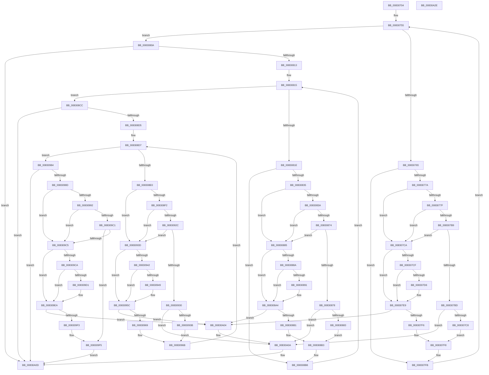

# CmGetInstallerClassMappedPropertyKeys

- RVA: `0x00830704`–`0x00830A2F` (길이 `811` bytes)
- VA: `0x0000000140830704`
- 실행 섹션: `PAGE`
- PDB 이름 있음: `예`; PDB Function 태그: `아니요`
- unwind 정보 RVA: `0x000DA63C`
- 디코드: `216`개 명령, `811/811` bytes 표시
- 미해석 바이트: `0` (있으면 어셈블리에 `.byte`로 보존)

> 이 문서는 커널 이미지의 기계어와 PDB 기호를 분석해 생성했습니다. 4번과 5번은 함수 원형과 자료형을 바이너리 사용 방식에서 추정한 C 해석이며 원본 소스 복구 결과는 아닙니다.

## 1. Dependencies

- 직접 호출 지점: **4**; 고유 호출 대상: **4**
- 직접 호출자로 확인된 함수: **2**
- RIP 상대 이미지 참조: **3**

### Outgoing calls
- `0x008307AA` → [_CmGetInstallerClassMappedPropertyFromRegProp](../9D/_CmGetInstallerClassMappedPropertyFromRegProp_function_009D3E34.md) (function, `0x009D3E34`)
- `0x00830865` → [_CmGetInstallerClassMappedPropertyFromRegValue](../9D/_CmGetInstallerClassMappedPropertyFromRegValue_function_009D4058.md) (function, `0x009D4058`)
- `0x0083091D` → [_CmGetInstallerClassMappedPropertyFromComposite](../9D/_CmGetInstallerClassMappedPropertyFromComposite_function_009D398C.md) (function, `0x009D398C`)
- `0x008309B5` → [CmGetInstallerClassMappedPropertyFromCoInstallers](../9D/CmGetInstallerClassMappedPropertyFromCoInstallers_function_009D44BC.md) (function, `0x009D44BC`)

### Direct callers
- [CmDeleteInstallerClassWorker](../82/CmDeleteInstallerClassWorker_function_0082A490.md) at `0x0082A592`
- [_PnpDispatchInstallerClass](../9D/_PnpDispatchInstallerClass_function_009D3580.md) at `0x009D36C8`

### Static image references
- `0x00830755` → RVA `0x00000000` (`image boundary/outside`; read)
- `0x008309D1` → RVA `0x000143F8` (`.rdata`; read)
- `0x008309E0` → RVA `0x00014408` (`.rdata`; read)

## 2. Other-region calls and transfers

- 다른 실행 섹션으로 향하는 call: **0**
- 별도 외부 분기/꼬리 이동을 확인하지 못했습니다.

## 3. Assembly (complete function range)

```asm
00830704  48 8B C4                        mov rax, rsp
00830707  48 89 58 08                     mov qword ptr [rax + 8], rbx
0083070B  48 89 68 10                     mov qword ptr [rax + 0x10], rbp
0083070F  48 89 70 20                     mov qword ptr [rax + 0x20], rsi
00830713  4C 89 40 18                     mov qword ptr [rax + 0x18], r8
00830717  57                              push rdi
00830718  41 54                           push r12
0083071A  41 55                           push r13
0083071C  41 56                           push r14
0083071E  41 57                           push r15
00830720  48 83 EC 50                     sub rsp, 0x50
00830724  48 8B 9C 24 B0 00 00 00         mov rbx, qword ptr [rsp + 0xb0]
0083072C  45 33 D2                        xor r10d, r10d
0083072F  44 21 50 C8                     and dword ptr [rax - 0x38], r10d
00830733  45 8A F9                        mov r15b, r9b
00830736  44 21 50 38                     and dword ptr [rax + 0x38], r10d
0083073A  4C 8B E2                        mov r12, rdx
0083073D  44 8B B4 24 A8 00 00 00         mov r14d, dword ptr [rsp + 0xa8]
00830745  4C 8B E9                        mov r13, rcx
00830748  44 21 13                        and dword ptr [rbx], r10d
0083074B  48 8B B4 24 A0 00 00 00         mov rsi, qword ptr [rsp + 0xa0]
00830753  33 FF                           xor edi, edi
00830755  48 8D 15 A4 F8 7C FF            lea rdx, [rip - 0x83075c]
0083075C  83 FF 09                        cmp edi, 9
0083075F  0F 83 A5 00 00 00               jae 0x14083080a
00830765  48 8D 0C 7F                     lea rcx, [rdi + rdi*2]
00830769  48 8B AC CA 10 C7 B4 00         mov rbp, qword ptr [rdx + rcx*8 + 0xb4c710]
00830771  48 85 ED                        test rbp, rbp
00830774  0F 84 81 00 00 00               je 0x1408307fb
0083077A  45 84 FF                        test r15b, r15b
0083077D  75 4B                           jne 0x1408307ca
0083077F  48 8D 84 24 B0 00 00 00         lea rax, [rsp + 0xb0]
00830787  4C 8B CD                        mov r9, rbp
0083078A  48 89 44 24 38                  mov qword ptr [rsp + 0x38], rax
0083078F  49 8B D4                        mov rdx, r12
00830792  83 64 24 30 00                  and dword ptr [rsp + 0x30], 0
00830797  48 8D 44 24 40                  lea rax, [rsp + 0x40]
0083079C  48 83 64 24 28 00               and qword ptr [rsp + 0x28], 0
008307A2  49 8B CD                        mov rcx, r13
008307A5  48 89 44 24 20                  mov qword ptr [rsp + 0x20], rax
008307AA  E8 85 36 1A 00                  call 0x1409d3e34
008307AF  44 8B D0                        mov r10d, eax
008307B2  3D 23 00 00 C0                  cmp eax, 0xc0000023
008307B7  74 11                           je 0x1408307ca
008307B9  85 C0                           test eax, eax
008307BB  74 0D                           je 0x1408307ca
008307BD  3D 34 00 00 C0                  cmp eax, 0xc0000034
008307C2  0F 84 42 02 00 00               je 0x140830a0a
008307C8  EB 2E                           jmp 0x1408307f8
008307CA  48 85 F6                        test rsi, rsi
008307CD  74 1A                           je 0x1408307e9
008307CF  8B 03                           mov eax, dword ptr [rbx]
008307D1  41 3B C6                        cmp eax, r14d
008307D4  73 13                           jae 0x1408307e9
008307D6  0F 10 45 00                     movups xmm0, xmmword ptr [rbp]
008307DA  48 8D 0C 80                     lea rcx, [rax + rax*4]
008307DE  0F 11 04 8E                     movups xmmword ptr [rsi + rcx*4], xmm0
008307E2  8B 45 10                        mov eax, dword ptr [rbp + 0x10]
008307E5  89 44 8E 10                     mov dword ptr [rsi + rcx*4 + 0x10], eax
008307E9  8B 03                           mov eax, dword ptr [rbx]
008307EB  8D 48 01                        lea ecx, [rax + 1]
008307EE  3B C8                           cmp ecx, eax
008307F0  0F 82 0E 02 00 00               jb 0x140830a04
008307F6  89 0B                           mov dword ptr [rbx], ecx
008307F8  45 33 D2                        xor r10d, r10d
008307FB  4C 8B 84 24 90 00 00 00         mov r8, qword ptr [rsp + 0x90]
00830803  FF C7                           inc edi
00830805  E9 4B FF FF FF                  jmp 0x140830755
0083080A  45 85 D2                        test r10d, r10d
0083080D  0F 88 FA 01 00 00               js 0x140830a0d
00830813  33 FF                           xor edi, edi
00830815  83 FF 0D                        cmp edi, 0xd
00830818  0F 83 AE 00 00 00               jae 0x1408308cc
0083081E  8B C7                           mov eax, edi
00830820  48 C1 E0 05                     shl rax, 5
00830824  48 8B AC 10 20 D3 B4 00         mov rbp, qword ptr [rax + rdx + 0xb4d320]
0083082C  48 85 ED                        test rbp, rbp
0083082F  0F 84 81 00 00 00               je 0x1408308b6
00830835  45 84 FF                        test r15b, r15b
00830838  75 4B                           jne 0x140830885
0083083A  48 8D 84 24 B0 00 00 00         lea rax, [rsp + 0xb0]
00830842  4C 8B CD                        mov r9, rbp
00830845  48 89 44 24 38                  mov qword ptr [rsp + 0x38], rax
0083084A  49 8B D4                        mov rdx, r12
0083084D  83 64 24 30 00                  and dword ptr [rsp + 0x30], 0
00830852  48 8D 44 24 40                  lea rax, [rsp + 0x40]
00830857  48 83 64 24 28 00               and qword ptr [rsp + 0x28], 0
0083085D  49 8B CD                        mov rcx, r13
00830860  48 89 44 24 20                  mov qword ptr [rsp + 0x20], rax
00830865  E8 EE 37 1A 00                  call 0x1409d4058
0083086A  44 8B D0                        mov r10d, eax
0083086D  3D 23 00 00 C0                  cmp eax, 0xc0000023
00830872  74 11                           je 0x140830885
00830874  85 C0                           test eax, eax
00830876  74 0D                           je 0x140830885
00830878  3D 34 00 00 C0                  cmp eax, 0xc0000034
0083087D  0F 84 87 01 00 00               je 0x140830a0a
00830883  EB 2E                           jmp 0x1408308b3
00830885  48 85 F6                        test rsi, rsi
00830888  74 1A                           je 0x1408308a4
0083088A  8B 03                           mov eax, dword ptr [rbx]
0083088C  41 3B C6                        cmp eax, r14d
0083088F  73 13                           jae 0x1408308a4
00830891  0F 10 45 00                     movups xmm0, xmmword ptr [rbp]
00830895  48 8D 0C 80                     lea rcx, [rax + rax*4]
00830899  0F 11 04 8E                     movups xmmword ptr [rsi + rcx*4], xmm0
0083089D  8B 45 10                        mov eax, dword ptr [rbp + 0x10]
008308A0  89 44 8E 10                     mov dword ptr [rsi + rcx*4 + 0x10], eax
008308A4  8B 03                           mov eax, dword ptr [rbx]
008308A6  8D 48 01                        lea ecx, [rax + 1]
008308A9  3B C8                           cmp ecx, eax
008308AB  0F 82 53 01 00 00               jb 0x140830a04
008308B1  89 0B                           mov dword ptr [rbx], ecx
008308B3  45 33 D2                        xor r10d, r10d
008308B6  4C 8B 84 24 90 00 00 00         mov r8, qword ptr [rsp + 0x90]
008308BE  48 8D 15 3B F7 7C FF            lea rdx, [rip - 0x8308c5]
008308C5  FF C7                           inc edi
008308C7  E9 49 FF FF FF                  jmp 0x140830815
008308CC  45 85 D2                        test r10d, r10d
008308CF  0F 88 38 01 00 00               js 0x140830a0d
008308D5  33 FF                           xor edi, edi
008308D7  83 FF 04                        cmp edi, 4
008308DA  0F 83 A4 00 00 00               jae 0x140830984
008308E0  8B C7                           mov eax, edi
008308E2  48 03 C0                        add rax, rax
008308E5  48 8B AC C2 40 BA B4 00         mov rbp, qword ptr [rdx + rax*8 + 0xb4ba40]
008308ED  45 84 FF                        test r15b, r15b
008308F0  75 4B                           jne 0x14083093d
008308F2  48 8D 84 24 B0 00 00 00         lea rax, [rsp + 0xb0]
008308FA  4C 8B CD                        mov r9, rbp
008308FD  48 89 44 24 38                  mov qword ptr [rsp + 0x38], rax
00830902  49 8B D4                        mov rdx, r12
00830905  83 64 24 30 00                  and dword ptr [rsp + 0x30], 0
0083090A  48 8D 44 24 40                  lea rax, [rsp + 0x40]
0083090F  48 83 64 24 28 00               and qword ptr [rsp + 0x28], 0
00830915  49 8B CD                        mov rcx, r13
00830918  48 89 44 24 20                  mov qword ptr [rsp + 0x20], rax
0083091D  E8 6A 30 1A 00                  call 0x1409d398c
00830922  44 8B D0                        mov r10d, eax
00830925  3D 23 00 00 C0                  cmp eax, 0xc0000023
0083092A  74 11                           je 0x14083093d
0083092C  85 C0                           test eax, eax
0083092E  74 0D                           je 0x14083093d
00830930  3D 34 00 00 C0                  cmp eax, 0xc0000034
00830935  0F 84 CF 00 00 00               je 0x140830a0a
0083093B  EB 2E                           jmp 0x14083096b
0083093D  48 85 F6                        test rsi, rsi
00830940  74 1A                           je 0x14083095c
00830942  8B 03                           mov eax, dword ptr [rbx]
00830944  41 3B C6                        cmp eax, r14d
00830947  73 13                           jae 0x14083095c
00830949  0F 10 45 00                     movups xmm0, xmmword ptr [rbp]
0083094D  48 8D 0C 80                     lea rcx, [rax + rax*4]
00830951  0F 11 04 8E                     movups xmmword ptr [rsi + rcx*4], xmm0
00830955  8B 45 10                        mov eax, dword ptr [rbp + 0x10]
00830958  89 44 8E 10                     mov dword ptr [rsi + rcx*4 + 0x10], eax
0083095C  8B 03                           mov eax, dword ptr [rbx]
0083095E  8D 48 01                        lea ecx, [rax + 1]
00830961  3B C8                           cmp ecx, eax
00830963  0F 82 9B 00 00 00               jb 0x140830a04
00830969  89 0B                           mov dword ptr [rbx], ecx
0083096B  4C 8B 84 24 90 00 00 00         mov r8, qword ptr [rsp + 0x90]
00830973  48 8D 15 86 F6 7C FF            lea rdx, [rip - 0x83097a]
0083097A  45 33 D2                        xor r10d, r10d
0083097D  FF C7                           inc edi
0083097F  E9 53 FF FF FF                  jmp 0x1408308d7
00830984  45 85 D2                        test r10d, r10d
00830987  0F 88 80 00 00 00               js 0x140830a0d
0083098D  45 84 FF                        test r15b, r15b
00830990  75 33                           jne 0x1408309c5
00830992  48 8D 84 24 B0 00 00 00         lea rax, [rsp + 0xb0]
0083099A  49 8B D4                        mov rdx, r12
0083099D  48 89 44 24 30                  mov qword ptr [rsp + 0x30], rax
008309A2  4C 8D 4C 24 40                  lea r9, [rsp + 0x40]
008309A7  83 64 24 28 00                  and dword ptr [rsp + 0x28], 0
008309AC  49 8B CD                        mov rcx, r13
008309AF  48 83 64 24 20 00               and qword ptr [rsp + 0x20], 0
008309B5  E8 02 3B 1A 00                  call 0x1409d44bc
008309BA  3D 23 00 00 C0                  cmp eax, 0xc0000023
008309BF  74 04                           je 0x1408309c5
008309C1  85 C0                           test eax, eax
008309C3  75 30                           jne 0x1408309f5
008309C5  48 85 F6                        test rsi, rsi
008309C8  74 20                           je 0x1408309ea
008309CA  8B 03                           mov eax, dword ptr [rbx]
008309CC  41 3B C6                        cmp eax, r14d
008309CF  73 19                           jae 0x1408309ea
008309D1  0F 10 05 20 3A 7E FF            movups xmm0, xmmword ptr [rip - 0x81c5e0]
008309D8  48 8D 0C 80                     lea rcx, [rax + rax*4]
008309DC  0F 11 04 8E                     movups xmmword ptr [rsi + rcx*4], xmm0
008309E0  8B 05 22 3A 7E FF               mov eax, dword ptr [rip - 0x81c5de]
008309E6  89 44 8E 10                     mov dword ptr [rsi + rcx*4 + 0x10], eax
008309EA  8B 03                           mov eax, dword ptr [rbx]
008309EC  8D 48 01                        lea ecx, [rax + 1]
008309EF  3B C8                           cmp ecx, eax
008309F1  72 11                           jb 0x140830a04
008309F3  89 0B                           mov dword ptr [rbx], ecx
008309F5  44 3B 33                        cmp r14d, dword ptr [rbx]
008309F8  45 1B D2                        sbb r10d, r10d
008309FB  41 81 E2 23 00 00 C0            and r10d, 0xc0000023
00830A02  EB 09                           jmp 0x140830a0d
00830A04  41 BA 95 00 00 C0               mov r10d, 0xc0000095
00830A0A  83 23 00                        and dword ptr [rbx], 0
00830A0D  4C 8D 5C 24 50                  lea r11, [rsp + 0x50]
00830A12  41 8B C2                        mov eax, r10d
00830A15  49 8B 5B 30                     mov rbx, qword ptr [r11 + 0x30]
00830A19  49 8B 6B 38                     mov rbp, qword ptr [r11 + 0x38]
00830A1D  49 8B 73 48                     mov rsi, qword ptr [r11 + 0x48]
00830A21  49 8B E3                        mov rsp, r11
00830A24  41 5F                           pop r15
00830A26  41 5E                           pop r14
00830A28  41 5D                           pop r13
00830A2A  41 5C                           pop r12
00830A2C  5F                              pop rdi
00830A2D  C3                              ret
00830A2E  CC                              int3
```

## 4. C-style interpretation (structured pseudocode)

```c
__int64 __fastcall CmGetInstallerClassMappedPropertyKeys(__int64 a1, __int64 a2, __int64 a3, unsigned __int8 a4, __int64 a5, unsigned int a6, __int64 a7)
{
    __int64 result;
    __int64 v_r10;
    __int64 v_rdi;
    __int64 v_rsp;
    unsigned __int64 v_stack_m28;
    unsigned __int64 v_stack_m38;
    unsigned __int64 v_stack_m40;
    unsigned int v_stack_m48;
    unsigned __int64 v_stack_m50;
    unsigned __int64 v_stack_m58;
    unsigned __int64 v_stack_p18;

    *(unsigned __int64 *)(v_rsp + 8) = v_rbx;
    *(unsigned __int64 *)(v_rsp + 16) = v_rbp;
    *(unsigned __int64 *)(v_rsp + 32) = v_rsi;
    *(unsigned __int64 *)(v_rsp + 24) = a3;
    v_rsp = (v_rsp) - (80);
    v_r10 = 0;
    v_rdi = 0;
loc_00830755:
    if (0 >= 9) goto loc_0083080A;
    if (*(unsigned __int64 *)(v_rip - 8587100 + v_rdi + v_rdi * 2 * 8 + 11847440) == 0) goto loc_008307FB;
    if (a4 != 0) goto loc_008307CA;
    v_stack_m40 = a7;
    v_stack_m58 = v_stack_m38;
    result = _CmGetInstallerClassMappedPropertyFromRegProp(a1, a2, a3, *(unsigned __int64 *)(v_rip - 8587100 + v_rdi + v_rdi * 2 * 8 + 11847440));
    if (((unsigned int)(result)) == 0xC0000023ULL) goto loc_008307CA;
    if ((unsigned int)(result) == 0) goto loc_008307CA;
    if (((unsigned int)(result)) == 0xC0000034ULL) goto loc_00830A0A;
    goto loc_008307F8;
loc_008307CA:
    if (a5 == 0) goto loc_008307E9;
    result = (unsigned int)(*(unsigned int *)(a7));
    if (((unsigned int)((unsigned int)(*(unsigned int *)(a7)))) < ((unsigned int)((unsigned int)(a6)))) {
        a1 = (unsigned int)(*(unsigned int *)(a7)) + (unsigned int)(*(unsigned int *)(a7)) * 4;
        *(unsigned __int64 *)(a5 + a1 * 4) = v_xmm0;
        result = *(unsigned int *)(*(unsigned __int64 *)(v_rip - 8587100 + v_rdi + v_rdi * 2 * 8 + 11847440) + 16);
        *(unsigned int *)(a5 + a1 * 4 + 16) = (unsigned int)(result);
    }
    if (((unsigned int)((unsigned int)(*(unsigned int *)(a7)) + 1)) < ((unsigned int)((unsigned int)(*(unsigned int *)(a7))))) goto loc_00830A04;
    *(unsigned int *)(a7) = (unsigned int)((unsigned int)(*(unsigned int *)(a7)) + 1);
loc_008307F8:
    v_r10 = 0;
loc_008307FB:
    v_rdi = (unsigned int)((v_rdi) + 1);
    goto loc_00830755;
loc_0083080A:
    if (sign_flag) goto loc_00830A0D;
    v_rdi = 0;
loc_00830815:
    if (0 >= 13) goto loc_008308CC;
    result = (0) << (5);
    if (*(unsigned __int64 *)(result + a2 * 1 + 11850528) == 0) goto loc_008308B6;
    if (a4 != 0) goto loc_00830885;
    v_stack_m40 = a7;
    v_stack_m58 = v_stack_m38;
    result = _CmGetInstallerClassMappedPropertyFromRegValue(a1, a2, v_stack_p18, *(unsigned __int64 *)(result + a2 * 1 + 11850528));
    if (((unsigned int)(result)) == 0xC0000023ULL) goto loc_00830885;
    if ((unsigned int)(result) == 0) goto loc_00830885;
    if (((unsigned int)(result)) == 0xC0000034ULL) goto loc_00830A0A;
    goto loc_008308B3;
loc_00830885:
    if (a5 == 0) goto loc_008308A4;
    result = (unsigned int)(*(unsigned int *)(a7));
    if (((unsigned int)((unsigned int)(*(unsigned int *)(a7)))) < ((unsigned int)((unsigned int)(a6)))) {
        a1 = (unsigned int)(*(unsigned int *)(a7)) + (unsigned int)(*(unsigned int *)(a7)) * 4;
        *(unsigned __int64 *)(a5 + a1 * 4) = v_xmm0;
        result = *(unsigned int *)(*(unsigned __int64 *)(result + a2 * 1 + 11850528) + 16);
        *(unsigned int *)(a5 + a1 * 4 + 16) = (unsigned int)(result);
    }
    if (((unsigned int)((unsigned int)(*(unsigned int *)(a7)) + 1)) < ((unsigned int)((unsigned int)(*(unsigned int *)(a7))))) goto loc_00830A04;
    *(unsigned int *)(a7) = (unsigned int)((unsigned int)(*(unsigned int *)(a7)) + 1);
loc_008308B3:
    v_r10 = 0;
loc_008308B6:
    v_rdi = (unsigned int)((v_rdi) + 1);
    goto loc_00830815;
loc_008308CC:
    if (sign_flag) goto loc_00830A0D;
    v_rdi = 0;
loc_008308D7:
    if (0 >= 4) goto loc_00830984;
    result = (0) + (0);
    if (a4 != 0) goto loc_0083093D;
    v_stack_m40 = a7;
    v_stack_m58 = v_stack_m38;
    result = _CmGetInstallerClassMappedPropertyFromComposite(a1, a2, v_stack_p18, *(unsigned __int64 *)(v_rip - 8587461 + result * 8 + 11844160));
    if (((unsigned int)(result)) == 0xC0000023ULL) goto loc_0083093D;
    if ((unsigned int)(result) == 0) goto loc_0083093D;
    if (((unsigned int)(result)) == 0xC0000034ULL) goto loc_00830A0A;
    goto loc_0083096B;
loc_0083093D:
    if (a5 == 0) goto loc_0083095C;
    result = (unsigned int)(*(unsigned int *)(a7));
    if (((unsigned int)((unsigned int)(*(unsigned int *)(a7)))) < ((unsigned int)((unsigned int)(a6)))) {
        a1 = (unsigned int)(*(unsigned int *)(a7)) + (unsigned int)(*(unsigned int *)(a7)) * 4;
        *(unsigned __int64 *)(a5 + a1 * 4) = v_xmm0;
        result = *(unsigned int *)(*(unsigned __int64 *)(v_rip - 8587461 + result * 8 + 11844160) + 16);
        *(unsigned int *)(a5 + a1 * 4 + 16) = (unsigned int)(result);
    }
    if (((unsigned int)((unsigned int)(*(unsigned int *)(a7)) + 1)) < ((unsigned int)((unsigned int)(*(unsigned int *)(a7))))) goto loc_00830A04;
    *(unsigned int *)(a7) = (unsigned int)((unsigned int)(*(unsigned int *)(a7)) + 1);
loc_0083096B:
    v_r10 = 0;
    v_rdi = (unsigned int)((v_rdi) + 1);
    goto loc_008308D7;
loc_00830984:
    if (sign_flag) goto loc_00830A0D;
    if (a4 != 0) goto loc_008309C5;
    v_stack_m48 = a7;
    result = CmGetInstallerClassMappedPropertyFromCoInstallers(a1, a2, v_stack_p18, v_stack_m38);
    if (((unsigned int)(result)) == 0xC0000023ULL) goto loc_008309C5;
    if ((unsigned int)(result) != 0) goto loc_008309F5;
loc_008309C5:
    if (a5 == 0) goto loc_008309EA;
    result = (unsigned int)(*(unsigned int *)(a7));
    if (((unsigned int)((unsigned int)(*(unsigned int *)(a7)))) < ((unsigned int)((unsigned int)(a6)))) {
        a1 = (unsigned int)(*(unsigned int *)(a7)) + (unsigned int)(*(unsigned int *)(a7)) * 4;
        *(unsigned __int64 *)(a5 + a1 * 4) = v_xmm0;
        result = *(unsigned int *)(v_rip - 8504798);
        *(unsigned int *)(a5 + a1 * 4 + 16) = (unsigned int)(result);
    }
    if (((unsigned int)((unsigned int)(*(unsigned int *)(a7)) + 1)) < ((unsigned int)((unsigned int)(*(unsigned int *)(a7))))) goto loc_00830A04;
    *(unsigned int *)(a7) = (unsigned int)((unsigned int)(*(unsigned int *)(a7)) + 1);
loc_008309F5:
    v_r10 = (unsigned int)((v_r10) & (0xC0000023ULL));
    goto loc_00830A0D;
loc_00830A04:
loc_00830A0A:
loc_00830A0D:
    return (unsigned int)((unsigned int)((unsigned int)(0xC0000095ULL)));
}
```

## 5. (Beta) C Style

```c
int64_t CmGetInstallerClassMappedPropertyKeys(int64_t Arg1, int64_t Arg2, int64_t Arg3, uint8_t Arg4, int64_t Arg5, uint32_t Arg6, void *Arg7)
{
    uint8_t *arg7 = (uint8_t *)Arg7;

    int64_t result;
    int64_t local_r10;
    int64_t local_rdi;
    int64_t local_rsp;
    uint64_t v_stack_m28;
    uint64_t v_stack_m38;
    uint64_t v_stack_m40;
    uint32_t v_stack_m48;
    uint64_t v_stack_m50;
    uint64_t v_stack_m58;
    uint64_t v_stack_p18;

    *(uint64_t *)(local_rsp + 0x8) = local_rbx;
    *(uint64_t *)(local_rsp + 0x10) = local_rbp;
    *(uint64_t *)(local_rsp + 0x20) = local_rsi;
    *(uint64_t *)(local_rsp + 0x18) = Arg3;
    local_rsp = (local_rsp) - (80);
    local_r10 = 0;
    local_rdi = 0;
loc_00830755:
    if (0 >= 9) goto loc_0083080A;
    if (*(uint64_t *)(v_rip - 0x83075C + local_rdi + local_rdi * 2 * 8 + 0xB4C710) == 0) goto loc_008307FB;
    if (Arg4 != 0) goto loc_008307CA;
    v_stack_m40 = Arg7;
    v_stack_m58 = v_stack_m38;
    result = _CmGetInstallerClassMappedPropertyFromRegProp(Arg1, Arg2, Arg3, *(uint64_t *)(v_rip - 0x83075C + local_rdi + local_rdi * 2 * 8 + 0xB4C710));
    if (((uint32_t)(result)) == 0xC0000023ULL) goto loc_008307CA;
    if ((uint32_t)(result) == 0) goto loc_008307CA;
    if (((uint32_t)(result)) == 0xC0000034ULL) goto loc_00830A0A;
    goto loc_008307F8;
loc_008307CA:
    if (Arg5 == 0) goto loc_008307E9;
    result = (uint32_t)(*(uint32_t *)(arg7));
    if (((uint32_t)((uint32_t)(*(uint32_t *)(arg7)))) < ((uint32_t)((uint32_t)(Arg6)))) {
        Arg1 = (uint32_t)(*(uint32_t *)(arg7)) + (uint32_t)(*(uint32_t *)(arg7)) * 4;
        *(uint64_t *)(Arg5 + Arg1 * 4) = v_xmm0;
        result = *(uint32_t *)(*(uint64_t *)(v_rip - 0x83075C + local_rdi + local_rdi * 2 * 8 + 0xB4C710) + 0x10);
        *(uint32_t *)(Arg5 + Arg1 * 4 + 0x10) = (uint32_t)(result);
    }
    if (((uint32_t)((uint32_t)(*(uint32_t *)(arg7)) + 1)) < ((uint32_t)((uint32_t)(*(uint32_t *)(arg7))))) goto loc_00830A04;
    *(uint32_t *)(arg7) = (uint32_t)((uint32_t)(*(uint32_t *)(arg7)) + 1);
loc_008307F8:
    local_r10 = 0;
loc_008307FB:
    local_rdi = (uint32_t)((local_rdi) + 1);
    goto loc_00830755;
loc_0083080A:
    if (sign_flag) goto loc_00830A0D;
    local_rdi = 0;
loc_00830815:
    if (0 >= 13) goto loc_008308CC;
    result = (0) << (5);
    if (*(uint64_t *)(result + Arg2 * 1 + 0xB4D320) == 0) goto loc_008308B6;
    if (Arg4 != 0) goto loc_00830885;
    v_stack_m40 = Arg7;
    v_stack_m58 = v_stack_m38;
    result = _CmGetInstallerClassMappedPropertyFromRegValue(Arg1, Arg2, v_stack_p18, *(uint64_t *)(result + Arg2 * 1 + 0xB4D320));
    if (((uint32_t)(result)) == 0xC0000023ULL) goto loc_00830885;
    if ((uint32_t)(result) == 0) goto loc_00830885;
    if (((uint32_t)(result)) == 0xC0000034ULL) goto loc_00830A0A;
    goto loc_008308B3;
loc_00830885:
    if (Arg5 == 0) goto loc_008308A4;
    result = (uint32_t)(*(uint32_t *)(arg7));
    if (((uint32_t)((uint32_t)(*(uint32_t *)(arg7)))) < ((uint32_t)((uint32_t)(Arg6)))) {
        Arg1 = (uint32_t)(*(uint32_t *)(arg7)) + (uint32_t)(*(uint32_t *)(arg7)) * 4;
        *(uint64_t *)(Arg5 + Arg1 * 4) = v_xmm0;
        result = *(uint32_t *)(*(uint64_t *)(result + Arg2 * 1 + 0xB4D320) + 0x10);
        *(uint32_t *)(Arg5 + Arg1 * 4 + 0x10) = (uint32_t)(result);
    }
    if (((uint32_t)((uint32_t)(*(uint32_t *)(arg7)) + 1)) < ((uint32_t)((uint32_t)(*(uint32_t *)(arg7))))) goto loc_00830A04;
    *(uint32_t *)(arg7) = (uint32_t)((uint32_t)(*(uint32_t *)(arg7)) + 1);
loc_008308B3:
    local_r10 = 0;
loc_008308B6:
    local_rdi = (uint32_t)((local_rdi) + 1);
    goto loc_00830815;
loc_008308CC:
    if (sign_flag) goto loc_00830A0D;
    local_rdi = 0;
loc_008308D7:
    if (0 >= 4) goto loc_00830984;
    result = (0) + (0);
    if (Arg4 != 0) goto loc_0083093D;
    v_stack_m40 = Arg7;
    v_stack_m58 = v_stack_m38;
    result = _CmGetInstallerClassMappedPropertyFromComposite(Arg1, Arg2, v_stack_p18, *(uint64_t *)(v_rip - 0x8308C5 + result * 8 + 0xB4BA40));
    if (((uint32_t)(result)) == 0xC0000023ULL) goto loc_0083093D;
    if ((uint32_t)(result) == 0) goto loc_0083093D;
    if (((uint32_t)(result)) == 0xC0000034ULL) goto loc_00830A0A;
    goto loc_0083096B;
loc_0083093D:
    if (Arg5 == 0) goto loc_0083095C;
    result = (uint32_t)(*(uint32_t *)(arg7));
    if (((uint32_t)((uint32_t)(*(uint32_t *)(arg7)))) < ((uint32_t)((uint32_t)(Arg6)))) {
        Arg1 = (uint32_t)(*(uint32_t *)(arg7)) + (uint32_t)(*(uint32_t *)(arg7)) * 4;
        *(uint64_t *)(Arg5 + Arg1 * 4) = v_xmm0;
        result = *(uint32_t *)(*(uint64_t *)(v_rip - 0x8308C5 + result * 8 + 0xB4BA40) + 0x10);
        *(uint32_t *)(Arg5 + Arg1 * 4 + 0x10) = (uint32_t)(result);
    }
    if (((uint32_t)((uint32_t)(*(uint32_t *)(arg7)) + 1)) < ((uint32_t)((uint32_t)(*(uint32_t *)(arg7))))) goto loc_00830A04;
    *(uint32_t *)(arg7) = (uint32_t)((uint32_t)(*(uint32_t *)(arg7)) + 1);
loc_0083096B:
    local_r10 = 0;
    local_rdi = (uint32_t)((local_rdi) + 1);
    goto loc_008308D7;
loc_00830984:
    if (sign_flag) goto loc_00830A0D;
    if (Arg4 != 0) goto loc_008309C5;
    v_stack_m48 = Arg7;
    result = CmGetInstallerClassMappedPropertyFromCoInstallers(Arg1, Arg2, v_stack_p18, v_stack_m38);
    if (((uint32_t)(result)) == 0xC0000023ULL) goto loc_008309C5;
    if ((uint32_t)(result) != 0) goto loc_008309F5;
loc_008309C5:
    if (Arg5 == 0) goto loc_008309EA;
    result = (uint32_t)(*(uint32_t *)(arg7));
    if (((uint32_t)((uint32_t)(*(uint32_t *)(arg7)))) < ((uint32_t)((uint32_t)(Arg6)))) {
        Arg1 = (uint32_t)(*(uint32_t *)(arg7)) + (uint32_t)(*(uint32_t *)(arg7)) * 4;
        *(uint64_t *)(Arg5 + Arg1 * 4) = v_xmm0;
        result = *(uint32_t *)(v_rip - 0x81C5DE);
        *(uint32_t *)(Arg5 + Arg1 * 4 + 0x10) = (uint32_t)(result);
    }
    if (((uint32_t)((uint32_t)(*(uint32_t *)(arg7)) + 1)) < ((uint32_t)((uint32_t)(*(uint32_t *)(arg7))))) goto loc_00830A04;
    *(uint32_t *)(arg7) = (uint32_t)((uint32_t)(*(uint32_t *)(arg7)) + 1);
loc_008309F5:
    local_r10 = (uint32_t)((local_r10) & (0xC0000023ULL));
    goto loc_00830A0D;
loc_00830A04:
loc_00830A0A:
loc_00830A0D:
    return (uint32_t)((uint32_t)((uint32_t)(0xC0000095ULL)));
}
```

### 관측된 메모리 오프셋

구조체 형식이 확인되지 않은 접근은 인자 기준의 오프셋으로만 기록했습니다.

| 기준 인자 | 오프셋 표현 | 폭 (bit) | 접근 |
|---|---:|---:|---|
| `Arg7` | `+ 0x0` | `32` | `R` |
| `Arg7` | `+ 0x0` | `32` | `R/W` |
| `Arg7` | `+ 0x0` | `32` | `W` |

## 6. Execution-region graph

[열기: 2D/3D 그래프와 함수 탐색 컨트롤 패널](../../../control-panel.html?section=page&rva=0x00830704&view=graph)

- 2D 그래프는 위에서 아래로 흐르고, 3D 그래프는 빈 공간을 드래그해 회전합니다. Shift+드래그는 이동, 휠은 확대·축소, 함수 노드 선택은 대상 보고서 이동입니다.

### Static fallback


